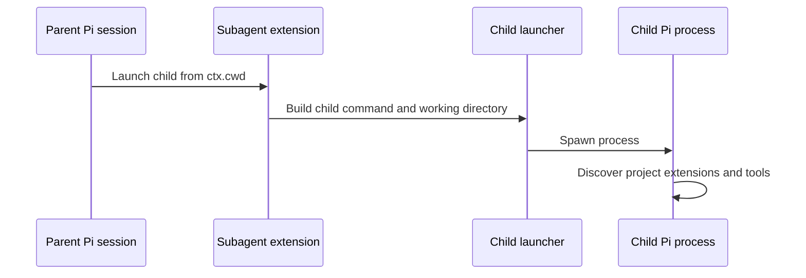

# Subagent launch working directory

## Issue

Fusion and Interactive Subagents can launch child sessions from the Pi configuration directory instead of the parent
session's current working directory.

Expected behavior: A child inherits the parent extension context working directory. An explicit named-agent `cwd` value
overrides the inherited directory.

Observed behavior: The user reports child launches under `/home/.pi`. Those children do not discover the project
extensions and tools.

## Hypothesis evaluation

```text
launch directory mismatch
├─ H1: Fusion does not pass the parent context directory to the child process
├─ H2: Interactive Subagents uses process.cwd() or the agent configuration directory
└─ H3: A launcher passes the correct directory, but a nested process replaces it
```

## Causal path



## H1: Fusion launch directory

**Prediction:** If H1 is correct, Fusion launch input or process-spawn code omits `ctx.cwd` or replaces it with a
configuration path.

**Observation:** Fusion passes `ctx.cwd` to `DefaultResourceLoader`, `createAgentSession`, and `SessionManager.create`.
A follow-up reuses the same in-process session.

**Conclusion:** The evidence does not support H1. Add regression coverage. Do not change Fusion launch logic without
contrary runtime evidence.

## H2: Interactive launch directory

**Prediction:** If H2 is correct, Interactive Subagents resolves its default directory from `process.cwd()` or the agent
definition path instead of the command context.

**Observation:** Interactive uses `ctx.cwd` for session placement. Its fresh Pi and Claude shell commands omit `cd` when
no explicit `cwd` exists. Resume commands also omit `cd ctx.cwd`.

**Conclusion:** The evidence supports H2. Fresh and resumed children can inherit the mux backend directory instead of
the parent context directory.

## H3: Nested process replacement

**Prediction:** If H3 is correct, extension-level launch input contains the parent directory, but the child-process
layer starts in another directory.

**Observation:** Mux helpers use `process.cwd()` or the pane's inherited directory. `sendLongCommand()` does not set a
directory. The generated command contains no inherited-directory `cd`.

**Conclusion:** H3 is a contributing mechanism, not the primary cause. The command builder loses the parent directory
before the mux runs it.

## Active-checkout correction

The cwd scout inspected separate checkouts under `/home/michalo`. The implementation target is under
`.pi/git/github.com/michalo1334`.

The active Fusion checkout uses a child-process launcher. It passes `ctx.cwd` through `runTask`, `ChildLaunchSpec`, mux
surface creation, and the final `spawn(..., { cwd })` call. Test `CWD-01` now locks the extension-level contract.
Existing child-process tests exercise wrapper generation with an explicit cwd.

## Implemented result

- Fusion keeps its existing `ctx.cwd` propagation. Test `CWD-01` covers delegates and follow-ups.
- Interactive Pi and Claude launch commands use `effectiveCwd ?? ctx.cwd`.
- Interactive resume commands start with `ctx.cwd` before they apply Pi environment variables.
- Relative tool cwd values resolve from the parent context directory.
- Relative named-agent cwd values keep the existing policy and resolve from the agent configuration directory.
- Unit tests cover inherited cwd, overrides, shell escaping, and resume command ordering.

The Zellij lifecycle integration test still fails on the committed baseline because the child never writes its marker.
The Zellij focus test also fails because its harness does not implement focus helpers. These failures are not
regressions from this change.

## Fix contract

- Fusion: keep its existing cwd propagation and regression coverage. Do not change launch logic without contrary runtime
  evidence.
- Interactive fresh launch: use `effectiveCwd ?? ctx.cwd` in Pi and Claude commands.
- Interactive resume: start the command with `cd ctx.cwd`.
- Keep an explicit named-agent or tool `cwd` higher priority than `ctx.cwd`.
