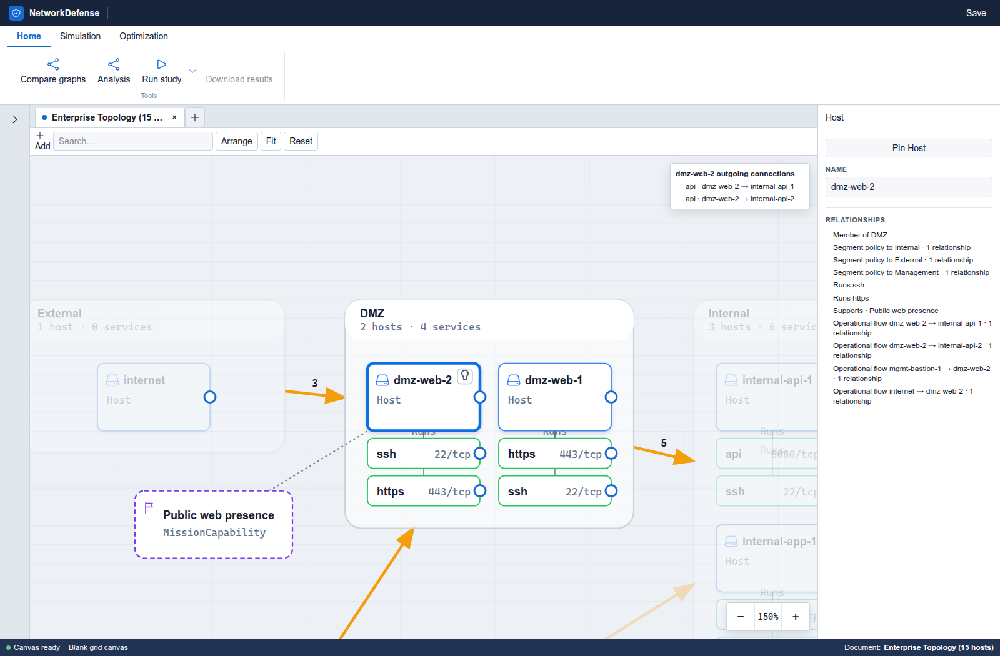
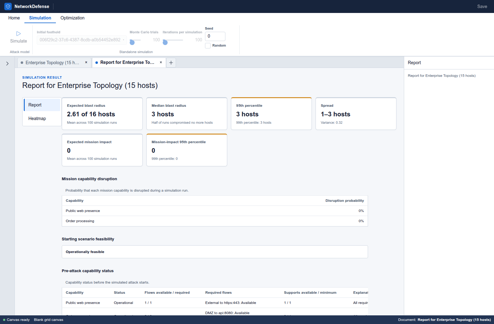
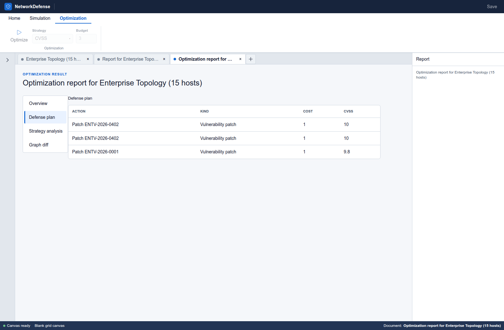

# Network Defense

Network Defense is a master's thesis project for modeling computer networks, simulating attack propagation, and comparing defenses under a fixed action budget. It compares vulnerability patches, segmentation changes, and credential revocation through their effects on mission capabilities and host compromise.

The system is a research simulator, not a penetration-testing tool. Success probabilities are scenario inputs, not estimates of real-world exploit likelihood. Attack paths emerge during simulation rather than being enumerated in advance.

## Core workflows

### Network modeling

The topology represents hosts, services, and their dependencies within network segments. Saved graph revisions provide fixed inputs for simulation and comparison.



### Attack simulation

Repeated simulations estimate blast radius, mission impact, and host compromise probabilities. Reports show aggregate outcomes and variation between runs.



### Defense optimization

Defense strategies select actions within a fixed budget. Reports list the selected defenses and the resulting graph changes.



## Local setup

The local environment requires Linux, Git, a running Docker engine, and Python 3. Terraform, Elixir, Node, and the databases run in containers. The environment includes two application sites and observability services.

```bash
git clone https://github.com/michalo1334/master_thesis.git
cd master_thesis/infra/environments/local
./terraform.sh init
./init-secrets.py
./terraform.sh plan
./terraform.sh apply
./terraform.sh output urls
```

Terraform presents the plan for review before provisioning. The secret helper creates missing random secret files with owner-only permissions and preserves existing values. Required paths come from Terraform configuration.

The `application` entry in the URL output identifies the dashboard. A small example workflow is:

1. **Create document → Graph → Enterprise Topology (15 hosts)** opens the seeded topology. **Arrange** lays out its nodes.
2. The **Simulation** example uses foothold `workstation-4`, 100 trials, 100 iterations, and seed 0. **Simulate** starts the run.
3. **Optimization** operates on the graph tab. The example uses **CVSS** and a budget of 3; **Optimize** starts defense selection.

These are example inputs, not recommended research settings.

The [setup verification](docs/getting-started-verification.md) records the exercised environment and its limits. The [infrastructure guide](docs/infrastructure.md) covers configuration, port conflicts, and lifecycle details. This development stack is intended for local use; it is not a hardened public deployment.

Running `./terraform.sh destroy` from the same directory removes the stack. **This deletes its database and other managed data volumes.** Host secret files remain.

## Repository guide

- **Model:** [scope and limits](docs/concepts/scope.md), [requirements](docs/concepts/requirements.md), [graph and reachability](docs/concepts/graph.md), [attack simulation](docs/concepts/attack.md), [defenses](docs/concepts/defense.md).
- **Research workflow:** [methodology](docs/concepts/evaluation-methodology.md), [current evaluation runtime](docs/architecture/evaluation-architecture.md), [target study pipeline](docs/design/evaluation-study-pipeline.md), [decision history](docs/history/evaluation-decisions.md), [worked example](docs/concepts/model-example.md), [vocabulary](docs/concepts/vocabulary.md).
- **Engineering:** [architecture](docs/architecture.md), [dashboard](docs/design/dashboard.md), [RabbitMQ executor](docs/design/rabbitmq-distributed-executor.md), [interview evidence and tradeoffs](docs/interview-evidence.md).

The comparison, family, Precision Pilot, and Final analysis components are implemented. Verification uses synthetic evidence. The YAML lifecycle and Pilot/Final collectors remain unimplemented. Real-study settings and deployment remain unapproved.

The Elixir/Phoenix application and Svelte UI live in [`src/`](src/); provisioning lives in [`infra/`](infra/). [`docs/`](docs/) holds project documentation and [`planning/`](planning/) holds working plans. The thesis text is maintained separately.
