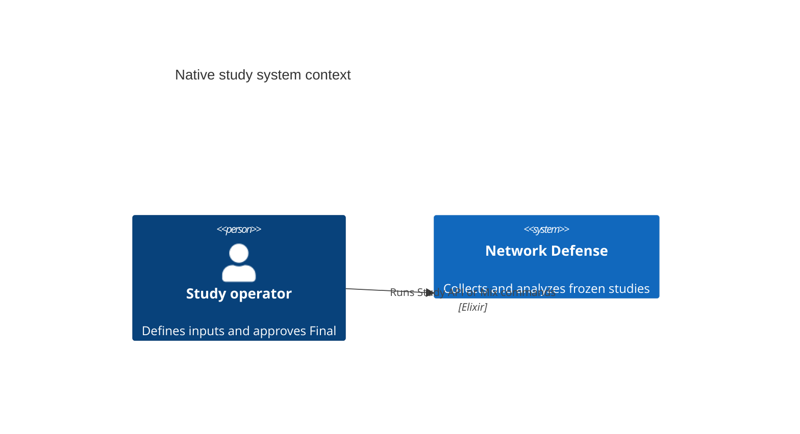
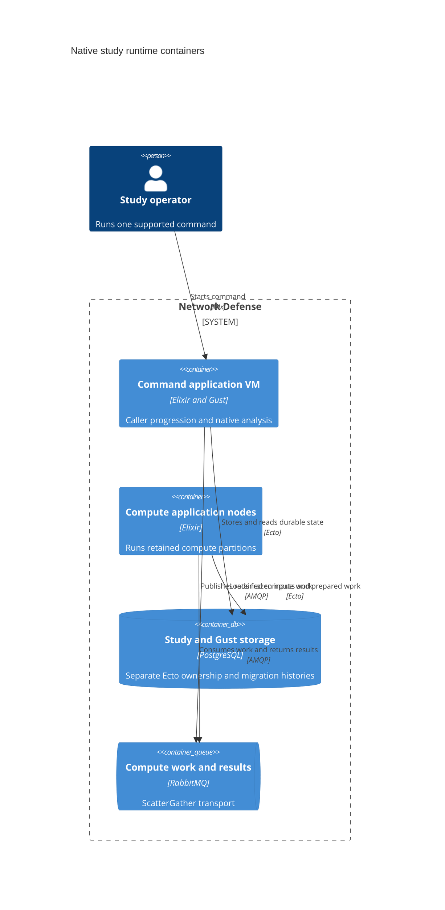

# Native Evaluation2 architecture

This page maps the implemented native system for application developers.
Read the [overview](../concepts/evaluation-study-overview.md) for the lifecycle and the [operator guide](../evaluation2.md) for commands.
The [methodology](../concepts/evaluation-methodology.md) states the scientific assumptions.

The [verification record](../history/evaluation2-verification.md) preserves the complete native path with retained optimization/simulation services.
Calibration and legacy deletion remain later verification work.
Legacy runtime files remain until that gate; they are outside the supported Evaluation2 path.

## System context

Study operations are Elixir application calls, rather than evaluation web routes.
No external statistics service participates in native analysis.

## Runtime containers

This is a responsibility view of the service-backed path, rather than a fixed host count.
The command VM can also consume compute work under the configured executor.
The [infrastructure guide](../infrastructure.md#native-evaluation2-runtime) describes startup requirements.
The [RabbitMQ design](../design/rabbitmq-distributed-executor.md) defines transport and coordinator-loss limits.

## Component ownership

| Owner | Responsibility |
|---|---|
| `Study` | Supported API, public return values and bounded errors |
| `Definition` | Input construction, graph resolution and derived invariants |
| `Workflow` | Caller-owned progression, canonical provisioning, waiting, completion proof and acceptance requests |
| `Workflow.RunMonitor` | One supervised wait-only service for durable-state polling, including separate-VM cancellation |
| `Collection` | Immutable resolved plans, domain effect calls and scientific evidence projection |
| `Pilot.Analysis` | Candidate assessments, complete fan-in and runtime-based selection |
| `Final.Collection` | Measured-replica validation, equality and prepared representative evidence |
| `Final.Timing` | Application-supervised monotonic clock sessions and duration receipts |
| `Final.Analysis` | Accepted-evidence preparation, comparison jobs and complete-family correction |
| `Compute` | Pure Nx/Decimal numerical calculations |
| `Persistence` | Typed storage contexts, revision/snapshot/result reads and canonical phase-run links |
| `Persistence.Collection` | Plan/item transactions and retry-safe effect reservations |
| `Persistence.Executions` | Locked lifecycle transitions and atomic result acceptance |
| Gust | Static DAG execution, mapped tasks, retries and durable task results |
| Optimization/simulation domains | Existing physical effects, trial execution and domain records |

There is one Workflow progression loop.
There is no study coordinator service, separate background lifecycle runner or stored Final tier cursor.
Static DAG tasks call domain capabilities; they do not own lifecycle decisions.
Mix tasks own arguments, startup and formatting, rather than clocks or science.

## Four static phase DAGs

All sources live in [`src/priv/gust/dags/`](../../src/priv/gust/dags/).

| DAG | Work and terminal value |
|---|---|
| `evaluation2_study_pilot_collection` | Prepare → mapped optimization → mapped simulation → assemble; empty typed output, phase-owned snapshot |
| `evaluation2_study_pilot_analysis` | Prepare → mapped candidate/comparison assessments → select; outcome and complete candidate summaries |
| `evaluation2_study_final_tier_collection` | One sequential tier: prepare, warm-up, five static measured chains, complete; tier/session and five timing receipts |
| `evaluation2_study_final_analysis` | Prepare → mapped comparisons → correct; complete corrected family |

Pilot and each analysis phase link one canonical run under `:single`.
Final Collection links one canonical run per tier key in small/medium/large order.
Workflow derives the next tier from those links; no DAG dispatches another DAG.

The [pipeline guide](../design/evaluation-study-pipeline.md) details create-link-dispatch, completion proof and clock loss.

## Durable ownership

Evaluation2 uses eight application tables from the [native migration](../../src/priv/repo/migrations/20261029195122_create_evaluation2_study_tables.exs).
Gust stores its own runs/tasks under its separate Repo and migration history.

| Record | Durable ownership |
|---|---|
| Study revision | Declared study/revision identity and resolved typed definition |
| Execution | Revision link, lifecycle state, compact Pilot outcome, frozen selection and bounded error |
| Phase | One row per fixed phase and execution |
| PhaseRun | One application link to one Gust run; unique phase/key and Gust identity |
| CollectionPlan | One immutable ordered request set per PhaseRun |
| CollectionItem | One replica/item coordinate, with unique optimization and experiment links |
| EvidenceSnapshot | One phase-owned typed evidence value |
| Result | One execution-owned corrected family and raw measured timing |

The snapshot table is `evaluation2_evidence_snapshots`.
Its columns are `id`, `study_phase_id`, `evidence` and `inserted_at`.
Its unique phase link supplies ownership through phase → execution → revision.
Immutability is an application rule; it is not a cryptographic integrity guarantee.

A prepared snapshot can precede lifecycle acceptance.
The locked transition and its successor phase witness acceptance.
Final Analysis requires that witness, rather than accepting any stored snapshot.
Result insertion and `succeeded` commit together in the existing transaction owner.

## Physical work and scientific views

Plans contain resolved requests in canonical group/row order.
Tasks load those requests rather than rebuild work from mutable inputs.
Each CollectionItem reserves its own optimization and experiment.
Retrying an item reuses its effects.
A different replica, phase or execution creates fresh effects.

Each tier/budget collects CVSS once and shares its matrix among comparisons.
Group positions are definition-global; item positions are local to a PhaseRun plan.
Trial indices remain one-based in the simulation domain.
Numerical code receives aligned scientific matrices and frozen bounds, rather than persistence records.

Pilot and Final evidence use distinct phase seeds.
All measured replicas repeat the same scientific seeds; their position changes physical identity only.
Seed derivation excludes database IDs, process identity, scheduling and timings.
The [methodology](../concepts/evaluation-methodology.md#7-seeds-separation-and-fixed-sample-limits) states the IID-input assumption and fixed-sample limit.

## Contracts and read boundaries

The YAML constructor uses the existing YAML and JSON Schema libraries.
It ignores extra keys and drops them during typed construction.
Graph existence, Host membership, effective policy, counts, finite bounds and seed allocations are creation-owned checks.
The [native input schema](../../src/priv/evaluation2/definition.schema.json) has no compatibility format.

Gust phase boundaries use explicit typed codecs and canonical identities.
Workflow requires exact canonical root parameters, succeeded status, one succeeded terminal task and valid typed output before acceptance.
Analysis additionally binds the canonical snapshot.
Final checks the complete comparison set and recomputes Holm consistency before accepting terminal output.

Public result reads join the owning revision, outcome, selection, stored family and timing after success.
They do not rerun numerical inference or prove tamper resistance.
The public result omits internal phase/run/snapshot IDs and environment assertions.
Detailed evidence remains available to internal owners.

The legacy HTTP schemas, service caps and Python response classifications do not govern native Evaluation2.
Native input has a 1 MiB CLI document limit and constructor count/shape checks.
It has no claimed general memory/work-budget framework.
Choose tractable counts and assess representative workloads before larger studies.

## Re-entry, cancellation and provenance

Canonical links and effect reservations support idempotent re-entry.
RunMonitor polls persisted execution and Gust state.
A finite API wait returns Status without cancellation.
A later caller can accept completed work and reconstruct durable timing.
An incomplete lost clock session fails without replacement measurements.

Cancellation commits application state before best-effort stopping of linked Gust runs.
Late completion cannot advance a terminal execution.
Already-terminal cancellation returns the stored Status unchanged.
Underlying compute effects can still finish.

The frozen definition records method, seed contract and expected configured environment label.
Final boundaries re-read the label and reject missing or changed configuration.
Known method/seed incompatibility also fails checked boundaries.
The label is an operator assertion; it is not an authenticated machine fingerprint.
The implementation does not record a complete build/dependency identity or automatically detect a hot reload.
Keep the measured runtime stable and record external source/dependency facts with the study evidence.

## Source map

| Concern | Source |
|---|---|
| Supported facade and types | [`study.ex`](../../src/lib/network_defense/evaluation2/study.ex), [`study/`](../../src/lib/network_defense/evaluation2/study/) |
| Constructor and seeds | [`definition.ex`](../../src/lib/network_defense/evaluation2/study/definition.ex), [`randomness.ex`](../../src/lib/network_defense/evaluation2/study/randomness.ex) |
| Progression and proof | [`workflow.ex`](../../src/lib/network_defense/evaluation2/study/workflow.ex), [`workflow/run_monitor.ex`](../../src/lib/network_defense/evaluation2/study/workflow/run_monitor.ex) |
| Persistence owners | [`persistence.ex`](../../src/lib/network_defense/evaluation2/study/persistence.ex), [`persistence/`](../../src/lib/network_defense/evaluation2/study/persistence/) |
| Native method | [`compute.ex`](../../src/lib/network_defense/evaluation2/study/compute.ex), [`compute/`](../../src/lib/network_defense/evaluation2/study/compute/) |
| Phase capabilities | [`pilot/`](../../src/lib/network_defense/evaluation2/study/pilot/), [`final/`](../../src/lib/network_defense/evaluation2/study/final/) |
| Thin commands | [`study_command.ex`](../../src/lib/mix/study_command.ex), [`tasks/`](../../src/lib/mix/tasks/) |
| Behavior checks | [`evaluation2 tests`](../../src/test/network_defense/evaluation2/) |

Major capability/contract docs use `@moduledoc` and `@doc`.
Small records and action adapters can remain hidden.
No ExDoc dependency or diagram-rendering platform is configured.
The [verification record](../history/evaluation2-verification.md#documentation-checks) records source, compiled-doc and diagram checks separately from rendering limits.
