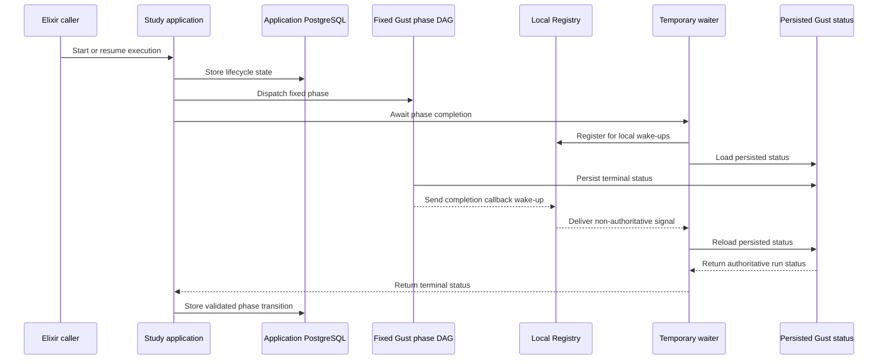

# Evaluation architecture

## Status and authority

This page maps the current evaluation runtime for application developers. Start with the [study overview](../concepts/evaluation-study-overview.md) for the user workflow. The public study lifecycle coordinates Pilot and Final collection and analysis. The comparison and family workflows remain reusable lower-level operations. Operational T1–T4 timing collection is implemented. T5 timing summaries and compact-result timing persistence remain planned.

Only synthetic evidence supports the recorded verification. Real-study settings, evidence collection, and deployment remain unapproved. Historical local checks do not establish current service readiness. See [verification history and limits](../history/evaluation-decisions.md#verification-and-operational-evidence).

| Question                                  | Authority                                                       |
| ----------------------------------------- | --------------------------------------------------------------- |
| Scientific method                         | [Evaluation methodology](../concepts/evaluation-methodology.md) |
| Shared terms                              | [Vocabulary](../concepts/vocabulary.md#evaluation-and-study)    |
| Current behavior                          | Source, checked-in schemas, and tests linked below              |
| Study lifecycle and remaining timing work | [Study pipeline design](../design/evaluation-study-pipeline.md) |
| Decisions and historical evidence         | [Evaluation decisions](../history/evaluation-decisions.md)      |

## Runtime ownership

This diagram shows the study callback boundary, not the task schedule. Fixed Gust DAG completion callbacks send local wake-ups through a Registry. Temporary waiters load persisted Gust status after registration and reload it after a wake-up. The signal itself cannot establish success.

Application PostgreSQL owns study state. The public study lifecycle uses neither polling nor Phoenix PubSub. This statement does not cover every lower-level comparison or family workflow. Registry entries and coordinators are local, temporary processes. An application restart does not recreate coordinators automatically.

| Owner                  | Responsibility                                                                                                                         |
| ---------------------- | -------------------------------------------------------------------------------------------------------------------------------------- |
| Elixir application     | Lifecycle state, strict contracts, collection planning, source binding, coordinator transitions, preflight, and typed result read-back |
| Application PostgreSQL | Immutable study revisions and results; execution, phase, collection, runtime-link, and evidence-snapshot records                       |
| Gust                   | Fixed collection and analysis DAGs, mapped work, retries, run/task state, errors, and saved task results                               |
| Python                 | One synchronous, stateless numerical calculation per request; no database, job registry, scheduler, or result store                    |

The local application and Gust repositories use one PostgreSQL service. Their Ecto repositories, tables, and migration histories remain separate.

Comparison and family requests include bounded matrices in Gust run parameters. Pilot and Final runs instead hold snapshot IDs, settings, positions, and compact results. Do not describe all four workflows as matrix-free in Gust.

## Fixed Gust DAGs

The facade starts the comparison and family workflows. The study coordinator starts the Pilot and Final collection and analysis workflows. No DAG starts another DAG. Family and Final analysis tasks reuse the comparison action and Holm call directly, not nested comparison or family runs.

| DAG                                      | Fixed task shape                                                                                                                                 | Output                                                 |
| ---------------------------------------- | ------------------------------------------------------------------------------------------------------------------------------------------------ | ------------------------------------------------------ |
| `evaluation_comparison`                  | `prepare` → `compare`                                                                                                                            | One comparison statistics record                       |
| `evaluation_family`                      | `prepare_family` → mapped `compare_member` → `correct_family`                                                                                    | One complete-family result with Holm adjustment        |
| `evaluation_study_pilot_collection`      | `prepare_pilot_collection` → mapped `collect_pilot_item` → `assemble_pilot_snapshot`                                                             | One Pilot snapshot ID                                  |
| `evaluation_pilot`                       | `prepare_pilot` → mapped `evaluate_candidate_comparison` → `select_pilot`                                                                        | One recommendation or explicit insufficiency           |
| `evaluation_study_final_tier_collection` | One run per tier: environment check → excluded warm-up → five fixed measured stages with environment checks and timing markers → tier completion | One compact tier receipt; evidence stays in PostgreSQL |
| `evaluation_final`                       | `prepare_final` → mapped `compare_final_member` → `correct_final_family`                                                                         | One validated Final family result                      |

### Study DAG data flow

```mermaid
flowchart TB
    REV["Stored study revision<br/>Comparisons, candidates, seeds, and rules"]

    subgraph PC["Pilot collection DAG"]
        PC_PREP["Prepare work<br/>Input: revision and Pilot settings<br/>Output: ordered collection-item IDs"]
        PC_RUN["Collect mapped items<br/>Input: collection-item ID<br/>Output: item position, plan-run and experiment IDs, and trial counts"]
        PC_SNAP["Assemble snapshot<br/>Input: complete linked evidence<br/>Output: Pilot snapshot ID"]
        PC_PREP --> PC_RUN --> PC_SNAP
    end

    subgraph PA["Pilot analysis DAG"]
        PA_PREP["Prepare candidates<br/>Input: Pilot snapshot ID and analysis settings<br/>Output: candidate/comparison work"]
        PA_RUN["Evaluate mapped work<br/>Input: one candidate and comparison<br/>Output: one candidate assessment"]
        PA_SELECT["Select outcome<br/>Input: ordered assessments<br/>Output: candidate rows, summaries, and recommendation or insufficiency"]
        PA_PREP --> PA_RUN --> PA_SELECT
    end

    GATE["Explicit resume<br/>Input: Pilot outcome and caller selection<br/>Output: frozen candidate, counts, and override marker"]

    subgraph FC["Final tier DAG family - sequential tiers"]
        FC_WARM["Check environment and warm up<br/>Input: stored revision, frozen selection, declared tier, and environment setting<br/>Output: persisted excluded warm-up evidence at -1"]
        FC_RUN["Collect five measured replicas<br/>Input: successful warm-up, canonical tier work, and environment setting<br/>Output: persisted evidence at 0..4 and synchronous timing markers"]
        FC_RECEIPT["Complete tier<br/>Input: completed warm-up and measured work<br/>Output: persisted warm-up/measured evidence and compact tier receipt"]
        FC_WARM --> FC_RUN --> FC_RECEIPT
    end

    EQUALITY["Coordinator equality gate and snapshot acceptance<br/>Input: all tier evidence for positions 0..4<br/>Output: accepted replica-0 Final snapshot ID"]

    subgraph FA["Final analysis DAG"]
        FA_PREP["Prepare family<br/>Input: Final snapshot ID, stored Pilot source, frozen counts, and declared identities<br/>Output: comparison work"]
        FA_RUN["Evaluate mapped comparisons<br/>Input: one declared comparison<br/>Output: one comparison result"]
        FA_CORRECT["Correct family<br/>Input: complete ordered results<br/>Output: validated family result"]
        FA_PREP --> FA_RUN --> FA_CORRECT
    end

    RESULT["Persist success<br/>Input: accepted phase references and Final result<br/>Output: compact study result with no timing summary"]

    REV --> PC_PREP
    PC_SNAP -->|Pilot snapshot ID| PA_PREP
    PA_SELECT --> GATE
    GATE --> FC_WARM
    FC_RECEIPT -->|All tiers complete; reload measured evidence| EQUALITY
    EQUALITY -->|Accepted Final snapshot ID| FA_PREP
    FA_CORRECT --> RESULT
```

The collection DAGs store detailed evidence in PostgreSQL. Pilot collection returns a snapshot ID; each Final tier run returns a compact tier receipt. The analysis DAGs consume snapshot IDs and stored settings. They return typed outcomes instead of evidence matrices.

The coordinator runs tiers in the order the comparison family first declares each tier. It stores the ordered Gust run IDs in `StudyPhaseRun` rows. Each tier has excluded warm-up `-1`, then measured positions `0..4`. The configured environment assertion must match the revision before warm-up and before and after each measured replica.

Synchronous timing markers let the coordinator measure plan-selection, simulation, and total elapsed intervals in its own clock domain. It validates five measured timing values per tier in memory. Raw monotonic readings and these intervals are not persisted.

After all tiers finish, the coordinator loads PostgreSQL evidence and builds five complete-family non-timing summaries, one per measured position. One canonical selector call checks equality and selects replica `0`. The coordinator creates and accepts that replica's Final snapshot outside Gust. It accepts no replacement replica.

The diagram shows the public study lifecycle only. Timing summaries and their compact-result persistence are not implemented.

Pilot maps one candidate/comparison pair. Family and Final map one declared comparison. Fan-in restores declared order and rejects missing, duplicate, or unexpected rows. Pilot selects within its own run and applies no Holm correction. Family and Final apply Holm once across the complete family.

The current Pilot contract uses one ordered candidate list. Each candidate has a stable ID, a plan count per side, and an attack count per plan. The coordinator preserves declared candidate order through analysis and result read-back.

## Public application boundary

[`NetworkDefense.Evaluations`](../../src/lib/network_defense/evaluations.ex) exposes these Elixir operations. They are not public Phoenix routes.

| Capability     | Operations                                                             |
| -------------- | ---------------------------------------------------------------------- |
| Comparison     | `submit_comparison/1`, `await_comparison/2`, `get_comparison_result/1` |
| Family         | `submit_family/1`, `await_family/2`, `get_family_result/1`             |
| Study revision | `create_study_revision/1`                                              |
| Study start    | `start_study/1`                                                        |
| Study status   | `study_status/1`                                                       |
| Study resume   | `resume_study/2`                                                       |
| Study cancel   | `cancel_study/1`                                                       |
| Study result   | `study_result/1`                                                       |

Each comparison or family `submit_*` operation returns a Gust run ID, each `await_*` operation returns the completion status, and each `get_*_result` operation performs a separate, typed read-back from persisted data. All operations return typed success or bounded error values.

The Pilot and Final workflows have no public group. They stay internal to the study coordinator, so a caller cannot start a Gust run, create an evidence snapshot, or read a Pilot or Final result outside one study execution. The Pilot and Final sections below describe those internal boundaries.

The development commands `mix evaluation.compare` and `mix evaluation.family` run named synthetic fixtures. Pilot and Final work runs only inside a study execution.

### Final source and evidence boundary

This is an internal coordinator contract. No caller submits Final work directly.

`resume_study/2` takes only the Final selection: `:recommended` or `{:override_insufficient, candidate_id}`. Every other Final input comes from PostgreSQL. In one locked transaction, the resume command stores the frozen selection, the selected counts, and the override flag, and it creates the empty `final_collection` phase. The coordinator then owns the rest of the boundary:

- it runs the ordered Final tier family, validates complete-family equality, and creates and links the replica-zero snapshot to `final_collection`;
- it reads the accepted Pilot analysis run, the frozen selection, and the Final snapshot when it builds the Final request; and
- it writes the completion assertions from the stored phase rows.

The built request must match the accepted Pilot source and the Final snapshot on:

- study revision and family;
- the complete ordered comparison identities;
- the selected plan count per side and attacks per plan; and
- the declared source and Final metadata.

A recommended Pilot must freeze the recommended counts. An insufficient Pilot accepts only a candidate the stored revision declares, and the stored override flag then records that choice. A failed, invalid, or incomplete Pilot supplies no fallback.

The stored assertions claim that Final evidence was collected after the Pilot and excludes Pilot observations. The contract validates those stored assertions and the completion metadata. It does not authenticate collection history, prove physical freshness, or detect reused observations from matrix values.

Each Final comparison takes its analysis seed from the declared study definition, in declared order. Final does not derive these seeds or compare them with Pilot seeds. Disjoint Pilot/Final collection seeds remain a scientific requirement, not a provenance guarantee from these checks.

## Contracts, limits, and read-back

Checked-in JSON Schemas define the wire shapes. Elixir validates the original values before Ecto materialization, so type coercion cannot hide invalid input. Python uses strict Pydantic models. Shared fixtures and drift tests check agreement.

Submission rejects invalid requests before creating a Gust run. Pilot and Final also load snapshots, check bindings, and preflight every generated compute request. Preflight uses the execution request builder but makes no HTTP call. Preparation repeats the checks against persisted inputs. Mapped tasks validate bounded requests and returned responses.

Snapshot storage size, generated comparison-request size, bootstrap replicates, and total work have separate guards. Each protects a different resource boundary. Pilot also bounds candidate work and outer subsampling. These deployment caps are not scientific settings. Missing or malformed configuration produces bounded errors on the affected paths. No layer truncates evidence, candidates, comparisons, or repeats.

Read-back requires more than a succeeded Gust run:

- Comparison verifies schema and request/result relations, including method, interval, confidence, and test alternative.
- Family verifies membership, order, correction settings, and member relations.
- Pilot reloads evidence and re-derives summaries, pass decisions, and recommendation from the complete candidate rows.
- Final rechecks source/snapshot bindings, order, member relations, and the stored family result.

These checks do not rerun numerical statistics or independently recompute Holm. Schema-valid changes that preserve the checked relations can pass. Read-back is not a cryptographic integrity check.

### Snapshot storage contract

Both roles use `evaluation_evidence_snapshots`. The current table has exactly seven columns:

| Column              | Meaning                                                                                  |
| ------------------- | ---------------------------------------------------------------------------------------- |
| `id`                | Snapshot UUID                                                                            |
| `study_revision_id` | Stored study-revision UUID; this snapshot table has no foreign key to the revision table |
| `phase`             | `pilot` or `final`                                                                       |
| `schema_version`    | Snapshot contract version                                                                |
| `family_id`         | Family identifier                                                                        |
| `payload`           | Validated PostgreSQL JSONB document                                                      |
| `inserted_at`       | Insertion time                                                                           |

Create paths encode the normalized payload with [`JsonBoundary`](../../src/lib/network_defense/evaluation/json_boundary.ex). They enforce the configured encoded-size cap immediately before insertion. They do not store a byte-count column.

Read paths validate the stored contract, metadata, relations, and non-byte limits. They do not re-encode the payload or perform a read-time byte check. There is no `payload_bytes`, `updated_at`, content hash, or database immutability trigger. Create/read-only access is an application rule. Changed evidence needs a new snapshot ID.

### Compute HTTP boundary

| Internal route                                     | Operation                                    |
| -------------------------------------------------- | -------------------------------------------- |
| `POST /v1/comparisons/corrected-crossed-bootstrap` | One crossed comparison; also reused by Final |
| `POST /v1/families/holm`                           | One complete-family correction               |
| `POST /v1/pilots/candidate-comparisons`            | One Pilot candidate comparison               |
| `GET /health`, `GET /ready`                        | Liveness and readiness                       |

The calculation routes return `400` for invalid JSON, `413` for oversized bodies, `415` for unsupported media types, and `422` for validation failures. Documented `500` and `503` envelopes describe calculation or temporary service failures. See the [shared error contract](../../src/priv/evaluation/contracts/v1/schemas/error.schema.json) and [`ErrorEnvelope`](../../src/lib/network_defense/evaluation/error_envelope.ex). Diagnostics are bounded and exclude submitted values and stack traces.

## Ordering, randomness, and retries

Scientific identity is `(tier, budget, alternative, reference, outcome)`. Arrays define comparison and candidate order. Object key order, database row order, and completion order do not.

Pilot preserves the historical tier/occurrence offsets and candidate-specific child streams. Separate streams serve outer sampling, interval draws, and centered null draws. The [methodology](../concepts/evaluation-methodology.md#10-reproducibility-and-limits) explains the scientific constraints. The [Pilot implementation](../../services/evaluation_compute/src/evaluation_compute/pilot.py) and tests define the exact stream contract.

Temporary transport failures and valid documented HTTP `500`/`503` failures remain retryable. Documented client errors, malformed success responses, and contract mismatches are permanent. Invalid response envelopes do not become retryable merely because the HTTP status is `500` or `503`.

A retry retains the request and scientific seeds. Work can execute more than once after a lost response. Pilot collection and each analysis phase accept one Gust run per execution. Final collection accepts one run per declared tier through ordered phase-run rows. Another study execution creates new runs. There is no exactly-once computation guarantee. The prototype adds no automatic coordinator restart recovery or phase replay.

`final_collection.gust_run_id` is nil. Compact collection references use ordered `gust_run_ids`: a one-item list for Pilot and one ID per tier for Final. Pilot and Final analysis references remain scalar.

## Source ownership

| Concern                              | Authoritative location                                                                                                                                                                                                        |
| ------------------------------------ | ----------------------------------------------------------------------------------------------------------------------------------------------------------------------------------------------------------------------------- |
| Comparison and family                | [`comparison/`](../../src/lib/network_defense/evaluation/comparison/), [`family/`](../../src/lib/network_defense/evaluation/family/)                                                                                          |
| Study lifecycle and collection       | [`study/`](../../src/lib/network_defense/evaluation/study/), [`study_execution.ex`](../../src/lib/network_defense/evaluation/study_execution.ex), [`study_phase.ex`](../../src/lib/network_defense/evaluation/study_phase.ex) |
| Pilot and Final analysis             | [`pilot/`](../../src/lib/network_defense/evaluation/pilot/), [`final/`](../../src/lib/network_defense/evaluation/final/)                                                                                                      |
| Snapshots                            | [`evidence_snapshot.ex`](../../src/lib/network_defense/evaluation/evidence_snapshot.ex), [`evidence_snapshots.ex`](../../src/lib/network_defense/evaluation/evidence_snapshots.ex)                                            |
| DAGs                                 | [`priv/gust/dags/`](../../src/priv/gust/dags/)                                                                                                                                                                                |
| Schemas and conformance fixtures     | [`priv/evaluation/`](../../src/priv/evaluation/), shared through [`contracts/evaluation/`](../../contracts/evaluation/)                                                                                                       |
| Compute routes and numerical methods | [`evaluation_compute/`](../../services/evaluation_compute/src/evaluation_compute/)                                                                                                                                            |
| Verification                         | [`Elixir evaluation tests`](../../src/test/network_defense/evaluation/), [`Python tests`](../../services/evaluation_compute/tests/)                                                                                           |

## Remaining boundary

The current runtime has the YAML boundary, immutable normalized study revisions, the study state machine, fixed collection and analysis DAGs, explicit resume and cancellation, and one immutable compact result after success.

Operational T1–T4 integration is complete: sequential tier runs, excluded warm-up, five measured replicas, coordinator elapsed intervals, environment gates, and complete-family equality. Timing values remain memory-only, and compact-result timing is empty. T5 adds timing summaries, compact-result persistence, and the manual timed journey. The [study pipeline design](../design/evaluation-study-pipeline.md) defines that work.

This prototype does not authorize deployment, real evidence collection, automatic restart recovery, phase replay, or production scientific settings.
