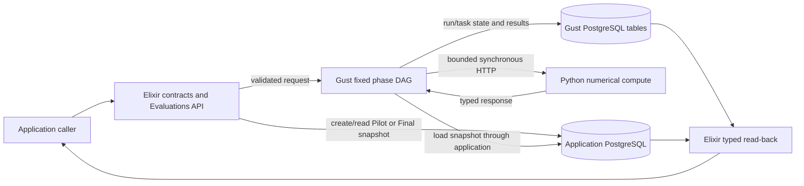

# Evaluation architecture

## Status and authority

This page maps the current analysis runtime for application developers. The comparison, family, Precision Pilot, and Final components are implemented and merged. These components correspond to implementation Stages 2–5. Stage numbers do not define a lifecycle or an automatic chain.

Only synthetic evidence supports the recorded verification. Real-study settings, evidence collection, and deployment remain unapproved. Historical local checks do not establish current service readiness. See [verification history and limits](../history/evaluation-decisions.md#verification-and-operational-evidence).

| Question                          | Authority                                                       |
| --------------------------------- | --------------------------------------------------------------- |
| Scientific method                 | [Evaluation methodology](../concepts/evaluation-methodology.md) |
| Shared terms                      | [Vocabulary](../concepts/vocabulary.md#evaluation-and-study)    |
| Current behavior                  | Source, checked-in schemas, and tests linked below              |
| Future end-to-end lifecycle       | [Study pipeline design](../design/evaluation-study-pipeline.md) |
| Decisions and historical evidence | [Evaluation decisions](../history/evaluation-decisions.md)      |

## Runtime ownership

This is a data-flow map, not a scheduling DAG.

| Owner                  | Responsibility                                                                                                           |
| ---------------------- | ------------------------------------------------------------------------------------------------------------------------ |
| Elixir application     | Strict input parsing, evidence persistence, source binding, request construction, preflight, and typed result validation |
| Application PostgreSQL | Pilot and Final evidence snapshots, including matrices                                                                   |
| Gust                   | Fixed task dependencies, mapped work, retries, run/task state, errors, and explicitly saved task results                 |
| Python                 | One synchronous, stateless numerical calculation per request; no database, job registry, scheduler, or result store      |

The local application and Gust repositories use one PostgreSQL service. Their Ecto repositories, tables, and migration histories remain separate.

Comparison and family requests include bounded matrices in Gust run parameters. Pilot and Final runs instead hold snapshot IDs, settings, positions, and compact results. Do not describe all four workflows as matrix-free in Gust.

## Fixed analysis DAGs

A caller starts each workflow. No analysis DAG starts another DAG. Family and Final tasks reuse the comparison action and Holm call directly, not nested comparison or family runs.

| DAG                     | Fixed task shape                                                          | Output                                          |
| ----------------------- | ------------------------------------------------------------------------- | ----------------------------------------------- |
| `evaluation_comparison` | `prepare` → `compare`                                                     | One comparison statistics record                |
| `evaluation_family`     | `prepare_family` → mapped `compare_member` → `correct_family`             | One complete-family result with Holm adjustment |
| `evaluation_pilot`      | `prepare_pilot` → mapped `evaluate_candidate_comparison` → `select_pilot` | One recommendation or explicit insufficiency    |
| `evaluation_final`      | `prepare_final` → mapped `compare_final_member` → `correct_final_family`  | One validated Final family result               |

Pilot maps one candidate/comparison pair. Family and Final map one declared comparison. Fan-in restores declared order and rejects missing, duplicate, or unexpected rows. Pilot selects locally and runs no Holm correction. Family and Final apply Holm once across the complete family.

The current Pilot contract declares separate plan-count and attack-count arrays. It evaluates their complete Cartesian grid in declared plan-major order. The future YAML design uses an [ordered candidate list](../design/evaluation-study-pipeline.md#pilot-candidates), not this input shape.

## Public application boundary

[`NetworkDefense.Evaluations`](../../src/lib/network_defense/evaluations.ex) exposes these Elixir operations. They are not public Phoenix routes.

| Capability     | Operations                                                             |
| -------------- | ---------------------------------------------------------------------- |
| Comparison     | `submit_comparison/1`, `await_comparison/2`, `get_comparison_result/1` |
| Family         | `submit_family/1`, `await_family/2`, `get_family_result/1`             |
| Pilot snapshot | `create_evidence_snapshot/1`, `get_evidence_snapshot/1`                |
| Pilot analysis | `submit_pilot/1`, `await_pilot/2`, `get_pilot_result/1`                |
| Final snapshot | `create_final_evidence_snapshot/1`, `get_final_evidence_snapshot/1`    |
| Final analysis | `submit_final/1`, `await_final/2`, `get_final_result/1`                |

Each `submit_*` operation returns a Gust run ID. Each `await_*` operation returns the completion status and does not return the scientific result. Each `get_*_result` operation performs a separate, typed read-back from persisted data. All operations return typed success or bounded error values.

The development commands `mix evaluation.compare` and `mix evaluation.family` run named synthetic fixtures. Pilot and Final use the Elixir boundary.

### Final source and evidence boundary

Current Final submission requires a pre-created Final snapshot and an integer `source_pilot_run_id`. The source Pilot must be complete, readable, valid, and have outcome `recommended`.

The request must match the source Pilot and snapshot on:

- study revision and family;
- the complete ordered comparison identities;
- the selected plan count per side and attacks per plan; and
- the declared source and Final metadata.

The caller cannot change the recommended counts. An insufficient, failed, invalid, or incomplete Pilot cannot supply a fallback. The [target confirmatory override](../design/evaluation-study-pipeline.md#pilot-to-final-gate) does not exist in this API.

The caller supplies required true assertions that Final evidence was collected after the Pilot and excludes Pilot observations. The contract also validates completion metadata and related bindings. These checks validate caller assertions. They do not authenticate collection history, prove physical freshness, or detect reused observations from matrix values.

Each Final comparison has an explicit caller-provided analysis seed in declared order. Final does not derive these seeds or compare them with Pilot seeds. Disjoint Pilot/Final collection seeds remain a scientific requirement, not a provenance guarantee from this API.

## Contracts, limits, and read-back

Checked-in JSON Schemas define the wire shapes. Elixir validates the original values before Ecto materialization, so type coercion cannot hide invalid input. Python uses strict Pydantic models. Shared fixtures and drift tests check agreement.

Submission rejects invalid requests before creating a Gust run. Pilot and Final also load snapshots, check bindings, and preflight every generated compute request. Preflight uses the execution request builder but makes no HTTP call. Preparation repeats the checks against persisted inputs. Mapped tasks validate bounded requests and returned responses.

Snapshot storage size, generated comparison-request size, bootstrap replicates, and total work have separate guards. Each protects a different resource boundary. Pilot also bounds candidate work and outer subsampling. These deployment caps are not scientific settings. Missing or malformed configuration produces bounded errors on the affected paths. No layer truncates evidence, candidates, comparisons, or repeats.

Read-back requires more than a succeeded Gust run:

- Comparison verifies schema and request/result relations, including method, interval, confidence, and test alternative.
- Family verifies membership, order, correction settings, and member relations.
- Pilot reloads evidence and re-derives summaries, pass decisions, and recommendation from the complete candidate rows.
- Final rechecks source/snapshot bindings, order, member relations, and the stored family result.

These checks do not rerun numerical statistics or independently recompute Holm. Schema-valid changes that preserve the checked relations can pass. Read-back is not a cryptographic integrity check.

### Snapshot storage contract

Both roles use `evaluation_evidence_snapshots`. The current table has exactly seven columns:

| Column              | Meaning                                                                               |
| ------------------- | ------------------------------------------------------------------------------------- |
| `id`                | Snapshot UUID                                                                         |
| `study_revision_id` | Required study UUID label; no durable study-revision record or foreign key exists yet |
| `phase`             | `pilot` or `final`                                                                    |
| `schema_version`    | Snapshot contract version                                                             |
| `family_id`         | Family identifier                                                                     |
| `payload`           | Validated PostgreSQL JSONB document                                                   |
| `inserted_at`       | Insertion time                                                                        |

Create paths encode the normalized payload with [`JsonBoundary`](../../src/lib/network_defense/evaluation/json_boundary.ex). They enforce the configured encoded-size cap immediately before insertion. They do not store a byte-count column.

Read paths validate the stored contract, metadata, relations, and non-byte limits. They do not re-encode the payload or perform a read-time byte check. There is no `payload_bytes`, `updated_at`, content hash, or database immutability trigger. Create/read-only access is an application rule. Changed evidence needs a new snapshot ID.

### Compute HTTP boundary

| Internal route                                     | Operation                                    |
| -------------------------------------------------- | -------------------------------------------- |
| `POST /v1/comparisons/corrected-crossed-bootstrap` | One crossed comparison; also reused by Final |
| `POST /v1/families/holm`                           | One complete-family correction               |
| `POST /v1/pilots/candidate-comparisons`            | One Pilot candidate comparison               |
| `GET /health`, `GET /ready`                        | Liveness and readiness                       |

The calculation routes return `400` for invalid JSON, `413` for oversized bodies, `415` for unsupported media types, and `422` for validation failures. Documented `500` and `503` envelopes describe calculation or temporary service failures. See the [shared error contract](../../src/priv/evaluation/contracts/v1/schemas/error.schema.json) and [`ErrorEnvelope`](../../src/lib/network_defense/evaluation/error_envelope.ex). Diagnostics are bounded and exclude submitted values and stack traces.

## Ordering, randomness, and retries

Scientific identity is `(tier, budget, alternative, reference, outcome)`. Arrays define comparison and candidate order. Object key order, database row order, and completion order do not.

Pilot preserves the historical tier/occurrence offsets and candidate-specific child streams. Separate streams serve outer sampling, interval draws, and centered null draws. The [methodology](../concepts/evaluation-methodology.md#10-reproducibility-and-limits) explains the scientific constraints. The [Pilot implementation](../../services/evaluation_compute/src/evaluation_compute/pilot.py) and tests define the exact stream contract.

Temporary transport failures and valid documented HTTP `500`/`503` failures remain retryable. Documented client errors, malformed success responses, and contract mismatches are permanent. Invalid response envelopes do not become retryable merely because the HTTP status is `500` or `503`.

A retry retains the request and scientific seeds. Work can execute more than once after a lost response or recovery. A second valid Final submission can create another Gust run. There is no exactly-once submission or computation guarantee. Gust `0.1.40` can re-arm its retry budget after coordinator restart. Stored state alone does not prove safe recovery for every external effect.

## Source ownership

| Concern                              | Authoritative location                                                                                                                                                             |
| ------------------------------------ | ---------------------------------------------------------------------------------------------------------------------------------------------------------------------------------- |
| Comparison and family                | [`comparison/`](../../src/lib/network_defense/evaluation/comparison/), [`family/`](../../src/lib/network_defense/evaluation/family/)                                               |
| Pilot and Final                      | [`pilot/`](../../src/lib/network_defense/evaluation/pilot/), [`final/`](../../src/lib/network_defense/evaluation/final/)                                                           |
| Snapshots                            | [`evidence_snapshot.ex`](../../src/lib/network_defense/evaluation/evidence_snapshot.ex), [`evidence_snapshots.ex`](../../src/lib/network_defense/evaluation/evidence_snapshots.ex) |
| DAGs                                 | [`priv/gust/dags/`](../../src/priv/gust/dags/)                                                                                                                                     |
| Schemas and conformance fixtures     | [`priv/evaluation/`](../../src/priv/evaluation/), shared through [`contracts/evaluation/`](../../contracts/evaluation/)                                                            |
| Compute routes and numerical methods | [`evaluation_compute/`](../../services/evaluation_compute/src/evaluation_compute/)                                                                                                 |
| Verification                         | [`Elixir evaluation tests`](../../src/test/network_defense/evaluation/), [`Python tests`](../../services/evaluation_compute/tests/)                                                |

## Future boundary

The current runtime has no YAML loader, durable normalized study revision, study execution state machine, collection DAGs, or immutable application study result. It has no lifecycle resume or replay API. Existing simulation and optimization APIs are not an implemented evaluation collector.

The [target design](../design/evaluation-study-pipeline.md) adds an application state machine and fixed Pilot/Final collection DAGs. It reuses the analysis components. This page does not authorize that implementation, real-study values, evidence collection, or deployment.
