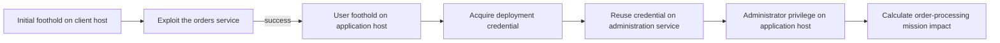

# Attack Simulation and Mission Impact

The attack simulation models how an attacker can move through one context graph.
It also measures the effect of the attack on mission capabilities. The
[model example](model-example.md) shows one complete attack path.

## Configured initial foothold

Each experiment declares one host as the initial foothold. Every trial starts
with user privilege on that host. The attack rules stay fixed across trials.
Each trial uses a different derived random seed.

The declared foothold must identify a host in the graph. Validation rejects an
invalid value before the trial starts.

## Attacker state

The attacker state contains four sets during one trial:

| Field             | Meaning                                                 |
| ----------------- | ------------------------------------------------------- |
| Footholds         | Hosts that the attacker controls.                       |
| Credentials       | Credentials that the attacker owns.                     |
| Privileges        | The privilege that the attacker holds on each foothold. |
| Attempted actions | Past action attempts and their attempt counts.          |

An action can change the state in these ways:

- A successful exploit adds a foothold or increases a privilege.
- Credential acquisition adds a credential.
- Credential reuse adds a foothold or increases a privilege.
- Every selected action increases its attempt count, even when it fails.

### Privilege transitions

A privilege is `none`, `user`, or `administrator`. These levels form an
increasing order. An action replaces the current privilege when it grants a
higher level. All other grants leave the state unchanged.

| From            | To              | Result                               |
| --------------- | --------------- | ------------------------------------ |
| `none`          | `user`          | Set user privilege.                  |
| `none`          | `administrator` | Set administrator privilege.         |
| `user`          | `administrator` | Increase to administrator privilege. |
| `user`          | `user`          | Keep user privilege.                 |
| `administrator` | `user`          | Keep administrator privilege.        |
| `administrator` | `none`          | Keep administrator privilege.        |

## Rules and actions

Four rules find actions that the attacker can take. These rules produce three
action types.

| Rule                             | Action                 | Required conditions                                                                                                                                                                               | Effect after success                                          |
| -------------------------------- | ---------------------- | ------------------------------------------------------------------------------------------------------------------------------------------------------------------------------------------------- | ------------------------------------------------------------- |
| Remote service exploitation      | `ExploitVulnerability` | The attacker controls a source host; the source can reach a service; the target host runs that service; the service has an applicable vulnerability; and the attacker has the required privilege. | Add the target host as a foothold with the granted privilege. |
| Local vulnerability exploitation | `ExploitVulnerability` | The attacker controls a host; the host has an applicable vulnerability; and the attacker has the required privilege.                                                                              | Increase privilege on the same host.                          |
| Credential acquisition           | `AcquireCredential`    | The attacker controls a host that stores a credential and has the required privilege.                                                                                                             | Add the credential to the attacker state.                     |
| Credential reuse                 | `ReuseCredential`      | The attacker controls a source host; the source can reach a service; and an owned credential authenticates to that service.                                                                       | Add the target host as a foothold with the granted privilege. |

Remote and local exploitation use the same action type. Remote exploitation
acts through a reachable service. Local exploitation acts on the controlled
host itself.

| Action                 | Probability                                       | Effect                                  |
| ---------------------- | ------------------------------------------------- | --------------------------------------- |
| `ExploitVulnerability` | The vulnerability's scenario exploit probability. | Add a foothold or increase a privilege. |
| `AcquireCredential`    | `1`                                               | Add a credential.                       |
| `ReuseCredential`      | `1`                                               | Add a foothold or increase a privilege. |

Credential acquisition and reuse are deterministic. Exploitation is
probabilistic and uses the vulnerability's scenario probability.

## Simulation loop

Each trial follows these steps:

1. Evaluate all four rules against the attacker state.
2. Collect the eligible actions.
3. Stop when the eligible action set is empty.
4. Select one eligible action uniformly at random.
5. Sample the selected action's outcome.
6. Apply the effect when the action succeeds.
7. Record the attempt, whether it succeeds or fails.
8. Continue until the next iteration would exceed the iteration limit.

This two-part process is important. Uniform selection decides which eligible
action the attacker attempts. The action probability decides whether that
action succeeds.

### Stopping rules

An experiment declares an iteration limit and a maximum attempt count. The
maximum attempt count defaults to `1`. It applies to each distinct action and
prevents one failed action from remaining eligible without limit.

A trial stops when one of these conditions is true:

- the next iteration would exceed the iteration limit; or
- the eligible action set is empty.

## Mission impact

At the end of a trial, each mission capability is operational or disrupted. A
capability is disrupted when at least one of these conditions is true:

- a required flow is unavailable;
- a required target host is compromised; or
- too few support hosts remain uncompromised.

Mission impact is the sum of the impact weights of all disrupted capabilities.
Blast radius is the number of foothold hosts at the end of the trial, including
the initial foothold.

The two outcomes answer different questions. Mission impact measures damage to
modeled operations. Blast radius measures how far the attacker spread.

## Example progression

The shared example follows remote exploitation and credential reuse.

The [model example](model-example.md) lists the nodes, relationships, and
conditions for this path.
