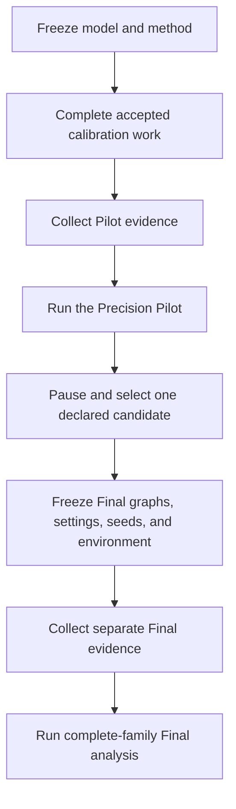

# Evaluation Methodology

The study compares each defense strategy with CVSS prioritization. It uses the
same attack columns on both sides of a comparison and represents two sources of
variation: selected defense plans and attack outcomes.

The method has four main parts:

1. Build aligned outcome matrices for each comparison.
2. Estimate the effect and its uncertainty with a crossed bootstrap.
3. Use the Precision Pilot to choose Final sample counts.
4. Apply Holm correction to the complete Final comparison family.

A change to the estimand, sampling units, reference strategy, or correction
family is a method change and needs an explicit justification.

## Running example

The callouts follow one fictional comparison from a 36-comparison family:

- medium tier;
- budget of three actions;
- topology-driven policy segmentation;
- CVSS reference; and
- mission-impact outcome.

The numbers illustrate how data moves through the method.

## 1. Research scope and model

The study examines how controlled topology growth affects:

- simulation runtime;
- defense-plan selection runtime;
- total evaluation runtime; and
- mission-impact differences between defense strategies and CVSS
  prioritization.

Use small, medium, and large tiers, with one frozen graph per tier. Host count
sets topology size. Edge count is a recorded graph property.

Keep the model comparable across tiers. This includes node roles, relationship
types, exposure patterns, reachability policy, attacker entry context, and the
meaning of an action budget. Record attack-relevant topology diagnostics for
each tier, including values that stay unchanged.

The results describe these frozen graphs.

### Model assumptions

CVSS scores, exploit probabilities, capability weights, support thresholds,
required flows, reachability policy, and defense actions are model inputs.

At each step, the simulator selects one eligible attacker action uniformly and
then samples its outcome. The initial foothold contributes to blast radius. The
attack horizon limits the number of action steps.

Mission impact is the weighted sum of disrupted mission capabilities. The
model's support thresholds and required flows determine capability status. The
evaluation uses these weights and rules unchanged.

> **Worked example — model.** Freeze the medium graph, attacker entry, mission
> weights, reachability policy, and budget definition. Change the defense
> strategy for the comparison.

## 2. Treatments, reference, and controls

The primary family compares four alternatives with CVSS prioritization.

| Alternative                         | Role                                   |
| ----------------------------------- | -------------------------------------- |
| Random defense selection            | Randomized benchmark.                  |
| Topology-driven policy segmentation | Selection based on graph structure.    |
| Simulation-informed selection       | Selection based on simulated outcomes. |
| Simulated-annealing search          | Stochastic search over defense plans.  |

CVSS is the primary reference. A no-defense experiment provides descriptive
context.

One primary comparison identifies a tier, budget, alternative, reference, and
outcome. Mission impact is the primary outcome. Direct comparisons between two
alternative strategies belong to exploratory analysis.

Here, budget means the number of defense actions in a plan.

> **Worked example — treatment.** The comparison identity is medium tier,
> budget three, topology-driven policy segmentation, CVSS reference, and
> mission-impact outcome. Each strategy uses a budget of three defense actions.

## 3. Replication units and evidence alignment

| Unit                     | Meaning                                            | Variation represented     |
| ------------------------ | -------------------------------------------------- | ------------------------- |
| Plan-selection replicate | One selected plan.                                 | Plan-selection variation. |
| Attack replicate         | One attacker execution against a plan.             | Attack variation.         |
| Timing replica           | One repeated execution of fixed scientific inputs. | Runtime variation.        |
| Graph                    | One frozen topology in a size tier.                | One conditional scenario. |

These units answer different questions. Meet each required count independently.

Each comparison uses two matrices. A row is one selected plan. A column is one
shared attack seed.

- The first matrix contains alternative outcomes.
- The second matrix contains CVSS outcomes with the same ordered columns.

Every plan must cover the same attack columns in the same order. The same
attack seed identifies the same column on both sides. A defense can still
change the resulting attack path and outcome.

During resampling, use the same sampled columns on both sides. Draw alternative
and CVSS plan rows independently. Keep stable plan and comparison identities,
and preserve the matrix structure.

Before inference, validate the strategy and budget matrix, sample counts,
selection seeds, and attack-column alignment. A strategy can use an allowed
subset of the declared selection seeds.

**Worked example — aligned matrices.** Each Final matrix has eight plan rows and
twelve shared attack columns. This table abbreviates the middle rows and
columns:

| Side         | Plan | Seed 101 | Seed 102 | …   | Seed 112 |
| ------------ | ---- | -------- | -------- | --- | -------- |
| Segmentation | A1   | 2        | 3        | …   | 1        |
| Segmentation | A2   | 3        | 2        | …   | 2        |
| Segmentation | A8   | 2        | 2        | …   | 1        |
| CVSS         | C1   | 4        | 5        | …   | 3        |
| CVSS         | C2   | 5        | 4        | …   | 4        |
| CVSS         | C8   | 3        | 5        | …   | 4        |

Seed 101 names the same attack column on both sides. The plan rows remain
independent.

## 4. Primary estimand and interval

Let $A$ be the alternative matrix with $n_A$ plan rows and $m$ attack columns.
Let $C$ be the CVSS matrix with $n_C$ rows and the same $m$ columns.

The effect estimate is the difference between their mean mission impacts:

$$
\widehat{\Delta}=\overline{A}-\overline{C}.
$$

- A negative value favors the alternative because it has lower mission impact.
- A positive value favors CVSS.

The interval covers plan-selection and attack-outcome variation.

### Corrected crossed bootstrap

The crossed bootstrap resamples both sources of variation while keeping attack
columns paired.

For each bootstrap draw:

1. Sample $m$ attack-column indices with replacement.
2. Sample $n_A$ alternative plan-row indices with replacement.
3. Sample $n_C$ CVSS plan-row indices independently with replacement.
4. Apply the sampled columns to both matrices.
5. Calculate the sampled mean difference $\Delta_b$.
6. Apply the finite-sample correction:

$$
\gamma=\sqrt{
\max\!\left(\frac{n_A}{n_A-1},\frac{n_C}{n_C-1}\right)
\frac{m}{m-1}
},
\qquad
\Delta_b^*=\widehat{\Delta}+\gamma(\Delta_b-\widehat{\Delta}).
$$

The correction expands variation around the observed effect for small row and
column counts. For confidence level $1-\alpha$, use the $\alpha/2$ and
$1-\alpha/2$ percentiles of the corrected draws. Half the distance between the
limits is the interval half-width.

Require at least five plan rows per side and ten shared attack columns. These are
eligibility bounds. Actual coverage depends on the model and evidence.

### Raw p-value: centered crossed bootstrap

The primary test uses a centered crossed bootstrap. Center each matrix by
subtracting its observed mean. Then run the corrected crossed bootstrap with a
separate deterministic random stream.

For $B$ centered draws, calculate the two-sided raw p-value:

$$
p_{\mathrm{raw}}=
\frac{1+\#\{b:|\Delta_{0,b}^*|\geq|\widehat{\Delta}|\}}{B+1}.
$$

The added one in the numerator and denominator prevents a reported value of
zero. Use the declared bootstrap count for both the interval and the centered
draws.

A comparison is non-informative when the effect and both interval limits are
numerically zero. Assign a raw p-value of one. A zero-width interval with a
nonzero effect receives a degeneracy warning.

> **Worked example — effect.** Suppose the full segmentation matrix has mean
> `2.4` and the CVSS matrix has mean `4.1`. Then
> $\widehat{\Delta}=2.4-4.1=-1.7$, so segmentation has lower mission impact. A
> corrected interval could be `[-2.3, -1.0]`. With 999 centered draws and 11 at
> least as extreme as the estimate, $p_{\mathrm{raw}}=(1+11)/(999+1)=0.012$.

## 5. Complete-family multiplicity correction

Holm correction limits the chance of at least one false rejection across the
primary family. It orders the raw p-values, adjusts them by the number of
remaining tests, and keeps the adjusted values in order.

Declare the family before inspecting Final results. Its size follows the study
design. For example, four alternatives, three budgets, and three tiers produce
36 comparisons.

Before correction:

1. Collect every expected comparison.
2. Verify that each declared identity occurs exactly once.
3. Reject missing, duplicate, or unexpected identities.
4. Apply Holm once to the complete family, including non-informative results.

After correction, restore the declared comparison order. Holm adjusts p-values.
Estimates and intervals remain per-comparison quantities. Simultaneous intervals
require a separate method.

Controls, secondary outcomes, and exploratory comparisons enter the primary
family when the study definition declares them as members.

> **Worked example — family.** The comparison joins the other 35 declared rows.
> Holm correction starts after all 36 raw p-values are available and adjusts the
> example's `0.012` in relation to that complete set.

## 6. Precision Pilot

The Precision Pilot chooses two common Final sample counts:

- plan-selection replicates per comparison side, $n$; and
- attacks per plan, $m$.

The study declares an ordered list of candidate count pairs. Each candidate has
a stable ID. The study also supplies the target half-width, guard quantile,
outer subsample count, confidence level, bootstrap count, and Pilot base seed.

Each candidate must meet the minimum bounds and fit every comparison on both
sides. Reject an oversized candidate.

### Candidate evaluation

For each candidate and family comparison:

1. Select alternative rows, CVSS rows, and shared attack columns without
   replacement.
2. Run the corrected crossed bootstrap on this subsample.
3. Record the interval half-width.
4. Repeat for the declared number of outer subsamples.
5. Take the declared guard quantile of the half-widths.
6. Compare the guarded half-width with the target.
7. Require every outer subsample to be informative.

The outer step tests the candidate across many observed subsets and samples
without replacement. Inside each subset, the bootstrap resamples rows and
columns with replacement to estimate uncertainty.

A candidate passes when every family comparison passes. Its worst guarded
half-width is the largest value across the family.

### Runtime selection heuristic

Among passing candidates, select the one with the lowest predicted runtime:

$$
T(n,m)=L\,G\,n\left(t_{\mathrm{select}}+m\,t_{\mathrm{trial}}\right),
$$

where:

- $L$ is the tier count;
- $G$ is the largest strategy-group count in any tier;
- $t_{\mathrm{select}}$ is the median plan-selection duration; and
- $t_{\mathrm{trial}}$ is the median duration per attack trial.

Break a tie in this order:

1. lower predicted runtime;
2. larger plan count;
3. smaller attack count; and
4. earlier candidate position.

If every candidate fails, return an insufficient Pilot and pause.

### Insufficient-Pilot confirmatory override

The study pauses after every valid Pilot. After an insufficient Pilot, resume
requires one candidate already declared in the study. Invalid, failed, partial,
and exhausted Pilot outcomes enter the terminal failed state.

The study policy still labels the resumed Final analysis as confirmatory. The
Pilot outcome stays insufficient. Record `pilot_override: true` and store the
selected candidate ID and counts as normal result data. The boolean is the
complete override-specific record.

The override carries these risks:

- the precision target remains unmet;
- confidence intervals can remain wide;
- raw p-values can remain unstable;
- Holm controls multiplicity while evidence strength remains limited; and
- manual candidate selection can introduce selection bias.

Evidence separation, matrix alignment, family membership, and Holm correction
remain in force.

> **Worked example — Pilot.** Candidate `c1 = (5 plans, 10 attacks)` has a worst
> guarded half-width of `1.3`, above the `1.0` target. Candidate
> `c2 = (8 plans, 12 attacks)` has `0.8`, and every comparison is informative.
> The Pilot recommends `c2`.

## 7. Pilot/Final separation and scientific freeze

Pilot selects sample counts. Final uses fresh evidence collected after that
decision.

Apply these seed rules:

- Each tier declares one evaluation root, which starts its attack-related
  random streams.
- Observed evaluation roots must match the declared phase set.
- Each strategy uses a non-empty subset of the phase's selection seeds.
- Every observed selection seed belongs to that declared set.
- Final uses the selected plan count from its own selection-seed set.
- Pilot and Final use disjoint selection seeds and evaluation roots.

After the pause, collect Final evidence with the selected counts and Final
seeds.



Calibration chooses feasible experimental settings. The Precision Pilot chooses
outcome sample counts. Begin the study lifecycle after calibration has an
accepted method.

A change to a frozen scientific input creates a new study revision and preserves
the measured evidence. The pause makes the sample-size decision explicit and
keeps Pilot and Final evidence separate.

> **Worked example — phase separation.** After the pause, collect new Final
> matrices with eight plan rows, twelve attack columns, and Final seed sets. The
> matrices above represent these newly collected outcomes.

## 8. Warm-up and timing replicas

For each tier, use one excluded warm-up and five accepted measured replicas.

The warm-up prepares the environment. Exclude it from timing and outcome
evidence. Measured replicas repeat fixed scientific inputs and estimate runtime
variation while outcome sample counts stay fixed.

Report the median and observed range for simulation, plan selection, and total
evaluation duration. Stop measured collection when the recorded environment
changes.

Accept a replica when its scientific configuration, graph, and selected plans
match. Also require matching attack outcomes, capability outcomes, pre-attack
flow status, host compromises, and non-timing summaries. Run identifiers and
timing values can differ.

> **Worked example — timing.** Exclude one warm-up. Five measured replicas take
> `39`, `41`, `42`, `44`, and `47` seconds. Report a median of `42` seconds and a
> range of `39–47` seconds.

## 9. Secondary and descriptive results

Secondary results can include:

- no-defense outcome context;
- blast radius, including the initial foothold;
- capability disruption and host compromise probabilities;
- pre-attack feasibility and required-flow disruption;
- variation between selected plans;
- empirical blast-radius distributions; and
- plan-selection, simulation, and total runtime.

A secondary attack-level contrast can use a simpler bootstrap over paired attack
differences. Adding its p-values to the primary Holm family requires a declared
method change.

A feasibility-policy comparison keeps all other model settings matched.

> **Worked example — secondary results.** Report blast radius, host compromise,
> and runtime beside the mission-impact result. Their scientific roles stay
> separate from the primary effect.

## 10. Reproducibility and limits

Record enough information to reconstruct the experiment:

- graph, model, attacker, and defense identities;
- selected plans, outcomes, strategies, and budgets;
- phase seeds and sample counts;
- candidate order and resampling settings;
- software and dependency versions; and
- the measured environment.

Keep plan-selection seeds, evaluation roots, attack seeds, resampling seeds, and
Pilot seeds distinct.

For Pilot analysis, derive the comparison stream seed as:

```text
comparison stream seed
    = Pilot base seed
    + zero-based tier rank × 1,000,000
    + zero-based comparison occurrence within that tier × 2
```

Tier rank follows first appearance in the comparison list. Comparison occurrence
follows within-tier order and stays stable when tiers are interleaved. Combine
the stream seed with the candidate plan and attack counts. Use separate child
streams for interval and centered-null calculations.

Canonical order is part of reproducibility. Scientific randomness depends on
the declared inputs, seeds, and order and stays stable across retries and
execution schedules.

Interpret results as conditional on the declared exploit model, capability
weights, frozen graphs, budgets, seeds, and measured environment. Report budget
claims as action counts, graph inference by tier, and timing for the measured
environment.

The study definition supplies every optimizer setting, topology setting,
numerical tolerance, and random-generator dependency that can change a result.
Treat a missing value as a validation error.

> **Worked example — reproducibility.** Record the comparison identity, graph
> revision, candidate `c2`, Pilot and Final seed schedules, selected plans,
> outcomes, resampling settings, software versions, and measured environment.
> These values reconstruct the example run.
