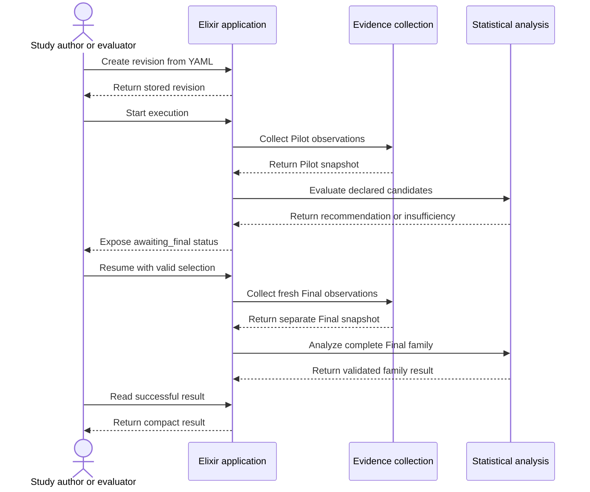
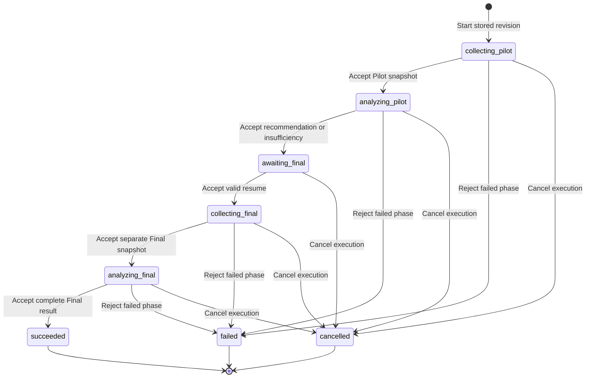

# Evaluation study overview

This page introduces the implemented study workflow for study authors, evaluators, operators, and new developers. It describes the prototype, not an approved real study or deployment.

A **study** declares a comparison family, scientific settings, seeds, and sample-size candidates. One **study execution** runs that definition through Pilot collection, Pilot analysis, a required pause, Final collection, and Final analysis.

## Define a study revision

The author supplies versioned YAML. The application validates it, resolves graph revisions, and stores an immutable, normalized study revision. Execution uses this stored definition, not the original YAML text.

The definition supplies all scientific settings. Resource limits do not change those settings. A changed definition requires a new revision.

Pilot candidates form one ordered list. Each candidate declares a stable ID, a plan count per side, and an attack count per plan. These are complete candidate choices, not separate count lists to combine. The application preserves declared order through analysis and read-back.

Graph revisions identify application-owned immutable inputs. Other declared revision strings are assertions, not independently authenticated provenance.

## Public operations

`NetworkDefense.Evaluations` exposes six Elixir application operations. These are not browser controls or public web endpoints.

| Operation                 | Purpose                                                    |
| ------------------------- | ---------------------------------------------------------- |
| `create_study_revision/1` | Validate YAML and return the stored normalized revision.   |
| `start_study/1`           | Start a new execution from a stored revision ID.           |
| `study_status/1`          | Read the persisted execution status.                       |
| `resume_study/2`          | Freeze a valid Final selection and start Final collection. |
| `cancel_study/1`          | Cancel a nonterminal execution.                            |
| `study_result/1`          | Read the validated compact result after success.           |

`study_status/1` returns the execution identity, revision identity, current state, and timestamps. It also returns the Pilot outcome, frozen candidate and counts, override marker, and bounded error when available. It does not load detailed phase progress, evidence, or Gust task status.

`study_result/1` returns no partial result. Failed and cancelled executions have status information but no compact scientific result.

## Follow one execution

### Pilot collection and analysis

Pilot collection selects defense plans and runs simulations from the declared inputs. The application assembles the observations into a Pilot evidence snapshot.

Pilot analysis evaluates each declared candidate against every declared comparison. A recommendation must pass all comparisons and rank first under the declared selection rule. If no candidate passes, the Pilot returns `insufficient`. Pilot analysis does not apply Holm correction.

Both valid outcomes lead to `awaiting_final`. An insufficient Pilot is not a failed analysis. A failed or invalid Pilot cannot supply a Final selection.

### Pause and resume

The application never starts Final collection automatically. At `awaiting_final`, the caller has two valid resume choices:

| Pilot outcome  | Selection for `resume_study/2`           | Effect                                                                      |
| -------------- | ---------------------------------------- | --------------------------------------------------------------------------- |
| Recommendation | `:recommended`                           | Use the recommended candidate and its exact counts.                         |
| Insufficient   | `{:override_insufficient, candidate_id}` | Use one candidate already declared in the revision and record the override. |

A rejected resume leaves the execution at `awaiting_final`. Resume cannot change the family, candidate counts, seeds, or other scientific settings.

The application freezes the accepted selection before Final collection. An override leaves the Pilot outcome insufficient. It does not establish that the precision target passed.

### Final evidence and analysis

Final collection uses the frozen counts and separate collection seeds. It runs tiers sequentially. Each tier has one excluded warm-up at position `-1`, then five measured replicas at positions `0..4`. Each replica repeats the same scientific inputs.

The configured observed environment assertion must match the revision's declared environment before warm-up and before and after each measured replica. A missing or different assertion fails collection. This check compares operator assertions; it does not authenticate the environment.

The coordinator process measures plan-selection, simulation, and total elapsed intervals. These intervals include Gust and ScatterGather wait time. Total elapsed time has its own boundaries; it is not the sum of the other intervals. The application keeps the five measured values per tier in memory until successful result creation stores their summaries. Raw monotonic readings and interval boundaries are not persisted.

After all tiers complete, the application assembles one complete-family non-timing summary for each measured position. All five summaries must match. Only replica `0` supplies the new Final snapshot. Warm-up supplies neither accepted outcome evidence nor timing values. A rejected replica has no replacement.

Pilot observations must not become Final evidence. Final analysis checks the accepted Pilot source, frozen selection, and Final evidence bindings. It analyzes every declared comparison and applies Holm correction once across the complete family.

The application asserts and checks evidence provenance. These checks do not cryptographically authenticate collection history or prove physical freshness from the observations alone.

## Public states

Terminal states do not change when a late completion arrives. Cancellation is idempotent for an already-cancelled execution. A caller cannot cancel a succeeded or failed execution.

## Evidence and successful results

An **evidence snapshot** is an application-managed record that the application treats as immutable. It holds Pilot or Final evidence matrices. Changed evidence requires a new snapshot; immutability is an application rule, not database-enforced protection.

The successful compact result contains:

- study and execution identities;
- accepted collection and analysis references, including snapshot identities;
- the Pilot outcome, selected candidate, counts, and override marker;
- the complete Final family result, including estimates, intervals, raw and adjusted p-values, and assessments;
- per-tier plan-selection, simulation, and total timing summaries; and
- declared software and environment revision assertions.

Collection references use ordered Gust run-ID lists: one entry for Pilot collection and one entry per tier for Final collection. Pilot and Final analysis references each retain one scalar run ID.

The result excludes evidence matrices, raw trial histories, and detailed workflow logs. Each timing summary contains five measured microsecond values, the median, the observed minimum, and the observed maximum. Detailed evidence stays in PostgreSQL snapshots and runtime records. Raw monotonic readings and interval boundaries are not persisted.

## Ownership and current limits

The application owns the study lifecycle, persisted state, source checks, and result validation. Gust runs fixed collection and analysis workflows below that boundary. It schedules tasks, retries temporary failures, and stores workflow state. Gust does not decide when a study resumes or which Final candidate it uses.

The current prototype has these limits:

- Operational timing collection and compact-result timing summaries are implemented. Timing does not change Final evidence selection.
- An application restart does not automatically recreate coordinators. The prototype has no automatic restart recovery or phase replay. Cancel a stranded execution and start a new one.
- Cancellation does not cancel underlying Gust, optimization, or simulation work. It prevents late completion from advancing the cancelled execution.
- Verification uses synthetic evidence. Real-study values, real evidence collection, and deployment remain outside approved prototype scope.
- Provenance is asserted and checked by the application, not cryptographically authenticated.

## Further reading

- [Evaluation methodology](evaluation-methodology.md): scientific rules and interpretation limits.
- [Vocabulary](vocabulary.md): shared terms.
- [Evaluation architecture](../architecture/evaluation-architecture.md): developer-facing runtime boundaries.
- [Study pipeline](../design/evaluation-study-pipeline.md): implementation authority for the study lifecycle and timing.
