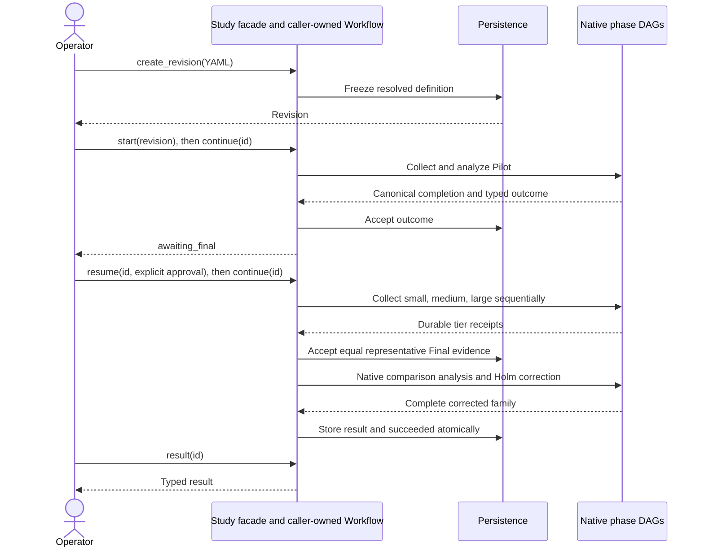
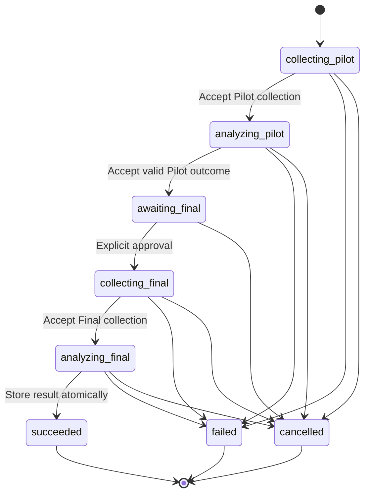

# Evaluation study overview

Evaluation2 runs a study from a frozen YAML revision to a durable native result.
This page introduces the workflow for study authors, operators and new developers.
Use the [operator guide](../evaluation2.md) for input, commands and a worked example.
Use the [methodology](evaluation-methodology.md) for statistical assumptions and interpretation.

## Define a study revision

A study declares one seed, shared defense and simulation policies, a comparison family, and ordered sample-size candidates.
It has fixed small, medium and large slots. Each slot names a persisted graph revision and one Host foothold.
The application resolves those inputs and freezes the normalized definition.
A changed definition requires a new revision.
One frozen revision can support several executions with fresh physical effects.

The constructor derives CVSS reference groups, comparisons, Pilot capacity, effective policies, seed schedules and graph-based outcome bounds.
Unknown input keys are ignored and dropped. Required known fields remain strict.
The definition records method/seed contract identities and the configured environment label.
It contains no operator-supplied software revision checklist.

## Public operations

[`NetworkDefense.Evaluation2.Study`](../../src/lib/network_defense/evaluation2/study.ex) is the supported Elixir facade.
It exposes application operations, rather than browser controls or public web endpoints.

| Operation | Purpose |
|---|---|
| `create_revision(yaml)` | Validate, resolve and freeze a revision; return `Revision` |
| `start(revision)` | Commit an execution and ensure its first Pilot run; return `Status` |
| `continue(execution_id, opts)` | Drive work to approval/terminal boundary; return `Status` |
| `status(execution_id)` | Read lifecycle state, outcome, selection and bounded error |
| `pilot_result(execution_id)` | Read the complete accepted Pilot report |
| `resume(execution_id, approval)` | Freeze valid Final counts and ensure the first tier run |
| `cancel(execution_id)` | Commit cancellation, then attempt to stop active Gust work |
| `result(execution_id)` | Read the typed result of a successful execution |

Calls return `{:ok, value}` or `{:error, Study.Error}`.
`start/1` takes the public `Revision` value, identified by study ID and revision number.
Keep the returned execution ID. A committed execution can remain available even if provisioning needs a later retry.

## Follow one execution

`start` and `resume` ensure the first run and return.
`continue` owns blocking progression between phases and tiers.
There is no background study coordinator or stored tier cursor.
Without a continuation caller, a dispatched Gust run can finish, while the next lifecycle step waits for another caller.

### Pilot and approval

Pilot collects unique strategy groups and projects aligned comparison matrices.
Native analysis evaluates every candidate against every comparison.
A candidate passes only when all its comparisons pass the finite-pool precision assessment.
Among passing candidates, the runtime heuristic chooses one recommendation.
If none passes, the valid outcome is `insufficient`.
Pilot applies no Holm correction.

Every valid Pilot pauses at `awaiting_final`.

| Accepted Pilot outcome | Explicit approval | Effect |
|---|---|---|
| Recommended | `:recommended` | Freeze the recommended candidate and exact counts |
| Insufficient | `{:override_insufficient, candidate_id}` | Freeze one declared candidate and retain the insufficient outcome |

Rejected approval leaves the execution waiting.
Approval cannot change graphs, policies, family, seeds or candidate counts.
An insufficient override gives up the precision target. It does not invalidate fresh-Final inference under its stated assumptions.
The public result records the insufficient outcome beside the selection; it has no separate override boolean.

### Final collection and timing

Final uses fresh effects and phase-separated scientific seeds.
Tiers execute in small/medium/large order.
Each tier runs excluded warm-up `-1`, followed by five measured replicas `0..4`.
The replicas repeat scientific inputs; they measure runtime variation rather than increase statistical sample size.

The application-owned clock measures plan selection, simulation and their total in one session.
Gust stores completed durations. Raw monotonic readings stay in memory.
The environment label must match the frozen label before each replica and at tier completion.
A lost incomplete session or unequal measured scientific evidence fails collection without a replacement replica.

After all tiers finish, Workflow proves canonical completion.
Final Collection checks measured equality and prepares replica-zero evidence.
Persistence separately accepts collection and creates `analyzing_final`.
A prepared snapshot alone is not an acceptance witness.

### Final analysis and result

Final analysis uses deterministic matching-based bounded-mean inference and one complete-family Holm correction.
It requires accepted Final evidence, frozen dimensions, aligned attack seeds and compatible method/environment contracts.
Persistence stores the corrected family and timing with the `succeeded` transition in one transaction.

The public result contains:

- execution and revision identity;
- accepted Pilot outcome and frozen selection;
- complete corrected family, including estimates, pointwise intervals, p-values and warnings;
- five measured timing triplets per tier.

Timing helpers derive medians and observed ranges from the stored values.
Canonical phase/Gust links, evidence matrices and effect histories remain internal durable records.
The complete Pilot candidate report remains available through `pilot_result/1`.
A result read before success returns a bounded unavailable error.

## Public states

Terminal states fence late completions.
Cancellation returns the existing Status for any terminal execution and leaves its state unchanged.
Application cancellation commits first; stopping Gust work is best-effort and does not guarantee immediate termination of underlying effects.

## Waiting, re-entry and limits

`continue(id, timeout: milliseconds)` returns current Status when its wait expires. It leaves work active and grants no approval.
A timeout in a live application differs from exit of an entire command VM, which stops its workers and clock.
The wait-only RunMonitor polls durable state, so cancellation from another VM ends a blocked continuation.

Re-entry uses canonical linked runs, stored task results and effect reservations.
It can rebuild completed tier timing after caller or clock loss.
An interrupted timed session cannot resume with invented durations.
No phase-replay API, replacement-replica policy or automatic background lifecycle recovery is provided.
Known incompatible method/seed contracts and changed measurement labels block continuation at their checked boundaries.

The [verification record](../history/evaluation2-verification.md) preserves two real successful native studies at small counts.
Full calibration and legacy deletion remain later verification gates.
The environment label is an operator assertion. It does not authenticate the machine or prove unchanged software.

## Further reading

- [Operator guide and worked example](../evaluation2.md)
- [Evaluation methodology](evaluation-methodology.md)
- [Native architecture](../architecture/evaluation-architecture.md)
- [Pipeline, timing and acceptance](../design/evaluation-study-pipeline.md)
- [Vocabulary](vocabulary.md#evaluation-and-study)
- [Historical decisions](../history/evaluation-decisions.md)
