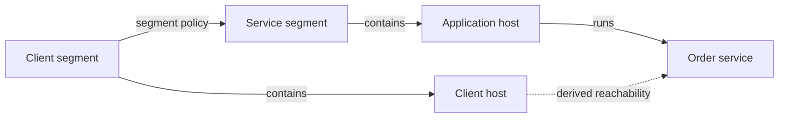

# Context Graph and Reachability

The context graph is the network model. Typed nodes describe resources and
mission capabilities. Directed relationships describe containment, software,
weaknesses, credentials, policy, and mission support.

## Nodes and relationships

The graph has six node types.

| Node type            | Meaning                                                                                     |
| -------------------- | ------------------------------------------------------------------------------------------- |
| `host`               | A compute resource.                                                                         |
| `service`            | An application that carries its listening protocol and port as attributes.                  |
| `network_segment`    | A container for hosts.                                                                      |
| `vulnerability`      | A weakness of a host or service. It has CVSS properties and a scenario exploit probability. |
| `credential`         | A secret that can authenticate to a service.                                                |
| `mission_capability` | A mission outcome that one or more hosts support.                                           |

The graph has seven stored relationship types. The arrow in the last column
shows the permitted direction.

| Relationship           | Meaning                                                                                                                            | Valid endpoints                                     |
| ---------------------- | ---------------------------------------------------------------------------------------------------------------------------------- | --------------------------------------------------- |
| `contains`             | A segment contains a host. Each host belongs to one segment.                                                                       | `network_segment -> host`                           |
| `runs`                 | A host runs a service. Each service belongs to one host.                                                                           | `host -> service`                                   |
| `segment_reachability` | A source segment can reach matching services in a target segment. The relationship contains a protocol and an optional port range. | `network_segment -> network_segment`                |
| `has_vulnerability`    | A host or service exposes a vulnerability. The relationship states the required and granted privilege.                             | `host -> vulnerability`, `service -> vulnerability` |
| `stores_credential`    | A host stores a credential. The relationship states the required privilege.                                                        | `host -> credential`                                |
| `authenticates_to`     | A credential authenticates to a service. The relationship states the granted privilege.                                            | `credential -> service`                             |
| `supports`             | A host supports a mission capability.                                                                                              | `host -> mission_capability`                        |

A host-to-service `network_reachability` relationship is a flow derived in
memory from segment policy. Graph revisions store authored policy. A save
rejects a derived flow, which keeps one stored source of reachability.

## Authored policy and derived reachability

A `segment_reachability` relationship authorizes traffic from one segment to
another. It contains these values:

- protocol;
- start port; and
- end port.

A policy matches a service when the protocols match, or when the policy uses
`any`. When the policy has a port range, the service port must be inside that
range.

Reachability is deny by default. A matching policy must connect the host's
segment to the service host's segment. Same-segment access requires an explicit
policy from the segment to itself.

For each matching policy, the system derives a host-to-service
`network_reachability` relationship. When several policies authorize the same
host and service pair, the system returns one relationship. It sorts the result,
so the same graph revision always produces the same flow set.

One policy edit updates every affected derived flow. Attack and mission rules
then receive the concrete host-to-service flows that they need.

## Topology projection

The topology view separates graph meaning from screen geometry.

The domain projection decides:

- which segment contains each host;
- which host owns each service;
- how policies and derived flows are grouped;
- which entities need context anchors;
- result order and summary counts; and
- placement problems.

The browser decides:

- rectangles and coordinates;
- edge paths;
- zoom and viewport scale;
- focus views; and
- user-controlled pins.

This split prevents the browser from inventing graph rules. For example, host
membership is a graph rule, so the domain projection supplies it. Card size is
a display rule, so the browser calculates it. A position change can therefore
move an item on the screen without changing its segment membership.

## Graph revisions

A graph is a linear sequence of immutable revisions.

1. An `initial` revision creates the graph.
2. An `edit` revision records a user change.
3. An `optimization` revision records selected defense actions.

Each new revision points to one immutable parent.

An edit names the base revision from which it started. A valid base belongs to
the same graph. The system rejects unknown and cross-graph bases before it
creates the revision.

## Baseline topology and scenario provenance

The baseline scenario uses a fixed synthetic topology for controlled
comparisons under one policy and attacker model.

Segment policies represent logical enforcement. Gateway and bastion systems are
hosts, and attack rules act on their services. The model omits router and
firewall node types.

The scenario starts with an external foothold and permits lateral movement
through remote services. Its concepts follow NIST SP 800-207 and MITRE ATT&CK
techniques T1190 and T1021.

Treat each attacker starting point as a separate experiment and report its
estimate separately.
