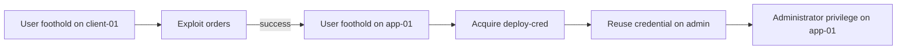

# Model Example: A Synthetic Micro-Scenario

This fictional example applies the graph, attack, and defense rules to one small
scenario.

The example has two network segments and two hosts. The application host runs
two services, stores one credential, and supports one mission capability.

## Nodes

The example uses all six node types.

| Node               | Type                 | Meaning                                                        |
| ------------------ | -------------------- | -------------------------------------------------------------- |
| `client-zone`      | `network_segment`    | The client segment.                                            |
| `service-zone`     | `network_segment`    | The service segment.                                           |
| `client-01`        | `host`               | A host in `client-zone`.                                       |
| `app-01`           | `host`               | A host in `service-zone`.                                      |
| `orders`           | `service`            | An order service on TCP port `8080`, run by `app-01`.          |
| `admin`            | `service`            | An administration service on TCP port `8443`, run by `app-01`. |
| `orders-rce`       | `vulnerability`      | A vulnerability on `orders` that grants user privilege.        |
| `deploy-cred`      | `credential`         | A deployment credential stored on `app-01`.                    |
| `order-processing` | `mission_capability` | A capability supported by `app-01`.                            |

## Relationships

The example uses all seven authored relationship types. Reachability is deny by
default, so it includes an explicit same-segment policy for the administration
service.

| Relationship           | From           | To                 | Additional data                 |
| ---------------------- | -------------- | ------------------ | ------------------------------- |
| `contains`             | `client-zone`  | `client-01`        | -                               |
| `contains`             | `service-zone` | `app-01`           | -                               |
| `runs`                 | `app-01`       | `orders`           | -                               |
| `runs`                 | `app-01`       | `admin`            | -                               |
| `segment_reachability` | `client-zone`  | `service-zone`     | TCP `8080`                      |
| `segment_reachability` | `service-zone` | `service-zone`     | TCP `8443`                      |
| `has_vulnerability`    | `orders`       | `orders-rce`       | Grants user privilege.          |
| `stores_credential`    | `app-01`       | `deploy-cred`      | Requires user privilege.        |
| `authenticates_to`     | `deploy-cred`  | `admin`            | Grants administrator privilege. |
| `supports`             | `app-01`       | `order-processing` | -                               |

The two segment policies authorize access to `orders` and `admin`. The graph
derives host-to-service flows from these policies. The explicit self-policy
authorizes same-segment access to `admin`.

## Attack path

The attack path has three ordered steps. Each step depends on the result of the
previous step.

| Step | Action                          | Required state                                                                                      | Result                                      |
| ---- | ------------------------------- | --------------------------------------------------------------------------------------------------- | ------------------------------------------- |
| 1    | Exploit `orders` remotely.      | A foothold on `client-01`, reachability to `orders`, and the applicable `orders-rce` vulnerability. | A foothold on `app-01` with user privilege. |
| 2    | Acquire `deploy-cred`.          | User privilege on `app-01`.                                                                         | Ownership of `deploy-cred`.                 |
| 3    | Reuse `deploy-cred` on `admin`. | Ownership of the credential and same-segment reachability to `admin`.                               | Administrator privilege on `app-01`.        |

Step 1 is probabilistic because it exploits a vulnerability. Steps 2 and 3 are
deterministic after their conditions are true.

## Mission capability

`order-processing` depends on `app-01` and on the required flow from
`client-zone` to `orders`.

The capability is operational when:

- the required flow exists;
- `app-01` remains uncompromised; and
- enough support hosts remain uncompromised.

After the attack reaches `app-01`, the capability can be disrupted because its
supporting host is compromised.

## Defense comparison

Two one-action plans illustrate the feasibility rule:

- Patching `orders-rce` removes the first attack step and keeps the required
  flow. The capability remains operational before the attack.
- Blocking the policy from `client-zone` to `service-zone` removes both the
  attack path and the required flow. The capability is disrupted before the
  attack.

The first action is feasible. The pre-attack feasibility constraint rejects the
second action.

## Example coverage

The path focuses on remote exploitation and credential reuse. It uses one
support host and one required flow. Larger graphs can have several support
hosts, capabilities, and attack paths.
