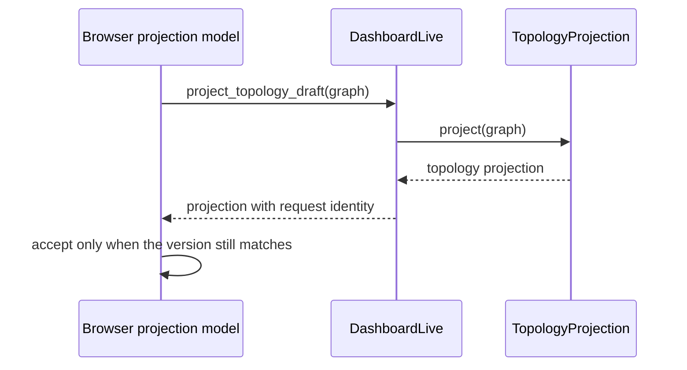
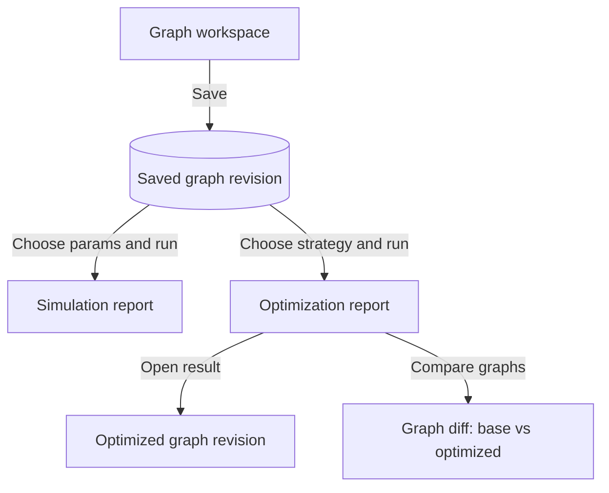

# Dashboard

The dashboard is the browser UI of the system. It presents a graph workspace
and report views. It drives attack simulation, defense optimization and native
Evaluation2 studies. This page describes the current behavior.

The model rules behind the workflows live in the concepts pages
([graph](../concepts/graph.md), [defense](../concepts/defense.md), and
[model-example](../concepts/model-example.md)).

## Workflows

Each run workflow starts with a stable graph. The next section explains why a
stable graph matters.

### Graph and revision management

The workspace opens a saved graph revision for editing. The user edits nodes
and relationships, then saves. A save appends a new revision to the graph. The
graph keeps an immutable, linear revision history.

Graphs live in folders. Use folders to organize them. The user can create,
delete, and move graphs between folders (supporting behavior only).

Source references:

- graph revision model:
  [`graph_revision.ex`](../../src/lib/network_defense/graph/graph_revision.ex);
- workspace document and folders:
  [`WorkspaceModel.svelte.ts`](../../src/assets/svelte/dashboard/workspace/WorkspaceModel.svelte.ts).

### Topology canvas

The workspace shows one topology canvas for a graph. It does not offer a
separate network view. Elixir owns graph meaning and the browser owns geometry
and interaction ([graph](../concepts/graph.md)).

Open and Save return the graph and its matching projection from the same
revision. The canvas renders that projection. A new blank graph starts with an
empty projection.

When the user changes graph meaning, the browser sends the unsaved graph for a
draft projection. While the server works, the canvas keeps the last accepted
projection and marks changed entities as pending. The browser ignores a reply
whose version is older than the current one, so a slow reply cannot overwrite a
newer state. A geometry-only change, such as a drag or an arrangement, does not
request a projection.

When an entity has no unambiguous placement, the canvas lists it in the
Unplaced tray with a reason. The user keeps full graph editing. When projection
fails, the canvas shows a non-blocking error and keeps flat editing available.
It does not restore a second projector in TypeScript.

Zoom changes entity detail, not positions or connection representation. Every
zoom level uses one directed connection bundle per ordered segment pair. The
bundle shows a connection count. Its hover, keyboard-focus, and click detail
lists `service · source host → target host`. Selecting a host shows that host's
outgoing projected connections. Segment containment draws no line: the enclosing
frame and the projected host list already show it.

Source references:

- Elixir projector:
  [`topology_projection.ex`](../../src/lib/network_defense/graph/topology_projection.ex);
- browser projection model:
  [`topology-projection-model.svelte.ts`](../../src/assets/svelte/dashboard/graph/topology-projection-model.svelte.ts);
- scene join:
  [`topology-scene.ts`](../../src/assets/svelte/dashboard/graph/topology-scene.ts).

### Simulation and report

The user runs an attack simulation on the active graph revision. The system
shows a pending report and its progress. When the run completes, the report
shows the expected and median blast radius, mission impact, and their spread
across the runs.

Source reference:

- simulation report view:
  [`SimulationReport.svelte`](../../src/assets/svelte/dashboard/simulation-report/SimulationReport.svelte).

### Defense optimization and graph comparison

The user chooses a defense strategy and runs optimization against the active
graph revision. The report shows the requested and used budget, the applied
actions, and a per-strategy analysis. The optimization appends an optimized
graph revision to the graph.

The user can open the optimized graph revision as a new document. The user can
also compare the base graph with the optimized graph and inspect the diff.

The user can compare any two saved graph revisions directly and inspect a
structural diff.

Source references:

- optimization report with graph diff:
  [`OptimizationReport.svelte`](../../src/assets/svelte/dashboard/optimization-report/OptimizationReport.svelte);
- optimization runs and reports:
  [`optimizations.ex`](../../src/lib/network_defense/optimizations.ex).

## Why save before run

Simulation and optimization run against a graph revision. When the active
graph has unsaved edits, the system saves it before it starts the run
([`DashboardModel.svelte.ts`](../../src/assets/svelte/dashboard/DashboardModel.svelte.ts)).
This save creates a stable graph revision that the run can target.

A stable revision matters because the run input must not change while the run
executes. Each simulation or optimization is a long-running, asynchronous job.
The job reads its graph revision. If the user could edit and re-save the graph
during the run, the result would no longer match the input the user saw. Saving
first fixes the input as one immutable revision, so the report always describes
the graph the user intended to run.

## User flow

The diagram shows the path from the graph workspace to a simulation report or
an optimized graph with its diff.

## Native Study documents

Use **+ → Study** to search saved revisions or create a new revision. Opening an
existing workspace revision selects its tab. Each Study document holds one
revision and its execution history.

Study ID and Family ID are assigned automatically. An optional Study name labels
the document and saved revision; leaving it empty uses the identifier as a fallback.

The definition form controls the authored settings. Select a saved graph revision
for each tier, then select one of that revision's Hosts. Supply scientific
settings explicitly. The generated YAML is read-only and supports copy and
download. Master seeds remain exact decimal strings across the browser boundary.

**Freeze revision** sends the entered field text to the backend. The web boundary
casts numeric values and returns field-path errors. The shared definition
constructor validates scientific settings before saving an immutable definition.
Generated backend contracts supply lifecycle states, phases, tiers, approval
values and execution-control classifications. The client owns display labels,
view tabs and display units.
The frozen view shows declared settings, derived structure and the measurement
label. **Create revision from this** copies declared settings into a draft. The
author supplies the new revision number and confirms its identity before freezing.
Workspace persistence restores unfinished drafts and saved view selections.

### Execute and review

| Action | Accepted behavior |
|---|---|
| Start new Pilot | Create a separate execution and ensure its first collection run |
| Continue | Advance that execution until approval, a terminal state or the finite request timeout |
| Approve recommended candidate | Freeze the backend recommendation's exact counts |
| Approve insufficient override | Freeze a declared candidate after explicit confirmation |
| Cancel execution | Commit cancellation and end this session's pending continuation caller |
| Refresh | Read accepted state and reconcile execution history |

Continue runs asynchronously under the LiveView. Switching workspace tabs or
selected executions preserves its request. Closing a Study document releases its
observers and continuation callers. Disconnect does the same when the owning
LiveView ends. Reopening reads current facts and requires another explicit Continue.
Dispatched effects follow the backend's existing completion and cancellation rules.

If a Start reply is uncertain, reconcile execution history before starting another
attempt. A failed or cancelled execution retains its accepted context. A new
attempt uses a separate execution identity.

Progress identifies the current phase, tier and replica. Warm-up has an explicit
excluded label. Optimization items, simulation trials and analysis jobs use
separate counters. Unknown totals use the waiting indicator. Accepted Study
state controls Pilot and Final availability. Persistent notices show approval,
success, failure and cancellation. Background executions can mark their Study
tab for attention.

Final results show stored comparison estimates, pointwise intervals, raw and
Holm-adjusted p-values, decisions, assessments and warnings. Timing shows
server-derived summaries and all five measured triplets for each tier. Display
unit changes preserve the stored values. The inspector shows revision,
execution and selected-comparison context.

Final dispatch requires an execution-capable Gust runtime, the intended Repo
and executor targets, a live application clock and a stable measurement label.
The existing graph, simulation and optimization ribbon remains available.

See the [integration plan](evaluation-study-ui-plan.md) for ownership and lifecycle
constraints.

Source references:

- supported backend facade: [`study.ex`](../../src/lib/network_defense/evaluation2/study.ex);
- browser document: [`StudyDocument.svelte.ts`](../../src/assets/svelte/dashboard/study/StudyDocument.svelte.ts);
- request ownership: [`study_requests.ex`](../../src/lib/network_defense_web/study_requests.ex).

## Core journey capture

The [README](../../README.md#core-workflows) shows real topology, simulation,
and defense screenshots. The [infrastructure guide](../infrastructure.md)
describes the local environment and its limits.
