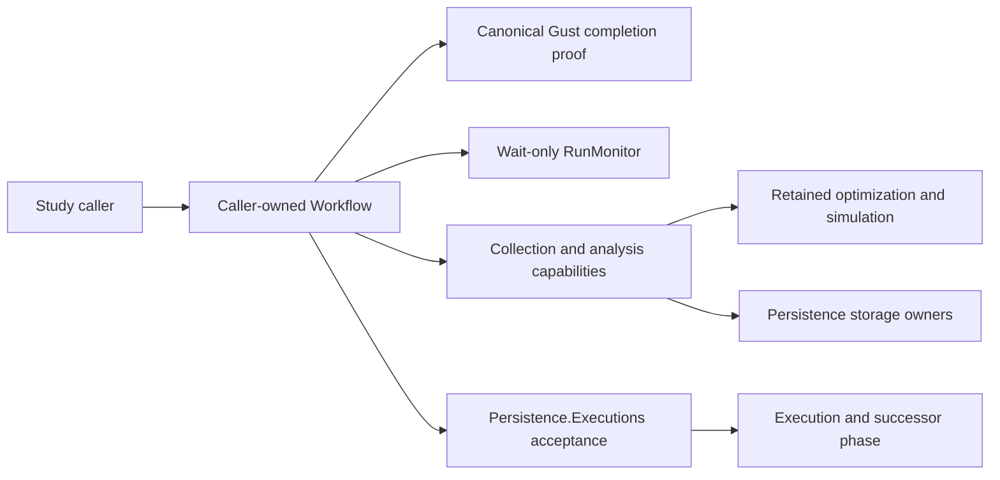
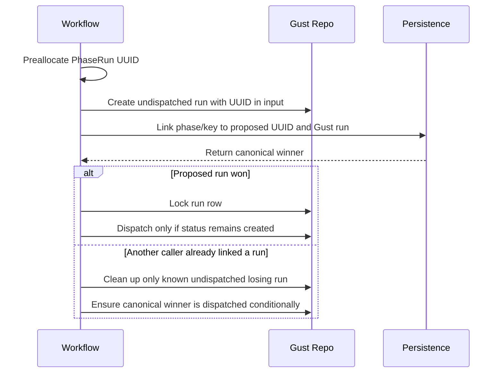

# Evaluation2 pipeline, timing and acceptance

This is the current developer guide for native study orchestration.
It replaces the legacy coordinator/runner design.
The [architecture](../architecture/evaluation-architecture.md) maps owners and storage.
The [methodology](../concepts/evaluation-methodology.md) defines inference.
The [operator guide](../evaluation2.md) defines supported commands.

## Public boundary and lifecycle

`NetworkDefense.Evaluation2.Study` is the supported facade.
`start/1` commits an execution and ensures Pilot Collection; `resume/2` commits approval and ensures the first Final tier.
Both return Status.
`continue/1,2` drives the execution to approval, terminal state or a finite wait bound.



Workflow has one progression loop and no stored tier cursor.
It reloads durable context, ensures the canonical run, waits, proves completion and requests acceptance.
Persistence creates each successor phase in the same transaction as its transition.
Final tier progression follows ordered canonical PhaseRuns.
A dispatched run can finish without a continuation caller; cross-phase progression needs a caller again.

## Create, link, dispatch

Application storage and Gust storage have separate transaction owners.
The provisioning protocol preserves this order:



Unique phase/key and Gust-run constraints make concurrent callers converge on one canonical row.
The authoritative Gust row lock prevents dispatch from a stale `created` status.
There is no application dispatch flag, general orphan scanner or Gust fork.

The phase-run UUID travels in the root input before linking.
Mapped actions verify their acting run and canonical phase ownership before calling a capability.
Another successful run cannot satisfy this phase merely because its output has the right shape.

## Completion proof and acceptance

Before accepting a phase result, Workflow checks:

1. The linked application PhaseRun belongs to the expected execution, phase and tier key.
2. Root parameters exactly match its canonical phase-run identity and expected snapshot when applicable.
3. The Gust run succeeded.
4. Exactly one expected terminal task succeeded and has a stored result.
5. The strict codec decodes the complete typed output.
6. Domain validation confirms frozen scientific contracts and complete membership.

A succeeded Gust status alone is insufficient.
Pilot Analysis validates complete candidate/comparison fan-in and outcome consistency.
Final Analysis validates complete family membership, statistics and recomputed Holm adjustments/decisions.
Final timing proof also binds prepared session identity and exact completed replica receipts.

Persistence owns idempotent acceptance.
An equal retry returns the current accepted state; a conflicting value fails.
A failed or cancelled execution fences late acceptance.
Final result insertion and `succeeded` occur atomically.

## Pilot path

Pilot Collection prepares one immutable ordered group plan.
It reserves unique item effects, collects aligned observations and inserts phase-owned evidence.
Its typed terminal output is empty; Workflow reads the snapshot through its owning phase.

Pilot Analysis loads that accepted snapshot.
It creates candidate/comparison jobs, evaluates outcome-independent subsets and returns a complete candidate report.
The compact accepted outcome lives on the execution.
Detailed candidate summaries remain in the succeeded Gust terminal result and supply `Study.pilot_result/1`.

Every valid outcome pauses at `awaiting_final`.
Approval uses `:recommended` or an explicit insufficient override for a declared candidate.
The stored selection contains candidate ID and exact counts.
The insufficient outcome beside that selection records the override without a separate boolean.

## Static Final tier sequence

One reusable static DAG executes for each tier in small/medium/large order:

```text
prepare tier/session
  → prepare warm-up -1 and check environment
  → warm-up optimization → warm-up simulation
  → prepare measured 0 and check environment → measured chain 0
  → prepare measured 1 and check environment → measured chain 1
  → prepare measured 2 and check environment → measured chain 2
  → prepare measured 3 and check environment → measured chain 3
  → prepare measured 4 and check environment → measured chain 4
  → check environment and complete tier
```

Replica positions change physical item/effect identity, while scientific inputs and seeds remain fixed.
Warm-up performs the same scientific work and contributes no measured durations.
Replica preparation and the terminal boundary re-read the configured label against the frozen definition.
The tier opens its clock session before the first label check, but no measurement starts before that check passes.
They do not authenticate hardware or software.

### Measured chain and clock ownership

```text
prepare items
  → plan_start marker
  → mapped optimization items complete
  → simulation_start marker (also the plan-completion boundary)
  → mapped simulation items complete
  → replica_end marker and stored duration receipt
```

`Final.Timing` is an application-supervised clock-only GenServer.
It starts before Gust can dispatch new work.
A session token binds readings to one canonical tier PhaseRun.
Marker order is fixed. Repeated markers return the same receipt within that session.

For monotonic readings `p`, `s` and `e` in microseconds:

| Duration | Definition |
|---|---|
| Plan selection | `s - p` |
| Simulation | `e - s` |
| Total | `e - p`, equal to the two component durations' sum |

These are complete-batch elapsed intervals, including queue, scheduling and retry delays inside the boundaries.
Replica preparation before plan start, inter-replica gaps and later statistical analysis lie outside them.
The result's `total` is therefore measured collection time, rather than whole-study wall time.

Raw readings remain transient.
Gust stores the completed replica triplets and terminal tier output.
Workflow checks these durable receipts before releasing transient clock state.
The [verification record](../history/evaluation2-verification.md#timing-and-failure-evidence) preserves the shared handoff marker and duration-sum invariant.

### Caller loss and clock loss

Completed tier receipts survive caller or clock loss.
A later continuation proves the canonical run again and reconstructs the timing summary.
A prepared or partially measured tier that loses its clock session cannot continue that measurement.
The clock rejects old incomplete sessions; neither task timestamps nor silent reruns supply replacement durations.

This is bounded re-entry, rather than automatic recovery or phase replay.
Gust may reclaim eligible work under its existing lease rules, but that does not restore transient clock readings.
Keep a measured command VM alive until its boundary.

## Equality, representative evidence and Final acceptance

After all tier runs complete, Workflow proves their canonical typed outputs.
`Final.Collection.prepare_snapshot/2` then checks physical sources, warm-up completeness, dimensions, duration receipts and measured equality.

The equality payload retains scientific input graphs, action meaning, settings, seeds, trial ordering and outcomes.
It excludes physical item/effect/output IDs, timestamps, sessions and durations.
All measured positions must agree with position zero.
Unequal or interrupted work fails without a replacement replica.

The capability projects representative measured position zero into a complete comparison evidence value.
It prepares the Final snapshot through Persistence.
It does not own lifecycle acceptance.
Workflow separately calls `Persistence.Executions.accept_final_collection/1`.
That locked transition creates the `analyzing_final` successor, which is the durable acceptance witness.
A snapshot's presence alone cannot authorize Final analysis.

## Native Final analysis

Final Analysis prepares jobs only from accepted Final evidence.
It checks frozen model bounds, selected dimensions and derived ordered attack seeds.
Mapped jobs evaluate deterministic matching-based statistics in outcome units.
Fan-in requires every canonical comparison once and applies Decimal Holm correction across that complete family.

Workflow proves the terminal result, reconstructs timing from canonical tier receipts and rechecks provenance before acceptance.
`Persistence.Executions.accept_final_analysis/3` stores family and timing with success in one transaction.
Public result reads join the owning execution's Pilot history, selection and stored Final values.
They do not rerun inference or expose private phase links.

## Waiting, failures and cancellation

RunMonitor only waits.
It polls linked Gust status and durable execution state, including cancellation from another command VM.
The caller reloads Status after waiting.
A finite API timeout returns current Status and leaves work active.

Typed permanent failures remain permanent; unexpected exceptions retain Gust retry behavior.
Workflow maps definitive failure to the owning active phase.
Retry-safe item reservations prevent a retry from reserving a second effect for the same item.
They do not guarantee exactly-once computation after a lost response.

Cancellation commits application state before best-effort stopping.
Gust has succeeded/failed terminal run statuses; application `cancelled` is a separate lifecycle state.
Created/enqueued runs are fenced under the authoritative Gust row lock; running runs use Gust stopping.
Underlying effects can still finish.
Terminal executions return their existing state on cancellation, and late completion cannot advance them.

## Verification and history

The [verification record](../history/evaluation2-verification.md) preserves constructor, numerical, Pilot, timing and full-study evidence.
It includes the two real native successful studies and the 990-case implementation regression checkpoint.
It retains failed checks, corrections and limits separately from successful observations.

The [complete calibration](../history/evaluation2-calibration-20261031.md) passed its declared model-grid checks. The obsolete implementation is removed; the verification record tracks the retained-tree audit.
The [legacy implementation plan](evaluation-study-pipeline-implementation-plan.md), [legacy refactor record](evaluation-study-pipeline-refactor-plan.md)
and [runtime-contract record](evaluation-study-runtime-contract-future-work.md) are historical references, rather than current interfaces.
