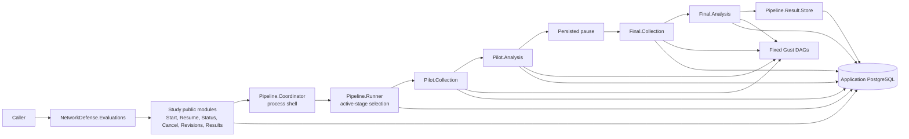
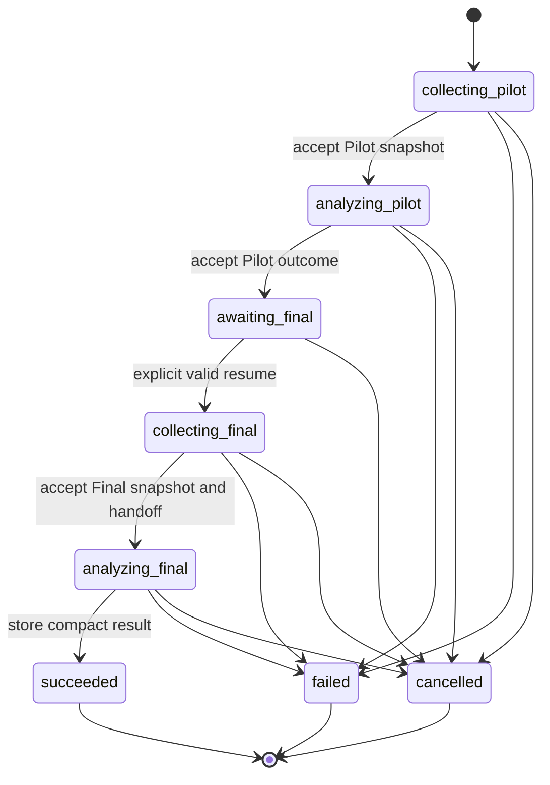

# Evaluation study pipeline

## Status and authority

This document describes the implemented evaluation study pipeline. Application developers are its main audience. Study authors and operators can start with the [study overview](../concepts/evaluation-study-overview.md).

The [methodology](../concepts/evaluation-methodology.md) defines the scientific method. The [vocabulary](../concepts/vocabulary.md) defines shared terms. The [decision history](../history/evaluation-decisions.md) records accepted choices and prototype limits.

The modular pipeline refactor is complete through R7. R8 manual end-to-end verification and R9 automated test reconstruction remain separate work.

Real-study settings, evidence collection, and deployment remain unapproved. The examples approve no scientific values.

## Public boundary

`NetworkDefense.Evaluations` keeps six study operations:

- create a study revision;
- start a study;
- read study status;
- resume a paused study;
- cancel a study; and
- read a successful result.

The comparison and family APIs remain separate reusable workflows. Pilot and Final stages are internal to the study pipeline.

The public study modules stay under `NetworkDefense.Evaluation.Study`. Pipeline process and stage modules stay under `NetworkDefense.Evaluation.Study.Pipeline`.

## Runtime structure

### Process ownership

`Pipeline.Coordinator` owns process concerns:

- start one supervised task;
- claim one execution in the local coordinator registry;
- complete the caller handshake; and
- invoke `Pipeline.Runner` in the registered process.

`Pipeline.Runner` owns orchestration:

- select the active stage from persisted execution state;
- compose Pilot Collection and Pilot Analysis;
- compose Final Collection and Final Analysis;
- resume explicit Final Analysis coordination from `analyzing_final`;
- map stage failures to bounded study errors; and
- persist active-phase failure state.

Each stage owns its successful database transition. The runner does not duplicate stage-specific persistence.

The registered coordinator process also receives Final timing-boundary messages. This keeps all elapsed measurements in one monotonic clock domain.

### Recovery boundary

Gust persists run and task state. Completion callbacks only wake local waiters. A waiter reloads persisted Gust status before it accepts completion.

The application does not start an automatic recovery worker. An application restart can leave an active execution without a coordinator. Explicit internal coordination can continue `analyzing_final`, but the public API does not perform automatic replay.

## Definition boundary

YAML is the user input transport. PostgreSQL stores one normalized immutable definition.

Revision creation performs these steps:

1. Read one bounded YAML document.
2. Parse it once.
3. Validate the versioned definition contract.
4. Resolve each graph revision.
5. Store one normalized JSON-compatible revision.

Only graph revisions have application-owned immutable records and loaders. Other revision strings remain bounded caller assertions.

Scientific settings and seeds are required. Deployment resource limits remain application configuration. A resource limit cannot replace or truncate a scientific setting.

The checked-in contract defines the input shape:

- [JSON Schema](../../src/priv/evaluation/study/v1/schemas/definition.schema.json)
- [YAML example](../../contracts/evaluation/study/v1/valid/study-small.yaml)
- [Normalized JSON example](../../contracts/evaluation/study/v1/valid/study-small.json)

## Lifecycle

A rejected resume keeps the execution at `awaiting_final`. A valid insufficient Pilot result also pauses. It is not a failed analysis.

| State | Stage responsibility |
| --- | --- |
| `collecting_pilot` | Collect Pilot evidence and accept the Pilot snapshot. |
| `analyzing_pilot` | Evaluate candidates, persist the Pilot outcome, and pause. |
| `awaiting_final` | Validate the caller selection and freeze one declared candidate. |
| `collecting_final` | Run sequential tiers, validate replicas and timing, and accept the Final snapshot. |
| `analyzing_final` | Analyze the complete family and store the compact result. |

Cancellation locks the execution row. A late stage result cannot revive a cancelled execution.

## Stage contracts

Each stage has one typed IO family. Mapped Gust work uses smaller item contracts with stable database references.

Stage return rules are:

- Pilot Collection returns Pilot Analysis IO;
- Pilot Analysis returns `:paused`;
- Final Collection returns Final Analysis IO; and
- Final Analysis returns `:completed`.

Gust stores compact identifiers and receipts. In-process IO can contain loaded definitions, phases, snapshots, tier rows, and typed results.

The Final Collection-to-Analysis handoff is versioned and stored in the locked Final Collection phase. The handoff contains the accepted snapshot reference, ordered tier references, and validated timing summary. A repeated acceptance must match the stored handoff.

## Gust DAGs

The runtime uses six checked-in DAGs. Four belong to the study lifecycle.

| DAG | Role |
| --- | --- |
| `evaluation_comparison` | Run one reusable comparison. |
| `evaluation_family` | Run one reusable corrected family. |
| `evaluation_study_pilot_collection` | Prepare Pilot work, collect mapped items, and assemble the Pilot snapshot. |
| `evaluation_pilot` | Prepare candidates, evaluate mapped candidate comparisons, and select the Pilot outcome. |
| `evaluation_study_final_tier_collection` | Collect one Final tier with warm-up, measured replicas, timing markers, and environment boundaries. |
| `evaluation_final` | Prepare, compare, and correct the Final family. |

The DAG files define static topology. A compile-time macro expands the five measured Final replica chains. It does not generate a graph at runtime.

No study DAG starts another DAG. The pipeline stages create, accept, dispatch, await, and read their own Gust runs.

## Shared collection boundary

Pilot and Final collection share these modules under `Pipeline.Collection`:

- planning and phase lookup;
- stable collection-item storage;
- reservations and run identity;
- concurrency control;
- work-item and receipt contracts; and
- evidence assembly.

Pilot and Final stages keep separate task IO, DAGs, bounded errors, and acceptance rules.

Each collection item has a stable application record. A retry reuses linked optimization and experiment effects. This supports repeat-safe effects, but it does not promise exactly-once computation.

Detailed evidence remains in application PostgreSQL. Gust task results contain compact references. Fan-in reloads linked records, rejects incomplete work, and restores declared order.

## Pilot

Pilot Collection creates one evidence snapshot. Pilot Analysis evaluates one ordered candidate list.

Each candidate has:

- a stable candidate ID;
- a plan count per side; and
- an attack count per plan.

A candidate passes only if every declared comparison passes. Selection uses the declared runtime rule. The tie-break order is lower predicted runtime, more plans, fewer attacks, then earlier declared position.

Pilot Analysis applies no Holm correction. If no candidate passes, it stores an `insufficient` outcome. The execution always pauses after a valid Pilot outcome.

Resume accepts:

- the recommended candidate; or
- one declared candidate as an explicit insufficient override.

The resume transaction freezes the candidate, counts, and override marker before Final work starts.

## Final Collection

Final Collection runs tiers sequentially in declared family order. Each tier has:

- one excluded warm-up at position `-1`; and
- five measured replicas at positions `0` through `4`.

The static tier DAG uses seven environment checks:

1. before warm-up;
2. before measured replica `0`;
3. one shared boundary between each adjacent measured replica; and
4. after measured replica `4`.

A shared boundary is both the end check for one replica and the start check for the next replica.

Synchronous markers measure plan selection, simulation, and total elapsed time. Total is measured directly. It is not calculated as the sum of the other intervals.

After all tiers finish, Final Collection:

1. validates five measured timing records for every tier;
2. builds one complete-family non-timing summary for each measured position;
3. requires all five summaries to match;
4. selects replica `0` as the evidence source;
5. creates and accepts the Final snapshot; and
6. stores the Final Analysis handoff.

The stage creates no replacement replica after a mismatch.

## Final Analysis and result

Final Analysis reloads authoritative values from PostgreSQL. It checks the frozen selection, accepted Pilot source, Final snapshot, ordered family, and analysis settings.

The Final DAG calculates every comparison and applies one Holm correction across the complete declared family.

`Pipeline.Result.Store` creates one immutable compact result and transitions the execution to `succeeded` in the locked success transaction. Read-back validates the result against:

- the study revision;
- all four phase rows;
- the ordered Final tier-run family; and
- the stored compact result contract.

Failed and cancelled executions have no compact scientific result.

## Persistence

| Record | Purpose |
| --- | --- |
| Study revision | Immutable normalized definition. |
| Study execution | Lifecycle state, Pilot outcome, frozen Final selection, and bounded error. |
| Study phase | One fixed stage with accepted run, snapshot, handoff, result reference, or error. |
| Study phase run | One ordered Final tier and its Gust run. |
| Collection item | Stable link to optimization and simulation effects. |
| Evidence snapshot | Immutable Pilot or Final evidence payload. |
| Study result | Immutable compact successful result. |

Final Collection keeps its scalar phase run ID empty. Ordered `StudyPhaseRun` rows hold one Gust run per tier. Pilot Collection, Pilot Analysis, and Final Analysis each use one scalar Gust run ID.

Historical migration module and table names remain because Ecto migration history requires them. Current schemas and pipeline persistence use those tables directly.

## Scientific invariants

The refactor preserves these rules:

- scientific identity is `(tier, budget, alternative, reference, outcome)`;
- alternative and reference plan rows are independent;
- all plans in one comparison use the same ordered attack columns;
- intervals use the corrected crossed bootstrap;
- raw p-values use the centered crossed bootstrap with add-one correction;
- Final Analysis applies Holm once across the complete family;
- non-informative members remain in that family;
- fan-in restores declared order; and
- scheduling IDs and completion order do not change scientific randomness.

Pilot and Final use separate collection seeds and evidence snapshots.

## Verification state

R7 static verification includes formatting, warnings-as-errors compilation, strict Credo, Dialyzer, DAG loading, and namespace searches.

R8 is the first behavioral gate for the rebuilt pipeline. It must run:

1. one complete public study journey through pause, resume, Final tiers, Final Analysis, and result read-back; and
2. one cancellation journey during active work.

R9 reconstructs automated tests from the pre-refactor baseline. Tests must target public behavior, scientific calculations, typed stage contracts, persistence invariants, DAG topology, cancellation, bounded failures, environment boundaries, timing summaries, and compact results.

Deployment, real evidence collection, automatic recovery, phase replay, replacement replicas, and UI expansion require separate approval.
