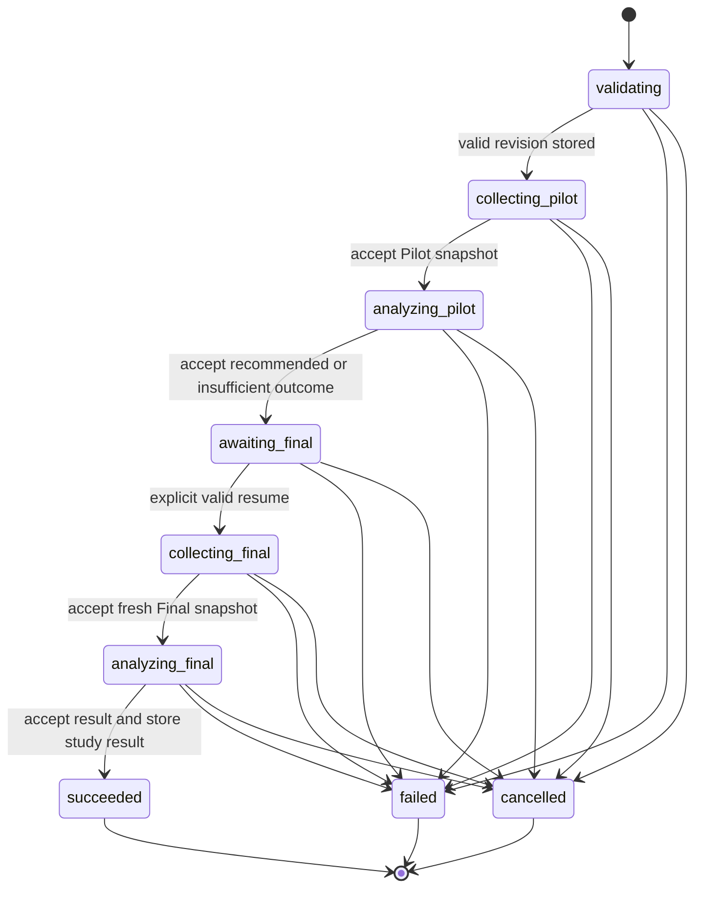
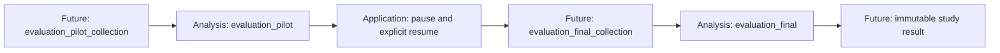
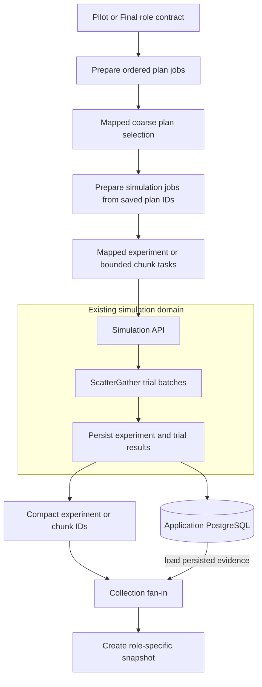

# Evaluation study pipeline

## Status and authority

This is the authoritative target design for an end-to-end YAML study pipeline. Its audience is application developers and study authors. The lifecycle, YAML loader, collection DAGs, and compact study-result record are not implemented.

The [current architecture](../architecture/evaluation-architecture.md) describes the implemented comparison, family, Pilot, and Final analysis components. Their source and schemas define current behavior. This design does not widen their current contracts by documentation alone.

The [methodology](../concepts/evaluation-methodology.md) defines the scientific method. The [vocabulary](../concepts/vocabulary.md) defines shared terms. The [decision history](../history/evaluation-decisions.md) records accepted choices and known limits.

Real-study settings, evidence collection, and deployment remain unapproved. Examples below approve no scientific values.

## Definition boundary

YAML is the only user input format. It is an input transport, not a second persisted authority.

1. Read a bounded YAML document.
2. Parse and validate it once at study-revision creation.
3. Resolve and check immutable domain revision references.
4. Store one immutable normalized JSON-compatible study definition.
5. Execute from that stored definition, not from the source file.

Do not store the source YAML text. Later phase boundaries still validate their typed inputs, persisted bindings, and results. They do not reparse YAML.

The loader requires `schema_version`. It rejects:

- unsupported versions, missing required fields, and unknown keys at every level;
- duplicate keys, aliases, merge keys, and custom tags;
- non-string map keys;
- non-finite numbers and other values that cannot map safely to JSON;
- implicit type conversions that violate declared field types; and
- executable expressions, dynamic module names, task topology, service addresses, and secrets.

Do not interpolate environment variables. Scientific settings and seeds must be explicit. Deployment resource caps remain external configuration. Reject work above a cap; do not change scientific settings to fit it.

The definition references immutable graph, model, attacker-context, defense-semantics, strategy, and other required domain revisions. Do not inline complete domain objects. A scientific change creates a new study revision. Do not use content hashes merely to establish record identity.

## Lifecycle and phase ownership

One explicit application state machine owns the study lifecycle. One study-pipeline module must contain its visible, declarative transition table. Gust owns execution inside fixed phase DAGs. It does not become the authority for study state.

There is no calibration phase. Graph and model revisions must already be suitable declared inputs. The historical methodology can describe earlier feasibility work without adding a lifecycle phase here.



The diagram shows lifecycle states, not task topology. A failed resume request leaves the execution at `awaiting_final`; it does not by itself cause the failure edge.

| State                       | Accepted event or condition                                    | Next state / action                                                                                                  |
| --------------------------- | -------------------------------------------------------------- | -------------------------------------------------------------------------------------------------------------------- |
| `validating`                | Definition and referenced revisions pass                       | Store normalized revision; start Pilot collection; enter `collecting_pilot`                                          |
| `collecting_pilot`          | One attempt yields a validated Pilot snapshot                  | Accept its run ID and snapshot; start Pilot analysis; enter `analyzing_pilot`                                        |
| `analyzing_pilot`           | One attempt yields a validated recommendation or insufficiency | Accept the analysis run ID; always enter `awaiting_final`                                                            |
| `analyzing_pilot`           | One attempt is invalid, failed, partial, or exhausted          | Enter `failed`; resume is forbidden                                                                                  |
| `awaiting_final`            | Explicit resume satisfies the gate below                       | Freeze the selected declared candidate in execution data; start a new Final collection run; enter `collecting_final` |
| `collecting_final`          | One attempt yields a validated, separate Final snapshot        | Accept its run ID and snapshot; start Final analysis; enter `analyzing_final`                                        |
| `analyzing_final`           | One attempt yields a validated complete family                 | Accept the analysis run ID; store the compact immutable result; enter `succeeded`                                    |
| Any other nonterminal state | Terminal validation failure or exhausted phase failure         | Enter `failed`; retain available accepted references in the terminal result                                          |
| Any nonterminal state       | Accepted cancellation                                          | Enter `cancelled`; retain available accepted references in the terminal result                                       |
| Any terminal state          | Late completion or duplicate transition event                  | Do not advance or revive the execution                                                                               |

A validated insufficient outcome is not a failed analysis.

## Fixed phase DAGs

Use four named phase DAGs:

| DAG                           | Status                         | Role                                                               |
| ----------------------------- | ------------------------------ | ------------------------------------------------------------------ |
| `evaluation_pilot_collection` | Future                         | Collect and assemble Pilot evidence                                |
| `evaluation_pilot`            | Implemented analysis component | Evaluate sample-size candidates and select or report insufficiency |
| `evaluation_final_collection` | Future                         | Collect and assemble separate Final evidence after resume          |
| `evaluation_final`            | Implemented analysis component | Run crossed comparisons and one complete-family Holm correction    |

The target phase boundaries are explicit. Only the two analysis components below exist today.



The lower-level `evaluation_comparison` and `evaluation_family` workflows remain reusable. Phase actions reuse their mathematics without starting nested runs for each comparison.

Do not generate Elixir, Python, modules, tasks, or DAG topology from YAML. Do not introduce a generic workflow framework or a DAG compiler. The definition produces ordered work-item data for checked-in DAGs.

The current Pilot and Final analysis DAG shapes remain the phase structure. Future integration must adapt their input/binding contracts for the declared candidate list and the explicit override. It must not fabricate a `recommended` Pilot or silently widen a list into undeclared candidates.

### Collection roles and parallel execution

The two collection DAGs have separate role contracts and shared collection actions. Their fixed conceptual shape is:



Gust owns durable phase orchestration, coarse mapped work, retries, fan-in, and compact task results. Collection actions call the existing optimization and simulation APIs. ScatterGather remains the intra-simulation parallel executor for trial batches. Do not map each trial as a Gust task.

Simulation and evidence data stay in application PostgreSQL. Gust receives compact job, experiment, or chunk IDs. Collection fan-in loads the persisted data, checks completeness and declared order, and creates the role-specific snapshot. Python remains synchronous numerical compute only.

Capacity planning must account for Gust concurrency multiplied by ScatterGather concurrency. A cap at one layer does not bound the combined fan-out. Future integration tests must cover retries around empty, partial, failed, and completed experiments. A completed experiment must not be mistaken for an unstarted job, and partial evidence must not become an accepted snapshot.

## Pilot candidates

A [Pilot sample-size candidate](../concepts/vocabulary.md#precision-pilot) is one declared ordered item with a stable ID, a plan count per side, and attacks per plan.

Use an explicit ordered list. Separate arrays must not imply a Cartesian product. Candidate IDs must be unique. Counts must meet the method's lower bounds and fit every Pilot comparison on both sides.

The Pilot applies the accepted method to every candidate/comparison pair:

- Sample alternative and reference plan rows independently without replacement.
- Sample shared attack columns without replacement.
- Run the corrected crossed bootstrap with replacement inside each outer sample.
- Take the declared guard quantile of interval half-widths.
- Require informative evidence and the target width for every declared comparison.
- Select among passing candidates by the declared runtime rule and deterministic tie-break.

The tie-break is lower predicted runtime, then more plans, then fewer attacks, then declared candidate position. Runtime prediction is a resource heuristic, not statistical evidence. No Holm correction runs during Pilot. When no candidate passes, the Pilot reports explicit insufficiency. It does not automatically select the largest candidate.

## Pilot-to-Final gate

Every definition must contain `pilot_to_final.mode: pause`. `pause` is the only accepted value. This field makes the transition policy explicit. There is no automatic transition from Pilot completion to Final collection.

After a valid Pilot analysis, the execution always enters `awaiting_final`.

| Accepted Pilot outcome      | Resume rule                                                                                           |
| --------------------------- | ----------------------------------------------------------------------------------------------------- |
| `recommended`               | Explicit resume uses the recommended declared candidate and its exact counts                          |
| `insufficient`              | Explicit manual resume can select one candidate already declared in YAML, with `pilot_override: true` |
| Failed or invalid execution | Resume is forbidden                                                                                   |

An insufficient-Pilot override cannot introduce new counts, change the family, or alter other frozen scientific settings. Such changes need a new study revision.

The override is explicitly confirmatory under the approved policy. It does not imply that the Pilot precision check passed. Its risks must remain visible:

- The Pilot precision target was not met.
- Confidence intervals can remain wide.
- Raw p-values can be unstable.
- Holm correction does not repair weak evidence or inadequate precision.
- Manual post-Pilot candidate selection can introduce bias.

Record only the `pilot_override` boolean as override-specific data. Store the selected candidate ID and required counts as normal execution/result data. Do not add an approval record, actor, reason, or override-specific timestamp. Normal record insertion times remain normal metadata. This policy provides limited audit evidence: it cannot establish who selected the candidate or why.

The compact result must expose `pilot_override`, including `false` for the ordinary recommended path. Do not relabel insufficiency as a recommendation to pass the current Final API. Supporting this path requires explicit future contract integration; current direct Final submission still requires a recommended Pilot.

## Evidence and scientific invariants

Pilot and Final use separate role-specific snapshots. Final collection begins only after the paused gate resumes. It uses separate declared seeds and a new phase run. Pilot observations must never become Final observations.

The future controlled collector can enforce procedural separation through phase runs, job IDs, seed schedules, and snapshot assembly. It must check the evidence's domain revisions, selected counts, family, and attack-column alignment before accepting a snapshot.

The current direct Final APIs validate caller assertions about freshness and Pilot exclusion. They do not prove physical provenance. Controlled collection provides stronger procedural evidence, not a claim that the existing assertion checks already do so.

Preserve these rules from the [methodology](../concepts/evaluation-methodology.md):

- Scientific identity is `(tier, budget, alternative, reference, outcome)`.
- The effect is alternative mean mission impact minus CVSS reference mean.
- Alternative and reference plan-row samples are independent.
- Every plan uses the same ordered attack columns within a comparison.
- Intervals use the corrected crossed bootstrap.
- Raw p-values use the centered crossed bootstrap with add-one correction.
- Apply Holm once across the complete declared Final family.
- Keep non-informative members in that family.
- Restore deterministic declared ordering before fan-in.
- Scientific randomness is independent of Gust IDs, tasks, workers, retries, map indices, and completion order.

Collection seeds and analysis seeds are different inputs. Declare both. Pilot and Final collection seed sets must be disjoint. Preserve the historical Pilot stream policy. Final supplies an explicit analysis seed for each ordered comparison. Do not derive scientific seeds from scheduling identifiers.

## Persistence and attempts

| Target application record          | Mutability and purpose                                                     |
| ---------------------------------- | -------------------------------------------------------------------------- |
| Normalized study revision          | Immutable JSON-compatible definition; no source YAML                       |
| Study execution                    | Mutable lifecycle state and selected candidate                             |
| Phase attempts                     | All Gust run IDs and accepted-result status, linked to execution and phase |
| Pilot and Final evidence snapshots | Existing role-specific create/read records                                 |
| Compact study result               | One immutable terminal summary per execution                               |

A phase executes at least once and can execute more than once. Keep every phase attempt run ID. Select one validated result for the phase. An attempt's success status alone is insufficient.

Reconcile phase completion from persisted run state and validated results. A callback is only a notification, not proof of delivery. Duplicate completion events must not advance the lifecycle twice. Late results must not revive cancelled executions or replace an accepted result silently. Retain attempt identity separately from scientific identity.

Retries keep scientific inputs and seeds. They can repeat computation or external effects. Do not claim exactly-once execution, submission, or collection. Source/environment references do not freeze an executable Gust definition. Cross-deployment recovery and replay APIs remain outside this design's implemented claims.

### Compact study result

Store the following without copying evidence matrices:

| Group           | Required data                                                                               |
| --------------- | ------------------------------------------------------------------------------------------- |
| Identity        | Result ID, schema version, study revision ID, execution ID, terminal status                 |
| Pilot           | Accepted collection and analysis run IDs, snapshot ID, Pilot outcome                        |
| Selection       | Selected candidate ID, plan count per side, attacks per plan, `pilot_override` boolean      |
| Final           | Accepted collection and analysis run IDs, Final snapshot ID                                 |
| Inference       | Family ID, method, alpha, family size, compact validated per-comparison Final family result |
| Reproduction    | Software and environment revision references                                                |
| Record metadata | Insertion time                                                                              |

A failed or cancelled execution can lack later accepted phases. Represent those references and the absent family result explicitly as absent. Do not invent a successful phase to fill a terminal record. Full attempt history stays in the phase-attempt records.

The per-comparison family result retains identity, estimate, interval, raw and adjusted p-values, and assessment. It is not a report archive, duplicate observation store, or full task history.

## Illustrative YAML

All values below are illustrative and unapproved. This is a strict target-design example, not an implemented schema or runnable study. Field names show the intended input responsibilities. Immutable revision IDs stand for external domain records, not inline objects.

The example declares two candidate items, not a product of count arrays. Seed lists are explicit. The collection contract must check capacity and complete coverage before execution.

```yaml
schema_version: 1
study:
  id: example-study
  revision: 1
revisions:
  model: example-model-revision
  attacker_context: example-attacker-revision
  defense_semantics: example-defense-revision
  strategies:
    alternative-a: example-alternative-revision
    cvss: example-cvss-revision
  environment: example-environment-revision
  application: example-application-revision
  compute: example-compute-revision
graphs:
  - tier: tier-a
    graph_revision_id: example-graph-revision
family:
  id: example-family
  comparisons:
    - tier: tier-a
      budget: 2
      alternative: alternative-a
      reference: cvss
      outcome: mission_impact
simulation:
  iterations_per_trial: 40
  max_attempts_per_action: 2
pilot:
  collection:
    plan_count_per_side: 6
    attacks_per_plan: 12
    selection_seeds: [101, 102, 103, 104, 105, 106]
    evaluation_roots:
      - tier: tier-a
        seed: 201
  candidates:
    - id: candidate-a
      plan_count_per_side: 5
      attacks_per_plan: 10
    - id: candidate-b
      plan_count_per_side: 6
      attacks_per_plan: 12
  analysis:
    method: precision_pilot_v1
    stream_policy: historical_offset_v1
    seed: 301
    outer_subsamples: 40
    target_half_width: 0.5
    guard_quantile: 0.9
    confidence_level: 0.95
    bootstrap_replicates: 1000
    selection_rule: lowest_predicted_runtime
pilot_to_final:
  mode: pause
final:
  collection:
    selection_seed_pool: [401, 402, 403, 404, 405, 406]
    evaluation_roots:
      - tier: tier-a
        seed: 501
  analysis:
    comparison_method: corrected_crossed_bootstrap_v1
    test_method: centered_crossed_bootstrap
    confidence_level: 0.95
    bootstrap_replicates: 1000
    comparison_seeds: [601]
    family_method: holm
    alpha: 0.05
```

Final counts come from the resumed candidate, not independent YAML overrides. The declared Final selection pool must support every permitted candidate. A deterministic selection policy must preserve declared order and the methodology's valid-subset rule. Complete domain revisions supply the referenced model and strategy settings; the loader must not fill scientific gaps with hidden defaults.

## Verification before implementation acceptance

The future implementation must demonstrate:

- strict YAML rejection cases and immutable normalized storage without YAML text;
- visible transition-table coverage, including failure, cancellation, pause, and invalid resume;
- recommended and insufficient resume paths without new candidate counts;
- visible override risks and `pilot_override` in terminal results;
- complete ordered candidate/comparison work without undeclared Cartesian combinations;
- controlled Pilot/Final separation and rejection of reused Pilot observations;
- collection retries around empty, partial, failed, and completed experiments;
- bounded combined Gust/ScatterGather concurrency;
- complete-family validation and one Holm correction;
- deterministic retries and out-of-order completion;
- all phase attempts retained with one accepted result per phase; and
- compact immutable terminal persistence without evidence matrices.

The parser choice, concrete persistence schema, collection chunk sizing, command/UI surface, replay policy, representative capacities, and real-study scientific values still need implementation review. This document authorizes none of their deployment or collection effects.
