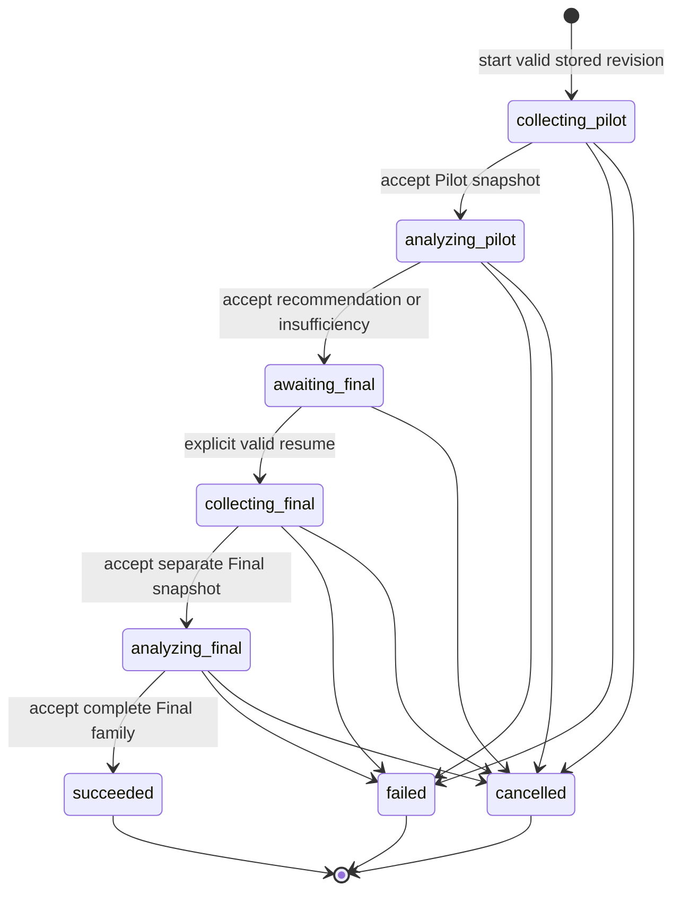
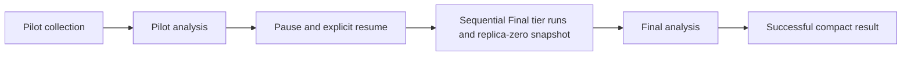
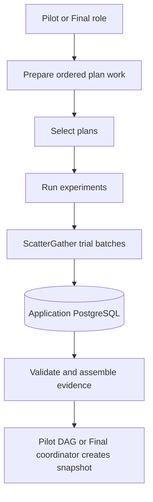

# Evaluation study pipeline

## Status and authority

This document is the implementation authority for the current YAML study lifecycle and the remaining timing design. Application developers are its main audience. Study authors and operators can start with the [study overview](../concepts/evaluation-study-overview.md).

| Boundary                 | Current state                                                                                                                                                      | Remaining work                                                                             |
| ------------------------ | ------------------------------------------------------------------------------------------------------------------------------------------------------------------ | ------------------------------------------------------------------------------------------ |
| Definition and lifecycle | YAML input, immutable normalized revisions, public operations, and explicit pause/resume are implemented.                                                          | No automatic coordinator restart recovery or phase replay is planned for this prototype.   |
| Core outcome path        | Pilot/Final collection and analysis and compact successful results are implemented.                                                                                | Preserve the accepted scientific and lifecycle boundaries.                                 |
| Operational timing       | T1–T4 are implemented: sequential tiers, excluded warm-up, five measured replicas, coordinator elapsed intervals, environment gates, and complete-family equality. | No replacement replica, automatic recovery, or replay.                                     |
| Timing output            | Five measured timing values per tier are validated in memory. Compact-result timing is empty (`null`).                                                             | T5 adds timing summaries, compact-result timing persistence, and the manual timed journey. |

The [methodology](../concepts/evaluation-methodology.md) defines the scientific method. The [vocabulary](../concepts/vocabulary.md) defines shared terms. The [decision history](../history/evaluation-decisions.md) records accepted choices and known limits. Current source contracts define implemented behavior.

Real-study settings, evidence collection, and deployment remain unapproved. Examples approve no scientific values.

## Definition boundary

YAML is the only user input format. It is an input transport, not a second stored authority.

The revision-creation boundary uses `YamlElixir.read_from_string/1` with default string keys. The application does not call `:yamerl` directly. It does not define separate YAML rules for aliases, merge keys, tags, or duplicate keys.

Revision creation has these steps:

1. Read one bounded YAML string.
2. Parse it once.
3. Validate the parsed value with the versioned definition schema.
4. Resolve each graph revision.
5. Store one immutable, normalized, JSON-compatible definition.

The parsed root must be a map with `schema_version`. The schema rejects unsupported versions, missing fields, unknown fields, incorrect types, invalid ranges, and inconsistent scientific settings. A JSON-compatibility check runs before storage.

Only graph revisions have application-owned immutable records and loaders. Other revision strings are bounded caller assertions. They do not create authenticated provenance. Do not add records, resolvers, hashes, or registries for those strings.

The declared study ID and revision number identify one caller-defined revision and must be unique together. The stored study-revision UUID is the application record identity. Creation does not compare content or return an existing revision.

Scientific settings and seeds are required. Deployment resource caps remain external configuration. Work above a cap fails without changing scientific settings. The loader must not fill missing settings with defaults.

Store no source YAML. Execute from the stored definition. Later boundaries validate typed inputs, bindings, and results. They do not parse YAML again.

The checked-in contract is the source of truth for the definition shape:

- [JSON Schema](../../src/priv/evaluation/study/v1/schemas/definition.schema.json)
- [YAML conformance example](../../contracts/evaluation/study/v1/valid/study-small.yaml)
- [Normalized JSON example](../../contracts/evaluation/study/v1/valid/study-small.json)

## Lifecycle ownership

Revision creation is outside the execution lifecycle. `start_study` accepts one stored study-revision ID. An invalid or missing revision creates no execution.

One application state machine owns each study execution. Gust owns work inside fixed phase DAGs. Gust does not own study state.

There is no calibration lifecycle phase. Calibration finishes before revision creation.

A rejected resume request leaves the execution at `awaiting_final`. It does not fail the execution. A validated insufficient Pilot is not a failed analysis.

| State                 | Accepted event or condition                           | Result                                                    |
| --------------------- | ----------------------------------------------------- | --------------------------------------------------------- |
| `collecting_pilot`    | Pilot collection returns a valid snapshot             | Store the accepted references and start Pilot analysis    |
| `analyzing_pilot`     | Pilot returns a valid recommendation or insufficiency | Store the outcome and enter `awaiting_final`              |
| `awaiting_final`      | Explicit resume satisfies the Final gate              | Freeze the selected candidate and start Final collection  |
| `collecting_final`    | Final collection returns a valid separate snapshot    | Store the accepted references and start Final analysis    |
| `analyzing_final`     | Final returns one valid complete family               | Store the successful compact result and enter `succeeded` |
| Any active phase      | The phase fails terminally                            | Store a bounded execution error and enter `failed`        |
| Any nonterminal state | Cancellation is accepted                              | Enter `cancelled`                                         |
| Any terminal state    | A duplicate or late event arrives                     | Keep the terminal state                                   |

### Ephemeral coordinator

The prototype uses one supervised application task to coordinate phases. Gust persists each phase run and owns task retries inside that run. Gust completion callbacks wake temporary waiters, but persisted Gust rows remain authoritative. The application does not add an Oban handoff, polling worker, automatic restart recovery, or phase replay.

Each fixed phase has one application row. It links the execution, phase, accepted snapshot or result reference, and bounded error. Pilot collection and both analysis phases each link one scalar Gust run ID.

Final collection keeps `StudyPhase.gust_run_id` nil. Ordered `StudyPhaseRun` rows link one Gust run per declared tier. Each row records the tier and its position. These rows form one phase-run tier family, not replay attempts.

`start_study` stores the execution and its Pilot collection phase before it starts the coordinator task. The task then:

1. Submits the phase to Gust.
2. Stores the returned Gust run ID.
3. Awaits the terminal Gust result.
4. Validates the typed result.
5. Stores the accepted references and lifecycle transition.
6. Continues with the next phase or stops at `awaiting_final`.

`resume_study` starts a new task for the Final phases. It dispatches and awaits each tier run before starting the next tier. After timing validation and complete-family equality, it creates the replica-zero snapshot outside Gust and starts Final analysis. A task checks the locked execution state before it accepts a result. Snapshot acceptance also locks and checks that state. A completion after cancellation must not revive the execution.

An application restart can leave an active execution without a coordinator. The prototype does not reconnect automatically. The operator cancels that execution and starts a new one. Whole-phase replay and multiple attempts are outside this prototype.

## Fixed phase DAGs

The pipeline uses four checked-in DAG definitions. Final collection instantiates its tier DAG once per tier:

| DAG                                      | Current status | Role                                                                            |
| ---------------------------------------- | -------------- | ------------------------------------------------------------------------------- |
| `evaluation_study_pilot_collection`      | Implemented    | Collect and assemble Pilot evidence                                             |
| `evaluation_pilot`                       | Implemented    | Evaluate declared sample-size candidates                                        |
| `evaluation_study_final_tier_collection` | Implemented    | Collect one tier's warm-up and measured evidence; return a compact tier receipt |
| `evaluation_final`                       | Implemented    | Analyze the complete Final family                                               |

The lower-level comparison and family workflows remain reusable. Phase actions reuse their mathematics. They do not create nested Gust runs for each comparison.

The active lifecycle keeps Pilot and Final submission, await, result, and snapshot functions out of the public `NetworkDefense.Evaluations` facade. The lifecycle uses their modules internally.

The YAML definition supplies ordered work data to checked-in DAGs. It must not generate modules, tasks, source code, or DAG topology. Do not add a workflow framework or DAG compiler.

### Collection boundary

Pilot and Final collection share planning, reservation, and evidence rules but use different DAG actions. Their data boundary is:

The supervised task owns the ephemeral sequence between phases and between Final tiers. Gust owns durable work inside each run, coarse mapped work, and task retries. Pilot snapshot fan-in runs inside Gust. Final complete-family equality and snapshot creation run in the coordinator after all tier runs finish. ScatterGather owns trial batches inside one experiment. Python remains synchronous, stateless numerical computation.

Each declared collection item has one stable application record. A retry reuses its linked optimization run and experiment. The record closes the crash window between a domain effect and Gust task-result storage.

Gust task results contain compact record IDs. Evidence and simulation data remain in application PostgreSQL. Fan-in loads only linked records. It rejects incomplete work and restores declared order before it creates a snapshot.

Pilot collection maps one collection action per item. Final tier runs have separate mapped plan-selection and simulation stages for each replica. Each tier run has fixed warm-up and measured stages, environment checks, synchronous timing markers, and a compact tier receipt. The application enforces a collection-item cap and a shared Gust collection-concurrency cap. ScatterGather retains its existing controls for trial batches. These controls remain separate; the application does not validate a combined Gust × ScatterGather concurrency product at startup.

## Outcome journey

One execution follows this sequence:

1. The author creates an immutable revision from YAML.
2. The author starts an execution from the stored revision ID.
3. Pilot collection creates a Pilot snapshot from persisted plan and trial evidence.
4. Pilot analysis returns a recommendation or insufficiency. The execution always pauses.
5. Explicit resume freezes one declared candidate. Final collection uses separate seeds and evidence.
6. Final analysis calculates every comparison and applies one Holm correction.
7. The lifecycle stores one successful compact result.

Pilot and Final observations never share an evidence snapshot.

## Pilot candidates and Final gate

A Pilot candidate is one ordered item with:

- a stable candidate ID;
- a plan count per side; and
- an attack count per plan.

Do not use separate count arrays or an implicit Cartesian product. Candidate IDs must be unique. Counts must meet the methodology bounds and fit every Pilot comparison on both sides.

For each candidate and comparison, the Pilot:

1. Samples alternative and reference rows independently without replacement.
2. Samples shared attack columns without replacement.
3. Runs the corrected crossed bootstrap inside each outer sample.
4. Takes the declared guard quantile of interval half-widths.
5. Requires informative evidence and the target width.

A candidate passes only when every declared comparison passes. Selection uses the declared runtime rule. The tie-break order is:

1. lower predicted runtime;
2. more plans;
3. fewer attacks; and
4. earlier declared position.

Runtime prediction is a resource heuristic. It is not statistical evidence. Pilot analysis applies no Holm correction. If no candidate passes, the result is `insufficient`. Do not select the largest candidate automatically.

Every definition uses `pilot_to_final.mode: pause`. Final collection never starts automatically.

| Pilot outcome     | Resume rule                                                                 |
| ----------------- | --------------------------------------------------------------------------- |
| `recommended`     | Use the recommended declared candidate and its exact counts                 |
| `insufficient`    | Require one manually selected declared candidate and `pilot_override: true` |
| Failed or invalid | Reject resume                                                               |

An override cannot change the family, counts, or any other frozen scientific setting. Such a change requires a new study revision.

The successful result exposes `pilot_override` for both paths. The override does not change the Pilot outcome. It does not establish that the precision target passed.

## Scientific invariants

Preserve these rules from the methodology:

- Scientific identity is `(tier, budget, alternative, reference, outcome)`.
- The effect is the alternative mean outcome minus the declared reference mean outcome.
- A budget is the maximum number of defense actions, not a required exact plan size.
- Alternative and reference plan rows are independent.
- Every plan in a comparison uses the same ordered attack columns.
- Intervals use the corrected crossed bootstrap.
- Raw p-values use the centered crossed bootstrap with add-one correction.
- Final analysis applies Holm once across the complete declared family.
- Non-informative members remain in that family.
- Fan-in restores declared order.
- Scheduling IDs and completion order do not affect scientific randomness.

Collection seeds and analysis seeds have separate roles. Pilot and Final selection pools and evaluation roots are disjoint.

Every typed optimization request contains one concrete selection seed. The study supplies its declared seed. The dashboard can preserve its Random seed option, but it resolves generation before typed request parsing.

When a role requires `n` plan-selection seeds, use the first `n` seeds in declared order. Do not choose another valid subset. Attack columns follow the existing child-seed policy from each declared tier root.

## Timing — implemented collection and remaining output

Operational T1–T4 integration is complete. It does not change the outcome method. Final collection runs tiers sequentially in the order the comparison family first declares each tier. For each tier, it runs:

- one excluded warm-up with replica position `-1`; and
- five measured replicas with positions `0` through `4`.

Measured work starts only after warm-up succeeds. All replicas use the same scientific inputs. Warm-up supplies neither accepted Final evidence nor measured timing values. The prototype creates no replacement replica after rejection.

The definition supplies the expected measured-environment revision. Application configuration supplies the current observed operator assertion. Each tier run compares them before warm-up and before and after each measured replica. A missing or different assertion fails with a bounded error. This check adds no fingerprint or authenticated provenance.

Synchronous boundary markers let the Final coordinator measure intervals with `System.monotonic_time(:microsecond)` in its own process. Plan selection spans optimization dispatch through completion. Simulation spans experiment dispatch through completion. Total spans optimization dispatch through experiment completion. These elapsed intervals include Gust and ScatterGather wait time. Each interval uses its own boundaries; total is not the sum of the other intervals. The pure interval calculation also supports overlapping spans.

The coordinator validates exactly five measured timing values, in positions `0..4`, for every tier. These values remain memory-only. Raw monotonic readings and Final elapsed intervals are not persisted.

After all tier runs finish, the coordinator reloads detailed PostgreSQL evidence. It builds one non-timing summary for each measured position across the complete declared family. Summaries cover selected plans, graph content, ordered attack histories, capability outcomes, host compromises, and other scientific evidence. Runtime IDs, durations, timestamps, and graph layout do not determine equality.

The coordinator calls the canonical selector once with the five complete-family summaries. All five must match. Only replica `0` supplies the Final snapshot; replicas `1..4` supply timing variation, not additional inferential evidence. Snapshot creation and acceptance run outside Gust, under the lifecycle state gate.

T5 remains: summarize each duration in microseconds with its five measured values, median, minimum, and maximum. Persist those summaries in the compact result and validate read-back. The manual timed journey must also check the resulting summaries and persistence. Until T5, compact-result timing stays `null`.

## Persistence

| Record                    | Purpose                                                                                                      |
| ------------------------- | ------------------------------------------------------------------------------------------------------------ |
| Normalized study revision | Immutable validated definition; no source YAML                                                               |
| Study execution           | Mutable lifecycle state, selected candidate, accepted phase references, and terminal error                   |
| Study phase               | One fixed-phase row with accepted references or bounded error; a scalar Gust run except for Final collection |
| Study phase run           | One Final tier row with declared position and linked Gust run; ordered across the phase                      |
| Collection item           | Stable link to retried optimization and experiment effects                                                   |
| Pilot and Final snapshots | Existing immutable role-specific evidence records                                                            |
| Compact study result      | One immutable successful scientific outcome                                                                  |

A failed or cancelled execution has no compact scientific result. Its execution record exposes its terminal state, bounded error, and accepted phase references.

The successful compact result contains:

| Group        | Data                                                                                    |
| ------------ | --------------------------------------------------------------------------------------- |
| Identity     | Result ID, schema version, study-revision ID, and execution ID                          |
| Pilot        | Accepted collection and analysis run IDs, snapshot ID, and Pilot outcome                |
| Selection    | Candidate ID, counts, and `pilot_override`                                              |
| Final        | Accepted collection and analysis run IDs and snapshot ID                                |
| Timing       | Empty (`null`) until T5 persists per-tier measured values, medians, and observed ranges |
| Inference    | Family identity, method, alpha, family size, and compact comparison results             |
| Reproduction | Declared software and environment revision assertions                                   |
| Metadata     | Insertion time                                                                          |

Compact collection references use ordered `gust_run_ids`. Pilot collection has a one-item list. Final collection has one ID per tier in the same order as its `StudyPhaseRun` rows. Pilot and Final analysis references remain scalar. Result creation and read-back validate the Final tier family against PostgreSQL.

Do not copy evidence matrices into the result. Detailed evidence stays in PostgreSQL snapshots and runtime records. Each comparison keeps its identity, estimate, interval, raw and adjusted p-values, and assessment.

## Verification policy

Use tests for behavior that protects scientific validity, persistence, or phase transitions. Use manual checks for wiring that is easy to observe and cheap to repeat.

Automated checks should include:

- focused unit tests for parsing, definition rules, pure transitions, and deterministic selection;
- repository tests for revision, execution, phase, and result constraints;
- a small number of integration tests for coordinator transitions and collection-item reuse; and
- one recommended journey and one insufficient-override journey.

Manual checks can cover status inspection, cancellation, ordinary failure display, operator-facing API use, and the complete timed journey.

Do not add source-text, AST, schema-layout, helper, or manifest tests. Do not build exhaustive malformed-input or state-pair matrices. Do not duplicate a behavior at unit, integration, and journey levels without a separate risk. Use shared fixtures for common setup and request data.

The implementation plan defines observable EARS behaviors. It does not define an exact test count. Add a reasonable set of unit and integration tests for each risk. A chunk can use manual verification when automation would only repeat lower-level proof. Deployment and real evidence collection require separate approval.
