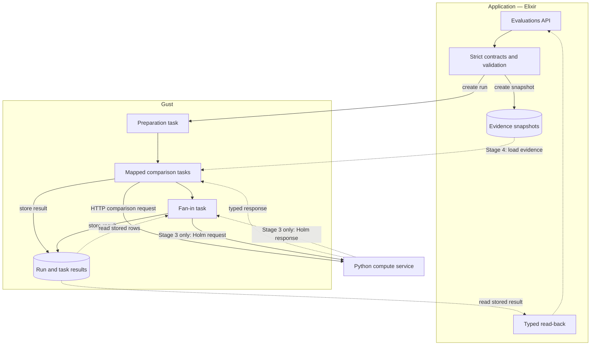
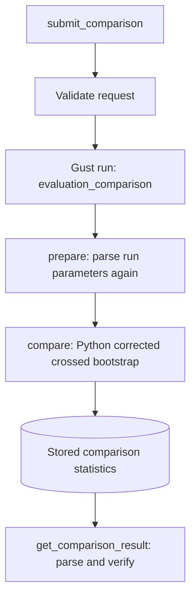
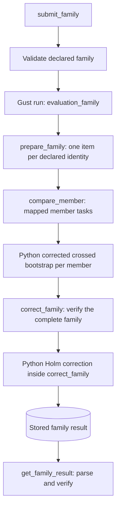
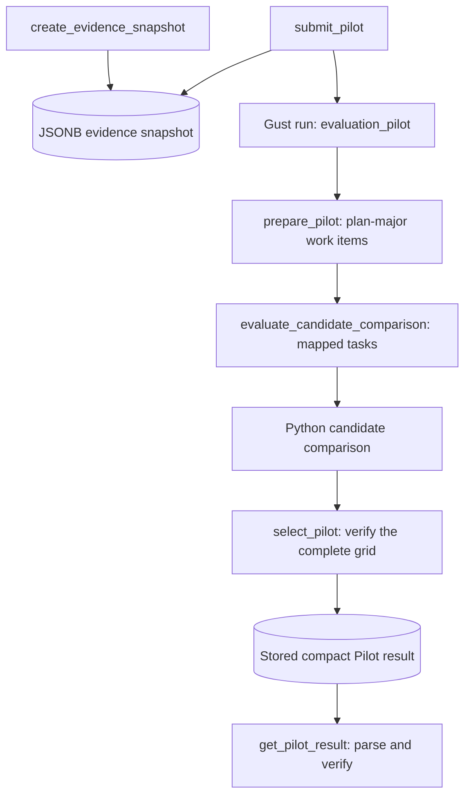

# Evaluation pipeline — implemented map

**Status:** Implemented software map for Stage 2, Stage 3, and Stage 4, merged into `evaluation/rebuild` at `79b152c`. The three workflows passed a synthetic check in the local deployment on 2026-10-19. That check used synthetic evidence and development resource caps. It produced no study result. Scientific settings for a real study remain unapproved.

**Runtime note:** The check is historical. The application, compute, messaging, and observability services are now stopped after an authorised cleanup. PostgreSQL, pgAdmin, their volumes, and the local networks remain. This page does not claim current deployment readiness.

**Authority:** The source files and the checked-in JSON Schemas define the behavior. This page explains how to read them. Read the [preserved methodology](../concepts/evaluation-methodology.md) for the scientific rules. Read the [Stage 4 overview](evaluation-stage-4-overview.md) for the full Pilot contract.

## 1. What the software contains

The repository contains three evaluation workflows. Each workflow has one fixed Gust DAG and one caller-facing Elixir interface.

| Workflow | Gust DAG | Python operation | Stored output |
| --- | --- | --- | --- |
| Stage 2 comparison | `evaluation_comparison` | Corrected crossed bootstrap for one comparison | One comparison statistics record |
| Stage 3 family | `evaluation_family` | One corrected crossed bootstrap per family member, then one Holm correction | One family result |
| Stage 4 Pilot | `evaluation_pilot` | One candidate comparison per candidate and comparison pair | One Pilot result with a recommendation or an explicit insufficiency |

The stage numbers record implementation order. They do not describe an automatic chain. No DAG starts another DAG. A caller starts each workflow and reads its result.

The DAG shapes are:

```text
evaluation_comparison:   prepare -> compare
evaluation_family:       prepare_family -> compare_member (one per member) -> correct_family
evaluation_pilot:        prepare_pilot -> evaluate_candidate_comparison (one per candidate and comparison) -> select_pilot
```

- Stage 3 reuses the comparison calculation inside its mapped tasks. It does not start Stage 2 Gust runs.
- Stage 4 reuses the crossed-bootstrap calculation. It does not run Holm and it does not run the family workflow.
- Stage 4 selects Final sample sizes. It does not collect Final evidence and it does not produce Final results.

The tests and deployed checks use synthetic evidence. The workflows perform no evidence collection. They do not approve a study revision and they do not make a thesis claim.

## 2. System map

Four parts share the work:

- **Elixir application.** It parses requests, validates data, stores Stage 4 evidence snapshots, starts Gust runs, and verifies stored results before it returns them.
- **Gust.** It loads the fixed DAG files, schedules tasks, expands mapped tasks, retries temporary failures, and persists run state, task state, errors, and task results.
- **Python compute service.** It performs one synchronous calculation for one request. It keeps no database, no job registry, and no result store.
- **PostgreSQL.** The application repository holds the Stage 4 evidence snapshots. The Gust repository holds run and task records. Both repositories use the same PostgreSQL database in the local deployment. The separation is logical: separate Ecto repositories, tables, and migration history, not two database services.



Solid arrows show dependency, write flow, and a request. Dotted arrows show a read or a reply. The boxes show logical ownership, not separate physical services. The diagram shows system data flow, not one scheduling DAG. The three focused DAG diagrams below stay acyclic. Stage 2 has one preparation task and one comparison task, with no mapped tasks and no fan-in. The mapped and fan-in shape belongs to Stage 3 and Stage 4.

### Boundaries

- Elixir owns the public contract, evidence persistence, request construction, result verification, and orchestration calls.
- Gust owns dependency order, mapped-task expansion, retries, run state, task state, and task-result persistence.
- Python owns only the numerical calculation for one bounded request.
- Python never reads the application database. Elixir loads evidence and sends the bounded values in the request.
- No layer truncates observations, candidates, comparisons, or repeats. Oversized data fails with a typed error.

The fan-in reads stored task rows from Gust. Only the Stage 3 fan-in sends a request to Python. It extracts the ordered identities and raw p-values from the stored member results and sends them in a typed Holm request. Python has no database access and receives no Gust task objects. The Stage 4 fan-in selects locally from the stored rows and calls nothing.

## 3. Checks at each boundary

A workflow validates its inputs more than once. Each checkpoint protects a different failure.

| Checkpoint | What it checks |
| --- | --- |
| Submission | The caller map matches the checked-in JSON Schema. Strict types apply before Ecto materializes the data, so Ecto coercion cannot hide a wire error. |
| Preparation | The persisted Gust run parameters parse again. The task does not trust earlier validation. Stage 3 and Stage 4 build canonical work items in declared order. |
| Execution | Each mapped task rebuilds its bounded request and validates it before the HTTP call. Python validates again with strict models and rejects unknown fields. |
| Read-back, Stage 2 and Stage 3 | The stored result parses against its schema and each member's contract relations: the interval order, the confidence level, the test alternative, and the statistics method. Stage 3 also checks the expected identities, the family order, the correction method, and alpha. The check does not recompute estimates, p-values, or the Holm correction. A schema-valid change that keeps these relations can pass. |
| Read-back, Stage 4 | The stored result parses, agrees with the request and the snapshot, and the validator re-derives each candidate summary and the recommendation from the stored rows with the shared selection key. A pass or recommendation without row support fails. |

A succeeded run alone is not enough for any workflow.

Stage 4 adds one check before a Gust run exists. `submit_pilot/1` loads the snapshot, checks that the request matches the snapshot, and calls `Pilot.Work.preflight/2`. Preflight builds every candidate request in memory through the same construction and local validation that mapped execution uses. It checks identities, evidence agreement, the request schema, and the candidate-request byte limit under the current Elixir limits. It does not contact Python. It cannot test the remote caps, the combined-work cap, service availability, or a calculation failure. A remote rejection or failure can still occur after the run exists. Preflight stores no matrix.

The two runtimes share one contract source:

- Elixir validates JSON Schema first, then materializes typed Ecto embedded schemas.
- Python validates with strict Pydantic models.
- Checked-in valid and invalid fixtures must produce the same decisions in both runtimes. Contract drift tests compare the shared definitions.

## 4. Identity, ordering, and seeds

### Identity tuple

One comparison identity has five fields:

```text
(tier, budget, alternative, reference, outcome)
```

All five fields together identify a comparison. A family declares its expected identities once. Stage 3 and Stage 4 verify that every expected identity appears once and that no unexpected identity appears.

### Declared array order

Arrays carry meaning:

- `expected_comparisons` declares the family order.
- The first appearance of a tier fixes its tier rank.
- The position of a comparison inside a tier fixes its occurrence index.
- JSON object key order never defines identity or order.

Declared order is the only source of rank and occurrence. Grouping or interleaving the same declarations does not change the derived streams while the first-appearance order of tiers and the occurrence order inside each tier stay the same. A different declared order can assign different streams.

### Work order

Stage 3 maps one member per declared identity. Stage 4 maps one candidate comparison per candidate and comparison pair. Stage 4 orders these items by the declared plan-candidate array order first, then the declared attack-candidate array order, then the declared comparison order. The order is not a numerical sort. The mapped work set is the complete Cartesian product, with no gaps and no duplicates.

For example, with plan candidates `[p1, p2]` and attack candidates `[a1, a2]`, one comparison produces four items in this order:

```text
(p1, a1), (p1, a2), (p2, a1), (p2, a2)
```

The example uses abstract names. It is not a study setting.

### Seeds

Stage 2 requests declare one resampling seed. Stage 3 requests declare one resampling seed for each comparison. Stage 4 derives a stream seed for each declared comparison from the Pilot base seed:

```text
stream_seed = base_seed + tier_rank * 1_000_000 + occurrence_index * 2
```

Stage 4 then creates a candidate-specific root sequence from the stream seed and the candidate counts, spawns one child per outer subsample, and splits each child into a sampling stream and a bootstrap stream. The accepted crossed bootstrap splits its own seed into one interval stream and one null stream. The [methodology](../concepts/evaluation-methodology.md#4-primary-estimand-and-interval) defines the calculation. The [Stage 4 overview](evaluation-stage-4-overview.md#scientific-method) records the fixed child-stream contract.

These inputs must not change a scientific stream:

- Gust task identifiers;
- worker count;
- completion order;
- retry count; or
- database row order.

A retry recalculates the same request. Tests cover grouped tiers, interleaved tiers, retries, completion order, and fixed historical values.

## 5. Evidence shape

A comparison carries two matrices. One side is the alternative strategy. The other side is the reference strategy, which CVSS provides in the study design.

| Dimension | Meaning |
| --- | --- |
| Plan rows | One selected plan. Each row holds one value per shared attack column. |
| Attack columns | One shared attack seed. Both sides use the same ordered columns. |

The two sides sample plan rows independently. Both sides sample the same attack columns. All plans in one crossed comparison must cover the same ordered attack columns. Unequal coverage is rejected, not repaired.

The estimator uses two different resampling operations:

- **Outer subsampling** selects plan rows and attack columns without replacement. It produces the subsamples for the Pilot.
- **Inner bootstrap** resamples rows and columns with replacement inside the accepted crossed bootstrap.

Do not interchange these operations. They estimate different variation.

Two result states stay distinct:

- A **non-informative** comparison has a numerically zero estimate and numerically zero interval limits. The comparison result sets its raw p-value to one. Non-informative evidence blocks Pilot eligibility.
- A **zero-width interval** has numerically equal limits. When the result is informative, the calculation reports the `zero_width_interval` warning. The [methodology](../concepts/evaluation-methodology.md) calls this condition a degeneracy warning. Do not read it as proof of equivalence.

The classification uses the accepted numerical tolerance of the calculation. This page does not repeat the tolerance value.

## 6. Stage 2 — one crossed comparison



1. **Submit.** `submit_comparison/1` parses the request, then starts one Gust run with the request as run parameters. An invalid request creates no run.
2. **Prepare.** The `prepare` task parses the persisted parameters again. It stops the run when they no longer match the contract.
3. **Compare.** The `compare` task sends one synchronous request to the comparison route. It stores the typed statistics with Gust task-result persistence.
4. **Read back.** `get_comparison_result/1` requires a succeeded run. It parses the run parameters and the stored statistics, and it verifies the result relations against the request. The check does not recompute the estimate or the p-value.

The same request and seeds give the same statistics. Tests check this property; it is not a data flow. Stage 2 returns one raw comparison. It does not correct a family, choose sample sizes, or collect evidence. The DAG adapts run parameters to the reusable comparison action. A later workflow can pass prepared inputs to the same action.

## 7. Stage 3 — complete-family Holm correction



1. **Submit.** `submit_family/1` parses the family request: the expected identities plus one comparison request for each identity. It rejects a missing, duplicate, or unexpected member before it creates a Gust run.
2. **Prepare.** `prepare_family` parses the persisted request again and builds one canonical item per declared identity in declared order. It stores the item list as its task result.
3. **Map and execute.** Gust expands `compare_member` once per item. Each mapped task builds its comparison request, calls the reused comparison action, and stores the statistics for its member. The tasks do not start Stage 2 runs.
4. **Fan in.** `correct_family` runs only after every mapped member succeeds. It collects the stored member results, verifies that the set is complete and matches the declared order, and builds one Holm request from the ordered identities and raw p-values.
5. **Correct.** Python applies one Holm correction across the entire declared family. The correction changes p-values only. Estimates and intervals stay per-comparison values. The task stores one family result with raw statistics and adjusted p-values.
6. **Read back.** `get_family_result/1` parses the request and the stored family result. It rechecks the family membership, the declared order, the method and alpha, and each member's contract relations against its request. It does not recompute the Holm adjustment. A succeeded run alone is not enough.

A failed correction stores no family result. A retry repeats only the pure correction call with the same request.

## 8. Stage 4 — Precision Pilot



1. **Store evidence.** `create_evidence_snapshot/1` validates the whole snapshot, then inserts one row in the application database. The row holds the matrices. Gust does not.
2. **Submit.** `submit_pilot/1` parses the request, loads the snapshot, checks that the request matches it, and runs preflight. Only then does it start one Gust run. The run parameters hold identifiers, the candidate grid, the sampling and precision settings, the selection settings, and the expected comparison identities. They hold no matrix.
3. **Prepare.** `prepare_pilot` repeats the whole check from the persisted parameters and stores the flattened candidate and comparison work items. Each item holds identifiers, positions, settings, and the comparison identity. It holds no matrix.
4. **Map and execute.** Gust expands one mapped task per item. Each task loads its comparison from the snapshot, builds one bounded request, and calls the Pilot route. It stores one compact candidate response. The response repeats no matrix.
5. **Fan in.** `select_pilot` runs only after every mapped comparison succeeds. It verifies the complete Cartesian set, stable order, unique rows, and exact request correlation. It then computes each candidate summary and selects a recommendation, or it records explicit insufficiency.
6. **Read back.** `get_pilot_result/1` parses the stored result against the request and the snapshot. It re-derives each candidate summary, the worst guarded half-width, the pass relation, and the recommendation from the stored rows with the shared selection rule. A stored result that claims a pass without support fails the read-back.

### Candidate rules

For each candidate and each declared comparison, the compute service:

1. samples alternative plan rows without replacement;
2. samples reference plan rows independently and without replacement;
3. samples shared attack columns without replacement;
4. runs the shared crossed bootstrap on the subsample;
5. records the interval half-width; and
6. takes the declared guard quantile across the outer samples.

The compute service calls the shared crossed-bootstrap function. That function computes interval draws, centered null draws, and a raw p-value. The Pilot uses only the interval and the informativeness flag. It does not return or persist the p-value, and it applies no correction. A comparison is informative only when every outer subsample is informative. One non-informative subsample makes the whole comparison non-informative.

A candidate summary reports the worst guarded half-width across the family, whether every comparison was informative, and which comparison positions were not informative. A candidate passes only when every comparison is informative and the worst guarded width meets the target.

### Recommendation or insufficiency

- When at least one candidate passes, the result names the recommended candidate and its common plan and attack counts.
- When no candidate passes, the result states `outcome = insufficient` and `insufficient_reason = no_passing_candidate`. The recommendation is empty. Summaries keep the non-informative positions.

The selection rule is one shared key. The selector and the read-back validator both use `PilotResult.selection_key/1`:

```text
(predicted_runtime_ms, -plan_count, attacks_per_plan, candidate_position)
```

The order is: lower predicted runtime, then more plans, then fewer attacks, then the declared candidate position. Predicted runtime is a resource heuristic. It is not a statistical result.

## 9. Public interfaces

### Elixir

`NetworkDefense.Evaluations` is the internal application boundary. Callers receive `{:ok, value}` or `{:error, reason}`.

| Capability | Functions |
| --- | --- |
| Comparison | `submit_comparison/1`, `await_comparison/2`, `get_comparison_result/1` |
| Family | `submit_family/1`, `await_family/2`, `get_family_result/1` |
| Evidence snapshot | `create_evidence_snapshot/1`, `get_evidence_snapshot/1` |
| Pilot | `submit_pilot/1`, `await_pilot/2`, `get_pilot_result/1` |

Two development commands start a workflow and print a summary: `mix evaluation.compare` and `mix evaluation.family`. Stage 4 has no Mix command. Callers use the Elixir functions.

### Python

| Route | Purpose |
| --- | --- |
| `POST /v1/comparisons/corrected-crossed-bootstrap` | One comparison statistics record |
| `POST /v1/families/holm` | One family correction from ordered raw p-values |
| `POST /v1/pilots/candidate-comparisons` | One candidate comparison |
| `GET /health`, `GET /ready` | Service liveness and readiness |

These are internal compute HTTP endpoints. The application calls them. They are not public Phoenix routes and they are not a supported external API.

The service returns the same transport codes for each calculation route:

| Status | Meaning |
| --- | --- |
| `400` | The body is not valid JSON |
| `413` | The body exceeds the byte limit |
| `415` | The media type is not `application/json` |
| `422` | Schema or scientific validation failed |
| `500` | The calculation failed |
| `503` | The service is temporarily unavailable |

## 10. Persistence

### Gust

Gust stores run parameters, run and task state, task errors, and task results. Read-back queries these records rather than trusting process memory.

- The Stage 2 run parameters carry the bounded comparison request, including its evidence matrix.
- The Stage 3 run parameters carry the bounded family request, including one comparison request and its evidence matrix per member.
- The Stage 4 run parameters carry identifiers and settings only. The matrices live in the application snapshot.

Stage 4 is the only workflow with evidence outside Gust. Do not apply that design claim to Stage 2 and Stage 3.

### Evidence snapshots

Stage 4 stores evidence in the application database as one JSONB row. The implemented table is `evaluation_evidence_snapshots`.

- The application exposes create and read operations only. There is no update or patch operation. Changed evidence requires a new snapshot ID.
- Creation validates the document and enforces the configured storage-size cap immediately before the insert.
- Reads trust the persisted PostgreSQL JSONB value. They validate its schema, metadata, relationships, and non-byte resource limits. They do not encode the payload again or infer content integrity from its encoded length.
- Version 1 adds no database immutability trigger, hashing, chunking, paging, or JSONB index. Create and read access are an application rule, not a database enforcement rule.
- `study_revision_id` is a required UUID. No durable study-revision table, foreign-key constraint, or migration order exists yet.

The [Stage 4 overview](evaluation-stage-4-overview.md#jsonb-snapshot-boundary) records the column meanings and the open decisions.

### Retries

Gust owns retries, run state, and task state. The workflows classify failures into two groups:

- **Temporary.** Transport failures and the documented service-unavailable responses become retryable task errors. Gust may run the task again.
- **Permanent.** Documented client errors, invalid success responses, and contract mismatches become permanent task failures. Gust does not retry them.

A retry recalculates with the same scientific inputs and seeds, so a retry must produce the same result. The software does not promise unlimited retries and it does not provide exactly-once computation. Gust `0.1.40` re-arms its retry budget when its coordinator restarts; that behavior is an accepted caveat. The application exposes no Gust worker-count setting.

## 11. Runtime limits and scientific settings

These are different kinds of value.

**Scientific settings** define the study: the candidate grid, target half-width, guard quantile, outer-subsample count, bootstrap replicate count, confidence level, and seeds. The caller declares them in each request. No approved real-study value exists yet.

**Runtime caps** protect the deployment from oversized work. They are configuration, not science.

The Stage 4 Pilot uses two cap sets:

| Owner | Caps | Behavior when missing or malformed |
| --- | --- | --- |
| Elixir application | Ten limits under `NetworkDefense.Evaluation.Pilot.Limits`, supplied by environment variables as an all-or-none set | The snapshot and Pilot paths that need these values return one bounded `configuration_invalid` issue instead of creating a snapshot or a Gust run. Stage 2, Stage 3, and application startup stay usable. |
| Python service | Three caps for outer subsamples, bootstrap replicates, and their product | The Pilot route fails with one bounded `configuration_invalid` issue. The comparison and Holm routes never read these caps. |

A Pilot request above a Python cap returns HTTP `422` with `error.code = validation_failed` and issue code `invalid_analysis_setting`. The check runs before any stream or array allocation. Each diagnostic holds constant text, a field path, and the configured cap. It repeats no request value.

The local deployment passes explicit development caps for a laptop. They are not scientific settings. Source links for the exact fields and values are in the [Stage 4 overview](evaluation-stage-4-overview.md#resolved-implementation-decisions).

## 12. Source map

| Responsibility | Location |
| --- | --- |
| Public Elixir boundary | [`evaluations.ex`](../../src/lib/network_defense/evaluations.ex) |
| Comparison workflow, action, client, contracts | [`comparison/`](../../src/lib/network_defense/evaluation/comparison/) |
| Family workflow, member mapping, fan-in, contracts | [`family/`](../../src/lib/network_defense/evaluation/family/) |
| Pilot preflight, work items, assembly, limits, contracts | [`pilot/`](../../src/lib/network_defense/evaluation/pilot/) |
| Snapshot schema and create/read persistence | [`evidence_snapshot.ex`](../../src/lib/network_defense/evaluation/evidence_snapshot.ex), [`evidence_snapshots.ex`](../../src/lib/network_defense/evaluation/evidence_snapshots.ex) |
| Fixed DAG definitions | [`evaluation_comparison.exs`](../../src/priv/gust/dags/evaluation_comparison.exs), [`evaluation_family.exs`](../../src/priv/gust/dags/evaluation_family.exs), [`evaluation_pilot.exs`](../../src/priv/gust/dags/evaluation_pilot.exs) |
| Wire schemas and fixtures | [`priv/evaluation/`](../../src/priv/evaluation/), [`contracts/evaluation/`](../../contracts/evaluation/) |
| Python routes and contracts | [`api.py`](../../services/evaluation_compute/src/evaluation_compute/api.py) |
| Python comparison, Holm, and Pilot calculation | [`statistics.py`](../../services/evaluation_compute/src/evaluation_compute/statistics.py), [`holm.py`](../../services/evaluation_compute/src/evaluation_compute/holm.py), [`pilot.py`](../../services/evaluation_compute/src/evaluation_compute/pilot.py), [`pilot_limits.py`](../../services/evaluation_compute/src/evaluation_compute/pilot_limits.py) |
| Elixir test suites | [`evaluation`](../../src/test/network_defense/evaluation/), including the comparison files and the [`family`](../../src/test/network_defense/evaluation/family/) and [`pilot`](../../src/test/network_defense/evaluation/pilot/) directories |
| Python test suites | [`tests/`](../../services/evaluation_compute/tests/) |

Each directory holds the authoritative modules. This table is a starting point, not a complete inventory.

## 13. Tests and verification scope

The checks cover more than a successful run:

- contract conformance for valid and invalid fixtures in both runtimes;
- contract drift between shared schema definitions;
- historical sampling and inner-stream values;
- deterministic repeated calculation;
- candidate ordering and the shared selection key;
- non-informative and zero-width result handling;
- persistence tampering that breaks declared relations, which read-back rejects;
- mapped-task retry that repeats only the failed item, and permanent failure that is not retried;
- preflight that prevents an invalid Pilot run; and
- end-to-end Gust integration with a real HTTP client.

The latest runs reported 127 passing Python tests and 650 passing Elixir tests, with two excluded Elixir tests. The Pilot suite also passed on a recreated test database.

The synthetic local deployment check exercised these paths:

- deterministic repeated Pilot runs;
- a Pilot run over zero-impact evidence, which returned explicit insufficiency;
- compact Gust persistence with no matrix;
- rejection without a run for an invalid request;
- a resource-cap rejection with `invalid_analysis_setting`;
- unchanged Stage 2 comparison values; and
- a successful Stage 3 Holm family run.

These results prove the deployed software paths. They are not study findings.

Additional hardening remains open for the deployed Stage 4 Pilot. The project has not run fault injection or restarts during active Pilot runs, parallel-run load, or near-limit valid capacity checks against that deployment. Stage 3 has automated coordinator-restart coverage. These are unstarted deployed checks, not known defects.

## 14. Not implemented

The following work does not exist in the software:

- real evidence collection and the orchestrating study workflow;
- a durable study-revision entity and its foreign key;
- a declarative pipeline definition language;
- one full study lifecycle DAG;
- automatic Pilot-completion-to-collection orchestration;
- automatic integration of evidence collection with Final family analysis;
- secondary reports, dashboards, and exports.

Stage 5 thin Pilot-to-Final wiring through a Final snapshot and the existing comparison/Holm engines is the exception: it is implemented in this worktree but uncommitted. It is not merged, not deployed, and not approved for real-study use. It analyzes evidence that a caller supplies, so it performs no collection and grants no study approval. See the [Stage 5 overview](evaluation-stage-5-overview.md).

Existing simulation and optimization features are not the evaluation collector described here. Stage 3 corrects a synthetic family. It is not Final evidence approval. The [methodology](../concepts/evaluation-methodology.md) states which scientific steps a future stage must still add.

The full study lifecycle stays a design draft with no implementation, and no detailed contract is approved. Collection, lifecycle approval, a study language, deployment, and the real-study authorization, settings, seeds, and caps remain unimplemented or unapproved.

## See also

- [Preserved evaluation methodology](../concepts/evaluation-methodology.md)
- [Vocabulary](../concepts/vocabulary.md#evaluation-and-study)
- [Stage 2 design](evaluation-stage-2-design.md)
- [Stage 3 design](evaluation-stage-3-design.md)
- [Stage 4 overview](evaluation-stage-4-overview.md)
- [Stage integration proposal](evaluation-stage-integration.md)
- [Stage 5 overview](evaluation-stage-5-overview.md) (thin adapter implemented in this worktree, uncommitted)
- [Full study pipeline overview](evaluation-study-pipeline-overview.md) (design draft, unimplemented)
