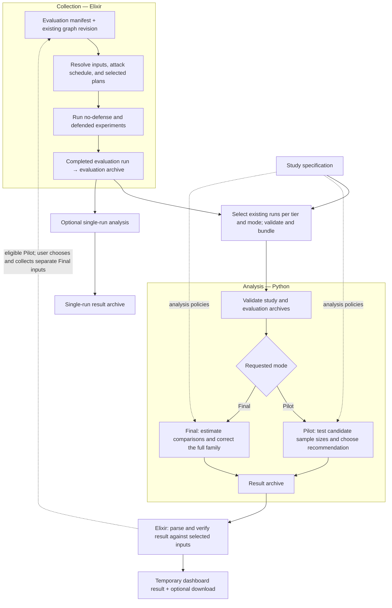
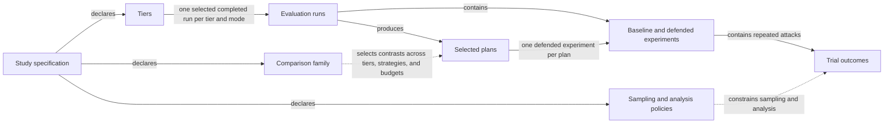
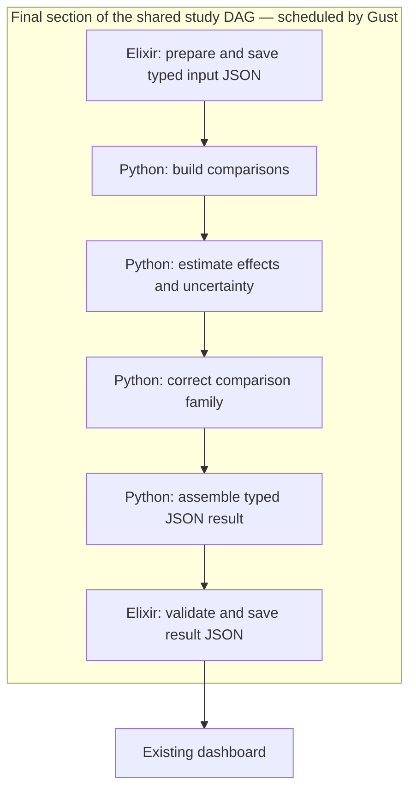

# Evaluation and study pipeline

This map describes the current implementation. It is not a proposed automatic study runner. The design interview is in [grilling-evaluation.md](grilling-evaluation.md).

The goal is to identify which relationships a declarative design must make visible. Distinguish three kinds of relationship:

- **Data flow:** a stage produces input for another stage.
- **Policy:** a declaration constrains or configures a stage.
- **Human handoff:** a person chooses inputs or starts the next operation.

## 1. Current execution flow

Solid arrows show data flow. Dotted arrows show policy or a named human handoff. The Pilot-to-collection arrow is not automatic execution.

### Boundaries that matter

- Collection loads an existing graph revision. It does not generate a new network during analysis.
- The study runner analyzes existing completed runs. A study specification does not currently launch their collection.
- Pilot and Final are separate analysis requests with separate evidence and disjoint seed schedules.
- In the dashboard, an eligible Pilot enables Final input selection. It does not collect Final runs or launch Final analysis.
- CLI and direct service requests do not pass through the dashboard's live-session gate.
- Python reads archives. It does not query the Elixir database or run attack simulations.
- Evaluation data is persisted. Dashboard study results are temporary unless the user downloads them.

The no-defense experiment is not the reference strategy in the study's primary comparisons. The current study uses CVSS as that reference.

## 2. Domain relationships

These arrows show associations, not execution order. A comparison family is a view across evidence; it does not own or generate the plans.

### Two independent dimensions

A selected plan varies by model variant, strategy, budget, and selection seed. Its experiment then repeats attacks. These are different sources of variation.

A comparison must preserve that structure. Treating every trial as an unrelated flat row would lose the plan/attack relationship that the crossed estimator uses.

Runtime repeats are another concern. Warm-ups and timing replicas do not add independent plan or attack evidence. See [evaluation concepts](../concepts/evaluation.md).

## 3. Where declarations would connect

These are observed change points, not an accepted design or library choice.

| Declaration | Relationships it must expose | Current implementation |
| --- | --- | --- |
| Collection recipe | Scenario, plan expansion, attack schedule, baseline, defended experiments | `src/lib/network_defense/evaluation/evaluation_manifest.ex`; `src/lib/network_defense/evaluation/evaluator.ex` |
| Study evidence | Tier labels, selected runs, mode, seed compatibility | `src/lib/network_defense/evaluation/study/study_runner.ex`; `src/lib/network_defense/evaluation/study/study_bundle.ex` |
| Comparison definition | Outcome, reference, alternatives, budgets, tiers, family membership | `evaluation/studies/topology-scale.json`; `evaluation/analysis/src/network_defense_analysis/study.py` |
| Analysis method | Required input shape, estimator, resampling, uncertainty, correction scope | `evaluation/analysis/src/network_defense_analysis/statistics.py`; `evaluation/analysis/src/network_defense_analysis/report.py` |
| Pilot policy | Candidate grid, precision condition, invalid evidence, runtime ranking | `evaluation/analysis/src/network_defense_analysis/study.py` |
| Output definition | Result sections, field types, CSV order, JSON representation, artifacts | `evaluation/analysis/src/network_defense_analysis/report.py`; `src/lib/network_defense/evaluation/analysis/analysis_result.ex` |
| Lifecycle transition | Eligibility, manual approval, separate collection, Final evidence | `src/lib/network_defense/evaluation/study/study_session.ex`; `src/lib/network_defense/evaluation/study/study_runner.ex` |

The key separation is **what a study declares**, **what a step computes**, and **how the application executes or presents that step**.

A schema library can describe valid inputs and outputs. It does not, by itself, describe these workflow relationships.

## 4. Candidate declarative model

The user selected an executable DAG as the design direction. The details below remain proposals, not current behavior:

- Give each step a name, typed inputs and outputs, and an implementation function.
- Declare native Gust dependencies and study-specific policies outside numerical implementations.
- Explain data flow in comments; ordinary task code supplies stage inputs. No data-binding DSL or compiler is selected.
- Store typed input snapshots and results as database JSON. Remove archive-based interchange and use the existing dashboard for presentation.
- Keep simulation and numerical algorithms in normal code.
- Make manual handoffs explicit instead of pretending that every dependency is an automatic trigger.
- Generate the pipeline view from the same declarations used to assemble execution, if the chosen tooling supports this clearly.
- Validate evidence compatibility and required scientific rules before execution. An editable graph alone does not make an experiment valid.

Accepted: study declarations define an executable DAG. The current runtime decision is one scheduler in Gust dispatching registered stages to a persistent Python server. This supersedes the earlier DAG-per-runtime scheduling option. See [the stage-server decision](grilling-evaluation.md#q6--python-stage-server), [the durability assessment](gust-evaluation-review.md), and [the complete provisional stage catalog and REST design](evaluation-stage-integration.md).

### Runtime boundary — accepted direction

This is a proposed architecture, not the current implementation. Accepted grouping: one shared study DAG and one run per study execution. Pilot, the manual Final-input gate, and Final are sections of that run. Specification is input data, not a separate DAG. See [Q12](grilling-evaluation.md#q12--dag-grouping).

The steps below illustrate only the Final section; their exact granularity is not yet agreed. All dependency edges are owned by Gust. Python-labelled nodes execute remotely on the Python stage server.

The Python server is compute-only and stateless. Elixir loads the saved typed JSON snapshot and supplies the data, parameters, and explicit seed policy in the request. Python validates the contract and returns typed JSON in the HTTP response. Python has no operation registry, database dependency, background job state, polling endpoint, or stored-result lookup. See [Q10](grilling-evaluation.md#q10--stateless-python-server).

A Gust task can return the decoded JSON response with `store_result: true`, using Gust's existing PostgreSQL result persistence. A separate Python scheduler, GustPy, data-binding compiler, artifact service, or archive-loading stage is not required. Payload sizes and exact stage granularity still need a representative-data check.

The target removes ZIP creation/loading, archive manifests/checksums, archive-related CSV conversion, result-file adapters, and report packaging/download paths. Typed JSON contracts replace that interchange format. The existing dashboard displays saved result data. Keep scientific compatibility checks, not archive compatibility. See [Q11](grilling-evaluation.md#q11--typed-json-instead-of-archives). Current-flow sections above still describe the existing ZIP-based code, not the target.

Accepted recovery: reuse completed Gust task results and rerun an interrupted stage with the same inputs and seed policy. A lost HTTP response may cause repeated computation; idempotence does not mean execution deduplication. Internal numerical checkpoints are not required initially. See [Q7](grilling-evaluation.md#q7--interrupted-stages). Full recovery across incompatible deployments is deferred; see [Q8](grilling-evaluation.md#q8--deployment-versions). Result persistence and restart behavior remain to be verified in an integration test.

## 5. Evidence for the map

The references below support this review snapshot. The diagrams use conceptual names to avoid copying implementation details.

| Relationship | Evidence |
| --- | --- |
| Resolve graph and shared attack schedule before execution | `src/lib/network_defense/evaluation/evaluator.ex:69-81`, `:394-440` |
| Expand and select plans | `src/lib/network_defense/evaluation/evaluator.ex:439-458`, `:556-625` |
| Baseline and defended experiments use the evaluation inputs | `src/lib/network_defense/evaluation/evaluator.ex:627-704` |
| Export completed, non-warm-up evidence | `src/lib/network_defense/evaluation/output_contract.ex:90-108`, `:329-357` |
| Validate selected tier runs and prepare study evidence | `src/lib/network_defense/evaluation/study/study_runner.ex:188-246`, `:288-322`, `:746-868` |
| Bind tier labels to archive identities and build the bundle | `src/lib/network_defense/evaluation/study/study_bundle.ex:45-102`, `:128-181` |
| Reuse the evaluation loader for each study tier | `evaluation/analysis/src/network_defense_analysis/study.py:172-257` |
| Evaluate Pilot candidates and select a recommendation | `evaluation/analysis/src/network_defense_analysis/study.py:738-842`, `:846-1129` |
| Assemble Final comparisons and correct the full family | `evaluation/analysis/src/network_defense_analysis/study.py:265-328` |
| Verify returned results and Pilot eligibility | `src/lib/network_defense/evaluation/study/study_runner.ex:338-520`, `:670-709` |
| Gate Final selection in the dashboard | `src/lib/network_defense/evaluation/study/study_session.ex:202-229` |
| Separate collection, Pilot, Final, and temporary results | [Evaluation lifecycle](../concepts/evaluation.md) |

No tests, evaluation jobs, or diagram-rendering checks ran for this documentation review.
