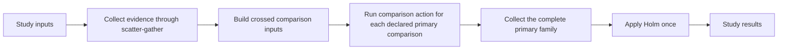
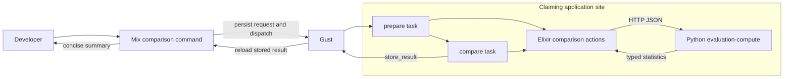
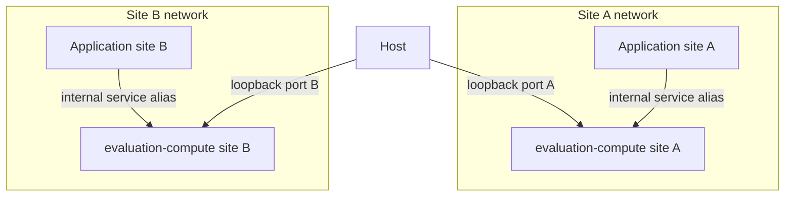
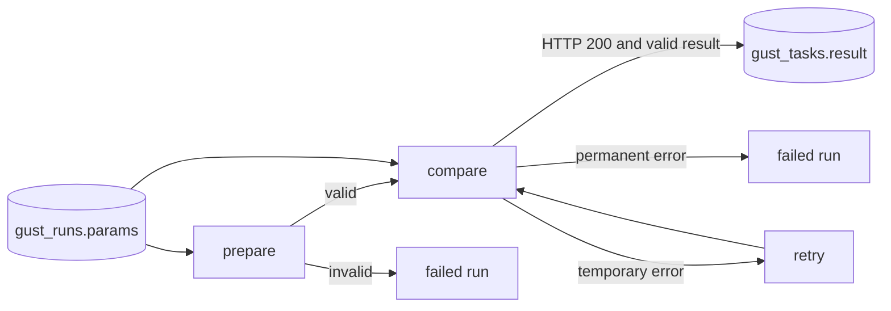

# Stage 2 design — one crossed-comparison prototype

## Status

The user approved this design as the Stage 2 implementation contract. The bounded prototype is implemented and has passed focused and full repository checks. A Terraform-managed demonstration remains gated by plan review and separate approval to apply.

Stage 1 removed the legacy evaluation subsystem. This design does not restore that implementation. It defines one new, bounded path.

## Purpose

Prove this boundary with synthetic evidence:

```text
Mix task → Gust run → Elixir validation → Python HTTP statistics
    → Gust task-result persistence → Mix summary
```

The prototype calculates one alternative-versus-CVSS mission-impact comparison. It does not collect evidence or make a complete study claim.

The existing simulation and optimization paths remain unchanged. Simulation continues to use the current scatter-gather compute layer. This prototype does not invoke it.

## Role in the future single study DAG

The comparison is a reusable action in the future single Gust study DAG. The prototype `evaluation_comparison` DAG is a test harness; it is not a child DAG that the study DAG must call.



The reusable boundary consists of:

- the comparison request, result, and error contracts;
- the Elixir comparison action and HTTP client; and
- the Python corrected-crossed-bootstrap endpoint.

The reusable `compare` action accepts a comparison request in its action arguments. It does not load a Mix fixture or assume that its input is the prototype run's root parameters. The prototype DAG adapts its run parameters to that action. A later study DAG can pass prepared or mapped comparison inputs to the same action.

The future family task consumes every declared primary comparison result and applies Holm once. This prototype returns raw p-values only. It does not implement that family task.

This design does not decide future collection, Pilot, manual-gate, or reporting task boundaries. It only prevents the comparison computation from depending on the temporary prototype DAG.

## Decisions

| Concern | Decision |
|---|---|
| Developer entry point | A Mix task starts the run, waits, reloads the stored result, and prints a summary. |
| Gust DAG | Two tasks: `prepare` then `compare`. |
| Evidence form | One shared attack-seed list and one mission-impact array per plan. |
| Request structure | Four small sections: `Evidence`, `ResamplingSpec`, `IntervalSpec`, and `TestSpec`. |
| Wire validation | Checked-in JSON Schema files are authoritative. Elixir uses pinned ExJsonSchema; Python uses strict Pydantic models. |
| Scientific settings | All settings travel in the request. Runtime configuration contains no scientific defaults. |
| Python API | `POST /v1/comparisons/corrected-crossed-bootstrap`. |
| Python lifecycle | Synchronous and stateless. |
| Stored result | Statistics and the labels needed to interpret them. The result does not repeat evidence, seed, resample count, sample counts, or a digest. |
| Input persistence | Gust stores the complete request in `gust_runs.params`. |
| Result persistence | Gust stores the successful `compare` result in `gust_tasks.result`. |
| Local deployment | One clean Terraform-managed Python container per site. |
| Site routing | Any site can claim the Gust run. The claiming worker uses its site-local service. |
| Host access | Each local service has a distinct port bound to `127.0.0.1`. |
| Observability | Readiness, health, and structured container logs. No telemetry integration in this prototype. |
| UI | None. |

## System shape



Gust schedules the work and persists run state. Elixir owns orchestration and both boundary validations. Python owns the numerical method. PostgreSQL stores the Gust run and task records. No application-specific evaluation table is added.

Use Gust core only. Do not add `gust_web` or mount the Gust dashboard. Application containers run Gust workers. The Mix command uses Gust's console role.

## Local runtime topology



Each application container receives one internal service URL through `EVALUATION_COMPUTE_URL`. The alias is the same on each isolated site network. Host ports are distinct and local-only.

A Gust worker executes a complete run at one site. The comparison does not select a site. Site identity does not enter the scientific request or result.

## Developer interaction

The approved command and DAG names are:

```text
Mix task: mix evaluation.compare --fixture crossed-small
DAG:      evaluation_comparison
Tasks:    prepare, compare
```

Example interaction:

```text
$ mix evaluation.compare --fixture crossed-small
Run: 42
Status: succeeded

Difference: -1.42 (alternative minus CVSS; lower favors alternative)
95% CI: [-2.31, -0.58]
Raw p: 0.014
Assessment: informative

Stored task: compare
```

The command does this:

1. Load a named synthetic fixture.
2. Submit the complete request as Gust run parameters.
3. Dispatch the run.
4. Wait by reading Gust run state from PostgreSQL.
5. Read `compare` with Gust's result lookup API.
6. Format the stored statistics for the terminal.

The command uses Gust's console role. It submits and observes the run but does not claim it. A normal Gust worker claims the run at an available site.

A request that fails public validation creates no Gust run. The command prints the typed error and exits with a nonzero status.

```text
$ mix evaluation.compare --fixture attack-column-count-mismatch
Run: not created
Error: validation_failed
  evidence.alternative.plans[0].mission_impacts: attack_column_count_mismatch
Stored result: none
```

A failure that occurs after submission reads the typed envelope from Gust task-error storage. The command then prints the run ID, failed task, error code, and issue paths. It never prints a successful result for a failed run.

## Gust DAG



### `prepare`

`prepare` is a prototype-DAG Gust action. It:

- loads the canonical run parameters by `run_id`;
- validates them against the canonical request schema again;
- materializes the validated data as Elixir request structs;
- applies crossed-evidence validation;
- checks plan IDs and shared attack-column coverage; and
- returns success without storing a task result.

The public context validates before run creation. `prepare` repeats validation as a durable safety check against a direct Gust insertion, stored-data corruption, or contract/version drift. An invalid persisted request raises Gust's non-recoverable task error. Gust marks the task and run as failed without a retry.

### `compare`

`compare` is a reusable native Gust action. It:

- accepts a raw comparison-request map in its action arguments;
- validates and materializes it through the same contract boundary;
- sends one synchronous HTTP request;
- validates the HTTP result against the Elixir result contract; and
- returns a JSON-compatible statistics map.

In the prototype DAG, the dynamic task declaration loads the request from the persisted run parameters and passes it to the action. The action itself does not query the run. A future mapped study task can pass one prepared comparison map through Gust task parameters.

The DAG sets `store_result: true` for `compare`. Gust persists the returned map. The Mix task reloads it with Gust's native result lookup.

The DAG does not pass hidden process state between tasks. `prepare` validates the durable Gust run parameters. The prototype `compare` task declaration reads those same parameters and passes the request explicitly to the reusable action.

### Retry classification

| Failure | Classification | Gust behavior |
|---|---|---|
| Invalid run input | Permanent | Fail immediately. |
| Python HTTP `400`, `413`, `415`, or `422` | Permanent | Fail immediately. |
| Valid HTTP response with an invalid result contract | Permanent | Fail immediately. |
| Connection failure or timeout | Temporary | Use Gust's normal retry behavior. |
| Python HTTP `500` or `503` | Temporary | Use Gust's normal retry behavior. |
| Retry limit reached | Failed | Persist task error; store no successful result. |

Gust `0.1.40` can execute an ordinary retryable task four times because of its coordinator counter. The reusable `Compare` action only classifies the error and raises the typed retryable exception; it does not query Gust run or task state. The prototype-only `PrototypeCompare` adapter checks the singleton `compare` task attempt and converts the third retryable failure to `Gust.DAG.NonRecError`. This enforces three total attempts in the prototype without coupling the reusable action to a task name or mapped siblings. `Gust.DAG.NonRecError` also disables retries for permanent errors.

### Persisted typed failures

Gust `0.1.40` persists task failures in `gust_tasks.error`, separate from successful `gust_tasks.result`. Its error parser stores exception type, exception message, and stacktrace. It does not preserve custom exception fields.

The comparison adapter therefore serializes one small, versioned failure envelope into the exception message:

```json
{
  "kind": "network_defense.evaluation.comparison_error",
  "version": 1,
  "error": {
    "schema_version": 1,
    "error": {
      "code": "validation_failed",
      "issues": [
        {
          "code": "attack_column_count_mismatch",
          "path": ["evidence", "alternative", "plans", 0, "mission_impacts"],
          "message": "Expected 10 mission-impact values but received 9.",
          "details": {"expected": 10, "actual": 9}
        }
      ]
    }
  }
}
```

`TaskFailure` owns this adapter:

- For a permanent failure, it JSON-encodes the envelope and raises `Gust.DAG.NonRecError` with that message. Gust persists exception type `Gust.DAG.NonRecError`.
- For a temporary failure, it raises `NetworkDefense.Evaluation.Comparison.TaskFailure.RetryableError` with the same encoded message. Gust persists that exact exception type.
- The encoded message is limited to 64 KiB. The 50-issue cap, bounded messages, and safe details keep it within this limit. If encoding or size validation fails, the adapter emits a small `workflow_failed` envelope.
- It never places evidence matrices, stacktraces, URLs with secrets, or raw response bodies in the envelope.

On every failed attempt, Gust writes the parsed exception type/message to `task.error`. If a later retry succeeds, Gust stores the statistics result and clears the prior error. If all three attempts fail, the last typed envelope remains in `task.error`.

`Workflow.failure_for_run/1` reads tasks for the run and selects the originating task with status `failed`, not a downstream task with status `upstream_failed`. It checks the persisted exception type, decodes the message, verifies the envelope kind/version, and strictly parses `ComparisonError`. It ignores Gust's persisted stacktrace for public output.

If a failed task has no valid comparison envelope, the workflow returns a safe `workflow_failed` issue at the empty path. This covers unexpected exceptions, worker-start failures, and corrupt task-error data without exposing exception messages.

The failure sources are:

| Source | Raised form | Persisted public error |
|---|---|---|
| Invalid `prepare` input | `NonRecError` | Original `ComparisonError` |
| HTTP `400`, `413`, `415`, or `422` | `NonRecError` | Validated HTTP `ComparisonError` |
| Invalid success/error body | `NonRecError` | `invalid_response_contract` |
| Connection failure or timeout | `RetryableError` | Local `compute_unavailable` |
| HTTP `500` or `503` | `RetryableError` | Validated HTTP `ComparisonError` |
| Retry exhaustion in prototype | `NonRecError` on attempt three | Last typed envelope |
| Unexpected task exception | Native exception | Safe `workflow_failed` fallback |

A typed failure is never parsed as `ComparisonStatistics` and is never written to the successful result field.

## Python HTTP interface

The service exposes only:

```text
GET  /health
GET  /ready
POST /v1/comparisons/corrected-crossed-bootstrap
```

`/health` reports that the process is alive. `/ready` reports that request models and the numerical module loaded successfully. The service has no external database or other readiness dependency.

The POST request completes synchronously. It does not create a job, operation resource, callback, result URL, file, or artifact.

### Success and failure statuses

| Status | Meaning |
|---|---|
| `200` | The response matches `ComparisonStatistics`. |
| `400` | The body is not valid JSON; return `invalid_json`. |
| `413` | The request exceeds 1 MiB; return `request_too_large`. |
| `415` | The content type is not JSON; return `unsupported_media_type`. |
| `422` | JSON is valid, but the typed request or evidence is invalid; return `validation_failed`. |
| `500` | An unexpected internal calculation failure occurred. |
| `503` | The service cannot perform the calculation at present. |

Errors use the typed error contract below. Internal errors do not return stack traces or internal file paths.

## Request contracts

The API does not accept one large specification map. `ComparisonRequest` is an envelope with one metadata field and four typed sections.

```text
ComparisonRequest envelope
├── schema_version: metadata
├── evidence: Evidence
│   ├── alternative: ComparisonSide
│   │   └── plans: PlanEvidence[]
│   └── reference: ComparisonSide
│       └── plans: PlanEvidence[]
├── resampling: ResamplingSpec
├── interval: IntervalSpec
└── test: TestSpec
```

`schema_version` is envelope metadata. It is not a fifth specification section.

### Wire-name mapping

All public JSON keys use lower snake case. Ecto and Pydantic use the same field names, so neither side defines aliases for these fields.

| Meaning | JSON key | Ecto field | Pydantic field/type |
|---|---|---|---|
| Envelope version | `schema_version` | `:schema_version` | `schema_version` on `ComparisonRequest` |
| Evidence section | `evidence` | `:evidence` | `evidence: Evidence` |
| Resampling section | `resampling` | `:resampling` | `resampling: ResamplingSpec` |
| Interval section | `interval` | `:interval` | `interval: IntervalSpec` |
| Test section | `test` | `:test` | `test: TestSpec` |

Nested keys also map directly, including `attack_seeds`, `mission_impacts`, and `confidence_level`. Enum values use lower snake case. Validation-error paths use these JSON wire names, not Elixir module names or Python class names.

### Valid request

This complete example meets the calibrated minimum of five plans per side and ten shared attack columns.

```json
{
  "schema_version": 1,
  "evidence": {
    "outcome": "mission_impact",
    "attack_seeds": [101, 102, 103, 104, 105, 106, 107, 108, 109, 110],
    "alternative": {
      "strategy": "simulation_informed",
      "plans": [
        {"id": "alt-01", "mission_impacts": [4.1, 3.8, 4.0, 4.2, 3.9, 4.1, 4.0, 3.7, 4.2, 3.8]},
        {"id": "alt-02", "mission_impacts": [4.0, 3.7, 4.2, 4.1, 3.8, 4.0, 3.9, 3.8, 4.1, 3.9]},
        {"id": "alt-03", "mission_impacts": [3.9, 3.8, 4.1, 4.0, 3.7, 4.2, 4.0, 3.9, 3.8, 4.1]},
        {"id": "alt-04", "mission_impacts": [4.2, 3.9, 4.0, 3.8, 4.1, 4.0, 3.7, 4.1, 3.9, 3.8]},
        {"id": "alt-05", "mission_impacts": [4.0, 4.1, 3.8, 3.9, 4.2, 3.8, 4.1, 4.0, 3.9, 3.7]}
      ]
    },
    "reference": {
      "strategy": "cvss",
      "plans": [
        {"id": "cvss-01", "mission_impacts": [5.6, 5.2, 5.4, 5.5, 5.3, 5.6, 5.4, 5.2, 5.5, 5.3]},
        {"id": "cvss-02", "mission_impacts": [5.5, 5.4, 5.3, 5.6, 5.2, 5.5, 5.3, 5.4, 5.6, 5.2]},
        {"id": "cvss-03", "mission_impacts": [5.4, 5.3, 5.5, 5.2, 5.6, 5.4, 5.5, 5.3, 5.2, 5.6]},
        {"id": "cvss-04", "mission_impacts": [5.3, 5.5, 5.2, 5.4, 5.6, 5.3, 5.4, 5.6, 5.2, 5.5]},
        {"id": "cvss-05", "mission_impacts": [5.2, 5.6, 5.4, 5.3, 5.5, 5.2, 5.6, 5.3, 5.4, 5.5]}
      ]
    }
  },
  "resampling": {
    "seed": 700001,
    "replicates": 10000
  },
  "interval": {
    "confidence_level": 0.95
  },
  "test": {
    "alternative": "two_sided"
  }
}
```

### Invalid request

This request uses the same exact wire names. Its first alternative plan has nine values for ten declared attack columns. Other fields are valid so the boundary reports the alignment fault directly.

```json
{
  "schema_version": 1,
  "evidence": {
    "outcome": "mission_impact",
    "attack_seeds": [101, 102, 103, 104, 105, 106, 107, 108, 109, 110],
    "alternative": {
      "strategy": "simulation_informed",
      "plans": [
        {"id": "alt-01", "mission_impacts": [4.1, 3.8, 4.0, 4.2, 3.9, 4.1, 4.0, 3.7, 4.2]},
        {"id": "alt-02", "mission_impacts": [4.0, 3.7, 4.2, 4.1, 3.8, 4.0, 3.9, 3.8, 4.1, 3.9]},
        {"id": "alt-03", "mission_impacts": [3.9, 3.8, 4.1, 4.0, 3.7, 4.2, 4.0, 3.9, 3.8, 4.1]},
        {"id": "alt-04", "mission_impacts": [4.2, 3.9, 4.0, 3.8, 4.1, 4.0, 3.7, 4.1, 3.9, 3.8]},
        {"id": "alt-05", "mission_impacts": [4.0, 4.1, 3.8, 3.9, 4.2, 3.8, 4.1, 4.0, 3.9, 3.7]}
      ]
    },
    "reference": {
      "strategy": "cvss",
      "plans": [
        {"id": "cvss-01", "mission_impacts": [5.6, 5.2, 5.4, 5.5, 5.3, 5.6, 5.4, 5.2, 5.5, 5.3]},
        {"id": "cvss-02", "mission_impacts": [5.5, 5.4, 5.3, 5.6, 5.2, 5.5, 5.3, 5.4, 5.6, 5.2]},
        {"id": "cvss-03", "mission_impacts": [5.4, 5.3, 5.5, 5.2, 5.6, 5.4, 5.5, 5.3, 5.2, 5.6]},
        {"id": "cvss-04", "mission_impacts": [5.3, 5.5, 5.2, 5.4, 5.6, 5.3, 5.4, 5.6, 5.2, 5.5]},
        {"id": "cvss-05", "mission_impacts": [5.2, 5.6, 5.4, 5.3, 5.5, 5.2, 5.6, 5.3, 5.4, 5.5]}
      ]
    }
  },
  "resampling": {
    "seed": 700001,
    "replicates": 10000
  },
  "interval": {
    "confidence_level": 0.95
  },
  "test": {
    "alternative": "two_sided"
  }
}
```

It produces issue path `evidence.alternative.plans[0].mission_impacts` with code `attack_column_count_mismatch`.

### `Evidence`

| Field | Rule |
|---|---|
| `outcome` | Must equal `mission_impact`. |
| `attack_seeds` | Unique, non-negative integers. At least ten values. Their declared order aligns every plan array. |
| `alternative.strategy` | A non-empty strategy identifier other than `cvss`. |
| `reference.strategy` | Must equal `cvss`. |
| `alternative.plans` | At least five plans. |
| `reference.plans` | At least five plans. |
| `plans[].id` | A non-empty identifier, unique within its side. It does not pair rows across sides. |
| `plans[].mission_impacts` | Finite numeric values. The length must equal `attack_seeds`. |

The two sides can have different plan counts. Every row uses the same shared attack columns. Elixir and Python both reject missing, duplicate, or unequal coverage.

Before sampling, the numerical layer orders plan rows by plan ID. It keeps the declared attack-column order. This gives stable row processing without pairing plan rows.

### `ResamplingSpec`

| Field | Rule |
|---|---|
| `seed` | Non-negative integer. It is the deterministic analysis-stream root. |
| `replicates` | Positive integer. It applies to both the interval and the centered null distribution. |

The numerical layer derives separate child streams for the interval and test. Worker identity, retry attempt, task ID, completion order, and site do not affect either stream.

### `IntervalSpec`

| Field | Rule |
|---|---|
| `confidence_level` | Finite number strictly between zero and one. |

The service returns the configured percentile interval from the finite-sample-corrected crossed bootstrap.

### `TestSpec`

| Field | Rule |
|---|---|
| `alternative` | Must equal `two_sided`. |

The service uses the centered crossed bootstrap. It does not implement or claim a permutation test.

## Stored result contract

The successful result contains statistics and the labels needed to interpret them. It does not repeat evidence, the analysis seed, the resample count, sample counts, or a digest. Gust retains those inputs with the run.

```json
{
  "schema_version": 1,
  "method": "corrected_crossed_bootstrap_v1",
  "estimate": {
    "contrast": "alternative_minus_reference",
    "value": -1.42
  },
  "interval": {
    "confidence_level": 0.95,
    "lower": -2.31,
    "upper": -0.58
  },
  "test": {
    "method": "centered_crossed_bootstrap",
    "alternative": "two_sided",
    "raw_p_value": 0.014
  },
  "assessment": {
    "status": "informative",
    "warnings": []
  }
}
```

All numbers must be finite JSON numbers.

`assessment.status` is one of:

- `informative`;
- `non_informative`.

For a non-informative result, the estimated difference and both interval limits are numerically zero. The service returns a raw p-value of one.

A zero-width interval with a nonzero estimate remains `informative` and adds `zero_width_interval` to `assessment.warnings`. This warning does not claim certainty.

The result has no adjusted p-value. It represents one comparison, not a declared Final family.

## Error contract

```json
{
  "schema_version": 1,
  "error": {
    "code": "validation_failed",
    "issues": [
      {
        "code": "attack_column_count_mismatch",
        "path": ["evidence", "alternative", "plans", 0, "mission_impacts"],
        "message": "Expected 10 mission-impact values but received 9.",
        "details": {
          "expected": 10,
          "actual": 9
        }
      }
    ]
  }
}
```

`error.issues` is always a list. Validation failures contain one or more field issues. Transport and system failures contain one issue at the empty path. The service caps the list at 50 entries.

| HTTP status | `error.code` | Issue behavior |
|---|---|---|
| `400` | `invalid_json` | One issue at `[]`. |
| `413` | `request_too_large` | One issue at `[]` with the byte limit. |
| `415` | `unsupported_media_type` | One issue at `[]` with the accepted media type. |
| `422` | `validation_failed` | One or more sorted field issues. |
| `500` | `compute_failed` | One safe issue at `[]`; no exception detail. |
| `503` | `compute_unavailable` | One safe issue at `[]`; no internal dependency detail. |

`path` uses JSON field names and zero-based list positions. An issue message is at most 256 UTF-8 bytes. `details` has at most 16 string keys; each value is a safe scalar or a list of at most 20 safe scalars. Human messages can differ between boundaries; code, path, and details are the stable contract. The service normalizes Pydantic validation errors into this contract. It does not expose Pydantic's raw error representation.

Initial issue codes are:

- `invalid_json`;
- `request_too_large`;
- `unsupported_media_type`;
- `required_field_missing`;
- `unknown_field`;
- `invalid_type`;
- `unsupported_schema_version`;
- `unsupported_outcome`;
- `unsupported_alternative_strategy`;
- `unsupported_reference`;
- `unsupported_test_alternative`;
- `invalid_identifier`;
- `invalid_analysis_setting`;
- `insufficient_plan_count`;
- `insufficient_attack_count`;
- `duplicate_plan_id`;
- `duplicate_attack_seed`;
- `attack_column_count_mismatch`;
- `non_finite_mission_impact`;
- `invalid_response_contract`;
- `compute_unavailable`;
- `compute_failed`;
- `workflow_failed`.

The Elixir and Python boundaries use the same public issue vocabulary. Internal exception classes do not cross the HTTP boundary.

## Parsing and validation design

This stage has no study-wide `StudySpecification`. `ResamplingSpec`, `IntervalSpec`, and `TestSpec` are small operation-request sections. They do not contain collection, Pilot, Final, family-correction, or persistence configuration.

Both boundaries use strict JSON rules. Elixir accepts maps with string keys as produced by `Jason`; it does not accept atom-key convenience input or create atoms from request keys.

- reject unknown fields at every object level;
- reject strings where the contract requires numbers;
- reject booleans as integers or numbers;
- require finite mission-impact and confidence values;
- reject implicit enum or identifier normalization; and
- return detected issues in stable path-and-code order, capped at 50 issues per response.

Identifiers must match the ASCII pattern `[A-Za-z0-9][A-Za-z0-9._:-]{0,127}`. They remain case-sensitive. Plan IDs are unique within a side. The numerical layer sorts plan rows by their exact ID bytes before sampling. It does not pair rows across sides.

### Canonical JSON Schemas

The checked-in schema set is the authoritative wire contract:

```text
contracts/evaluation/comparison/v1/schemas/
├── request.schema.json
├── statistics.schema.json
└── error.schema.json
```

Use JSON Schema Draft 4. It expresses the required contract and lets ExJsonSchema distinguish an integer token from a float such as `1.0`. Use `enum` with one value where a later draft would use `const`. Each object sets `additionalProperties` to `false`. Schemas are self-contained and use local definitions only. Runtime validation must not fetch remote schemas.

The schemas own rules for required fields, JSON types, literals, identifier patterns, ranges, array minimums, unique attack seeds, and unknown fields. They do not express relations between separate fields.

Do not generate Ecto or Pydantic source from these files. Native models remain easy to use in each runtime. Shared conformance examples detect drift between the canonical schemas and those models.

### Elixir parsing pipeline

Use pinned ExJsonSchema for wire validation. Use the existing `NetworkDefense.Contracts` macro and Ecto embedded schemas only to materialize data that has passed schema validation. Do not recreate JSON Schema rules in changesets.

```text
raw JSON/map
    │
    ├── 1-MiB and JSON-compatibility checks
    │
    ├── resolved ExJsonSchema contract
    │     ├── required and exact JSON types
    │     ├── additionalProperties: false
    │     ├── arrays, literals, patterns, and ranges
    │     └── collected structured errors
    │
    ├── Ecto embedded-schema materialization
    │
    ├── crossed-evidence rules
    │     ├── unique plan IDs per side
    │     └── each row length equals the shared attack count
    │
    └── {:ok, %ComparisonRequest{}}
        or {:error, %ComparisonError{issues: [...]}}
```

`SchemaValidator` declares each checked-in schema as an Elixir external resource, reads and resolves it at compile time, and stores the resolved root in the compiled module. A release therefore does not depend on the repository layout or runtime file access. A missing or invalid schema fails compilation, not request validation.

One comparison-local preflight recursively rejects non-string map keys before Jason can normalize atom keys. This check exists only because `submit_comparison/1` also accepts an Elixir map rather than raw JSON bytes. All string-key and unknown-field rules belong to ExJsonSchema.

`SchemaValidator` also contains one bounded error adapter. It converts ExJsonSchema's structured error type and fragment path to the stable public issue code, list path, and safe details. It decodes JSON Pointer escapes, sorts issues by path and code, and returns at most 50 issues. It does not expose library messages as stable contract data.

The adapter uses schema keyword plus contract path. This is a closed mapping, not per-field parsing:

| Schema failure | Public issue code |
|---|---|
| `required` | `required_field_missing` |
| `additionalProperties` | `unknown_field` |
| `type` | `invalid_type` |
| Root version `enum` | `unsupported_schema_version` |
| Outcome `enum` | `unsupported_outcome` |
| Alternative-strategy exclusion | `unsupported_alternative_strategy` |
| Reference-strategy `enum` | `unsupported_reference` |
| Test-alternative `enum` | `unsupported_test_alternative` |
| Identifier `pattern`, `minLength`, or `maxLength` | `invalid_identifier` |
| Attack-seed `uniqueItems` | `duplicate_attack_seed` |
| Attack-seed `minItems` | `insufficient_attack_count` |
| Plan-list `minItems` | `insufficient_plan_count` |
| Scientific numeric bound | `invalid_analysis_setting` |

Unrecognized validator failures fail closed as `workflow_failed` in Elixir or `compute_failed` in Python and are logged without request data. They do not invent a new public code at runtime.

`ComparisonRequest.parse/1` is the single Elixir entry point for raw maps. It invokes `SchemaValidator`, materializes the validated map through the Ecto embedded schemas, and applies one comparison-local crossed-evidence function. A materialization failure after schema success is an internal contract defect, not a second set of public field rules.

Validation responsibility is limited as follows:

| Rule type | Implementation |
|---|---|
| Required fields, exact JSON types, unknown fields, literals, patterns, lengths, uniqueness, and ranges | Canonical JSON Schema through ExJsonSchema; strict Pydantic models |
| Non-string Elixir map keys | One pre-encoding boundary check; not a JSON rule |
| Plan-ID uniqueness and shared-column alignment | One comparison-local crossed-evidence function per language |
| Response interval ordering and request echoes | One small Elixir result-relation check |
| Typed Elixir data | Ecto embedded-schema materialization after validation |
| Public error conversion | One bounded library-error adapter per language |

Do not add per-field parser functions or repeat schema constraints in Ecto changesets. Do not add model generation, a binding DSL, or a project-specific validation framework.

The Mix task enforces the 1-MiB file limit before `Jason.decode/1`. For any caller-supplied map, `submit_comparison/1` first rejects non-string keys. It then JSON-encodes the map to iodata and rejects it when the encoded size exceeds 1 MiB or a value is not JSON-compatible. The encoded bytes are used only for compatibility and size checks; the function validates the original caller map. It never decodes the bytes into a normalized replacement map. Atom keys or enum values therefore cannot become accepted strings through Jason. The function validates against the canonical request schema, materializes the typed request, applies crossed-evidence rules, and serializes it through the explicit wire encoder. It checks the canonical encoding against the same size limit before it persists that map.

Gust actions validate the persisted canonical map again. `prepare` and `compare` therefore use the same schema validator and materializer. `compare` sends the explicit wire encoding; it does not send `Map.from_struct/1` output or internal Ecto metadata.

For an HTTP `200`, Elixir validates the decoded body against `statistics.schema.json` and materializes `ComparisonStatistics`. A small result-relation check requires `interval.lower <= interval.upper` and requires the returned confidence level and test direction to match the request. Elixir does not recalculate the estimate, interval, p-value, or numerical tolerance.

For an HTTP error, Elixir validates the decoded body against `error.schema.json`. An invalid success or error body becomes `invalid_response_contract`. The 64-KiB response limit applies before JSON decode.

### Python parsing pipeline

Use Pydantic models with `ConfigDict(extra="forbid", strict=True)`. These models implement the canonical wire rules with native Python types; the shared examples verify parity with the checked-in schemas.

Define one reusable `JsonFiniteNumber` type alias as a union of a strict integer and a strict float with non-finite values disabled. Use this alias for every request or result field whose JSON Schema type is `number`. It must accept JSON integer and floating-point values, reject booleans, and reject NaN and infinity. The numerical service converts accepted values to its required array dtype after validation; the wire model does not force an integer token through a strict-float field.

Use Pydantic built-in constrained and literal types for local rules:

- `Literal[1]` for `schema_version`;
- literal values for `mission_impact`, `cvss`, and `two_sided`;
- strict non-negative or positive integers for seeds and replicates;
- `JsonFiniteNumber` plus bounds for mission impact and confidence;
- minimum list lengths for plans and attack seeds; and
- the shared ASCII identifier pattern.

After Pydantic parses local field rules, one comparison-local evidence function checks plan-ID uniqueness and shared-column alignment. It returns `ComparisonIssue` values directly, which permits the exact plan path for an alignment fault. `api.py` normalizes both Pydantic failures and these domain issues to `ComparisonError`; it does not return FastAPI or Pydantic's default error body.

After validation, the application service sorts plan rows, constructs the two numerical matrices, derives child random streams, calls the pure statistics module, and constructs `ComparisonStatistics`. FastAPI validates the response model before serialization.

### Shared conformance examples

Do not generate Ecto or Pydantic source from the schemas. Both runtimes implement native typed models and execute the same JSON examples:

```text
contracts/evaluation/comparison/v1/
├── schemas/
│   ├── request.schema.json
│   ├── statistics.schema.json
│   └── error.schema.json
├── valid/
│   ├── crossed-small.request.json
│   ├── integer-number.request.json
│   ├── informative.statistics.json
│   └── validation.error.json
└── invalid/
    ├── attack-column-count-mismatch.request.json
    └── attack-column-count-mismatch.expected.json
```

Each invalid expected file contains HTTP status plus ordered issue codes, paths, and safe details:

```json
{
  "http_status": 422,
  "issues": [
    {
      "code": "attack_column_count_mismatch",
      "path": ["evidence", "alternative", "plans", 0, "mission_impacts"],
      "details": {"expected": 10, "actual": 9}
    }
  ]
}
```

Add JSON examples for missing, unknown, wrong-type, duplicate, minimum-count, literal, and alignment failures. `integer-number.request.json` includes at least one integer-valued mission impact and must pass both boundaries. Add direct boundary tests for malformed JSON, oversized input, non-JSON Elixir values, atom keys, and non-finite Python values because those cases cannot be valid JSON fixture documents. Both language suites must produce the same code/path result for every shared example.

Conformance coverage is keyword-complete for the selected schema set. For every use of `type: number`, `type: integer`, `required`, `enum`, `not`, `uniqueItems`, `additionalProperties`, numeric bounds, string bounds or patterns, and array limits, include valid and invalid boundary cases. This is the acceptance check for parity between the canonical schemas, Ecto materialization, and Pydantic models. A few representative examples are not sufficient.

The Mix task resolves fixture names through an explicit fixed map. `crossed-small` points to the valid request. `attack-column-count-mismatch` points to the invalid request for the failure demonstration. The task accepts no arbitrary path. This keeps demonstration inputs and cross-runtime conformance examples identical.

This prototype does not create TypeScript models because it has no UI.

## Numerical ownership

Python alone implements:

- alternative mean minus CVSS mean;
- shared attack-column resampling;
- independent plan-row resampling;
- the documented finite-sample correction;
- the percentile interval;
- the centered null bootstrap;
- the add-one two-sided raw p-value;
- non-informative detection; and
- the zero-width warning.

Elixir does not recalculate statistics. It validates contracts, calls the service, and persists the returned result through Gust.

## Configuration ownership

### Scientific request

The request owns:

- outcome;
- evidence and its identities;
- analysis seed;
- resample count;
- confidence level; and
- test direction.

Terraform and application configuration must not override these values.

### Application runtime

The Elixir runtime owns:

- `EVALUATION_COMPUTE_URL`;
- a 2-second HTTP connection timeout;
- a 60-second HTTP response timeout;
- a 64-KiB maximum response size; and
- a 240-second Mix command wait limit.

The polling interval is an internal implementation detail. It must not create busy waiting or change Gust state.

### Python runtime

The Python container owns:

- bind host and port;
- a 1-MiB maximum request size;
- worker count;
- log level; and
- shutdown timeout.

A worker count change must not change numerical output.

## Clean Terraform module

Use a new module such as `infra/modules/local/evaluation_compute/`. Do not restore `infra/modules/local/analysis/`.

The module follows current local conventions:

- build a pinned Python image from the new service source;
- include source and dependency-lock hashes in the image trigger;
- create one container for each declared site;
- attach each container only to its site network;
- use one stable site-local alias;
- bind one distinct host port per site to `127.0.0.1`;
- set `restart = "unless-stopped"`;
- wait for a bounded readiness check;
- use no persistent volume; and
- return structured logs through stdout and stderr.

### Proposed module inputs

- `name_prefix`;
- `source_path`;
- declared sites;
- site network names;
- container image name or tag;
- container port;
- host-port map by site;
- request-size limit;
- process count; and
- log level.

### Proposed outputs

- container names by site;
- internal service URLs by site;
- loopback service URLs by site; and
- image ID.

The local root passes each site-specific internal URL to the matching application container. The app module exports it as `EVALUATION_COMPUTE_URL`.

The old ZIP limits, extraction paths, artifact directories, report outputs, analysis names, and compatibility configuration remain deleted.

Terraform does not need a secret for this loopback/site-network-only prototype. No service token is introduced.

## Context and module layout

The public context follows the current plural context convention:

```text
NetworkDefense.Evaluations
├── submit_comparison/1
├── await_comparison/2
└── get_comparison_result/1
```

- `submit_comparison/1` accepts a map, recursively rejects non-string keys, enforces JSON compatibility and the 1-MiB encoded limit, strictly parses it, converts the typed request to its canonical wire map, persists only that accepted map, dispatches `evaluation_comparison`, and returns `{:ok, run_id}`. Key-type, size, JSON, or contract failures return `ComparisonError` before run creation. DAG lookup, persistence, or dispatch failures return a safe `workflow_failed` error.
- `await_comparison/2` reads durable Gust run state until success, failure, or the caller's timeout. It returns `{:ok, :succeeded}`, `{:error, %ComparisonError{}}`, or `{:error, :timeout | :not_found}`. On failure it uses `Workflow.failure_for_run/1`.
- `get_comparison_result/1` first checks run state. For a succeeded run, it reads the stored `compare` result and parses `ComparisonStatistics`. For a failed run, it returns the decoded `ComparisonError`. For any active state, it returns `:not_ready`. It never parses a failure as statistics.

The context does not expose `Gust.Flows.Run`, task structs, or the HTTP client. The Mix task composes these three public functions and formats the result.

### Elixir modules

```text
src/lib/network_defense/evaluations.ex

src/lib/network_defense/evaluation/comparison/
├── workflow.ex
├── client.ex
├── wire.ex
├── schema_validator.ex
├── task_failure.ex
├── result_formatter.ex
├── contracts/
│   ├── comparison_request.ex
│   ├── evidence.ex
│   ├── comparison_side.ex
│   ├── plan_evidence.ex
│   ├── resampling_spec.ex
│   ├── interval_spec.ex
│   ├── test_spec.ex
│   ├── comparison_statistics.ex
│   └── comparison_error.ex
└── actions/
    ├── prepare.ex
    ├── compare.ex
    └── prototype_compare.ex

src/priv/gust/dags/
└── evaluation_comparison.exs

src/lib/mix/tasks/
└── evaluation.compare.ex
```

Responsibilities are narrow:

- `NetworkDefense.Evaluations` is the only public application context.
- `Workflow` contains the Gust adapter and polling/result lookup.
- `Client` owns Req configuration, limits, status classification, and typed response parsing.
- `Wire` owns explicit request/result/error map encoding. It contains no validation rules.
- `SchemaValidator` owns resolved local schemas, ExJsonSchema calls, issue normalization, sorting, and the 50-issue cap.
- `TaskFailure` owns the bounded exception-message envelope and persisted Gust error decoder.
- Contract modules own Ecto embedded schemas and materialization. Their changesets do not repeat wire constraints.
- `ComparisonRequest` owns parser orchestration and the crossed-evidence rules that the schema cannot express.
- `Prepare` adapts the prototype run input to validation and permanent failure handling.
- `Compare` accepts the comparison request in `execute/2` arguments, parses it, calls the client, and returns statistics. It does not query Gust run or task state.
- `PrototypeCompare` delegates to `Compare` and enforces the harness's three-attempt limit for its singleton task. Future mapped study tasks use `Compare` directly.
- `ResultFormatter` produces terminal text only. It does not alter stored statistics.
- The Mix task handles options, known-fixture lookup, application startup, output, and exit status.

The Gust DAG source contains a literal `use Gust.DSL` declaration because Gust rereads and recompiles DAG source at execution. Reusable action modules remain compiled Elixir modules.

### Python modules

```text
services/evaluation_compute/
├── pyproject.toml
├── uv.lock
├── Dockerfile
├── src/evaluation_compute/
│   ├── api.py
│   ├── run.py
│   ├── logging_config.py
│   ├── service.py
│   ├── error_mapping.py
│   ├── statistics.py
│   └── contracts/
│       ├── types.py
│       ├── request.py
│       ├── evidence.py
│       ├── specs.py
│       ├── result.py
│       └── errors.py
└── tests/
```

- `api.py` owns FastAPI routes, body limits, exception handlers, and HTTP status mapping.
- `run.py` configures and starts Uvicorn.
- `logging_config.py` emits JSON logs and permits only safe structured comparison fields.
- `service.py` converts validated models to canonical matrices and builds the typed result.
- `statistics.py` is a pure numerical module. It imports no FastAPI or Terraform code.
- `error_mapping.py` converts framework errors to stable public issues.
- `contracts/` contains Pydantic models and the shared declarative `JsonFiniteNumber` alias only. It contains no numerical-method code.

### Shared and infrastructure paths

```text
contracts/evaluation/comparison/v1/
├── schemas -> ../../../../src/priv/evaluation/contracts/v1/schemas
├── valid/
└── invalid/

src/priv/evaluation/contracts/v1/schemas/
├── request.schema.json
├── statistics.schema.json
└── error.schema.json

infra/modules/local/evaluation_compute/
└── *.tf
```

The logical shared schema path is a relative symlink to the release-packaged source. This keeps one physical checked-in schema set while preserving the cross-runtime contract path.

No module is named `manager`, `utils`, or `common`. Do not add a generic operation registry, schema compiler, repository abstraction, or shared base model unless the prototype has a concrete repeated need.

## Contract-validation dependency

Pin the exact Hex release `ex_json_schema` `0.11.5`, checksum `61ed2a8f07bd115e7ab6d45c147642a8c73b962bc419fadbb248046b9d3d0f20`.

ExJsonSchema is the only new Elixir wire-validation library in this prototype. It supports the selected Draft 4 contract, returns collected structured errors with fragment paths, and resolves a schema once for repeated validation. Its required `decimal ~> 3.0` dependency is already present through Ecto. Do not add Xema, Peri, OpenApiSpex, or a Rust NIF validator.

Load only the checked-in schemas. Do not enable runtime remote-schema retrieval. `SchemaValidator` marks the files as external resources and resolves them during compilation. Missing or invalid contract files must fail compilation.

Before implementation depends on the library behavior, focused contract tests must confirm:

- booleans do not satisfy integer or number fields;
- `1.0` does not satisfy a Draft 4 integer field;
- nested validation collects more than one issue;
- unknown-property errors retain the property location;
- fragment paths with JSON Pointer escapes normalize correctly; and
- the adapter enforces deterministic ordering and the 50-issue cap.

If these checks fail, stop and review the library choice. Do not compensate with a second field-validation framework.

## Gust dependency

Pin the exact Hex release `gust` `0.1.40`; do not use an open version range. The Hex release exists with checksum `1e816d237a77a0f026a85cd23d635ac06daec98fc9888b52ce903e678df4544a`.

A read-only comparison confirmed that its reviewed DSL, action, flow/result, persistence, and retry source files match Git commit `23fc8361482c2f85169c89a384d3a5ee73c2f317`. Keep the lockfile as the package integrity record.

Gust `0.1.40` requires `dns_cluster ~> 0.3.0`. Stage 2 updates the application's direct constraint from `~> 0.2.0` to `~> 0.3.0`.

Gust owns the shared `DNSCluster` process. It reads the query from `DNS_CLUSTER_QUERY`. `NetworkDefense.Application` must not start a second default-named `DNSCluster` child. A second child causes application startup to fail when the query is not `:ignore`. Deployment checks must confirm that one process is registered and that nodes discover their same-site peers.

Gust supplies Req transitively and accepts the currently locked Req `0.6.3`. The application must declare Req directly because the comparison client calls its public API.

Configure `Gust.Repo` to use the same physical PostgreSQL database as `NetworkDefense.Repo`, with Gust's separate `gust_schema_migrations` history and `gust_*` tables. Run both migration sets on a fresh database. Do not create an application-specific comparison table or a second database.

Use Gust's default database-polling dispatcher for this prototype. Do not add the optional PostgreSQL notification path or its extra connection.

### Explicit Gust runtime roles

The existing application `ROLE` remains `api` or `worker`; it continues to control Network Defense behavior. `GUST_ROLE` is a separate environment variable.

Terraform sets these values for **every** application node:

```text
GUST_ROLE=core
EVALUATION_COMPUTE_URL=http://evaluation-compute:<container-port>
```

This applies to both `ROLE=api` and `ROLE=worker`. In Gust `0.1.40`, `core` starts the run dispatcher, DAG loader, leader, and task/run supervisors without adding `gust_web`. Therefore, any application node can claim a run and use the compute container on its own site network. Do not rely on Gust's default `single` role.

Configure `:gust, :dags_folder` to the packaged `network_defense` `priv/gust/dags` directory. Because Gust is an OTP dependency, it starts `Gust.Repo` and its role-specific children during application startup. The DAG folder must exist in development and in the release image.

The Mix task uses the `app.config` requirement to load `runtime.exs`. It must not use an `app.start` requirement. The task sets `GUST_ROLE=console` before it starts applications. It then loads the DAG definition, creates and dispatches the run, polls durable run state, and reads the stored task result. Gust's `console` role starts its base services and DAG loader but no run dispatcher or task runner. Thus, the command observes the run without claiming it.

The Terraform app module adds `GUST_ROLE` and the site-specific internal compute URL to the existing per-node environment list. It does not replace `ROLE`. Host loopback URLs exist for direct health and HTTP contract checks; Gust actions use the internal URL.

## Data ownership and persistence

| Data | Owner and location |
|---|---|
| Complete request | Gust run parameters in PostgreSQL |
| Run and task status | Gust tables in PostgreSQL |
| Successful statistics | `compare` task result in Gust |
| Failure details | Versioned `ComparisonError` envelope in Gust task-error message |
| Python state | None after the response completes |
| Files and artifacts | None |

A retry can recompute the request. The same request and seed must return the same statistics. This is deterministic recomputation, not execution deduplication.

## Security and limits

- Listen on the site network and loopback only.
- Do not publish on all host interfaces.
- Enforce a small configured JSON body limit.
- Reject non-JSON content types.
- Do not log complete evidence matrices at normal log levels.
- Log method, duration, response status, and safe validation codes.
- Do not return stack traces.
- Use no shell commands, uploaded files, or dynamic operation names.

## Verification design

Implementation acceptance requires:

1. Contract tests for every canonical request/statistics/error schema and native model in both languages, including public rejection before Gust persistence. The parity matrix must cover every used schema keyword and its boundary values, including integer-valued JSON numbers, strict integers, booleans, alternative-strategy `not`, uniqueness, unknown fields, bounds, patterns, and array limits. Add Elixir-only tests for ExJsonSchema's strict type and path behavior and for atom-key rejection before Jason encoding.
2. Python numerical tests against independently specified small matrices.
3. Tests that distinguish shared attack columns from independent plan rows.
4. Deterministic recomputation tests that call Python twice, not a cached Gust result twice.
5. Non-informative and zero-width warning tests.
6. HTTP tests for `200`, `400`, `422`, and safe `500` behavior.
7. A Gust integration test that bypasses the public context, inserts invalid run parameters directly through Gust's test boundary, and proves `prepare` fails without a retry or successful result.
8. Gust tests that prove `compare` stores its successful result.
9. Gust tests that prove permanent and exhausted-retry failures preserve and decode typed issue code/path/details while successful retries clear old errors.
10. A real local run through Terraform-managed Python, Gust, PostgreSQL, HTTP, and native result read-back.
11. Existing graph, simulation, optimization, frontend, Elixir, and Terraform checks.

The real demonstration must show:

- public rejection of an oversized or invalid request before a Gust run is created;
- the canonical validated Gust run parameters for an accepted request;
- task status transitions;
- a stored statistics result read through Gust;
- identical statistics from a second computation with the same input and seed; and
- no successful result for invalid attack alignment.

## Explicit exclusions

- Simulation or optimization execution inside Python.
- Replacement of the existing scatter-gather layer.
- Live evidence collection.
- Study specifications or configuration references.
- Precision Pilot or Final workflows.
- Holm correction or any complete-family claim.
- Dashboard or generated TypeScript work.
- Python jobs, callbacks, polling, databases, files, or artifacts.
- Legacy ZIP, archive, CSV, or report contracts.
- Production deployment and site-affinity scheduling.

## Terraform plan and apply gate

Implementation can create and validate a Terraform plan. It must show the plan summary to the user before any apply. A separate explicit approval is required to apply it. A destroy is never implied by approval to apply.

The real Gust/HTTP demonstration occurs only after the reviewed plan is applied. If the user does not approve the apply, verification stops at Terraform validation and plan review.

## Current approval point

The user approved the design, and implementation review reports no blockers. A Terraform plan has been reviewed and now awaits the user's separate apply decision. Before any approved apply, the local state location must be selected explicitly and the plan must be regenerated against that state.
