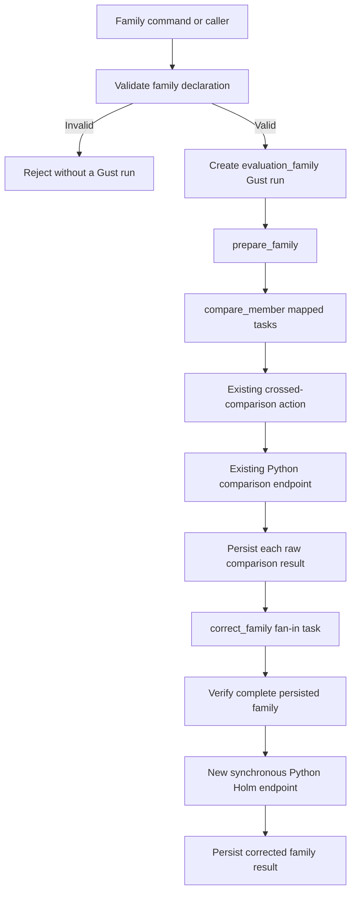

# Evaluation Stage 3: complete-family Holm pipeline

**Status:** Proposed design. No Stage 3 code exists.

## Purpose

Stage 2 calculates and stores one crossed comparison. Stage 3 will compose that operation across one declared primary family. It will then apply one Holm correction to all raw p-values in that family.

This stage is a bounded synthetic prototype. It will prove the family boundary and the runtime path. It will not collect evidence or produce thesis results.

## Design summary

The pipeline will:

1. accept an ordered family declaration and one comparison request for each declared identity;
2. reject incomplete or inconsistent declarations before it creates a Gust run;
3. use Gust `map_over` to run the existing comparison action once for each family member;
4. wait for all mapped comparisons;
5. verify the complete family again from persisted Gust task data;
6. send the ordered identities and raw p-values to one synchronous Python Holm operation;
7. combine the adjusted p-values with the stored comparison statistics; and
8. persist one typed family result in the final Gust task.

Holm changes p-values only. It does not change estimates or confidence intervals. The intervals remain per-comparison intervals.

## Fit with Stage 2

Stage 3 adds one layer above the accepted Stage 2 comparison path.



The following Stage 2 parts remain unchanged:

- the comparison request contract;
- the comparison statistics contract;
- `Comparison.Actions.Compare`;
- the corrected crossed-bootstrap calculation;
- the comparison HTTP endpoint;
- the single-comparison Gust DAG;
- the single-comparison workflow and command; and
- the Gust-only console role.

The family pipeline will not put family identity fields inside the comparison request. The current request schema rejects unknown fields. The statistical comparison operation also does not need tier or budget labels.

## Implementation dependencies

Stage 3 depends on these accepted Stage 2 parts:

- `Comparison.Actions.Compare` and its retry classification;
- the comparison request and statistics contracts;
- the comparison HTTP client and Python endpoint;
- Gust 0.1.40 mapped-task and downstream-stage behavior;
- the Gust-only console bootstrap;
- the packaged contract and fixture directories; and
- the existing `NetworkDefense.Evaluations` public boundary pattern.

Stage 3 must not change the numerical result of one Stage 2 comparison.

## Implementation ownership map

| Concern | Proposed owner |
| --- | --- |
| Root family request and stored family result | Elixir family contracts |
| Family identity, order, and completeness | Elixir family validation |
| Mapped comparison execution | Gust family DAG and family-member adapter |
| One crossed comparison | Existing Stage 2 comparison action |
| Holm request and response | Separate shared wire contracts |
| Holm numerical calculation | One Python function and synchronous endpoint |
| Run submission, waiting, and read-back | Separate Elixir family workflow |
| Synthetic command and fixture lookup | Separate family Mix command and fixture module |
| Compute deployment interface | Existing Terraform module and `EVALUATION_COMPUTE_URL` |
| Scheduling, retries, errors, and persistence | Gust |

Keep the Stage 2 comparison contracts, Stage 3 family contracts, and Python Holm contracts separate. One contract must not guess which shape it received.

## Scope

### Included

- one explicit ordered family declaration;
- a stable identity for each primary comparison;
- a small synthetic family fixture;
- mapped execution of the existing comparison action;
- complete-family validation before and after mapped execution;
- one Holm correction across all family members;
- an explicit family-wise significance level;
- adjusted p-values and null-rejection decisions;
- Gust persistence and validated read-back;
- typed Elixir and Python contracts;
- shared conformance fixtures; and
- a deployment-safe Mix command for the synthetic prototype.

### Excluded

- study specification management;
- graph or evidence collection;
- Precision Pilot behavior;
- Final collection;
- manual Pilot-to-Final gates;
- selection of the real thesis family;
- secondary or exploratory families;
- simultaneous confidence intervals;
- report generation;
- dashboard work;
- a Python database or job service; and
- infrastructure changes or deployment without separate approval.

## Scientific rules

The pipeline must preserve these rules:

1. The family declaration exists before the correction runs.
2. The correction uses every declared primary comparison.
3. Missing, duplicate, and unexpected comparisons are errors.
4. A non-informative comparison remains in the family. Its raw p-value remains one.
5. The pipeline applies Holm once across the complete declared family.
6. It does not apply separate corrections by tier, budget, or strategy.
7. It does not change the effect estimate or confidence interval.
8. It does not derive randomness from task IDs, workers, retries, or completion order.
9. The family size comes from the declaration. The implementation must not hard-code 36.
10. The synthetic family is not a Final family and cannot support a thesis claim.

### Decision threshold

The recovered historical implementation stored adjusted p-values. It did not store a significance threshold or a rejection decision. This design adds explicit `alpha` and `reject_null` fields. This addition is an output extension. It does not change the Holm-adjusted p-values.

A future Final protocol must declare `alpha` before it examines Final results. The pipeline must not infer `alpha` from the interval confidence level. The synthetic fixture value is an example and is not a universal constant.

The prototype can prove completeness only against its explicit declaration. It cannot prove that this declaration matches the future Final study specification. The Final study boundary must make that separate check.

## Family identity

Each comparison identity contains:

| Field | Meaning |
| --- | --- |
| `tier` | Stable frozen-topology tier label |
| `budget` | Positive action-count budget |
| `alternative` | Alternative defense strategy |
| `reference` | Comparison reference strategy |
| `outcome` | Compared outcome |

Identity equality uses this typed tuple:

```text
(tier, budget, alternative, reference, outcome)
```

The four labels are strings. `budget` is a strict positive integer. JSON object-field order does not affect identity equality. The pipeline must not compare serialized JSON text.

The identity must agree with the existing comparison request:

- `alternative` must equal the alternative strategy in the evidence;
- `reference` must equal the reference strategy in the evidence; and
- `outcome` must equal the evidence outcome.

Tier and budget do not belong in the statistical request. They remain family identity fields.

The ordered `expected_comparisons` list defines the family order. The pipeline must not derive this order from task IDs or database order. This rule also avoids an invented alphabetical tier order.

## Root family request

The root request has this conceptual shape:

```text
schema_version
evidence_role = synthetic_prototype
family_id
method = holm
alpha
expected_comparisons[]
  identity
comparisons[]
  identity
  request = existing ComparisonRequest
```

The request contains the expected family separately from the supplied comparison inputs. This separation makes missing and unexpected members observable.

The request must meet these conditions:

- `evidence_role` is exactly `synthetic_prototype`;
- `family_id` is non-empty and bounded;
- `method` is exactly `holm`;
- `alpha` is finite and greater than zero and less than one;
- `expected_comparisons` is non-empty;
- expected identities are unique;
- supplied comparison identities are unique;
- the supplied identity set equals the expected identity set;
- every supplied request passes the existing comparison validation; and
- every identity agrees with its comparison request.

The supplied comparison array can use any order. The preparation step aligns it to the declared expected order.

`NetworkDefense.Evaluations.submit_family/1` must parse this complete root contract before it calls the workflow. A validation error must return before `Gust.Flows.create_run/1`. Therefore, an invalid public request cannot create a Gust run.

## Gust DAG

The new DAG name will be `evaluation_family`. It has three task names.

```text
prepare_family
    |
    v
compare_member[0..m-1]
    |
    v
correct_family
```

Gust 0.1.40 has no separate fan-in option. In this document, fan-in means one downstream task that combines all mapped results. Gust must wait for every mapped `compare_member` task before it executes `correct_family`.

A failed, skipped, or missing mapped task must prevent correction. The pipeline must make no Holm HTTP call and store no family result in this case.

### `prepare_family`

This task reads the root run parameters and repeats family validation. It returns a saved result with this shape:

```text
gust_task_items[]
  identity
  request
```

The item order equals `expected_comparisons`. Gust assigns `map_index` from this order.

The public Elixir API validates the request before run creation. The task repeats validation because it must not assume that persisted run parameters are valid.

### `compare_member`

This task uses `map_over: :prepare_family`. Each mapped item contains one identity and one existing comparison request.

A new family-member adapter will:

1. parse the mapped item;
2. pass only its `request` to `Comparison.Actions.Compare`;
3. let the existing permanent and retryable failures keep their meaning; and
4. return an envelope that contains the identity and comparison statistics.

Its saved result has this shape:

```text
identity
statistics = existing ComparisonStatistics
```

The adapter must not change `Comparison.Actions.Compare`. Direct Stage 2 callers expect the existing statistics shape.

The adapter must not use `PrototypeCompare`. That adapter assumes one task named `compare`.

Gust 0.1.40 gives an ordinary failed task one initial execution and at most three retries per coordinator lifetime. That is four executions in total. This limit is library behavior. The reviewed DSL does not provide a per-task attempt-limit option. Stage 3 will not change this policy.

### `correct_family`

This task receives the Gust run ID. It reads:

- the root family declaration;
- the saved `prepare_family` result; and
- all mapped `compare_member` tasks through `Gust.Flows.get_tasks_by_name/2`.

It then verifies:

- the task count equals the expected family size;
- `map_index` values cover the expected ordered positions;
- each task input identity matches its declared position;
- each task result identity matches its task input;
- all identities are unique;
- the actual identity set equals the expected identity set;
- every stored comparison result passes `ComparisonStatistics` parsing against its original request; and
- every raw p-value is finite and in the closed interval from zero to one.

The task must stop with a permanent error if any check fails. It must not call Holm with a partial family.

After validation, the task sends a small correction request to Python. It does not send evidence matrices again.

## Python Holm operation

The statistical calculation remains in the computation service. Elixir owns scheduling, family completeness, and result persistence. Python owns the numerical Holm calculation.

An Elixir function would require fewer transport files. However, it would split the statistical methods between two languages. This design accepts one small HTTP call to keep the numerical methods together.

The new endpoint will be:

```text
POST /v1/families/holm
```

It remains synchronous. It has no run ID, callback, polling route, database, or durable state.

### Proposed Python public interface

The code below is interface pseudocode. These models and functions do not exist in the current Python package.

```python
from typing import Annotated, Literal

from pydantic import BaseModel, ConfigDict, Field, StrictBool, StrictInt

from .evidence import Identifier
from .types import JsonFiniteNumber


class FamilyIdentity(BaseModel):
    model_config = ConfigDict(extra="forbid", strict=True)

    tier: Identifier
    budget: Annotated[StrictInt, Field(gt=0)]
    alternative: Identifier
    reference: Identifier
    outcome: Identifier


class HolmMember(BaseModel):
    model_config = ConfigDict(extra="forbid", strict=True)

    identity: FamilyIdentity
    raw_p_value: Annotated[JsonFiniteNumber, Field(ge=0, le=1)]


class HolmRequest(BaseModel):
    model_config = ConfigDict(extra="forbid", strict=True)

    schema_version: Literal[1]
    family_id: Identifier
    method: Literal["holm"]
    alpha: Annotated[JsonFiniteNumber, Field(gt=0, lt=1)]
    expected_comparisons: Annotated[list[FamilyIdentity], Field(min_length=1)]
    raw_results: Annotated[list[HolmMember], Field(min_length=1)]


class HolmAdjustedMember(BaseModel):
    model_config = ConfigDict(extra="forbid", strict=True)

    identity: FamilyIdentity
    raw_p_value: Annotated[JsonFiniteNumber, Field(ge=0, le=1)]
    adjusted_p_value: Annotated[JsonFiniteNumber, Field(ge=0, le=1)]
    reject_null: StrictBool


class HolmResponse(BaseModel):
    model_config = ConfigDict(extra="forbid", strict=True)

    schema_version: Literal[1]
    family_id: Identifier
    method: Literal["holm"]
    alpha: Annotated[JsonFiniteNumber, Field(gt=0, lt=1)]
    family_size: Annotated[StrictInt, Field(gt=0)]
    results: Annotated[list[HolmAdjustedMember], Field(min_length=1)]
```

The endpoint will follow the transport rules of the current comparison endpoint.

```python
@app.post("/v1/families/holm", response_model=HolmResponse)
async def holm(request: Request) -> HolmResponse | JSONResponse:
    # Enforce application/json and the existing body-size limit.
    # Parse HolmRequest with strict Pydantic validation.
    # Validate the expected and supplied identity sets.
    # Call the pure Holm function.
    # Return rows in expected_comparisons order.
    ...
```

The numerical function will have no transport or persistence concerns.

```python
def adjust_holm(request: HolmRequest) -> HolmResponse:
    # Match rows by typed identity.
    # Break equal-p-value ties by declared family position.
    # Apply the cumulative Holm adjustment.
    # Restore declared family order.
    ...
```

The cross-field identity checks can use a strict model validator or a service validator. They must return the existing typed error envelope.

### Correction request

The correction request has this conceptual shape:

```text
schema_version
family_id
method = holm
alpha
expected_comparisons[]
  identity
raw_results[]
  identity
  raw_p_value
```

The endpoint repeats these checks:

- the content type is `application/json`;
- the body contains valid JSON syntax;
- fields use the required strict types;
- unknown fields are absent;
- integers are not accepted as booleans;
- floating-point values are finite;
- one or more expected comparisons exist;
- expected identities are unique;
- raw-result identities are unique;
- the expected and actual identity sets are equal;
- p-values are in the closed interval from zero to one; and
- `alpha` is in the open interval from zero to one.

The endpoint accepts raw results in any order. It returns results in the declared expected order.

### Holm algorithm

Let the family contain `m` raw p-values. Sort them from smallest to largest. Use declared family position as the stable tie-break value.

For the p-value at sorted position `i`, starting at one, calculate:

\[
q_{(i)} = \min\left(1, \max_{1 \leq j \leq i}\left((m-j+1)p_{(j)}\right)\right).
\]

Map each adjusted value back to its comparison identity. Return the final rows in declared family order.

Set `reject_null` to true when:

\[
q \leq \alpha.
\]

For example, consider four ordered family members and `alpha = 0.05`:

| Member | Raw p-value | Holm-adjusted p-value | Decision |
| --- | ---: | ---: | --- |
| A | 0.01 | 0.04 | Reject the null |
| B | 0.03 | 0.09 | Do not reject the null |
| C | 0.04 | 0.09 | Do not reject the null |
| D | 0.20 | 0.20 | Do not reject the null |

The calculation uses no random values. A retry must return the same result.

The arithmetic uses exact decimal values. Raw p-values, `alpha`, the running maximum, and the cap at one stay decimal until the decision is known. The result then becomes a JSON number. If binary conversion would reverse the exact decision, the output moves by one binary unit toward the correct side of `alpha`. This is a serialization correction, not a tolerance band. Do not add a tolerance band around `alpha`: `q <= alpha` is exact, and a band would change the decision rule.

This rule matters at decimal boundaries. Three raw p-values of `0.1` with `alpha = 0.3` give `q = 0.3` and three reject decisions. Binary floating point would produce `0.30000000000000004` and three false decisions.

The implementation will use a small direct function. It will not add a large statistical dependency for this operation. Reference-vector tests will verify the function against published Holm behavior.

### Correction response

The response has this conceptual shape:

```text
schema_version
family_id
method = holm
alpha
family_size
results[]
  identity
  raw_p_value
  adjusted_p_value
  reject_null
```

Elixir must validate the response against the request. It must reject changed identities, changed raw p-values, missing rows, extra rows, and inconsistent decisions.

## Persisted family result

The final Gust task stores one compact result:

```text
schema_version
evidence_role = synthetic_prototype
family_id
method = holm
alpha
family_size
comparisons[]
  identity
  statistics = existing ComparisonStatistics
  adjustment
    adjusted_p_value
    reject_null
```

The raw p-value remains at `statistics.test.raw_p_value`. The result does not duplicate the evidence matrices. The root Gust parameters and mapped task parameters retain the inputs.

The comparison list uses declared family order. The result parser verifies:

- the family metadata;
- the expected size;
- the exact ordered identities;
- every nested comparison result;
- each adjusted p-value;
- each decision against `alpha`; and
- the absence of unknown fields.

A succeeded Gust run is not sufficient by itself. Read-back succeeds only when the stored `correct_family` result passes this validation.

## Public Elixir interface

`NetworkDefense.Evaluations` will add separate family functions:

```text
submit_family/1
await_family/2
get_family_result/1
```

The code below is proposed interface code. It follows the accepted Stage 2 context pattern.

```elixir
defmodule NetworkDefense.Evaluations do
  alias NetworkDefense.Evaluation.Family
  alias NetworkDefense.Evaluation.Family.Contracts.FamilyRequest

  # The existing comparison functions remain unchanged.

  def submit_family(attrs) when is_map(attrs) do
    with {:ok, request} <- FamilyRequest.parse(attrs) do
      request
      |> Family.Wire.request()
      |> Family.Workflow.submit()
    end
  end

  def await_family(run_id, timeout_ms),
    do: Family.Workflow.await(run_id, timeout_ms)

  def get_family_result(run_id),
    do: Family.Workflow.result(run_id)
end
```

The family identity will use an embedded Ecto schema after JSON Schema validation.

```elixir
defmodule NetworkDefense.Evaluation.Family.Contracts.Identity do
  use Ecto.Schema

  @primary_key false
  embedded_schema do
    field :tier, :string
    field :budget, :integer
    field :alternative, :string
    field :reference, :string
    field :outcome, :string
  end
end
```

The JSON Schema boundary must reject coercion before Ecto materializes the value. Identity equality uses the five typed fields. It does not use encoded JSON text.

A separate family workflow module will own:

- lookup of the `evaluation_family` DAG;
- run creation and dispatch;
- terminal-state polling;
- failed-task decoding; and
- typed `correct_family` result read-back.

The single-comparison workflow must not guess which result shape a run contains.

## Command boundary

The synthetic command will be:

```text
mix evaluation.family --fixture holm-small
```

The command will:

1. resolve a packaged fixture through the application `priv` directory;
2. start only Gust in console role with one database connection;
3. validate and submit the family request;
4. wait for the terminal run state;
5. read the stored family result; and
6. print one row per comparison in declared order.

The output will show:

- the run ID;
- the family ID;
- `Synthetic prototype: not Pilot or Final`;
- method and alpha;
- family size;
- comparison identity;
- effect estimate and per-comparison interval;
- raw p-value;
- adjusted p-value;
- `reject_null` decision; and
- a note that intervals are not simultaneous.

The command will use a shared Gust-only console startup helper. The current comparison console can delegate to this helper without changing its behavior. Family and comparison fixture lookup remain separate.

## Terraform public interface

Stage 3 will use the existing computation-service deployment interface. The code below shows the retained Terraform boundary.

```hcl
variable "evaluation_compute" {
  type = object({
    container_port      = number
    host_ports          = map(number)
    image_name          = string
    log_level           = string
    process_count       = number
    request_limit_bytes = number
  })
}

module "evaluation_compute" {
  source = "../../modules/local/evaluation_compute"

  container_port      = var.evaluation_compute.container_port
  host_ports          = var.evaluation_compute.host_ports
  image_name          = var.evaluation_compute.image_name
  log_level           = var.evaluation_compute.log_level
  name_prefix         = local.name_prefix
  process_count       = var.evaluation_compute.process_count
  request_limit_bytes = var.evaluation_compute.request_limit_bytes
  site_networks       = { for site, network in docker_network.site : site => network.name }
  sites               = local.sites
  source_path         = abspath("${path.module}/../../../services/evaluation_compute")
}

module "app" {
  source = "../../modules/local/app"

  # Other application inputs remain unchanged.
  evaluation_compute_urls = module.evaluation_compute.internal_service_urls
}
```

The snippet omits the existing variable validations and unrelated application inputs. Those parts do not change.

The application continues to receive the site-local URL through `EVALUATION_COMPUTE_URL`. The family client appends `/v1/families/holm` to that base URL.

Stage 3 adds no Terraform variable, output, resource, port, network, service alias, or health route. The existing source trigger rebuilds the compute image when the Python package changes.

A future reviewed deployment can replace the application and compute containers with their updated images. This design does not authorize a Terraform apply.

## Contract ownership

Checked-in JSON Schema files remain the authoritative wire contracts. Place them with the current evaluation schemas under application `priv`.

Elixir uses:

- JSON Schema validation at the wire boundary; and
- Ecto embedded schemas for typed materialization and cross-field checks.

Python uses strict Pydantic models. Unknown fields are forbidden.

Shared conformance fixtures are checked-in JSON examples. Both runtimes must accept each valid example and reject each invalid example. Stored family-result fixtures verify Elixir read-back.

Each fixture group has one owner:

- root family request examples belong to the public Elixir boundary, because that boundary decides whether a run exists; and
- correction request examples belong to the compute service, because that service decides whether a correction runs.

A test feeds a fixture only to its owner contract. A root family request is not a correction request, even when both share the family identifier and the alpha value.

The main contract groups are:

- root family request;
- correction request;
- correction response;
- persisted family result; and
- bounded family error envelope.

Do not generate source code from these schemas.

## Failure behavior

| Failure | Classification | Required behavior |
| --- | --- | --- |
| Invalid root family request | Permanent | Reject before run creation |
| Invalid persisted root parameters | Permanent | Fail `prepare_family` |
| Invalid mapped comparison request | Permanent | Fail that mapped task and the run |
| Temporary comparison service failure | Retryable | Retry only that mapped comparison |
| Permanent comparison service failure | Permanent | Fail the run; do not run correction |
| Missing or malformed mapped result | Permanent | Fail before the Holm HTTP call; store no family result |
| Invalid correction request | Permanent | Fail `correct_family` |
| Temporary correction service failure | Retryable | Retry `correct_family`; do not repeat comparisons |
| Lost or ambiguous correction response | Retryable | Repeat the pure correction call only |
| Invalid correction response | Permanent | Fail `correct_family` |
| Invalid stored family result | Permanent read-back error | Do not return a successful family result |

Mapped comparison task results can remain stored after a later failure. They are operational records only. They are not a corrected family result.

User-visible errors must use bounded typed diagnostics. They must not expose stack traces, HTTP bodies, database errors, or evidence matrices.

## Determinism and retries

The design has no new scientific random stream.

Each comparison keeps its explicit Stage 2 resampling seed. Family execution does not derive a seed from a Gust run ID, task ID, worker, retry count, or completion order.

The ordered expected family controls:

- mapped task position;
- deterministic tie handling;
- persisted result order; and
- command display order.

The correction task matches rows by identity. It does not trust task completion order.

A temporary correction failure retries only the final task. It reuses the stored mapped results. A lost response can repeat the pure Python calculation. This repeat is safe because Python stores no state.

Gust makes at most four executions for a failed task while one coordinator lives: one initial execution and three retries. The attempt counter lives in the coordinator process. A coordinator restart therefore starts a new in-memory retry budget, and the durable task attempt count can pass four. This is the pinned behavior of Gust 0.1.40, not a durable attempt limit.

A run still stops safely. When the active coordinator uses up its budget, the task fails and the run fails. No family result is stored. A retry or a coordinator restart creates no scientific randomness, because the corrected comparison is a pure function of the stored request. A restart also cannot correct an incomplete family, because the correction task runs only after every mapped member succeeds.

Gust 0.1.40 does not guarantee that a restart preserves the original retry delay. The pipeline makes no timing claim about this delay.

A worker-count change must not change any statistics or adjusted p-value. Gust 0.1.40 exposes no worker-count setting, so no experiment varies a worker count. Three facts support the claim. The collector orders rows by `map_index`. Two concurrent runs of the same family return equal results. One coordinator claims each run. Do not describe this claim as experimentally proven.

## Synthetic fixture

The valid fixture will declare a small family. Four members are sufficient to demonstrate:

- more than one strategy or budget identity;
- mapped comparison execution;
- a tied raw p-value case;
- one non-informative member with raw p-value one; and
- at least one changed decision after correction.

The fixture is a mechanical example. Its family size and identities are not the Final study family.

Invalid fixtures will cover:

- duplicate expected identity;
- duplicate supplied identity;
- missing supplied identity;
- unexpected supplied identity;
- identity and comparison-request mismatch;
- a nested member comparison request that breaks its own contract, such as a short impact row or a repeated plan identifier; and
- an unsupported correction method.

Correction-only fixtures will also cover invalid p-values, changed response identities, and inconsistent decisions.

The valid request, the valid correction request, the valid correction response, and the valid stored result are checked-in examples. Both runtimes read these files. Python produces them and Elixir consumes them, so no runtime builds its own version of the same wire data.

## Test strategy

Implementation must use test-driven development.

### Python tests

- known Holm reference vectors;
- one-member family;
- tied p-values;
- adjusted values capped at one;
- monotonic adjusted values in sorted p-value order;
- input-result order invariance;
- declared output order;
- a raw p-value of one;
- exact alpha boundary behavior;
- an early failed Holm step with no later rejection;
- duplicate, missing, and unexpected identities;
- strict schema and unknown-field rejection;
- content type and request-size handling; and
- deterministic repeated calls.

### Elixir contract tests

- shared valid and invalid correction fixtures;
- root family request validation;
- identity-to-request consistency;
- exact family-set validation with the typed identity tuple;
- identity equality after JSON object-field reordering;
- supplied array-order independence;
- strict integer handling for `budget`;
- correction response correlation; and
- stored family-result validation.

### Action tests

- preparation emits canonical mapped items;
- the member adapter reuses the existing comparison action;
- the member adapter preserves identity;
- collection ignores task completion order;
- collection rejects an empty mapped task set;
- collection rejects malformed task inputs and results;
- collection includes non-informative results;
- correction retries preserve mapped comparison results; and
- a correction retry makes no new comparison HTTP call.

### Gust integration tests

- one prepare task, one mapped task per member, and one correction task;
- mapped tasks use zero-based, distinct `map_index` values;
- persisted root parameters equal the submitted family request;
- `prepare_family.result` preserves the declared order;
- every mapped input matches its identity, request, and `map_index`;
- mapped completion order can differ from declared order;
- fan-in starts only after all mapped tasks succeed;
- a permanent, skipped, or missing mapped task makes no correction call;
- a failed family stores no successful `correct_family` result;
- a temporary mapped failure retries only that member;
- a temporary correction failure retries only correction;
- one coordinator lifetime allows four executions of a failed member, and the member then fails, so the run fails safely with no correction call and no family result;
- a coordinator restart during retry starts a new in-memory retry budget, so the durable attempt count can pass four, while the run still stops safely and stores no family result;
- retry-delay timing is not part of the scientific contract;
- no worker-count setting exists, so the integration tests prove ordering independence and concurrent-run equality instead;
- the terminal family result survives read-back;
- invalid stored final JSON returns a bounded read-back error; and
- repeated runs return equal family JSON for equal inputs.

### Command tests

- packaged fixture resolution;
- Gust-only startup;
- valid family output;
- every invalid root fixture leaves the Gust run count unchanged;
- failed run prints no successful family result; and
- the full Network Defense application does not start.

The existing Stage 2 comparison tests must continue to pass unchanged in behavior.

## Operational limits

The synthetic root request contains small comparison matrices. The command keeps a bounded fixture-size check.

This design is not the evidence transport design for a complete Final study. A future collection workflow can produce comparison requests from persisted Gust task data. It must not require a Python artifact store or job registry.

The correction HTTP request remains small because it contains identities and p-values only.

No database migration is required. Gust stores root parameters, mapped task parameters, mapped results, and the final family result in its existing tables.

Application and Python image changes will require a reviewed deployment plan for deployed manual testing. No Terraform apply is part of this design or is authorized by it.

## Acceptance criteria

Stage 3 is complete only when all of these statements are true:

1. The valid synthetic family runs through Gust map and fan-in.
2. Every member uses the existing crossed-comparison action.
3. All expected member results are stored and validated.
4. Python applies one deterministic Holm correction to the complete family.
5. The stored family result contains every declared identity once.
6. Adjusted p-values match independent reference vectors, including the exact decimal boundary where the product equals `alpha`.
7. Canonical typed identity keys make JSON object order irrelevant.
8. A failed or skipped mapped task prevents correction-task execution.
9. Missing, duplicate, unexpected, or malformed members cause no Holm HTTP call and no successful family result.
10. Non-informative comparisons remain in the correction.
11. Persisted root, preparation, and mapped inputs match the submitted family and declared order.
12. Mapped indices are zero-based and match declared positions.
13. Task completion order, retries, and concurrent runs do not change the result. Gust exposes no worker-count setting. Ordering independence, equal results for two concurrent runs, and one coordinator per run support the claim. The tests do not vary a worker count.
14. Gust makes at most four executions for a failed task per coordinator lifetime: one initial execution and three retries. A coordinator restart can start a new in-memory retry budget, so the durable attempt count can pass four. The run still stops safely, stores no family result, and the restart changes no scientific value.
15. A correction retry makes no new comparison HTTP call.
16. The Mix command reads the persisted result through the public Elixir boundary.
17. Every invalid public root fixture creates no Gust run.
18. Invalid stored final JSON returns a bounded read-back error.
19. The current one-comparison command and contracts retain their behavior.
20. The stored result and command identify the evidence as a synthetic prototype.
21. The Terraform interface has no new Stage 3 field or resource.
22. All focused and full project checks pass.
23. Documentation does not describe synthetic output as Pilot or Final evidence.

## Selected boundary

This stage ends after the validated family result is persisted and read back.

It does not select the Final family, collect evidence, run a Pilot, start Final collection, or present a study conclusion.

## Review gate and later overviews

This document is a proposed design. It does not authorize Stage 3 implementation or deployment.

The later-stage documents are candidate overviews only:

- [Stage 4 Precision Pilot overview](evaluation-stage-4-overview.md);
- [Stage 5 Final freeze and input-preflight overview](evaluation-stage-5-overview.md); and
- [full study pipeline overview](evaluation-study-pipeline-overview.md).

Stage 3 does not depend on either candidate stage. Stage 4 and Stage 5 must receive separate detailed designs and approval before implementation.
