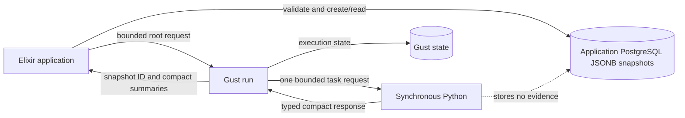

# Evaluation Stage 4 overview: choose Pilot sample sizes

**Status:** Approved evidence-storage boundary, implemented and merged. The Stage 4 implementation is merged into `evaluation/rebuild`; its source commit is `fefe324` (`Add Stage 4 Precision Pilot evaluation`). Its automated checks pass. The approved local deployment held the implementation and passed a synthetic Pilot check. No Pilot collection, Final work, or real study is authorized. The [implemented evaluation pipeline](evaluation-pipeline.md) is the current software map. The [vocabulary](../concepts/vocabulary.md#precision-pilot) defines the Pilot terms.

**Runtime note:** The deployment check is historical. The application, compute, messaging, and observability services are now stopped after an authorised cleanup. PostgreSQL, pgAdmin, their volumes, and the local networks remain. This page does not claim current deployment readiness.

This overview records the accepted Stage 4 contract and the reasons for it. It does not replace the source files, the checked-in JSON Schemas, or the tests.

## Status and selected decisions

**Selected boundary:** Stage 4 uses an immutable, application-owned PostgreSQL JSONB evidence snapshot with create/read access only. The application database owns evidence. Gust stores snapshot and study-revision IDs, stable positions, execution state, and compact results. Gust does not store full matrices. Elixir loads and validates snapshots and builds bounded requests. Python receives bounded synchronous requests, remains stateless, and stores no evidence.

No update or patch API exists. Changed evidence creates a new snapshot ID. Validate on insert and read. Arrays carry order. JSON object key order does not define identity or order.

Version 1 adds no hashes, content fingerprints, archives, paging, chunking, normalized observation tables, JSONB indexes, or database immutability trigger unless a demonstrated need appears. If a representative snapshot exceeds the future byte limit, stop for a separate storage decision. Never truncate it.

The scientific settings remain TBD. The historical values in this document are reference behavior only.

### Resolved implementation decisions

Four decisions close the implementation questions. The scientific setting values remain unapproved.

**Pilot random streams.** The implementation preserves the historical formula. Each tier gets the rank of its first appearance in `expected_comparisons`. `comparison_index` counts comparisons inside that tier. The comparison seed is the base seed plus `tier_rank * 1_000_000` plus `comparison_index * 2`. `SeedSequence([stream_seed, plan_count, attacks_per_plan])` creates the candidate-specific root sequence. It spawns one child for each outer sample. Each outer child spawns one sampling stream and one bootstrap stream. The bootstrap stream produces `inner_seed`. The accepted crossed bootstrap creates `SeedSequence(inner_seed)` and spawns separate interval and null streams. Retry, worker count, completion order, and tier interleaving do not change these streams. Tests cover grouped tiers, interleaved tiers, retries, completion order, and fixed historical stream values.

**Limits.** Every Pilot limit is required application configuration under `NetworkDefense.Evaluation.Pilot.Limits`. The ten values arrive as environment variables and the set is all-or-none. No value is set: the application, Stage 2, and Stage 3 start normally. The snapshot and Pilot paths that need these values return one bounded `configuration_invalid` issue instead of creating a snapshot or a Gust run. A partial or malformed set is reported on standard error at startup and stays unconfigured, so the same bounded error appears and no other path changes. A malformed value never crashes startup. The snapshot limits run before the insert and again on every read. They cover the canonical payload bytes, the comparison count, the plan rows on each side, and the attack columns of every comparison. The accepted 1 MiB HTTP boundary is reused only where it already exists.

The compute service reads its own three caps from the environment. They bound the outer subsample count, the bootstrap replicate count, and their product. A request above a cap fails with `422` and `invalid_analysis_setting` before any stream or array allocation. Each diagnostic holds constant text, the field path, and the configured cap. It never repeats a request value and never builds the product of two request values. A missing or malformed set fails only the Pilot route with one bounded `configuration_invalid` issue. The comparison and Holm routes never read these values.

The local deployment passes explicit development caps in `environments/local/local.auto.tfvars`. They are resource caps for a laptop, not scientific settings. The real-study values remain unapproved.

**Verified implementation behavior.** The local synthetic check exercised the deployed software on 2026-10-19. Repeated Pilot runs over the same request and seed produced the same guarded widths. A run over zero-impact evidence returned explicit insufficiency with `no_passing_candidate` and kept the non-informative positions. The stored Gust records held no matrix.

The check separated two resource boundaries:

- **Elixir submission.** A grid above the deployed Elixir cap created no Gust run. `submit_pilot/1` returned `validation_failed` with issue code `invalid_analysis_setting`.
- **Python service.** A direct HTTP request above a deployed Python cap reached the service and returned HTTP `422` with `error.code = validation_failed` and issue code `invalid_analysis_setting`. The check ran before any allocation.

Stage 2 comparison values and the Stage 3 Holm family path were unchanged. The check used synthetic evidence and development caps, so it proves software paths only.

**Insufficiency.** Version 1 reports one insufficient reason: `no_passing_candidate`. Each candidate summary keeps `non_informative_comparison_positions`.

**Snapshot scope.** Version 1 creates and analyzes Pilot evidence only. The existing snapshot phase constraint reserves `final`. No public Stage 4 path creates or analyzes Final evidence. The snapshot input and payload carry `phase` and `evidence_role`. Both must be `pilot`. A read rejects any other pair, including a database row that reserves `final` while it holds a Pilot payload.

## Scientific method

The Precision Pilot answers one question:

> How many plans and attacks per plan does the Final study need?

The request declares `plan_count_candidates[]` and `attacks_per_plan_candidates[]`. Their Cartesian product is the candidate grid. Declared order produces work-item order: plan position first, then attacks-per-plan position.

For each candidate and each declared family comparison:

1. Independently sample alternative plan rows without replacement.
2. Independently sample CVSS plan rows without replacement.
3. Sample shared attack columns without replacement.
4. Run the accepted inner crossed bootstrap with replacement. Alternative and CVSS use separate plan selections and the same selected attack columns.
5. Record the interval half-width.
6. Take the declared guard quantile across outer samples.
7. Reject a non-informative row. A zero estimate and zero-width interval does not prove adequate precision.

Aggregate by the worst guarded width across the full family. A candidate passes only when every declared comparison is informative and passes the target. Select only a passing candidate. If none passes, return explicit insufficiency. Holm correction does not run during the Precision Pilot. Stage 3 Holm correction applies later to the complete declared Final family. The candidate grid, target, quantile, repeat counts, confidence, and final selection rule are not approved.

Pilot evidence and seeds are separate from Final evidence and seeds. The Pilot recommendation supplies Final settings. It does not supply Final evidence. A runtime heuristic may select among passing candidates, but runtime is not a statistical result. Historically, the heuristic preferred the lowest predicted runtime, with a tie rule of more plans and then fewer attacks. The implemented prototype uses this rule. Its use for real Pilot evidence remains subject to approval.

The random-stream implementation must preserve the historical seed policy:

```text
declared Pilot base seed
    + tier_rank * 1_000_000
    + comparison_index * 2
    = comparison stream_seed
    → SeedSequence([stream_seed, plan_count, attacks_per_plan])
    → spawn(outer_subsamples) outer child streams
    → each outer child spawn(2)
        → sampling stream
        → bootstrap stream
            → inner_seed
            → SeedSequence(inner_seed)
            → spawn(2)
                → interval stream
                → null stream
```

The implementation must not replace this policy with identity hashes. Gust task IDs, worker count, completion order, retries, and database order must not affect scientific randomness. A retry must calculate the same result. The v1 child-stream contract is fixed and covered by an independent historical golden test.

## Why run a Precision Pilot?

A fixed sample size can cause two problems. Too little evidence produces wide and unstable confidence intervals. Too much evidence wastes simulation and optimization time. Repeated outer samples protect against a lucky subset of Pilot evidence. A guard quantile uses a conservative interval width instead of the narrowest observed width. One common size keeps Final comparisons consistent. A difficult comparison can increase the common requirement.

## Ownership and data flow



## JSONB snapshot boundary

The conceptual table is:

| Column | Meaning |
| --- | --- |
| `id` | UUID snapshot ID |
| `study_revision_id` | Required UUID; the foreign key and its timing are unapproved |
| `phase` | `pilot` or `final` |
| `schema_version` | Snapshot contract version |
| `family_id` | Required family identifier |
| `payload` | Validated JSONB snapshot |
| `inserted_at` | Creation time |

There is no `updated_at`. The application owns the row and has create/read operations only. The revision identifier is a UUID without a foreign key. The foreign key and its migration order are unapproved. A real Pilot cannot proceed without a durable revision reference.

### Ecto persistence interface

The snapshot schema and persistence module define the interface. Creation parses the full contract, encodes the normalized payload with Jason, and enforces the storage-size cap immediately before `Repo.insert/2`. An encoding failure becomes the role-specific validation error. The insert writes one complete row.

A read trusts the JSONB value that PostgreSQL returns. It parses the stored contract and validates the phase, evidence role, schema version, identifiers, relationships, ordering, dimensions, and other non-byte resource caps. It does not encode the payload again. Encoded length is not an integrity signal or a change detector.

Real-study limit values and study declarations remain unapproved. There is no update changeset, update function, JSONB patch function, content hash, or database update-prevention trigger.

## Snapshot payload

The following structural outline shows field ownership. It is not JSON and is not a conformance fixture. Checked-in fixtures must contain complete valid values.

```text
schema_version = 1
evidence_role = pilot
comparisons[]                         # declared family order
  position                            # consecutive from zero
  identity                            # Stage 3 typed identity
    tier
    budget
    alternative
    reference = cvss
    outcome = mission_impact
  evidence                            # exact Stage 2 evidence shape
    outcome = mission_impact
    attack_seeds[]                    # at least 10 ordered unique values
    alternative
      strategy = identity.alternative
      plans[]                         # at least 5 unique plan IDs
        id
        mission_impacts[]             # one value for each attack seed
    reference
      strategy = cvss
      plans[]                         # at least 5 unique plan IDs
        id
        mission_impacts[]             # one value for each attack seed
  provenance
    graph_revision_ids[]
    model_revision
    collection_seed
    source_run_ids[]
    environment
runtime_evidence
  plan_selection_ms[]
  attack_trial_ms[]
  tier_count
  strategy_group_count
```

`comparisons[]` order is authoritative. Each identity must equal its Stage 2 evidence metadata. Plan rows and attack seeds are ordered arrays. The canonical snapshot and fixture must retain the Stage 2 minimum counts and matrix-dimension checks.

Database columns hold `family_id`, `study_revision_id`, and `phase`. A Pilot request must repeat these compact identifiers and match the stored row. The stored phase must agree with `evidence_role`. The request's ordered `expected_comparisons` must equal the payload's ordered identities.

`runtime_evidence` contains measured inputs for a possible runtime heuristic. It does not contain the Pilot seed, outer-subsample count, precision target, guard quantile, confidence level, or bootstrap count. Those values belong to the immutable Pilot request.

## Checked-in schemas and fixtures

The following paths are implemented.

```text
src/priv/evaluation/pilot/v1/
  schemas/snapshot.schema.json
  schemas/request.schema.json
  schemas/candidate_request.schema.json
  schemas/candidate_response.schema.json
  schemas/result.schema.json
  schemas/error.schema.json
  valid/pilot-small.snapshot.json
  valid/pilot-small.request.json
  valid/pilot-small.result.json
  valid/candidate-responses/0.json … 7.json
  invalid/missing-comparison.request.json
  invalid/duplicate-comparison.snapshot.json

contracts/evaluation/pilot/v1/
  schemas -> ../../../../src/priv/evaluation/pilot/v1/schemas
  valid -> ../../../../src/priv/evaluation/pilot/v1/valid
  invalid -> ../../../../src/priv/evaluation/pilot/v1/invalid
```

Canonical files are under `src/priv`. Shared relative symlinks expose the same contract without a second copy. This layout follows the Stage 3 family layout because Pilot is also a multi-contract workflow. The Stage 2 comparison directory keeps its older `contracts/v1` name; Stage 4 does not extend that exception.

### JSON Schema excerpt

This excerpt shows the implemented schema shape. It is not complete. The checked-in schema files are authoritative. JSON Schema owns field names, required fields, basic types, local bounds, and unknown-field rejection. The Elixir parser owns strict JSON number checks and cross-field rules such as dimensions, identity equality, uniqueness, and consecutive order.

```json
{
  "$schema": "http://json-schema.org/draft-04/schema#",
  "type": "object",
  "additionalProperties": false,
  "required": ["schema_version", "evidence_role", "comparisons", "runtime_evidence"],
  "properties": {
    "schema_version": {"type": "integer", "enum": [1]},
    "evidence_role": {"type": "string", "enum": ["pilot"]},
    "comparisons": {
      "type": "array",
      "minItems": 1,
      "items": {"$ref": "#/definitions/comparison"}
    },
    "runtime_evidence": {"$ref": "#/definitions/runtime_evidence"}
  },
  "definitions": {
    "identifier": {
      "type": "string",
      "minLength": 1,
      "maxLength": 128,
      "pattern": "^[A-Za-z0-9][A-Za-z0-9._:-]{0,127}$"
    },
    "identity": {
      "type": "object",
      "additionalProperties": false,
      "required": ["tier", "budget", "alternative", "reference", "outcome"],
      "properties": {
        "tier": {"$ref": "#/definitions/identifier"},
        "budget": {"type": "integer", "minimum": 1},
        "alternative": {"$ref": "#/definitions/identifier"},
        "reference": {"type": "string", "enum": ["cvss"]},
        "outcome": {"type": "string", "enum": ["mission_impact"]}
      }
    },
    "comparison": {
      "type": "object",
      "additionalProperties": false,
      "required": ["position", "identity", "evidence", "provenance"],
      "properties": {
        "position": {"type": "integer", "minimum": 0},
        "identity": {"$ref": "#/definitions/identity"},
        "evidence": {"$ref": "#/definitions/evidence"},
        "provenance": {"$ref": "#/definitions/provenance"}
      }
    },
    "evidence": {
      "type": "object",
      "additionalProperties": false,
      "required": ["outcome", "attack_seeds", "alternative", "reference"],
      "properties": {
        "outcome": {"type": "string", "enum": ["mission_impact"]},
        "attack_seeds": {
          "type": "array",
          "minItems": 10,
          "uniqueItems": true,
          "items": {"type": "integer", "minimum": 0}
        },
        "alternative": {"$ref": "#/definitions/alternative_side"},
        "reference": {"$ref": "#/definitions/reference_side"}
      }
    },
    "alternative_side": {
      "type": "object",
      "additionalProperties": false,
      "required": ["strategy", "plans"],
      "properties": {
        "strategy": {
          "allOf": [
            {"$ref": "#/definitions/identifier"},
            {"not": {"enum": ["cvss"]}}
          ]
        },
        "plans": {"type": "array", "minItems": 5, "items": {"$ref": "#/definitions/plan"}}
      }
    },
    "reference_side": {
      "type": "object",
      "additionalProperties": false,
      "required": ["strategy", "plans"],
      "properties": {
        "strategy": {"type": "string", "enum": ["cvss"]},
        "plans": {"type": "array", "minItems": 5, "items": {"$ref": "#/definitions/plan"}}
      }
    },
    "plan": {
      "type": "object",
      "additionalProperties": false,
      "required": ["id", "mission_impacts"],
      "properties": {
        "id": {"$ref": "#/definitions/identifier"},
        "mission_impacts": {"type": "array", "minItems": 10, "items": {"type": "number"}}
      }
    },
    "provenance": {
      "type": "object",
      "additionalProperties": false,
      "required": ["graph_revision_ids", "model_revision", "collection_seed", "source_run_ids", "environment"],
      "properties": {
        "graph_revision_ids": {"type": "array", "minItems": 1, "items": {"$ref": "#/definitions/identifier"}},
        "model_revision": {"$ref": "#/definitions/identifier"},
        "collection_seed": {"type": "integer", "minimum": 0},
        "source_run_ids": {"type": "array", "minItems": 1, "items": {"$ref": "#/definitions/identifier"}},
        "environment": {"$ref": "#/definitions/identifier"}
      }
    },
    "runtime_evidence": {
      "type": "object",
      "additionalProperties": false,
      "required": ["plan_selection_ms", "attack_trial_ms", "tier_count", "strategy_group_count"],
      "properties": {
        "plan_selection_ms": {"type": "array", "minItems": 1, "items": {"type": "number", "minimum": 0}},
        "attack_trial_ms": {"type": "array", "minItems": 1, "items": {"type": "number", "minimum": 0}},
        "tier_count": {"type": "integer", "minimum": 1},
        "strategy_group_count": {"type": "integer", "minimum": 1}
      }
    }
  }
}
```

The excerpt follows the current draft-04 schema convention. The Elixir JSON boundary must apply the existing strict-type checks so booleans cannot satisfy integer or number fields. It must also enforce consecutive positions, unique plan IDs, finite numbers, identity-to-evidence equality, and matrix dimensions. These checks run before Ecto materialization and again after snapshot read-back.

## Pilot request and result

The following illustrative examples use one comparison and four candidates. They are internally consistent, but their scientific values and selection rule are illustrative. They do not approve study settings.

```json
{
  "schema_version": 1,
  "evidence_role": "pilot",
  "method": "precision_pilot_v1",
  "pilot_id": "pilot-example",
  "study_revision_id": "4f4a33c6-cc8e-4ac1-b145-18647a928e49",
  "family_id": "family-example",
  "snapshot_id": "af69d2ca-ff80-43aa-9800-67f6895be64d",
  "expected_comparisons": [
    {
      "tier": "tier-a",
      "budget": 10,
      "alternative": "alternative-a",
      "reference": "cvss",
      "outcome": "mission_impact"
    }
  ],
  "candidate_grid": {
    "plan_count_candidates": [5, 10],
    "attacks_per_plan_candidates": [10, 20]
  },
  "pilot_sampling": {"outer_subsamples": 100, "seed": 700001},
  "precision": {
    "target_half_width": 0.5,
    "guard_quantile": 0.9,
    "confidence_level": 0.95,
    "bootstrap_replicates": 1000
  },
  "selection": {"rule": "lowest_predicted_runtime"}
}
```

Candidate order is plan-major Cartesian order: `(0, 0)`, `(0, 1)`, `(1, 0)`, and `(1, 1)`. The flattened Gust work-item order then adds comparison position as the innermost position. A family with `m` comparisons produces `4 × m` work items in this example.

The persisted result is compact. It repeats immutable IDs and every candidate/comparison row, but it does not repeat evidence matrices.

```json
{
  "schema_version": 1,
  "evidence_role": "pilot",
  "method": "precision_pilot_v1",
  "pilot_id": "pilot-example",
  "study_revision_id": "4f4a33c6-cc8e-4ac1-b145-18647a928e49",
  "family_id": "family-example",
  "snapshot_id": "af69d2ca-ff80-43aa-9800-67f6895be64d",
  "outcome": "recommended",
  "expected_comparisons": [
    {"tier": "tier-a", "budget": 10, "alternative": "alternative-a", "reference": "cvss", "outcome": "mission_impact"}
  ],
  "candidate_grid": {
    "plan_count_candidates": [5, 10],
    "attacks_per_plan_candidates": [10, 20]
  },
  "pilot_sampling": {"outer_subsamples": 100, "seed": 700001},
  "precision": {
    "target_half_width": 0.5,
    "guard_quantile": 0.9,
    "confidence_level": 0.95,
    "bootstrap_replicates": 1000
  },
  "selection": {"rule": "lowest_predicted_runtime"},
  "candidate_results": [
    {"candidate_position": 0, "comparison_position": 0, "plan_count": 5, "attacks_per_plan": 10, "guarded_half_width": 0.74, "informative": true, "passes": false},
    {"candidate_position": 1, "comparison_position": 0, "plan_count": 5, "attacks_per_plan": 20, "guarded_half_width": 0.48, "informative": true, "passes": true},
    {"candidate_position": 2, "comparison_position": 0, "plan_count": 10, "attacks_per_plan": 10, "guarded_half_width": 0.46, "informative": true, "passes": true},
    {"candidate_position": 3, "comparison_position": 0, "plan_count": 10, "attacks_per_plan": 20, "guarded_half_width": 0.34, "informative": true, "passes": true}
  ],
  "candidate_summaries": [
    {"candidate_position": 0, "plan_count": 5, "attacks_per_plan": 10, "worst_guarded_half_width": 0.74, "all_comparisons_informative": true, "non_informative_comparison_positions": [], "all_comparisons_passed": false, "predicted_runtime_ms": 100.0},
    {"candidate_position": 1, "plan_count": 5, "attacks_per_plan": 20, "worst_guarded_half_width": 0.48, "all_comparisons_informative": true, "non_informative_comparison_positions": [], "all_comparisons_passed": true, "predicted_runtime_ms": 140.0},
    {"candidate_position": 2, "plan_count": 10, "attacks_per_plan": 10, "worst_guarded_half_width": 0.46, "all_comparisons_informative": true, "non_informative_comparison_positions": [], "all_comparisons_passed": true, "predicted_runtime_ms": 160.0},
    {"candidate_position": 3, "plan_count": 10, "attacks_per_plan": 20, "worst_guarded_half_width": 0.34, "all_comparisons_informative": true, "non_informative_comparison_positions": [], "all_comparisons_passed": true, "predicted_runtime_ms": 240.0}
  ],
  "recommendation": {"candidate_position": 1, "plan_count": 5, "attacks_per_plan": 20},
  "insufficient_reason": null
}
```

`expected_comparisons` binds every comparison position to a typed identity. The result parser verifies this declaration and all Pilot settings against the request and snapshot. `outcome = recommended` means a complete checked result with one selected candidate. If no candidate passes, `outcome = insufficient`, `recommendation` is null, and `insufficient_reason` gives a bounded typed reason. Failed, partial, or malformed execution remains a Gust run state and cannot produce either scientific outcome. A non-informative summary sets `all_comparisons_informative` to false and records the bounded non-informative comparison positions. The selector must not silently choose the largest candidate.

## Public Elixir interface

The implemented interface has this shape. The excerpt is illustrative; the modules are authoritative.

```elixir
defmodule NetworkDefense.Evaluations do
  alias NetworkDefense.Evaluation.{EvidenceSnapshots, Pilot}
  alias NetworkDefense.Evaluation.Pilot.Contracts.{
    EvidenceSnapshotInput,
    PilotRequest
  }

  def create_evidence_snapshot(attrs) when is_map(attrs) do
    with {:ok, input} <- EvidenceSnapshotInput.parse(attrs) do
      EvidenceSnapshots.create(input)
    end
  end

  def get_evidence_snapshot(snapshot_id),
    do: EvidenceSnapshots.get(snapshot_id)

  def submit_pilot(attrs) when is_map(attrs) do
    with {:ok, request} <- PilotRequest.parse(attrs),
         {:ok, snapshot, payload} <- EvidenceSnapshots.load(request.snapshot_id),
         :ok <- PilotRequest.matches_snapshot(request, snapshot, payload),
         :ok <- Pilot.Work.preflight(request, payload) do
      request
      |> Pilot.Wire.request()
      |> Pilot.Workflow.submit()
    end
  end

  def await_pilot(run_id, timeout_ms),
    do: Pilot.Workflow.await(run_id, timeout_ms)

  def get_pilot_result(run_id),
    do: Pilot.Workflow.result(run_id)
end
```

`EvidenceSnapshotInput.parse/1` validates metadata and payload before insertion. `PilotRequest.parse/1` validates the complete root request. Snapshot read-back and request-to-snapshot correlation then occur before `Pilot.Workflow.submit/1` can call `Gust.Flows.create_run/1`. `Pilot.Work.preflight/2` builds every canonical candidate request in memory with the same functions as mapped execution, so a request that exceeds `candidate_request_bytes` fails before the run exists. Invalid requests, missing, changed, or invalid snapshots, and oversize candidate requests cannot create a run. The return values follow the current typed `{:ok, value}` or `{:error, error}` pattern.

## Gust DAG

The DAG is implemented and loaded from `src/priv/gust/dags/evaluation_pilot.exs`. The shape follows the fixed `task_action` and `map_over` style used by the Family DAG. The one candidate × one comparison task boundary is an implemented prototype contract. Its use for real Pilot evidence still needs scientific approval.

```elixir
defmodule NetworkDefense.Evaluation.Pilot.DAG do
  use Gust.DSL

  alias NetworkDefense.Evaluation.Pilot.Actions.{
    EvaluateCandidateComparison,
    Prepare,
    Select
  }

  task_action :prepare_pilot, {Prepare, []},
    downstream: [:evaluate_candidate_comparison],
    store_result: true

  task_action :evaluate_candidate_comparison, EvaluateCandidateComparison,
    map_over: :prepare_pilot,
    ctx: %{params: params},
    downstream: [:select_pilot],
    store_result: true do
    [item: params]
  end

  task_action :select_pilot, {Select, []}, store_result: true
end
```

`prepare_pilot` reloads and validates the full root request and snapshot. It repeats the candidate-request preflight, so a changed runtime limit or changed stored data still fails before any mapped task exists. Its result contains flattened candidate × comparison work items in declared order. Each item contains immutable IDs, positions, settings, and identity. It contains no evidence matrix. The mapped action uses the snapshot ID and comparison position to load one comparison, builds one bounded Python request in memory, and stores one compact response. It does not store the matrix in Gust.

`select_pilot` reads the persisted mapped results. It requires the complete Cartesian candidate/comparison set, stable declared order, no duplicates, no missing or unexpected rows, and exact request correlation. It stores one compact Pilot result. A successful Gust run alone is not sufficient.

## Python endpoint and models

The models are implemented in `services/evaluation_compute`. The excerpt is illustrative. The implementation reuses the meanings of Stage 3 `FamilyIdentity` and Stage 2 `Evidence`, `Identifier`, and `JsonFiniteNumber` contracts.

```python
from typing import Annotated, Literal
from uuid import UUID

from pydantic import BaseModel, ConfigDict, Field, StrictBool, StrictInt

from .evidence import Evidence, Identifier
from .family import FamilyIdentity
from .types import JsonFiniteNumber


class Candidate(BaseModel):
    model_config = ConfigDict(extra="forbid", strict=True)

    plan_count: Annotated[StrictInt, Field(ge=5)]
    attacks_per_plan: Annotated[StrictInt, Field(ge=10)]


class CandidateComparisonRequest(BaseModel):
    model_config = ConfigDict(extra="forbid", strict=True)

    schema_version: Literal[1]
    method: Literal["precision_pilot_candidate_v1"]
    pilot_id: Identifier
    study_revision_id: UUID
    family_id: Identifier
    snapshot_id: UUID
    candidate_position: Annotated[StrictInt, Field(ge=0)]
    comparison_position: Annotated[StrictInt, Field(ge=0)]
    identity: FamilyIdentity
    candidate: Candidate
    evidence: Evidence
    outer_subsamples: Annotated[StrictInt, Field(gt=0)]
    stream_seed: Annotated[StrictInt, Field(ge=0)]
    guard_quantile: Annotated[JsonFiniteNumber, Field(gt=0, lt=1)]
    target_half_width: Annotated[JsonFiniteNumber, Field(gt=0)]
    confidence_level: Annotated[JsonFiniteNumber, Field(gt=0, lt=1)]
    bootstrap_replicates: Annotated[StrictInt, Field(gt=0)]


class CandidateComparisonResponse(BaseModel):
    model_config = ConfigDict(extra="forbid", strict=True)

    schema_version: Literal[1]
    method: Literal["precision_pilot_candidate_v1"]
    pilot_id: Identifier
    study_revision_id: UUID
    family_id: Identifier
    snapshot_id: UUID
    candidate_position: Annotated[StrictInt, Field(ge=0)]
    comparison_position: Annotated[StrictInt, Field(ge=0)]
    identity: FamilyIdentity
    candidate: Candidate
    outer_subsamples: Annotated[StrictInt, Field(gt=0)]
    stream_seed: Annotated[StrictInt, Field(ge=0)]
    guard_quantile: Annotated[JsonFiniteNumber, Field(gt=0, lt=1)]
    target_half_width: Annotated[JsonFiniteNumber, Field(gt=0)]
    confidence_level: Annotated[JsonFiniteNumber, Field(gt=0, lt=1)]
    bootstrap_replicates: Annotated[StrictInt, Field(gt=0)]
    guarded_half_width: Annotated[JsonFiniteNumber, Field(ge=0)]
    informative: StrictBool
    passes: StrictBool
```

The candidate lower bounds match the accepted Stage 2 evidence boundary. They are not recommendations for the rebuilt study. The implementation uses the fixed stream contract stated above. Each outer child splits into sampling and bootstrap streams. The bootstrap stream then produces the separate interval and null streams. Task IDs, workers, retries, and completion order cannot be inputs.

The numerical function has no transport, persistence, or scheduling concerns.

```python
def evaluate_candidate_comparison(
    request: CandidateComparisonRequest,
) -> CandidateComparisonResponse:
    # Create deterministic outer child streams.
    # Sample both plan sides separately without replacement.
    # Sample shared attack columns without replacement.
    # Run the accepted inner crossed bootstrap with replacement.
    # Return the guard quantile and exact informative/pass decisions.
    ...
```

The function rejects candidates that exceed either plan side or the available attack columns. It evaluates every declared outer sample. It must not truncate evidence, reduce the repeat count, or substitute another candidate.

### FastAPI route

The route is implemented. This excerpt shows its shape.

```python
@app.post("/v1/pilots/candidate-comparisons", response_model=CandidateComparisonResponse)
async def candidate_comparison(request: Request) -> CandidateComparisonResponse | JSONResponse:
    # Enforce application/json and the existing bounded body limit.
    # Parse the versioned bounded envelope with strict Pydantic validation.
    # Reject a configured compute cap violation with 422 invalid_analysis_setting.
    # Return the current documented 4xx errors for invalid input.
    # Return the current 500/503 error envelope for server/service failure.
    # Run one synchronous calculation and return the typed response.
    ...
```

The route preserves the current transport behavior:

| Status | Meaning |
| ---: | --- |
| `400` | Invalid JSON syntax |
| `413` | Request exceeds the byte limit |
| `415` | Media type is not `application/json` |
| `422` | Schema or scientific validation failed |
| `500` | Calculation failed |
| `503` | Compute service is temporarily unavailable |

Errors use the current versioned, bounded envelope. Issues have stable codes, paths, messages, and bounded details. Elixir treats `500` and `503` as retryable. Documented `4xx` responses and invalid success responses are permanent failures.

## Contract ownership and read-back checks

Elixir owns public parsing, snapshot persistence, snapshot read-back validation, bounded request construction, response validation, result assembly, and Gust orchestration. Gust owns scheduling, retries, run state, task state, errors, and compact persisted task results. Python owns only the synchronous numerical calculation. The local deployment forwards the caps as container environment variables. No Terraform interface describes a scientific setting.

Before a snapshot insert, the application validates:

- schema version and evidence role;
- consecutive comparison positions and unique identities;
- exact Stage 2 evidence shapes and matrix dimensions;
- identity-to-evidence equality;
- finite values and bounded provenance; and
- the configured storage-size cap.

On a snapshot read, the application repeats the contract, metadata, relationship, ordering, and non-byte dimension checks. It does not recompute the encoded size.

For a Pilot submission, the application also requires `phase = pilot`. It checks the root request's `study_revision_id`, `family_id`, `snapshot_id`, and ordered `expected_comparisons` against the stored row and payload. The payload does not duplicate the database IDs.

The application must measure a representative normalized snapshot before it approves real-study limit values. It must also approve separate limits for the root request, one Python request, candidate count, comparison count, matrix dimensions, and total work-item count. Oversized data fails as a typed error. No layer can truncate observations, candidates, comparisons, or repeats.

On Python response and final result read-back, the application validates:

- schema version, method, evidence role, and immutable IDs;
- the exact ordered comparison and candidate declarations;
- every candidate and comparison position and value;
- target, guard quantile, finite width, informative state, and pass decision;
- the complete Cartesian result set, with no duplicate, missing, unexpected, or changed row;
- each family-wide worst width and all-comparisons decision; and
- the recommendation or explicit insufficiency against the selected rule.

A succeeded Gust run is not sufficient. `get_pilot_result/1` succeeds only when the stored `select_pilot` result passes the full typed read-back check.

Checked-in schemas are the wire-contract authority. Elixir uses JSON Schema before Ecto materialization so invalid wire types cannot pass through Ecto coercion. Python uses strict Pydantic models and rejects unknown fields. Shared valid and invalid fixtures must produce the same decisions in both runtimes.

## Historical settings (reference only)

Historical planning used:

```text
Plan candidates:       [5, 6, 8]
Attack candidates:     [10, 12, 16]
Target half-width:     1.0
Guard quantile:        0.9
Outer subsamples:      100
Pilot seed:            700001
Selection rule:        lowest predicted runtime
```

The historical runtime heuristic was:

\[
T(p, a) = t \times g \times p \times m_p
        + t \times g \times p \times a \times m_a,
\]

where `t` is the tier count, `g` is the strategy-group count, `p` is the plan count, `a` is the attacks-per-plan count, `m_p` is the median measured plan-selection time, and `m_a` is the median measured attack-trial time. The heuristic selected the lowest predicted runtime. Equal predictions preferred more plans and then fewer attacks.

These values and rules are historical reference behavior. They are not approved rebuilt-study defaults. Runtime predicts resource use only. It is not a statistical result.

## Decisions still needed

The following remain TBD:

- scientific approval of the implemented snapshot payload schema and its provenance fields;
- the representative snapshot measurement and the approved limit values for each deployment (the mechanism is fixed; test values and the local development caps are illustrative only);
- the study-revision record, foreign key, and migration order;
- the approved Pilot evidence revision;
- the candidate grid, precision target, guard quantile, outer-subsample count, confidence level, bootstrap count, and Pilot seed;
- the Final-stage seed schedule (the Pilot stream formula is fixed);
- the runtime inputs, selection rule, and tie rule;
- whether one candidate × one comparison is the approved Python task boundary;
- the Final result contract (the Pilot result contract and its single insufficiency reason are fixed);
- calibration ownership as an external prerequisite, future stage, or separate workflow; and
- scientific approval of the complete Pilot declaration.

High-level storage ownership and the snapshot-ID boundary are selected. They are no longer open decisions.

## Worked example

The values below explain the decision only. They are not approved study settings. Assume the target guarded half-width is `0.50`.

| Candidate | Worst guarded half-width | Precision result |
| --- | ---: | --- |
| 5 plans and 10 attacks | 0.74 | Fails |
| 5 plans and 20 attacks | 0.48 | Passes |
| 10 plans and 10 attacks | 0.46 | Passes |
| 10 plans and 20 attacks | 0.34 | Passes |

The first candidate fails because `0.74` is greater than `0.50`. The other three pass. A runtime heuristic may select the lowest predicted runtime among passing candidates. That heuristic is not a statistical result. A non-informative required comparison makes a candidate unacceptable.

## Exclusions and stop point

Stage 4 does not include graph generation, optimizer or topology/runtime pilots, live simulation collection, Final evidence collection, Final family wiring, Final analysis, Holm correction of Final results, secondary reports, dashboard work, or further infrastructure deployment beyond the historical local synthetic check. See the [Stage 5 overview](evaluation-stage-5-overview.md) for the separate Pilot-to-Final wiring boundary, which is implemented but uncommitted in this worktree.

Stage 4 stops after one checked recommendation is saved and read back from Gust. It does not authorize Final work. Stage 5 is separate: its thin adapter is implemented but uncommitted in this worktree. The [full study pipeline overview](evaluation-study-pipeline-overview.md) remains an unimplemented design draft.

The [implemented evaluation pipeline](evaluation-pipeline.md) shows how this workflow relates to Stage 2, Stage 3, and the application boundary. The [Stage integration proposal](evaluation-stage-integration.md) records an earlier proposal for one lifecycle DAG; the implemented software does not use it.
