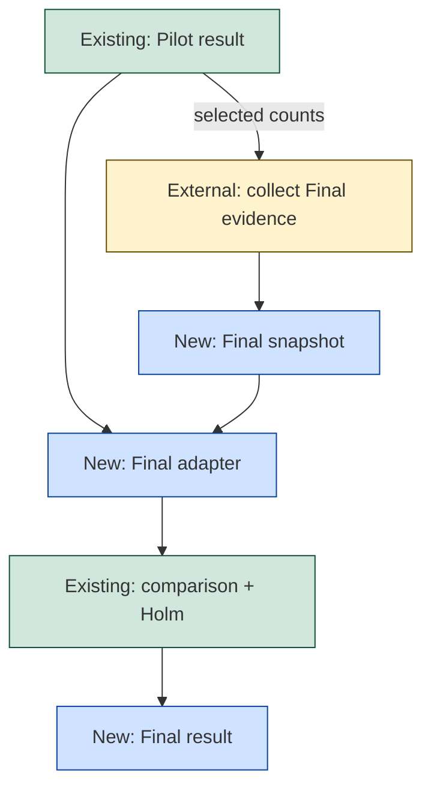

# Evaluation Stage 5: Pilot-to-Final wiring

**Status:** Implemented in this worktree as an uncommitted change. Stage 4 provides the recommended counts. Stage 2 and Stage 3 provide comparison statistics and Holm correction. Real-study settings, seeds, and resource caps remain unapproved.

Stage 5 adds only the missing wiring: a Final evidence snapshot, source-Pilot binding, and a thin family-shaped workflow around the existing mathematics. A caller supplies fresh Final evidence. Stage 5 never sends Pilot matrices into Final analysis, and it does not collect evidence.

## Flow



Collection is external. Stage 5 does not continue from Pilot completion to collection. It has no approval subsystem. `study_revision_id` is the only study label. Provenance and freshness are caller assertions. Final seeds are explicit and role-scoped.

## Illustrative wiring sketch

The Pilot getter and the Final calls exist today. Public input is a serialized wire map, so every key is a string.

```elixir
# Existing API. source_pilot_run_id is an integer Gust run ID.
{:ok, pilot} = NetworkDefense.Evaluations.get_pilot_result(source_pilot_run_id)
# Continue only when pilot.outcome == "recommended".

# Final APIs.
{:ok, snapshot} =
  NetworkDefense.Evaluations.create_final_evidence_snapshot(snapshot_input)

final_request =
  Map.merge(request_input, %{
    "snapshot_id" => snapshot.id,
    "source_pilot_run_id" => source_pilot_run_id,
    "plan_count" => pilot.recommendation.plan_count,
    "attacks_per_plan" => pilot.recommendation.attacks_per_plan
  })

{:ok, run_id} = NetworkDefense.Evaluations.submit_final(final_request)
{:ok, :succeeded} = NetworkDefense.Evaluations.await_final(run_id, timeout_ms)
{:ok, result} = NetworkDefense.Evaluations.get_final_result(run_id)
```

`snapshot_input` holds the snapshot metadata, the ordered Final evidence, and its collection provenance. `request_input` holds the declared identities, the analysis settings, the seeds, and the assertions. Submission requires the snapshot ID and rejects insufficient Pilot results, count overrides, and mismatches.

## How the adapter reuses existing code

The fixed shape is `prepare_final -> compare_final_member (mapped) -> correct_final_family`. It copies the family DAG shape and adds no framework or statistics.

- [`evaluation_final.exs`](../../src/priv/gust/dags/evaluation_final.exs) is the fixed Final DAG.
- [`evaluation_family.exs`](../../src/priv/gust/dags/evaluation_family.exs) shows the prepare, mapped-member, and fan-in shape.
- [`CompareMember`](../../src/lib/network_defense/evaluation/family/actions/compare_member.ex) calls [`Comparison.Actions.Compare`](../../src/lib/network_defense/evaluation/comparison/actions/compare.ex) with `ComparisonRequest.to_params(request)`.
- [`CorrectFamily`](../../src/lib/network_defense/evaluation/family/actions/correct_family.ex) calls [`Family.Client.holm`](../../src/lib/network_defense/evaluation/family/client.ex). The Holm request has no evidence-role field; Final can reuse the same numerical call.
- [`NetworkDefense.Evaluations`](../../src/lib/network_defense/evaluations.ex) provides the implemented Pilot getter and family workflow patterns.
- [`EvidenceSnapshots`](../../src/lib/network_defense/evaluation/evidence_snapshots.ex) provides the application-owned JSONB create/read pattern with a Final variant.

Final modules live under [`src/lib/network_defense/evaluation/final/`](../../src/lib/network_defense/evaluation/final/): contracts, wire format, member and family adapters, and the workflow.

## Resource guard

The comparison endpoint allocates one resample array per requested replicate. The Pilot caps do not cover that endpoint, so Final carries its own deployment caps: `max_bootstrap_replicates` and `max_total_work`. Both are required configuration, all-or-none, read from `NetworkDefense.Evaluation.Final.Limits`. The library holds no built-in value and never borrows a Pilot cap, so a missing or malformed configuration fails closed with a bounded Final error.

One work unit is one resample of one declared comparison over both plan sides and the shared ordered attack columns:

```text
work_units = declared_comparisons * (2 * plan_count * attacks_per_plan) * bootstrap_replicates
```

A work unit is a resource guard. It is not a statistical setting, and the guard never changes a computed value. The guard runs before Gust submission and again in [`prepare_final`](../../src/lib/network_defense/evaluation/final/actions/prepare_final.ex), every [`compare_final_member`](../../src/lib/network_defense/evaluation/final/actions/compare_final_member.ex), and [`correct_final_family`](../../src/lib/network_defense/evaluation/final/actions/correct_final_family.ex).

The test configuration holds labelled synthetic limits. They are test-only values, not study settings.

The accepted comparison contract also caps one member request at 1 MiB, which is smaller than the shared snapshot cap. The Final evidence therefore can be valid and still too large for one member call. [`Member`](../../src/lib/network_defense/evaluation/final/member.ex) owns one request builder and one preflight. The preflight runs before Gust submission and again in `prepare_final`. A submission rejection creates no run. A persisted preparation rejection happens inside a run that already exists, and it prevents the mapped dispatch, so no member task starts and no member call is sent. The conversion keeps the comparison parser code instead of letting a foreign error escape.

## Failure classification

A correction retry does not rerun a mapped member that already succeeded. It repeats the correction request with the same seeds. The correction client classifies a transport failure and a documented HTTP 500 or 503 reply as temporary, and [`CorrectFinalFamily`](../../src/lib/network_defense/evaluation/final/actions/correct_final_family.ex) keeps that classification. The Gust task attempt policy bounds the repeats; the adapter adds no retry loop of its own. A mapped member keeps the accepted comparison and Gust retry behaviour for its own temporary failure. A bounded Family issue or schema diagnostic becomes a bounded Final error with its code and rows; it never becomes a permanent malformed-response error.

## Cross-record binding

Submission checks the snapshot metadata, the declared order, the resource caps, and the actual source Pilot. A Final run outlives those checks, so [`Final.Binding`](../../src/lib/network_defense/evaluation/final/binding.ex) repeats the contract and relationship checks at every member, at the complete fan-in, and at the public result read. Read-back skips the compute guard because it performs no compute.

Reads trust the snapshot value persisted by PostgreSQL. The binding compares contracts and relationships. It does not encode the payload again or use encoded length as a content-integrity signal.

The current [`Family.Workflow`](../../src/lib/network_defense/evaluation/family/workflow.ex) and request contract remain synthetic-prototype-only. The adapter adds Final role/source metadata and snapshot loading; it does not relabel synthetic output or reimplement statistics.

Gust parameters and work items freeze source IDs, the snapshot ID, selected counts, settings, seeds, and provenance assertions. Gust stores compact metadata and results; the application snapshot stores Final matrices.

No declaration, approval, or checked-input subsystem is added. Collection and real-study approval remain outside this prototype.

## Public API

These five functions follow the existing `NetworkDefense.Evaluations` and snapshot/workflow patterns.

| Function | Required input | Result |
| --- | --- | --- |
| `create_final_evidence_snapshot/1` | Strict Final input: study revision, phase, family, the ordered Final evidence, and its collection provenance. | `{:ok, final_snapshot}` after validation, insert, and read-back through the validated read path, or a bounded typed error. |
| `get_final_evidence_snapshot/1` | Final snapshot UUID. | `{:ok, final_snapshot}` after stored-payload validation, or a bounded typed error. |
| `submit_final/1` | Pre-created `snapshot_id`, integer `source_pilot_run_id`, ordered identities, copied Pilot counts, explicit analysis settings, role-scoped comparison seeds, and the freshness and exclusion assertions. No inline payload union. | `{:ok, run_id}` after validation and Gust submission, or a bounded typed error. |
| `await_final/2` | Final Gust run ID and a non-negative timeout in milliseconds. | `{:ok, :succeeded}`, timeout, not-found, or typed run failure, following the existing pattern. |
| `get_final_result/1` | Final Gust run ID. | `{:ok, final_result}` after stored request/result validation, or a bounded typed error. |

`await_final/2` reports status only. A malformed run ID or timeout returns a bounded typed error, never a raised exception. The result comes from `get_final_result/1`.

`submit_final/1` uses the implemented `NetworkDefense.Evaluations.get_pilot_result/1`. It continues only when `pilot.outcome` is the actual string `"recommended"`; an insufficient Pilot cannot provide a fallback. The request repeats source, `study_revision_id`, family, ordered identities, and selected counts for correlation. Repeated counts must equal `pilot.recommendation.plan_count` and `pilot.recommendation.attacks_per_plan`. Declared array order defines work order; Gust completion order does not. No new seed derivation or scientific default is introduced.

## Acceptance criteria

These cases define the observable requirements. They do not authorize real-study settings.

Automated coverage sits in [`src/test/network_defense/evaluation/final/`](../../src/test/network_defense/evaluation/final/): contracts, contract drift, actions, resource guard, cross-record binding, public workflow API, and the full Gust integration run.

| ID | Requirement | Expected result |
| --- | --- | --- |
| S5-01 | WHEN strict Final snapshot input passes its role, metadata, family, and payload checks, THE create operation SHALL insert and read it back. | A typed Final snapshot is returned. |
| S5-02 | WHEN `submit_final/1` lacks a pre-created `snapshot_id`, THE operation SHALL reject before Gust run creation. | Bounded typed error; no run. |
| S5-03 | WHEN the source Pilot is missing, invalid, insufficient, or not `"recommended"`, THE operation SHALL reject. | No fallback and no run. |
| S5-04 | WHEN repeated counts differ from the recommended Pilot, THE operation SHALL reject the request. | No caller override. |
| S5-05 | WHEN preparation finds a strict-contract or Final source/correlation violation, THE run SHALL fail before mapped work continues. | Relation-preserving schema-valid changes are not generally detected without a hash or trigger. |
| S5-06 | WHEN a mapped member has invalid dimensions, role metadata, or source relations, THE member SHALL fail. | No accepted member result. |
| S5-07 | WHEN member completion order varies, THE fan-in SHALL restore declared positions and require the complete family. | Missing, duplicate, or unexpected members reject the family; no partial Holm result. |
| S5-08 | WHEN Final evidence has independent plan rows and shared ordered attack columns, THE adapter SHALL preserve that structure. | Existing comparison math receives the crossed evidence. |
| S5-09 | WHEN `get_final_result/1` reads a result, THE function SHALL validate stored request, comparison, Holm, source, and order relations. | Typed result or bounded error; no numerical recalculation claim. |
| S5-10 | WHEN the caller supplies completion or freshness metadata, THE system SHALL label it as assertion data. | No physical-freshness proof is claimed. |
| S5-11 | WHEN a caller submits the same valid Final request again, THE submission SHALL allow another Gust run. | No submission deduplication or exactly-once guarantee; retries within one run retain inputs and seeds. |
