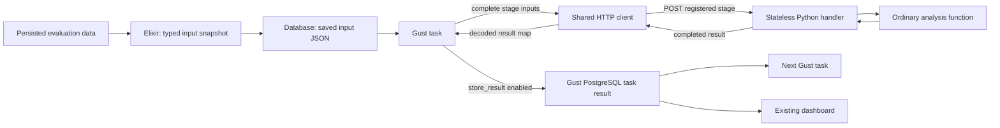

# Evaluation stage integration — current prototype design

Status: current design for the staged rebuild. See the implementation plan and stage handoffs for runtime status. This design replaces data-binding compilation, a durable Python operation server, and archive-based interchange. No Gust fork is authorized.

Related records:

- [Staged implementation plan and ownership](evaluation-rebuild-plan.md)
- [Interview and decisions](grilling-evaluation.md)
- [Current pipeline](evaluation-pipeline.md)
- [Gust source assessment](gust-evaluation-review.md)

## 1. Accepted decisions

- Use one shared study DAG definition, with a new Gust run for each study execution. Specification is input data; Pilot and Final are sections of the same run.
- Replace the giant specification with smaller typed stage-related structures. The root embeds those structures instead of containing every individual setting. Save the composition as one JSON document; no separate configuration-record IDs are required.
- Gust owns dependency scheduling, progress, retries, and saved task results.
- Python is a compute-only, idempotent, stateless HTTP server.
- Each Python request returns its completed typed JSON result in the HTTP response.
- Save and load typed input snapshots and results as database JSON. Use the existing dashboard to display results.
- Remove ZIP bundles and their preparation, loading, file manifests, checksums, and result packaging from the target workflow. Do not preserve that interchange format as a compatibility requirement.
- Use ordinary Gust task declarations. Explain data flow in comments; do not build a data-binding DSL or compiler.
- Delete obsolete behavior, tests, adapters, configuration, and active documentation during each stage. No legacy copies or disabled compatibility paths; Git history is the recovery source.
- Preserve completed stage results. Retry only the interrupted stage with the same effective inputs and seed policy.
- A lost response may cause repeated computation. Exactly-once execution and server-side request deduplication are not required.
- Internal numerical checkpoints and production deployment-version recovery are deferred.

The exact stage boundaries and request/response schemas remain provisional.

## 2. Architecture



Python does not retain a workflow session, stage-operation table, background job registry, or result lookup service. It must not depend on a previous request, process-local cache, or temporary path created by another stage.

A long-lived Python service process is compatible with stateless handlers. Request-local working files and bounded compute concurrency are implementation details, not durable execution state.

## 3. Small shared integration

### Specification composition

The root Specification composes smaller configuration contracts. A stage receives the relevant configuration, not the whole root. Shared scientific rules have one owner; do not create independently editable Pilot and Final copies of the same rule.

Accepted: embed nested typed structures and serialize them as one JSON specification. Do not add separate configuration-record IDs, tables, or lookup machinery. This composition does not define Gust data bindings or create separate DAGs. Keep mutable execution state, evidence snapshots, and computed results separate from the configuration definition.

The current persisted specification row already stores identity/title/version and one content map. The proposed cleanup gives that content smaller typed models; it does not require a database table per type.

| Proposed type | Owns | Used by |
| --- | --- | --- |
| PreparationSpec | Tier declarations and separate phase seed-schedule instances | Input preparation and compatibility checks |
| ComparisonSpec | Shared alternatives, reference, budgets, and outcome/family | Comparison building, Pilot, and Final |
| PilotSpec | Candidate grid, precision target, and recommendation settings | Pilot tasks |
| CorrectionSpec | Method and complete-family invariant | Final correction |

Root fields compose these contracts. Do not add an empty FinalSpec or one public configuration type per helper simply for symmetry. Keep shared policies in one place. A reusable schedule type has different Pilot and Final values, with cross-phase disjointness checked.

Accepted ownership: common confidence/resampling/analysis-seed settings remain with the selected evaluation inputs. Check their compatibility and carry the validated values in the typed stage input. The specification cleanup does not introduce a study-owned AnalysisSpec. See [Q13](grilling-evaluation.md#q13--specification-composition) for the source findings and accepted nested-structure choice.

### Elixir

Build a typed input snapshot from the selected persisted evaluations and save it as database JSON. Save the required observations and scientific configuration, not only IDs that would require later reads from changing source data. The snapshot can use Gust's saved task result initially; do not introduce a second snapshot store without a need.

Keep a small HTTP client and ordinary result-access helpers. Elixir loads the saved JSON and each task body explicitly chooses the inputs it needs. Comments explain the sources and consumers. Python does not need database access to resolve a snapshot ID.

Suggested comment shape:

```elixir
# Input: comparison matrix from the comparisons stage.
# Output: primary estimate consumed by family correction.
```

The task returns the decoded JSON map with Gust result storage enabled. This uses Gust's existing persistence path rather than adding Python operation persistence.

The client should handle request encoding, response validation, error/status handling, configurable timeouts, and correlation metadata. It does not need a generic data-binding resolver or a stage-operation poller.

Gust's existing reusable action hook may still be useful for repeated transport code, but there is no need to introduce it if an ordinary client function is clearer.

### Python

Keep:

- An allowlisted stage registry.
- Input/output request models.
- Stage handlers that call ordinary analysis functions.
- Typed JSON parsing and validation.
- Explicit seed and configuration inputs.

Use Ecto embedded schemas for Elixir-owned specification configuration and Pydantic for Python stage API contracts. The user selected this stack; versions and concrete fields remain implementation work. A contract describes the data structure; scientific checks also enforce cross-tier compatibility, seed separation, shared attack alignment, crossed-matrix structure, and complete comparison families.

Retain those scientific rules. Remove archive-member checks, extraction safety logic, file checksums, and archive-related CSV/string conversion. Boundary model validation and ordinary scientific helpers do not each need a separate DAG task.

Do not add a Python dependency scheduler, operation database, background job queue, submit/status protocol, callback mechanism, or artifact service for this prototype by default.

## 4. HTTP interface

Proposed minimal endpoints:

| Method and path | Purpose |
| --- | --- |
| `GET /healthz` | Existing health check |
| `POST /v1/stages/{stage_name}` | Execute an allowed stage and return its completed result |
| `GET /v1/stages` | Optional discovery of stage names and schemas |

There are no `/operations` endpoints in this design.

Send and return typed JSON for all analysis stages, including result assembly. The request supplies the required data, parameters, and seed policy. Do not return an opaque handle whose meaning depends on memory from an earlier Python request.

There is no archive-upload or binary-report exception. Loading an input means Elixir reads a saved JSON snapshot and sends its content. Reading a result means loading the saved response data for the next task or existing dashboard.

### Success and failure

- Return a successful response only when computation finishes and the result is available in the response body.
- Reject invalid stage names or input contracts clearly.
- Report computation failures so the Gust task can fail or retry according to policy.
- A timeout or broken connection does not prove Python stopped computing.
- Retrying the same effective inputs and seed may repeat work but must not change the scientific result or create duplicate logical effects.
- Correlation IDs support diagnostics; they are not a server-side deduplication mechanism.

Scientific idempotence does not require identical wall-clock durations, response headers, or diagnostic timestamps.

## 5. Completed results and recovery

For JSON-sized intermediate results:

1. Gust calls Python with the complete stage input.
2. Python returns a JSON result.
3. The Gust task returns that decoded map with `store_result: true`.
4. Gust saves the task result in PostgreSQL.
5. Later tasks read it through ordinary task code.

If the HTTP request or task execution is interrupted, Gust retries the same computation. If Python already finished but the response was lost, the work may run again. This is accepted by the compute-only design.

Completed Gust task results remain the reuse boundary. The source-supported recovery path still needs a restart test before the prototype's behavior is claimed as verified.

### Result representation

Use explicit JSON contracts for input snapshots, numerical intermediate values, and final results. Convert NumPy objects to the declared JSON representation at the boundary. The dashboard consumes structured result data, not a generated report archive.

Return only the data needed by downstream tasks. Measure representative payload sizes before fixing stage granularity. If transfers are unnecessarily large, first consider a coarser stage boundary. Do not introduce stateful Python handles or archive bundles as a workaround.

No base64 ZIP, binary report store, or file-packaging step is part of this design.

## 6. Complete provisional stage catalog

These are logical boundaries, not an approved implementation plan or a promise of one HTTP call per row. Preserve scientific methods and dashboard data meaning while extracting the stages. Legacy archive/file-format compatibility is not required.

**Accepted DAG grouping:** One shared study DAG, with one run per study execution. Specification is input data, not a DAG. Pilot and Final are sections of that run. Save Pilot results before the manual gate, then prepare a separate Final input snapshot and continue. No separate phase-DAG orchestration is required. See [Q12](grilling-evaluation.md#q12--dag-grouping).

```text
Specification → prepare Pilot JSON → Pilot tasks → save Pilot result
                                                        ↓
                                             manual Final-input gate
                                                        ↓
                 save Final result ← Final tasks ← prepare Final JSON
```

Shared catalog entries represent reusable implementations. Each use has a distinct phase-specific task identity, so preparation for Final does not loop back to the Pilot preparation node.

### Specification and shared preparation

| ID | Stage | Runtime | Input → output |
| --- | --- | --- | --- |
| S1 | Resolve and validate study specification | Elixir | Saved specification → locked rules and expected family |
| S2 | Preflight selected evidence | Elixir | Tier/run mapping and phase → eligible compatible selections |
| S3 | Prepare and save typed input snapshot | Elixir | Selections and persisted observations → validated JSON snapshot in the database |
| S5 | `study.build_comparisons` | Python | Typed evidence and family → crossed comparison data and stable identities |
| S6 | `study.runtime_inputs` | Python | Typed runtime evidence → existing Pilot runtime-model inputs |
| S7 | Validate and save result | Elixir | Typed response and expected identity → saved JSON consumed by the dashboard |

Former S4, `study.load_evidence`, is removed. There is no ZIP loading stage. Parse the typed request at the HTTP boundary. Keep scientific checks as model validators or ordinary helpers; retain a separate computation stage only when it performs a useful transformation.

### Pilot

| ID | Stage | Unit |
| --- | --- | --- |
| P1 | `pilot.build_grid` | Once: validate candidate bounds and produce work items |
| P2 | `pilot.evaluate_candidate` | Initially one task per candidate, with its expected comparison rows |
| P3 | `pilot.select_candidate` | Whole-Pilot fan-in; precision rules and runtime ranking |
| P4 | `pilot.assemble_result` | Typed precision rows, recommendation, runtime/context metadata, and dashboard result data |

Candidate work items carry stable identities. Scientific seed derivation remains in the existing Python methods. Gust task IDs and completion order must not become seed inputs.

```text
Saved typed input → grid → mapped candidate evaluation → selection → JSON result
                 └──────── runtime inputs ────────────────────┘
```

Do not make bootstrap iterations remote tasks. Candidate results do not become the observations used to construct crossed matrices.

### Pilot-to-Final handoff

| ID | Stage | Status |
| --- | --- | --- |
| H1 | Check Pilot eligibility | Preserve current rules |
| H2 | Freeze Final inputs and select separate evidence | Human/application handoff |
| H3 | Continue the Final phase with its approved tier mapping | Same study DAG run |

Automatic Final collection is not approved. These steps are outside the first analysis slice.

### Final

Final reuses S1–S3, S5, and S7.

| ID | Stage | Unit |
| --- | --- | --- |
| F1 | `final.estimate_comparison` | One mapped task per tier/comparison |
| F2 | `final.correct_family` | Complete-family fan-in; one Holm correction |
| F3 | `final.assemble_result` | Typed corrected primary family, tier context, metadata, and dashboard result data |

```text
Saved typed input → mapped estimates → complete-family correction → JSON result
```

Fan-in checks the expected key set, rejects missing/duplicate results, and uses the frozen scientific ordering.

### Detailed result data

| ID | Stage/group | Existing concerns |
| --- | --- | --- |
| R1 | `analysis.compute_details` | Typed secondary outcomes, capabilities, plan variation, CDF, host probabilities, runtime, and feasibility data |

Use the existing dashboard for presentation. Former R2/R3 file-rendering and archive-packaging nodes are not part of the target workflow. Any remaining result assembly produces structured JSON, not files. Detailed sections do not automatically become members of the Final primary family; their scientific role remains distinct.

### Existing collection and possible later wrappers

| ID | Stage | Owner |
| --- | --- | --- |
| C1 | Resolve graph revision, evaluation configuration, and shared attack schedule | Existing Elixir evaluator |
| C2 | Select and persist plans | Evaluation/optimization domain |
| C3 | Run no-defense experiment | Evaluation/simulation domain |
| C4 | Run defended experiments | Evaluation/simulation domain |
| C5 | Complete and persist evaluation data | Evaluation domain and typed data contracts |

The evaluator currently owns this sequence. Independent Gust nodes require additional refactoring. Network generation, warm-ups, timing-replica acceptance, and automatic collection are not silently added to the analysis prototype.

## 7. Complexity and scope

The previous 800–1,450 LOC estimate covered rejected binding compilation, asynchronous operation handling, and Python-owned persistence. It is no longer an estimate for the selected design.

The remaining shared code is smaller: an HTTP client, result-access conveniences, a Python stage registry, schemas, and handlers. Most remaining work is extracting useful analysis stages and defining their payloads—not building a workflow runtime.

Do not issue a new line-count promise before deciding payload shapes and checking a real mapped Pilot path. Tests and domain refactoring remain separate from transport-helper size.

Recommended first slice: a typed JSON snapshot of existing completed Pilot evidence, mapped candidate evaluation, fan-in, a JSON result response, and database persistence. Check numerical results and dashboard data against current behavior. Interrupt an HTTP stage and verify completed Gust results are reused.

The later implementation must remove ZIP builders/readers, archive-only manifests and checksums, archive-related CSV conversion, file-result adapters, packaging/download paths, and ZIP-specific tests. Replace format-specific assertions with typed-contract and numerical checks. Stage 1 owns removal of the approved legacy setup; later stages must not restore obsolete compatibility paths.

## 8. Evidence

- [Gust DSL and result-storage option](https://github.com/marciok/gust/blob/23fc8361482c2f85169c89a384d3a5ee73c2f317/apps/gust/lib/gust/dsl.ex)
- [Gust task execution](https://github.com/marciok/gust/blob/23fc8361482c2f85169c89a384d3a5ee73c2f317/apps/gust/lib/gust/dag/runner/task_execution.ex)
- `src/lib/network_defense/evaluation/study/study_runner.ex:276-390`: existing preparation and verification.
- `evaluation/analysis/src/network_defense_analysis/study.py:172-363`, `:738-1174`: shared loading, Final, and Pilot logic.
- `evaluation/analysis/src/network_defense_analysis/report.py:187-505`: comparisons and detailed outputs.
- `evaluation/analysis/src/network_defense_analysis/service.py:84-199`: current request-local temporary files.

No runtime probe, integration test, or dependency installation ran for this design.
