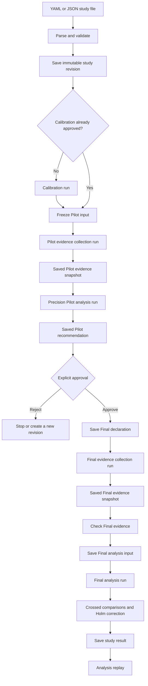
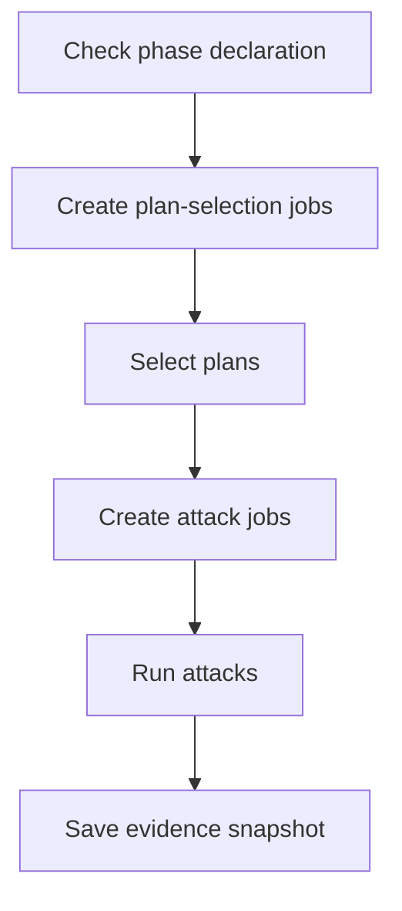
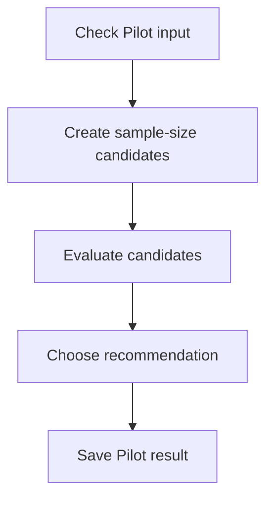
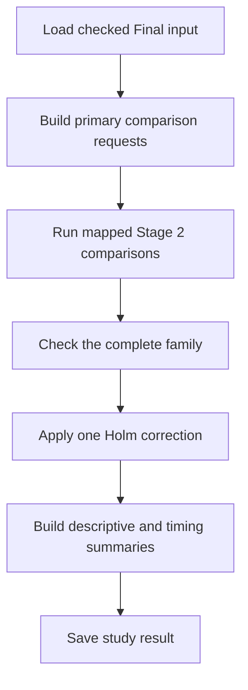
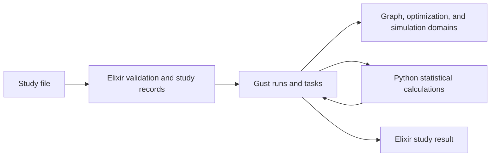

# Evaluation study pipeline overview

**Status:** Proposed high-level design, held as a draft in this branch worktree. Unimplemented, and no detailed contract is approved. The Stage 2, Stage 3, and Stage 4 statistical workflows are implemented and merged into `evaluation/rebuild`; see the [implemented evaluation pipeline](evaluation-pipeline.md). The lifecycle, the evidence collector, the Final policies, and the YAML or JSON language below do not exist in the software. Existing public Stage 4 operations accept any contract-valid numeric data, but only synthetic development evidence has been tested and authorized.

The separate [Stage 5 overview](evaluation-stage-5-overview.md) now defines thin Pilot-to-Final wiring. It loads a fresh Final snapshot, adapts bounded requests, and reuses the existing comparison and Holm engines. It has no standalone declaration or approval object, no `StudyRevision` table or foreign key, and no automatic collection step. The full lifecycle below remains a future design: its manual approval and future GUI policy are unchanged and are not implemented by the Stage 5 prototype.

## Purpose

This document shows how a small YAML or JSON language could drive the complete study lifecycle.

The language describes the study. It does not contain executable code. Elixir validates the input and creates work items for fixed Gust DAGs.

The Stage 2, Stage 3, and Stage 4 paths exist and are implemented. Stage 5 has a thin adapter, which is implemented but uncommitted in this worktree. The language and the lifecycle below remain proposals.

## Simplicity choices

The first version should use simple database identities and revisions.

Use:

- a study identifier and revision number;
- immutable graph revision IDs;
- immutable evidence snapshot IDs;
- immutable Pilot and Final result IDs;
- normalized JSON stored by the Elixir application; and
- explicit application and compute versions.

For the Stage 5 prototype, the study and revision values are UUID equality labels only. Do not add a `StudyRevision` table, create/get API, backfill, or foreign key. The full lifecycle may revisit its future domain model in a separate review.

Do not require:

- SHA-256 checks;
- content-addressed storage;
- signed manifests;
- archive checksum files;
- legacy ZIP packages; or
- a Python artifact store.

A frozen record cannot change in place. A scientific change creates a new revision. This rule provides the first reproducibility boundary without cryptographic checks.

If the study later moves evidence between independent systems, checksums can be added at that boundary.

## Main design rule

The YAML or JSON input produces data. It does not generate Elixir modules.

```text
YAML or JSON
    → decode
    → schema checks
    → scientific checks
    → typed Elixir structure
    → normalized JSON study revision
    → ordered work items
    → fixed Gust DAGs
```

If the chosen tooling supports it clearly, the pipeline view should come from the same declarations that assemble execution. The view must not become a second specification.

The input must not contain:

- Elixir or Python code;
- arbitrary expressions;
- database queries;
- dynamic module names;
- task IDs;
- worker names;
- service URLs;
- secrets; or
- environment-variable expansion in scientific fields.

## Full lifecycle

Use separate durable runs for the main phases.



Separate runs make these boundaries visible:

- Pilot evidence collection;
- Pilot sample-size selection;
- human approval;
- Final rule freeze;
- Final evidence collection; and
- Final analysis.

Gust supports waiting for an external event. However, the Pilot-to-Final approval should create a new saved declaration and a new run. This is easier to review than one long paused run.

## Illustrative miniDSL

The values below are examples only. They are not approved study settings, and the language is unimplemented.

```yaml
schema_version: 1

study:
  id: topology-scale-thesis
  revision: 1
  title: Topology scale defense comparison

model:
  revision: mission-model-v1
  attacker_context: enterprise-entry-v1
  defense_semantics: action-count-v1

graphs:
  - tier: small
    revision: graph-small-v1
  - tier: medium
    revision: graph-medium-v1
  - tier: large
    revision: graph-large-v1

primary_family:
  tier_order: [small, medium, large]
  alternative_order:
    - random
    - segmentation
    - simulation_informed
    - simulated_annealing
  budget_order: [2, 4, 6]
  reference: cvss
  outcome: mission_impact

descriptive_controls:
  - no_defense

pilot:
  selection_seeds: [1101, 1102, 1103, 1104, 1105]
  evaluation_roots:
    small: 1201
    medium: 1202
    large: 1203

  candidates:
    plan_counts: [5, 8, 12]
    attacks_per_plan: [20, 40, 80]

  precision:
    target_half_width: 0.50
    guard_quantile: 0.90
    outer_repeats: 100
    seed: 1301

final:
  selection_seed_pool:
    - 2101
    - 2102
    - 2103
    - 2104
    - 2105
    - 2106
    - 2107
    - 2108
    - 2109
    - 2110
    - 2111
    - 2112

  evaluation_roots:
    small: 2201
    medium: 2202
    large: 2203

analysis:
  comparison_method: corrected_crossed_bootstrap_v1
  test_method: centered_crossed_bootstrap
  bootstrap_repeats: 10000
  confidence_level: 0.95
  family_correction: holm
  alpha: 0.05
  random_stream_policy: historical_offset_v1
  stream_root: 2301

timing:
  excluded_warmups: 1
  measured_replicas: 5

environment:
  id: local-study-environment-v1
  application_version: thesis-app-v1
  compute_version: evaluation-compute-v1
```

## Why order is explicit

The primary family uses ordered lists. The compiler expands them in this order:

```text
tier order × alternative order × budget order
```

Each comparison identity contains:

```text
tier
budget
alternative
reference
outcome
```

The order controls:

- comparison positions;
- historical seed offsets;
- Gust mapped-task positions;
- deterministic tie handling; and
- report order.

The implementation must not sort tier names alphabetically.

## Input checks


### File checks

- The file uses YAML or JSON.
- The file size is bounded.
- Object keys are strings.
- Duplicate keys are rejected.
- YAML custom tags are rejected.
- YAML aliases and merge keys are rejected.
- Numbers are finite.

### Schema checks

- The schema version is supported.
- Required fields exist.
- Unknown fields are rejected.
- Integers, numbers, strings, and lists use strict types.
- Identifiers are non-empty and bounded.

### Scientific checks

- CVSS is the primary reference.
- No-defense remains descriptive.
- The primary family has no duplicate identity.
- Graph and model revisions exist.
- Pilot and Final seed values do not overlap.
- Every tier has one evaluation root in each phase.
- Candidate counts meet the approved lower bounds.
- Analysis settings agree across tiers.
- Holm applies to one complete primary family.
- Scientific order is explicit.

## Elixir loader pseudocode

The pseudocode in this document is illustrative.

```elixir
defmodule NetworkDefense.Evaluation.Study.SpecificationLoader do
  alias NetworkDefense.Evaluation.Study.{
    ScientificRules,
    Specification,
    Wire
  }

  def load(path) do
    with {:ok, bytes} <- bounded_read(path),
         {:ok, raw} <- decode(path, bytes),
         :ok <- require_json_values(raw),
         {:ok, specification} <- Specification.parse(raw),
         :ok <- ScientificRules.validate(specification) do
      {:ok,
       %{
         specification: specification,
         normalized: Wire.specification(specification),
         source_format: source_format(path)
       }}
    end
  end

  defp decode(path, bytes) do
    case Path.extname(path) do
      ".json" -> StrictJSON.decode(bytes)
      ".yaml" -> RestrictedYAML.decode(bytes)
      ".yml" -> RestrictedYAML.decode(bytes)
      _other -> {:error, :unsupported_format}
    end
  end
end
```

YAML is an authoring format. Elixir stores the normalized JSON-compatible map.

## Save an immutable study revision

```elixir
defmodule NetworkDefense.Evaluation.Studies do
  alias NetworkDefense.Evaluation.StudyRevision
  alias NetworkDefense.Repo

  def create_revision(path) do
    with {:ok, loaded} <- SpecificationLoader.load(path),
         :ok <- reject_existing_revision(loaded.specification) do
      %StudyRevision{}
      |> StudyRevision.changeset(%{
        study_id: loaded.specification.study.id,
        revision: loaded.specification.study.revision,
        specification: loaded.normalized,
        source_format: loaded.source_format
      })
      |> Repo.insert()
    end
  end
end
```

The database must reject another record with the same study ID and revision. The existing record is never updated in place.

## Compile work items, not code

```elixir
defmodule NetworkDefense.Evaluation.Study.Compiler do
  alias NetworkDefense.Evaluation.Study.{
    ComparisonIdentity,
    StudyPlan
  }

  def compile(specification) do
    with {:ok, family} <- compile_family(specification),
         :ok <- verify_disjoint_phase_seeds(specification),
         {:ok, pilot} <- compile_pilot(specification, family),
         {:ok, final_template} <-
           compile_final_template(specification, family) do
      {:ok,
       %StudyPlan{
         study_id: specification.study.id,
         revision: specification.study.revision,
         ordered_family: family,
         pilot: pilot,
         final_template: final_template
       }}
    end
  end

  defp compile_family(specification) do
    family =
      for tier <- specification.primary_family.tier_order,
          alternative <-
            specification.primary_family.alternative_order,
          budget <- specification.primary_family.budget_order do
        %ComparisonIdentity{
          tier: tier,
          budget: budget,
          alternative: alternative,
          reference: specification.primary_family.reference,
          outcome: specification.primary_family.outcome
        }
      end

    validate_unique_identities(family)
  end
end
```

The DAG modules remain checked-in Elixir code. The compiler creates only ordered input data.

## Public lifecycle API

Do not provide one `run_everything/1` function. The approval step must stay explicit.

The API sketch in this section belongs to the future full lifecycle. Its `approve_final` example represents a future manual approval policy and remains unchanged. The current Stage 5 prototype has a separate boundary: an explicit caller creates a Final snapshot and submits a Final run that reuses the existing comparison and Holm engines. See the [Stage 5 overview](evaluation-stage-5-overview.md#public-api).

```elixir
defmodule NetworkDefense.Evaluations do
  alias NetworkDefense.Evaluation.Study

  def create_study_revision(path) do
    Study.Studies.create_revision(path)
  end

  def start_pilot_collection(study_revision_id) do
    Study.CollectionWorkflow.submit(
      study_revision_id,
      :pilot
    )
  end

  def start_pilot_analysis(pilot_evidence_snapshot_id) do
    Study.PilotWorkflow.submit(pilot_evidence_snapshot_id)
  end

  def approve_final(pilot_result_id, approval) do
    Study.FinalDeclaration.create(
      pilot_result_id,
      approval
    )
  end

  def start_final_collection(final_declaration_id) do
    Study.CollectionWorkflow.submit(
      final_declaration_id,
      :final
    )
  end

  def check_final_evidence(final_evidence_snapshot_id) do
    Study.FinalInput.create(final_evidence_snapshot_id)
  end

  def start_final_analysis(final_input_id) do
    Study.FinalWorkflow.submit(final_input_id)
  end

  def get_study_result(final_run_id) do
    Study.FinalWorkflow.result(final_run_id)
  end
end
```

Every public function validates its input before it creates a Gust run.

## Evidence collection DAG

Pilot and Final can use the same fixed collection shape. Phase-specific validation keeps their inputs separate.



```elixir
defmodule NetworkDefense.Evaluation.Study.CollectionDAG do
  use Gust.DSL

  alias NetworkDefense.Evaluation.Study.Collection.Actions

  task_action :prepare_plan_jobs,
    {Actions.PreparePlanJobs, []},
    downstream: [:select_plan],
    store_result: true

  task_action :select_plan,
    Actions.SelectPlan,
    ctx: %{params: job},
    map_over: :prepare_plan_jobs,
    downstream: [:prepare_attack_jobs],
    store_result: true do
    [job: job]
  end

  task_action :prepare_attack_jobs,
    {Actions.PrepareAttackJobs, []},
    downstream: [:run_attack],
    store_result: true

  task_action :run_attack,
    Actions.RunAttack,
    ctx: %{params: job},
    map_over: :prepare_attack_jobs,
    downstream: [:assemble_evidence],
    store_result: true do
    [job: job]
  end

  task_action :assemble_evidence,
    {Actions.AssembleEvidence, []},
    store_result: true
end
```

Each preparation task returns:

```elixir
%{"gust_task_items" => ordered_jobs}
```

The actions call the retained graph, optimization, and simulation domains. Python does not collect or store evidence.

Large evidence matrices should be stored in Elixir-owned evidence tables. Gust parameters and results should contain snapshot IDs and compact summaries.

## Precision Pilot analysis DAG

Stage 4 starts from a saved Pilot evidence snapshot.



```elixir
defmodule NetworkDefense.Evaluation.Study.PilotDAG do
  use Gust.DSL

  alias NetworkDefense.Evaluation.Study.Pilot.Actions

  task_action :prepare_candidates,
    {Actions.PrepareCandidates, []},
    downstream: [:evaluate_candidate],
    store_result: true

  task_action :evaluate_candidate,
    Actions.EvaluateCandidate,
    ctx: %{params: candidate},
    map_over: :prepare_candidates,
    downstream: [:select_candidate],
    store_result: true do
    [candidate: candidate]
  end

  task_action :select_candidate,
    {Actions.SelectCandidate, []},
    downstream: [:assemble_pilot_result],
    store_result: true

  task_action :assemble_pilot_result,
    {Actions.AssembleResult, []},
    store_result: true
end
```

The candidate calculation uses the saved Pilot evidence. It must not use Gust task IDs, workers, retries, or completion order as scientific random inputs.

## Final approval and declaration

Approval creates a new record. It does not change the Pilot result.

```elixir
defmodule NetworkDefense.Evaluation.Study.FinalDeclaration do
  def create(pilot_result_id, approval) do
    with {:ok, pilot_result} <- load_eligible_pilot(pilot_result_id),
         :ok <- validate_approval(approval),
         {:ok, declaration} <-
           build_from_pilot(pilot_result, approval),
         :ok <- verify_disjoint_seeds(declaration) do
      insert_new_declaration(declaration)
    end
  end
end
```

The declaration records:

- the Pilot result ID;
- selected plan and attack counts;
- ordered primary family;
- Final seed sets;
- graph and model revision IDs;
- analysis settings;
- environment ID;
- approver identity; and
- approval time.

A scientific change creates a new declaration revision.

## Final evidence check

After separate Final collection, Elixir creates one checked Final input.

```elixir
defmodule NetworkDefense.Evaluation.Study.FinalInput do
  def create(final_evidence_snapshot_id) do
    with {:ok, snapshot} <- load_snapshot(final_evidence_snapshot_id),
         {:ok, declaration} <- load_declaration(snapshot),
         :ok <- require_final_phase(snapshot),
         :ok <- verify_graph_revisions(snapshot, declaration),
         :ok <- verify_model_revision(snapshot, declaration),
         :ok <- verify_seed_separation(snapshot, declaration),
         :ok <- verify_counts(snapshot, declaration),
         :ok <- verify_attack_alignment(snapshot),
         :ok <- verify_complete_family(snapshot, declaration) do
      insert_final_input(snapshot, declaration)
    end
  end
end
```

The check does not remove invalid evidence. One failed requirement blocks Final analysis.

## Final analysis DAG



```elixir
defmodule NetworkDefense.Evaluation.Study.FinalDAG do
  use Gust.DSL

  alias NetworkDefense.Evaluation.{Family, Study.Final.Actions}

  task_action :prepare_family,
    {Actions.PrepareFamily, []},
    downstream: [:compare_member],
    store_result: true

  task_action :compare_member,
    Family.Actions.CompareMember,
    ctx: %{params: member},
    map_over: :prepare_family,
    downstream: [:correct_primary_family],
    store_result: true do
    [member: member]
  end

  task_action :correct_primary_family,
    {Actions.CorrectPrimaryFamily, []},
    downstream: [:assemble_study_result],
    store_result: true

  task_action :assemble_study_result,
    {Actions.AssembleStudyResult, []},
    store_result: true
end
```

The Final wrapper can reuse the Stage 3:

- family identity rules;
- family collector;
- Holm client;
- Holm response validation; and
- result assembly helpers.

The Stage 2 comparison action remains unchanged.

## Data ownership



| Data | Owner | Storage |
| --- | --- | --- |
| YAML or JSON source | User and Elixir loader | Source file |
| Normalized study revision | Elixir | Application database |
| Future lifecycle approval and Final declaration | Elixir | Application database |
| Large evidence observations | Elixir | Evidence tables |
| Evidence snapshot metadata | Elixir | Application database |
| Scheduling, retries, and task state | Gust | Gust tables |
| Small task inputs and results | Gust | Gust JSON fields |
| Crossed bootstrap and Pilot calculations | Python | Returned in HTTP response |
| Holm calculation | Python | Returned in HTTP response |
| Final study result | Elixir | Application database and Gust result |

Python stores no study data.

The proposed presentation uses the existing dashboard to display saved result data. It replaces archive interchange and report packaging with typed records. It does not add a new presentation surface.

## Required checks

The first version should check what can change scientific meaning.

### Study checks

- study ID and revision are unique;
- graph and model revision IDs exist;
- family identities are complete and unique;
- analysis settings are explicit;
- Pilot and Final seed values are disjoint; and
- ordered dimensions are stable.

### Evidence checks

- evidence uses the expected phase;
- graph, model, strategy, budget, and outcome match;
- required plan and attack counts exist;
- attack columns have the same identity and order;
- plan rows remain independent;
- evaluation-root coverage is complete; and
- Pilot observations do not enter Final evidence.

### Analysis checks

- every declared comparison produces one result;
- no missing, duplicate, or unexpected family member exists;
- non-informative comparisons remain in the family;
- Holm runs once on the complete family; and
- stored results pass typed read-back validation.

## Checks not required in the first version

Do not add these until a real need exists:

- SHA-256 checks;
- content hashes;
- signed approvals;
- cryptographic evidence manifests;
- archive checksums;
- bitwise replay across different deployments; or
- external object storage.

The first version uses immutable database rows, revision IDs, foreign keys, and explicit versions.

## Study result

```elixir
%StudyResult{
  schema_version: 1,
  study_revision_id: "study-revision-1",
  calibration_result_id: "calibration-1",
  pilot_evidence_snapshot_id: "pilot-evidence-1",
  pilot_result_id: "pilot-result-1",
  final_declaration_id: "final-declaration-1",
  final_evidence_snapshot_id: "final-evidence-1",
  final_input_id: "final-input-1",
  final_run_id: "gust-run-1",
  primary_family: %FamilyResult{},
  descriptive_results: %{},
  timing_summary: %{},
  application_version: "thesis-app-v1",
  compute_version: "evaluation-compute-v1",
  warnings: [],
  limitations: [
    "Results are conditional on one frozen graph per tier.",
    "Confidence intervals are per-comparison intervals."
  ]
}
```

This is a typed result record. It is not a ZIP archive.

## Replay

### Analysis replay

```elixir
Evaluations.replay_analysis(final_input_id)
```

This creates a new analysis run from the saved Final input. It repeats:

```text
comparison requests → crossed statistics → Holm → result assembly
```

It does not rerun plan selection or attacks.

### Full scientific rerun

```elixir
Evaluations.rerun_study(study_revision_id)
```

This creates new collection and analysis runs from the saved study revision. Fixed scientific inputs and seeds should reproduce equivalent scientific outcomes.

Runtime durations do not need to match.

### Interrupted runs and recovery

Gust can reuse completed task results when a stage is retried with the same inputs and seed policy. A lost HTTP response can repeat one calculation, because idempotence does not deduplicate execution. The first version needs no internal numerical checkpoints. Recovery across incompatible deployments is deferred. See [the interrupted-stage decision](grilling-evaluation.md#q7--interrupted-stages) and [the deployment-version decision](grilling-evaluation.md#q8--deployment-versions).

## Relationship to current stages

| Stage | Role in this overview | Current status |
| --- | --- | --- |
| Stage 1 | Removed the legacy evaluation subsystem | Complete |
| Stage 2 | One crossed comparison | Implemented and accepted |
| Stage 3 | Complete-family Holm operation | Implemented and accepted |
| Stage 4 | Precision Pilot over saved evidence | Implemented and accepted |
| Stage 5 | Pilot-to-Final wiring through a Final snapshot and existing comparison/Holm engines | Thin adapter implemented; uncommitted in this worktree |
| Later work | Collection, Final result assembly, and replay | Not staged or approved |

## Decisions still needed

A detailed implementation design must decide:

- the YAML parser and restricted YAML rules;
- the study revision database schema;
- the evidence table shape;
- the size limit for one evidence snapshot;
- collection-run grouping and the exact collection-stage granularity;
- payload sizes for representative data;
- calibration inputs and outputs;
- the approval owner;
- exact Pilot and Final command interfaces;
- report output format; and
- numerical equality rules for replay.

These decisions require separate review. This overview does not authorize implementation, database migrations, evidence collection, or deployment.
