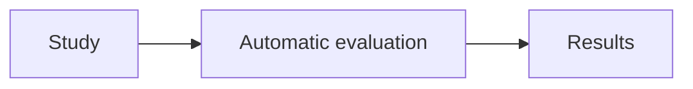
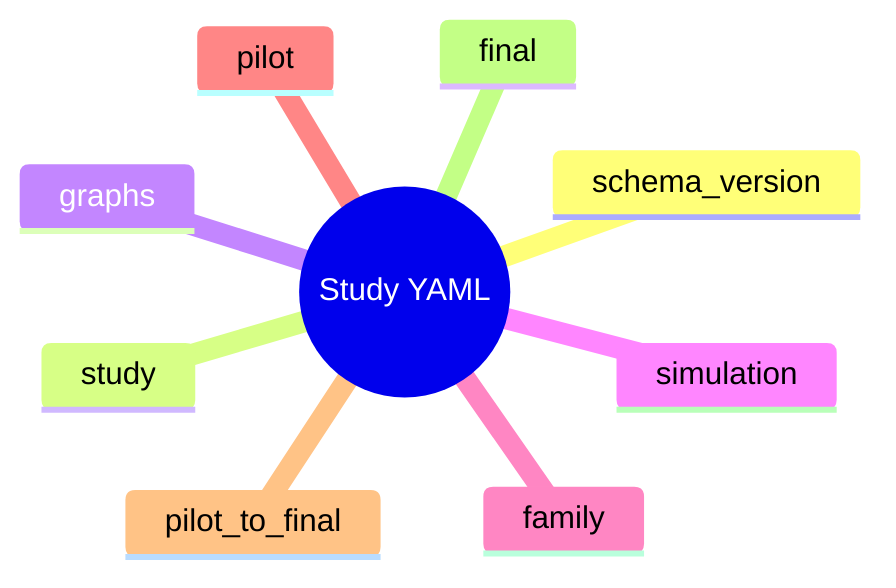
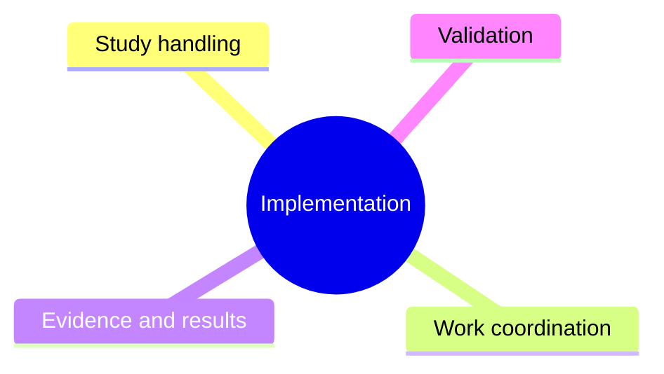
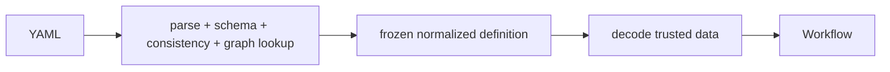
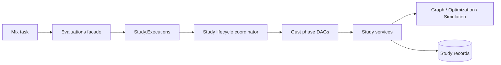

# Evaluation2 redesign — context and method

> Design-interview history. Later decisions can supersede earlier proposals and example interfaces.
> Use the [native operator guide](../evaluation2.md), [current architecture](../architecture/evaluation-architecture.md) and [stable verification record](../history/evaluation2-verification.md) for implemented behavior and status.

> Part of the [Evaluation2 redesign index](grilling-evaluation-redesign.md).

## Purpose

### Q1 — Scope

**Question:** Should the first replacement support complete studies only, or also retain standalone comparison and family operations?

**Recommendation:** Support complete studies first. Keep comparison and family calculations as internal reusable functions. Add standalone workflow operations only when a concrete use requires them.

**Reason:** Each separate operation adds an input contract, submission path, result reader, and verification surface.

**Choices:**

- **Complete studies:** Pilot, explicit approval, fresh Final evidence, statistical analysis, and required timing.
- **Studies and tools:** Complete studies plus supported standalone comparison and family operations.
- **Smaller first slice:** Build only part of the study path first. Specify the intended first outcome before continuing.

**Answer:** Complete study, operated through Mix tasks and supporting code.

**User clarification:** Work top down. Start with a high-level bird's-eye view. Then descend into Elixir modules, data shapes, state machines, and other implementation details.

The answer selects the primary study path. It does not approve a workflow library, persistence model, or command syntax.

### Q2 — Reporting scope

**Question:** Should evaluation produce study results and a terminal summary, or also generate thesis-ready tables and plots?

**Recommendation:** Produce machine-readable study results and a short terminal summary. Let separate reporting tools consume those results.

**Reason:** This gives evaluation a clear completion boundary. Presentation changes can stay separate from collection and inference.

**Answer:** Deferred. Agree the subsystem purpose and boundary before discussing output details.

## Bird's-eye view

**Approved:** Evaluation takes a declared study, runs it, and produces results.



The operator uses Mix tasks. The user approved this level and requested the next zoom.

## Zoom 1 — Study

Study means the existing YAML input that declares the evaluation. Use the current format as the baseline. Existing scenarios, comparisons, and strategies retain their meanings.

Source inspection confirms these eight top-level entries in the current YAML:



- `schema_version` and `study`: definition identity and revision information.
- `graphs` and `simulation`: scenarios, strategy configurations, and evidence-trial controls.
- `family`: declared comparisons and correction settings.
- `pilot`, `pilot_to_final`, and `final`: sampling, analysis, and the approval boundary.

Sources: `contracts/evaluation/study/v1/valid/study-small.yaml`, `src/priv/evaluation/study/v1/schemas/definition.schema.json`, and `.pi/tmp/study-model-field-flow.md`.

Fixed literal declarations include Holm, pause, the Pilot runtime selection rule, and the two-sided Final test. Family alpha and Final alpha are required to agree. Equal values in distinct Pilot/Final or scoring/evidence settings do not by themselves establish redundancy.

Introduce adjustments only when a concrete simplification requires them.

### Q4 — Study meaning

**Earlier question:** Does Study mean only the declared plan, or the plan together with its runs and results?

**Answer:** Study is the YAML input, like the current YAML format. Reuse it and tweak it if needed.

**User correction:** Reuse established scenarios, comparisons, strategies, and supporting code. Do not redesign everything or reopen their definitions. Scouts can inspect the existing source to resolve factual questions.

### Q5 — Start boundary

**Proposed question:** Should a Mix task accept a YAML file and start the study, or should the operator first register a revision and then start it separately?

**Status:** Deferred before asking. The user clarified that existing approaches should be reused while their supporting implementation becomes simpler.

Keep the current input approach as the baseline. Revisit this boundary only if implementation evidence gives a concrete reason.

## Method

### Q3 — Method baseline

**Earlier framing:** The assistant incorrectly presented methodology flexibility as an open design choice.

**User correction:** The methodology was established from the start. Selectable methodologies were never part of the requested design.

**Recorded constraint:** Apply `docs/concepts/evaluation-methodology.md`. Study inputs and settings vary within that methodology. This is an original constraint, not a newly selected feature.

Do not reopen this constraint during the interview unless the user requests a method change.

## Implementation map

The user approved this map as the next level of discussion:



The design question for each branch is: what custom code is necessary, and what can existing libraries provide?

Examine Study handling first. It establishes the trusted definition used by the other branches.

## Study handling

### Q6 — Check ownership

**Proposal:** Validate the study once when the YAML enters the application. Decode trusted stored data on later reads.



```elixir
# External boundary
def create(yaml) do
  with {:ok, raw} <- Yaml.parse(yaml),
       {:ok, definition} <- Definition.parse(raw),
       :ok <- GraphReferences.check(definition) do
    Revisions.insert(definition)
  end
end

# Internal read
def load(revision_id) do
  revision_id
  |> Revisions.fetch!()
  |> Definition.decode_stored!()
end
```

Keep resource checks in the operation that consumes the resource.

```elixir
WorkPlan.build(definition, selection)
ComputeRequest.encode(evidence, analysis_settings)
```

Do not call the full external `Definition.parse/1` path from Pilot and Final loaders.

## Code shape — first pass



Placeholder module shape. These names describe responsibilities. They do not claim that source modules exist.

```text
NetworkDefense.Evaluation.Study
├── Definition          # Existing YAML contract and normalized definition
├── Revisions           # Create and load frozen definitions
├── Executions          # Lifecycle persistence and status
├── Lifecycle           # Reuse/copy current pure transition table
├── Resume              # Validate and freeze Final selection
├── Cancel              # Apply lifecycle cancellation policy
├── Workflow            # Dispatch and await Gust phase DAGs
├── Collection
│   ├── Plan            # Definition + counts + phase -> work items
│   ├── Execute         # Call optimization and simulation APIs
│   └── Evidence        # Work results -> aligned matrices
├── Pilot
│   ├── Analyze         # Candidate/comparison calculations
│   └── Decide          # Complete-family candidate decision
├── Final
│   ├── Collect         # Sequential tiers and replicas
│   ├── Timing          # One clock owner
│   └── Analyze         # Comparison family + Holm
└── Result              # Final result construction and read
```

Avoid modules whose only job is to copy or recheck another internal shape.

### Public functions

Keep the current study operations as the baseline:

```elixir
Evaluations.create_study_revision(yaml)
Evaluations.start_study(revision_id)
Evaluations.study_status(execution_id)
Evaluations.resume_study(execution_id, selection)
Evaluations.cancel_study(execution_id)
Evaluations.study_result(execution_id)
```

Mix tasks are thin adapters:

```text
mix evaluation.study.create <study.yaml>
mix evaluation.study.start <revision-id>
mix evaluation.study.status <execution-id>
mix evaluation.study.resume <execution-id> <selection>
mix evaluation.study.result <execution-id>
mix evaluation.study.cancel <execution-id>
```

The create/start split remains the current baseline. Revisit it only if it creates unnecessary code in the reduced implementation.
