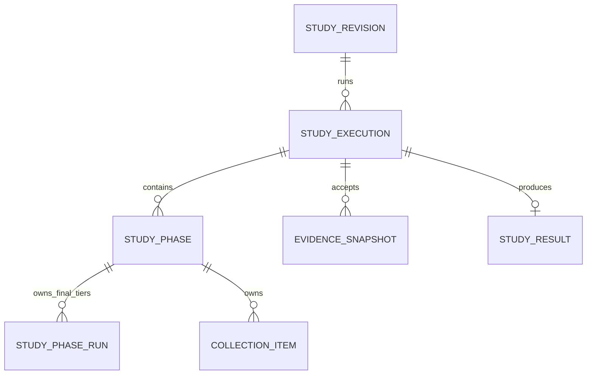

# Evaluation2 redesign — persistence and data model

> Design-interview history. Later decisions can supersede earlier proposals and example interfaces.
> Use the [native operator guide](../evaluation2.md), [current architecture](../architecture/evaluation-architecture.md) and [stable verification record](../history/evaluation2-verification.md) for implemented behavior and status.

> Part of the [Evaluation2 redesign index](grilling-evaluation-redesign.md).
> Covers persistence placeholders, data ownership, and Q9–Q31.

## Persistence shape — placeholders

Keep the current lifecycle, phase-run ownership, and selection fields until the phase contracts show that a field is unnecessary.

```elixir
%StudyExecution{
  id: execution_id,
  study_revision_id: revision_id,
  state: :collecting_pilot | :analyzing_pilot | :awaiting_final |
         :collecting_final | :analyzing_final | :succeeded |
         :failed | :cancelled,
  pilot_outcome: pilot_outcome | nil,
  selected_candidate_id: candidate_id | nil,
  selected_plan_count_per_side: integer | nil,
  selected_attacks_per_plan: integer | nil,
  pilot_override: boolean | nil,
  error: error | nil
}
```

Initial data-owner placeholders:



```text
StudyRevision     normalized YAML definition
StudyExecution    lifecycle, Pilot outcome, frozen selection
StudyPhase        accepted phase Gust run and phase output
StudyPhaseRun     ordered Final tier Gust runs
CollectionItem    immutable planned work and stable optimization/simulation links
EvidenceSnapshot  accepted Pilot or Final matrices
StudyResult       successful compact result
```

The phase records now have a clear owner: they connect the application lifecycle to separate Gust phase runs. Simplify their fields and checks later. The Final handoff remains undecided.

## Data

### Q9 — Evidence handling

**Proposal:** One accepted evidence shape for Pilot and one for Final.

```elixir
%Evidence{
  role: :pilot | :final,
  family_id: family_id,
  comparisons: [
    %ComparisonEvidence{
      identity: identity,
      attack_seeds: seeds,
      alternative: matrix,
      reference: matrix
    }
  ]
}
```

Assembly constructs the evidence from the validated definition and immutable planned work:

```elixir
def assemble(item_ids, definition, role) do
  item_ids
  |> CollectionItems.fetch_many!()
  |> Evidence.build!(definition, role)
  |> EvidenceSnapshots.create_or_load(role)
end
```

The builder iterates the declared family, creates one shared column list, and fills the two matrices at their declared positions. It does not need separate family, alignment, or matrix-size check passes.

Later code uses the accepted snapshot:

```elixir
snapshot = EvidenceSnapshots.fetch!(snapshot_id)
Pilot.Analyze.run(snapshot, definition.pilot)
Final.Analyze.run(snapshot, definition.final)
```

Do not rebuild optimization and simulation history during analysis or result read-back.

## Core service shape

### Collection

```elixir
Collection.Plan.pilot(definition)
#=> [%WorkItem{}]

Collection.Plan.final(definition, selection, tier, replica_position)
#=> [%WorkItem{}]

Collection.Execute.run(collection_item_id)
#=> {:ok, collection_item_id}

Collection.Evidence.assemble(execution_id, role, replica_position)
#=> {:ok, %EvidenceSnapshot{}}
```

Retry-safe effect ownership stays in the stable collection item:

```elixir
def run(item_id) do
  item = CollectionItems.lock!(item_id)
  optimization = CollectionItems.reserve_optimization(item)
  Optimizations.run_reserved(optimization)
  experiment = CollectionItems.reserve_experiment(item, optimization)
  Simulations.run(experiment)
  CollectionItems.complete(item)
end
```

### Pilot

```elixir
Pilot.Analyze.prepare(snapshot, definition)
#=> [%CandidateComparison{}]

Pilot.Analyze.run(candidate_comparison)
#=> %CandidateAssessment{
#     guarded_half_width: number,
#     informative: boolean,
#     passes: boolean
#   }

Pilot.Decide.run(assessments, definition.pilot)
#=> %PilotDecision{
#     outcome: :recommended | :insufficient,
#     recommendation: candidate | nil
#   }
```

Pilot methodology decisions remain mandatory.

```text
Candidate eligibility
  candidate counts fit the collected Pilot matrices

Comparison feasibility
  every outer subsample is informative

Comparison precision
  guarded half-width <= target half-width

Candidate pass
  every declared comparison is feasible and precise

Pilot outcome
  select the passing candidate by the runtime rule
  or return :insufficient when no candidate passes
```

These are observed scientific decisions. Construction cannot guarantee them.

### Approval

Reuse the current application pause and selection-freeze mechanism. Final collection starts as a new coordinated phase after the transaction commits.

```elixir
def resume_study(execution_id, requested_selection) do
  with {:ok, execution} <- Resume.accept(execution_id, requested_selection),
       :ok <- Coordinator.start(execution.id) do
    {:ok, execution}
  end
end
```

`Resume.accept/2` validates the Pilot outcome, freezes the declared candidate, and applies lifecycle event `:resume`. Final tier runs load this selection from `StudyExecution`.

The approval input reuses the current compact union:

```elixir
:recommended
{:override_insufficient, candidate_id}
```

The caller does not provide Final counts. `Resume.accept/2` resolves and freezes them from the declared candidate.

### Q11 — Compact insufficient outcome

**Source fact:** The current selector produces only one insufficient reason: `"no_passing_candidate"`. The terminal Gust result already retains every candidate summary and failed comparison detail.

**Question:** Should the compact `PilotOutcome` store an insufficient reason?

**Recommendation:** Store only the `:insufficient` tag. The reason is implied by the methodology: no declared candidate passed every comparison. Keep the detailed explanation in the terminal Pilot-analysis result.

```elixir
@type t ::
        %PilotOutcome{
          outcome: :recommended,
          candidate_id: String.t(),
          plan_count_per_side: pos_integer(),
          attacks_per_plan: pos_integer()
        }
        | %PilotOutcome{
            outcome: :insufficient,
            candidate_id: nil,
            plan_count_per_side: nil,
            attacks_per_plan: nil
          }
```

**Answer:** Store only the `:insufficient` tag. Do not persist a reason in the compact outcome. The terminal Pilot-analysis result remains the detailed explanation.

Add a reason enum later only if the methodology gains more than one scientifically distinct insufficient outcome.

### Q12 — Frozen selection shape

**Source fact:** The current implementation stores four scalar fields on `StudyExecution` and reconstructs a `Selection` struct. The Evaluation2 scaffold currently defines both representations.

**Worked example:** Approval selects candidate `candidate-b`, which declares six plans per side and twelve attacks per plan.

Scalar execution fields:

```elixir
%StudyExecution{
  selected_candidate_id: "candidate-b",
  selected_plan_count_per_side: 6,
  selected_attacks_per_plan: 12,
  pilot_override: false
}
```

Nested selection:

```elixir
%StudyExecution{
  selection: %Selection{
    candidate_id: "candidate-b",
    plan_count_per_side: 6,
    attacks_per_plan: 12,
    pilot_override: false
  }
}
```

**Question:** Should the Evaluation2 application model own one optional `Selection.t()` value, or retain four optional scalar fields?

**Recommendation:** Use `selection: Selection.t() | nil` in the application model. It makes partial selections unrepresentable and prevents each Final consumer from reconstructing the same value. A persistence adapter can map the value to existing scalar columns if retaining the current table is cheaper than a migration.

**Answer:** Use one nested `Selection.t() | nil` field because it is easier to read. Do not expose four optional selection fields in the Evaluation2 application model.

### Q13 — Pilot override flag

**Source fact:** The current `Selection` stores `pilot_override: boolean()`. The same fact is already implied by the compact Pilot outcome and the approved selection path.

Recommended approval:

```elixir
%StudyExecution{
  pilot_outcome: %PilotOutcome{outcome: :recommended},
  selection: %Selection{candidate_id: "candidate-b"}
}
```

Insufficient override:

```elixir
%StudyExecution{
  pilot_outcome: %PilotOutcome{outcome: :insufficient},
  selection: %Selection{candidate_id: "candidate-b"}
}
```

**Question:** Should `Selection` store `pilot_override`, or should the application derive it from `PilotOutcome.outcome`?

**Recommendation:** Remove `pilot_override` from `Selection`. Under the current approval contract, a selection after `:insufficient` is always an override and a selection after `:recommended` is not. Deriving it prevents contradictory states such as an insufficient outcome with `pilot_override: false`.

**Answer:** Remove `pilot_override`. Derive override status from `PilotOutcome.outcome` when reporting needs it.

### Q14 — Selection persistence

**Source fact:** The existing table stores candidate ID, plan count, attack count, and override as separate columns. The application decision now uses one nested `Selection` value and no override field.

Scalar persistence:

```text
selected_candidate_id          candidate-b
selected_plan_count_per_side   6
selected_attacks_per_plan      12
```

Single-value persistence:

```json
{
  "candidate_id": "candidate-b",
  "plan_count_per_side": 6,
  "attacks_per_plan": 12
}
```

**Question:** Should Evaluation2 persist `Selection` as one nullable JSONB/map field, or retain the existing scalar columns behind a mapping adapter?

**Recommendation:** Persist one nullable `selection` map. The application never needs to query executions by individual selection counts. One field matches the application type, removes all-or-none column constraints, and avoids reconstructing the same value on every read. Decode the application-written map once when loading `StudyExecution`.

**Answer:** Persist the complete `Selection` as one nullable map.

### Q15 — Pilot outcome duplication

**Source fact:** The current implementation stores the compact Pilot outcome on `StudyExecution` and copies the same map into the Pilot-analysis phase `result_ref`. The detailed candidate summaries remain in the terminal Gust result.

Duplicated acceptance:

```elixir
%StudyExecution{pilot_outcome: compact_outcome}
%StudyPhase{accepted_run_id: run_id, result_ref: compact_outcome}
```

Single-owner acceptance:

```elixir
%StudyExecution{pilot_outcome: compact_outcome}
%StudyPhase{accepted_run_id: run_id}
```

Both records are written in the same acceptance transaction. The phase identifies the accepted Gust source, and the execution owns the application decision used by resume and status.

**Question:** Should the Pilot-analysis phase retain a duplicate `result_ref`, or should `StudyExecution` be the only compact-outcome owner?

**Recommendation:** Remove the duplicate phase `result_ref`. Keep the accepted Gust run ID on the phase and the compact outcome on `StudyExecution`. The transaction between them provides source binding without storing and comparing the same map twice.

**Answer:** `StudyExecution` is the only compact Pilot-outcome owner. The Pilot-analysis phase keeps the accepted Gust run ID and does not copy the outcome.

### Q16 — Gust run ownership

**Source fact:** The current model uses two run representations. Pilot Collection, Pilot Analysis, and Final Analysis store one scalar Gust run ID on `StudyPhase`. Final Collection stores one `StudyPhaseRun` row for each tier.

Current special cases:

```text
Pilot Collection   StudyPhase.gust_run_id
Pilot Analysis     StudyPhase.gust_run_id
Final Collection   StudyPhaseRun × three tiers
Final Analysis     StudyPhase.gust_run_id
```

Unified run records:

```text
Pilot Collection   StudyPhaseRun(key: :single)
Pilot Analysis     StudyPhaseRun(key: :single)
Final Collection   StudyPhaseRun(key: {:tier, :small})
                   StudyPhaseRun(key: {:tier, :medium})
                   StudyPhaseRun(key: {:tier, :large})
Final Analysis     StudyPhaseRun(key: :single)
```

```elixir
@type run_key :: :single | {:tier, Tier.t()}

%StudyPhaseRun{
  study_phase_id: phase_id,
  key: run_key,
  gust_run_id: run_id
}
```

**Question:** Should every Gust run use `StudyPhaseRun`, or should single-run phases keep a scalar run ID on `StudyPhase`?

**Recommendation:** Use `StudyPhaseRun` for every Gust run. Then `StudyPhase` owns only the phase identity and lifecycle boundary, while one generic run record owns creation, dispatch, waiting, retry identity, and terminal status. This removes separate coordinator code paths for scalar and tiered runs.

**Answer:** Every Gust run uses `StudyPhaseRun`. `StudyPhase` does not store a scalar Gust run ID.

### Q17 — StudyPhase responsibility

**Source fact:** The current Evaluation2 scaffold gives `StudyPhase` run identity, snapshot identity, decoded output, and an error. The preceding decisions assign those facts to other owners.

Current broad phase record:

```elixir
%StudyPhase{
  phase: :pilot_collection,
  gust_run_id: run_id,
  snapshot_id: snapshot_id,
  output: output,
  error: error
}
```

Proposed grouping record:

```elixir
%StudyPhase{
  id: phase_id,
  execution_id: execution_id,
  phase: :pilot_collection
}
```

Related owners:

```text
StudyPhaseRun     Gust run identity and terminal run state
EvidenceSnapshot accepted Pilot or Final evidence
StudyExecution   lifecycle, Pilot outcome, frozen selection, terminal error
StudyResult      successful Final result
Gust             detailed task result and task error
```

**Question:** Should `StudyPhase` become a minimal grouping identity, or retain cached output, snapshot, and error fields?

**Recommendation:** Keep `StudyPhase` minimal. It groups runs under one declared phase and provides the transaction lock target for phase acceptance. Do not copy data already owned by snapshots, executions, results, or Gust.

**Answer:** `StudyPhase` keeps only its identity, owning execution, and phase kind.

### Q18 — Evidence snapshot ownership

**Source fact:** The Evaluation2 scaffold currently links `EvidenceSnapshot` to `StudyExecution`. After Q17, `StudyPhase` no longer stores a snapshot ID.

Execution-owned snapshot:

```elixir
%EvidenceSnapshot{
  id: snapshot_id,
  execution_id: execution_id,
  role: :pilot,
  evidence: evidence
}
```

Phase-owned snapshot:

```elixir
%EvidenceSnapshot{
  id: snapshot_id,
  study_phase_id: pilot_collection_phase_id,
  role: :pilot,
  evidence: evidence
}
```

The phase-owned form gives one direct relation:

```text
StudyExecution
└── StudyPhase :pilot_collection
    ├── StudyPhaseRun × one or more phase runs
    └── EvidenceSnapshot × one accepted snapshot
```

**Question:** Should an evidence snapshot belong directly to its collection phase, or only to the overall execution and role?

**Recommendation:** Store `study_phase_id` on `EvidenceSnapshot`. The execution is already available through the phase. A unique phase relation identifies the accepted evidence without a copied `snapshot_id` on `StudyPhase` or an execution-plus-role lookup convention.

**Answer:** An evidence snapshot belongs directly to its collection `StudyPhase`.

### Q19 — Evidence role tag

**Source fact:** The current scaffold stores the Pilot/Final role on both `EvidenceSnapshot` and its nested `Evidence`. The owning collection phase already determines the same role.

Duplicated role:

```elixir
%StudyPhase{phase: :pilot_collection}
%EvidenceSnapshot{role: :pilot}
%Evidence{role: :pilot}
```

Derived role:

```elixir
%StudyPhase{phase: :pilot_collection}
%EvidenceSnapshot{evidence: %Evidence{comparisons: comparisons}}
```

```elixir
Phase.evidence_role(:pilot_collection)
#=> :pilot
```

**Question:** Should snapshots and evidence store a `role` field, or derive Pilot/Final role from the owning phase kind?

**Recommendation:** Derive the role from `StudyPhase.phase` and remove both stored role fields. This prevents contradictory values and keeps the phase as the single lifecycle owner. Analysis phases receive a snapshot ID and load its owning collection phase, so detached evidence does not need its own role tag.

**Answer:** The owning collection phase is the only source of the Pilot/Final role. Remove `role` from both `EvidenceSnapshot` and `Evidence`.

### Q20 — Evidence identity copies

**Source fact:** The immutable study definition already owns the family ID, each comparison identity, and the declared comparison order. The current evidence shape copies the family ID and each comparison identity into the snapshot.

Copied metadata:

```elixir
%Evidence{
  family_id: "primary-comparisons",
  comparisons: [
    %ComparisonEvidence{
      identity: %ComparisonIdentity{
        tier: :small,
        budget: 4,
        alternative: :simulation_informed,
        reference: :cvss,
        outcome: :mission_impact
      },
      alternative: alternative_matrix,
      reference: reference_matrix
    }
  ]
}
```

Definition-owned metadata:

```elixir
%Evidence{
  comparisons: [
    %ComparisonEvidence{
      alternative: alternative_matrix,
      reference: reference_matrix,
      attack_seeds: attack_seeds
    }
  ]
}
```

Analysis restores readable pairs by position:

```elixir
Enum.zip(definition.family.comparisons, evidence.comparisons)
```

**Question:** Should evidence copy family and comparison identities, or store only ordered observations?

**Recommendation:** Store only the ordered observations. Snapshot construction already owns canonical declared order, and the snapshot reaches its immutable definition through phase → execution → revision. Remove `family_id` and `ComparisonEvidence.identity`; add identity only in views or exported documents by zipping with the definition.

**Answer:** Evidence stores only ordered observations. Family and comparison identities remain owned by the immutable study definition.

### Q21 — StudyPhaseRun status

**Source fact:** Gust already persists run status, task status, task results, and task errors. A `StudyPhaseRun` status or error would mirror that workflow state.

Mirrored status:

```elixir
%StudyPhaseRun{
  gust_run_id: 42,
  status: :succeeded,
  error: nil
}

%Gust.Run{id: 42, status: :succeeded}
```

Link-only record:

```elixir
%StudyPhaseRun{
  study_phase_id: phase_id,
  key: :single,
  gust_run_id: 42
}
```

Application progress comes from both authoritative owners:

```text
StudyExecution.state  domain lifecycle and cancellation
Gust.Run.status       workflow execution status
```

**Question:** Should `StudyPhaseRun` copy Gust status and errors, or remain only a stable application-to-Gust link?

**Recommendation:** Keep `StudyPhaseRun` link-only. Read workflow status and detailed errors from Gust. Keep the bounded terminal study error on `StudyExecution`. This avoids synchronization checks and lets a cancelled execution remain cancelled even if a Gust run finishes later.

**Answer:** Gust remains the only owner of run and task status. `StudyPhaseRun` stores only the application-to-Gust link.

### Q22 — StudyResult history copies

**Source fact:** The current `StudyResult` scaffold copies `pilot_outcome` and `selection` from `StudyExecution`, then adds the corrected Final family and timing.

Copied history:

```elixir
%StudyResult{
  execution_id: execution_id,
  pilot_outcome: execution.pilot_outcome,
  selection: execution.selection,
  family: corrected_family,
  timing: timing
}
```

Single-owner persistence:

```elixir
%StudyResult{
  execution_id: execution_id,
  family: corrected_family,
  timing: timing
}
```

A readable result view can combine the records:

```elixir
%StudyResultView{
  pilot_outcome: execution.pilot_outcome,
  selection: execution.selection,
  family: result.family,
  timing: result.timing
}
```

**Question:** Should the persisted `StudyResult` copy Pilot outcome and selection history, or store only the Final outputs it owns?

**Recommendation:** Keep Pilot outcome and selection on `StudyExecution` only. Persist only corrected Final statistics and timing on `StudyResult`. Build a joined view for the public read API or exports. The successful execution is immutable, so the view remains reproducible without duplicate fields.

**Answer:** Persist only Final-owned outputs on `StudyResult`. Build the complete public result view by joining the successful execution and result.

### Q23 — Timing summary persistence

**Source fact:** Final collection measures five values for plan selection, simulation, and total time in each tier. The methodology reports median and range. Median and range are deterministic functions of the five raw values.

Raw timings:

```elixir
%TierTiming{
  tier: :small,
  plan_selection_us: [91, 88, 94, 90, 89],
  simulation_us: [410, 405, 418, 409, 407],
  total_us: [506, 498, 517, 504, 501]
}
```

Copied derived summary:

```elixir
%DurationSummary{
  median_us: 504,
  min_us: 498,
  max_us: 517
}
```

**Question:** Should `StudyResult` persist only the five raw timing values, or persist raw values together with median/range summaries?

**Recommendation:** Persist only the raw values. Provide `Timing.median/1`, `Timing.range/1`, and result-view operations that derive the reported summary. This preserves all observations and prevents stored summaries from disagreeing with their source values.

**Answer:** Persist only the five raw measured values for each timing boundary. Derive median and range when building result views or reports.

### Q24 — Timing tier keys

**Source fact:** `Tier` is the closed set `:small | :medium | :large`. The current timing shape stores tiers as a list, and every `TierTiming` repeats its tier.

List with repeated tier:

```elixir
%TimingSummary{
  tiers: [
    %TierTiming{tier: :small, total_us: small_values},
    %TierTiming{tier: :medium, total_us: medium_values},
    %TierTiming{tier: :large, total_us: large_values}
  ]
}
```

Map keyed by tier:

```elixir
%TimingSummary{
  by_tier: %{
    small: %TierTiming{total_us: small_values},
    medium: %TierTiming{total_us: medium_values},
    large: %TierTiming{total_us: large_values}
  }
}
```

Ordered reporting remains explicit:

```elixir
Tier.all()
|> Enum.map(&Map.fetch!(summary.by_tier, &1))
```

**Question:** Should `TimingSummary` use a tier-keyed map and remove `tier` from `TierTiming`, or retain the ordered list with repeated tier fields?

**Recommendation:** Use a map keyed by `Tier.t()`. The key owns tier identity, while `Tier.all/0` owns presentation order. This prevents a list entry from carrying the wrong tier and makes direct tier lookup readable.

**Answer:** Use a tier-keyed timing map. Remove the repeated `tier` field from `TierTiming`.

### Q25 — Final tier terminal receipt

**Source fact:** The current `FinalTierContract.Output` contains only the tier and measured replica positions. The `StudyPhaseRun` key already owns the tier, and the static DAG already owns measured positions `0..4`.

Current receipt:

```elixir
%FinalTierContract.Output{
  tier: :small,
  measured_positions: [0, 1, 2, 3, 4]
}
```

The same facts already exist here:

```elixir
%StudyPhaseRun{key: {:tier, :small}, gust_run_id: run_id}
```

```text
Final tier DAG definition → measured replicas 0, 1, 2, 3, 4
Gust run status          → every required task succeeded
```

**Question:** Should a successful Final tier Gust run store this terminal receipt, or should Gust success plus the phase-run link be sufficient?

**Recommendation:** Remove the terminal business receipt. Use Gust success as the completion signal, load raw timing from the timing task results, and load observations from persisted collection items. Remove `FinalTierContract.Output` and the receipt field from `FinalTierRunResult` unless a later task produces an observed value that has no other owner.

**Answer:** Keep the contract convention with an empty typed output:

```elixir
%FinalTierContract.Output{}
```

The output carries no tier or replica metadata. Gust success remains the completion fact.

### Q26 — Final collection handoff

**Source fact:** The current scaffold has an application-level `FinalCollectionOutput` containing snapshot ID, tier-run references, and timing. The preceding decisions give each value another durable owner.

```elixir
%FinalCollectionOutput{
  snapshot_id: snapshot_id,
  tier_runs: tier_runs,
  timing: timing
}
```

Durable owners:

```text
EvidenceSnapshot   accepted Final evidence, owned by Final Collection phase
StudyPhaseRun      tier-to-Gust links
Gust task results  raw timing boundaries before StudyResult exists
StudyResult        raw timing after successful Final Analysis
```

After a coordinator restart, the aggregate can be rebuilt:

```elixir
phase = Phases.fetch!(execution.id, :final_collection)
snapshot = EvidenceSnapshots.for_phase!(phase.id)
runs = PhaseRuns.for_phase(phase.id)
timing = FinalTiming.load_from_gust!(runs)
```

**Question:** Should Evaluation2 persist a separate Final collection handoff/output record, or rebuild the aggregate from these owners?

**Recommendation:** Do not persist a separate handoff record. Treat `FinalCollectionOutput` as a transient view if a function needs it. The application can recover after a crash from the accepted snapshot, phase-run links, and Gust timing results, then persist timing once in `StudyResult`.

**Answer:** Do not persist a Final collection handoff. Rebuild the transient aggregate from its durable owners.

### Q27 — Collection item ownership

**Source fact:** The current Evaluation2 scaffold links each `CollectionItem` to `StudyPhase`. Final Collection now has three distinct `StudyPhaseRun` records under one phase.

Phase-owned items:

```elixir
%CollectionItem{
  phase_id: final_collection_phase_id,
  replica_position: 0,
  work: work
}
```

Finding the small-tier items requires reading work metadata:

```elixir
CollectionItems.for_phase(phase_id)
|> Enum.filter(&small_tier_work?/1)
```

Phase-run-owned items:

```elixir
%CollectionItem{
  study_phase_run_id: small_tier_run_id,
  replica_position: 0,
  work: work
}
```

```elixir
CollectionItems.for_phase_run(small_tier_run_id)
```

**Question:** Should `CollectionItem` belong to the specific `StudyPhaseRun` that plans and executes it, or only to the broader phase?

**Recommendation:** Store `study_phase_run_id` on `CollectionItem`. It gives every item one execution owner, makes Final tier queries direct, and ties retry-safe optimization/simulation links to the exact Gust run. Pilot Collection still works because its phase has one `StudyPhaseRun(key: :single)`.

**Answer:** Each `CollectionItem` belongs to the specific `StudyPhaseRun` that planned and executes it.

### Q28 — Collection position ownership

**Source fact:** The current Evaluation2 scaffold stores a complete `WorkItem` inside `CollectionItem`. The reused `WorkItem` also contains `item_position` and `replica_position`, which `CollectionItem` already stores.

Duplicated positions:

```elixir
%CollectionItem{
  replica_position: 0,
  item_position: 12,
  work: %WorkItem{
    replica_position: 0,
    item_position: 12,
    comparison_position: 1,
    side: :alternative
  }
}
```

Single-owner positions:

```elixir
%CollectionItem{
  replica_position: 0,
  item_position: 12,
  work: %WorkItem{
    comparison_position: 1,
    side: :alternative
  }
}
```

The row identity remains:

```text
study_phase_run_id + replica_position + item_position
```

**Question:** Should `CollectionItem` be the only owner of replica and item positions, with those fields removed from stored `WorkItem`?

**Recommendation:** Keep positions on `CollectionItem` only. They identify and order the persisted work row. `WorkItem` should contain only the scientific execution request. This prevents positional mismatches and keeps uniqueness constraints on ordinary columns instead of nested JSON fields.

**Answer:** `CollectionItem` is the sole owner of `replica_position` and `item_position`. Remove both fields from the Evaluation2 work request.

### Q29 — Planned work storage

**Source fact:** Final Collection repeats the same scientific inputs for one warm-up and five measured replicas. If every `CollectionItem` stores a complete resolved work request, the same graph, strategy, budget, seed, and simulation settings are stored six times.

Per-item storage:

```elixir
%CollectionItem{
  replica_position: replica,
  item_position: 12,
  work: %WorkItem{graph_revision_id: graph_id, strategy: strategy, selection_seed: seed}
}
```

One phase-run plan:

```elixir
%CollectionPlan{
  study_phase_run_id: phase_run_id,
  items: [%WorkItem{graph_revision_id: graph_id, strategy: strategy, selection_seed: seed}]
}

%CollectionItem{
  replica_position: replica,
  item_position: 12
}
```

The task resolves stable work by position:

```elixir
plan = CollectionPlans.fetch_for_run!(item.study_phase_run_id)
work = CollectionPlan.fetch_item!(plan, item.item_position)
```

Pilot has one replica position. Final uses the same ordered plan for the warm-up and all five measured replicas. The `CollectionItem` rows remain separate because each replica owns distinct optimization and simulation effect links.

**Question:** Should one immutable `CollectionPlan` belong to each collection `StudyPhaseRun`, while `CollectionItem` stores only replica/item positions and effect links?

**Recommendation:** Store one immutable plan per phase run. This keeps planned work stable across retries without copying the same work into every replica row. It also avoids the old behavior of rebuilding and comparing canonical work on every item execution.

**Answer:** Store one immutable `CollectionPlan` for each collection `StudyPhaseRun`. `CollectionItem` stores only replica/item positions and retry-safe effect links.

### Q30 — Collection plan item content

A plan can store either resolved execution requests or only coordinates into the study definition.

Resolved request:

```elixir
%WorkItem{
  comparison_position: 1,
  side: :alternative,
  graph_revision_id: graph_id,
  strategy: strategy,
  budget: budget,
  plan_position: 3,
  selection_seed: seed,
  evaluation_root: root,
  attack_count: attack_count,
  simulation: simulation_settings
}
```

Coordinate-only item:

```elixir
%PlanItem{
  comparison_position: 1,
  side: :alternative,
  plan_position: 3
}
```

A coordinate-only item requires each task to load the definition and frozen selection, then reconstruct the optimization and simulation request. A resolved item copies some definition data once into the immutable plan, but retries execute the exact stored request without reconstruction or comparison checks.

**Question:** Should `CollectionPlan.items` contain complete resolved `WorkItem` requests, or compact coordinates that tasks resolve from the definition?

**Recommendation:** Store complete resolved requests. The planner is the single owner of request construction. Later tasks decode the stored request and execute it. This replaces the old repeated reconstruction and equality checks with one immutable execution manifest.

**Answer:** `CollectionPlan.items` contains complete resolved `WorkItem` requests.

### Q31 — Work item identity copies

**Source fact:** The reused legacy `WorkItem` embeds the complete comparison identity and also stores the comparison position. It stores the budget three times: in the comparison, in the selected strategy, and as a top-level field.

```elixir
%LegacyWorkItem{
  comparison_position: 1,
  comparison: %Comparison{tier: :medium, budget: 6, outcome: outcome},
  side: :alternative,
  strategy: %Strategy{key: strategy_key, budget: 6},
  budget: 6
}
```

Collection needs the position and side to assemble ordered evidence. The immutable definition owns the full comparison identity under Q20. The resolved selected strategy already owns its budget.

A smaller Evaluation2 request is:

```elixir
%Evaluation2.WorkItem{
  comparison_position: 1,
  side: :alternative,
  graph_revision_id: graph_id,
  initial_foothold_node_id: foothold_id,
  strategy: %Strategy{key: strategy_key, budget: 6},
  plan_position: 3,
  selection_seed: seed,
  evaluation_root: root,
  attack_count: attack_count,
  iterations_per_run: iterations,
  max_attempts: max_attempts
}
```

**Question:** Should Evaluation2 define its own `WorkItem` without the embedded comparison and top-level budget fields?

**Recommendation:** Yes. Keep `comparison_position` and `side` for evidence assembly. Use the selected strategy as the sole budget owner. Join the full comparison identity from the immutable definition only when analysis or presentation needs it.

**Answer:** Define an Evaluation2-specific `WorkItem`. Remove the embedded comparison, the top-level budget, and the replica/item positions. The selected strategy owns its budget.
