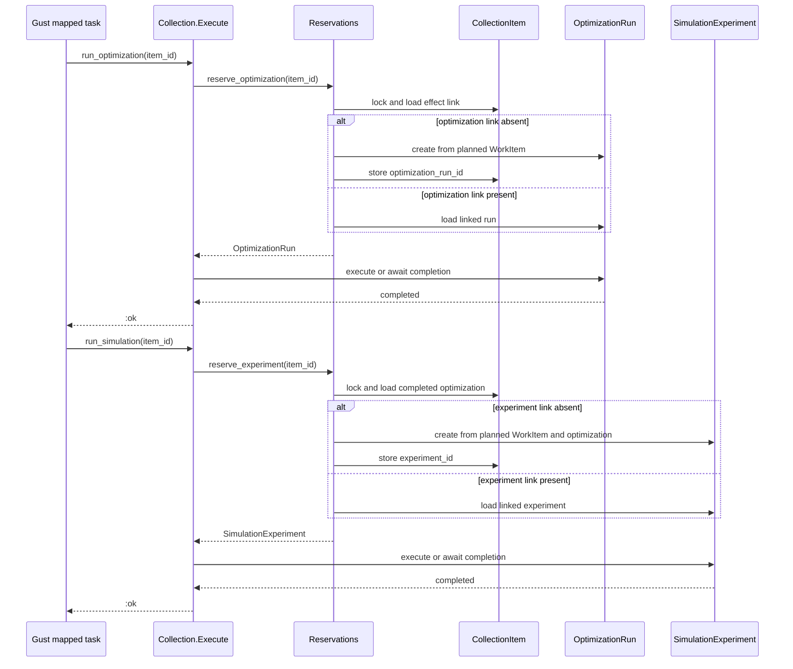
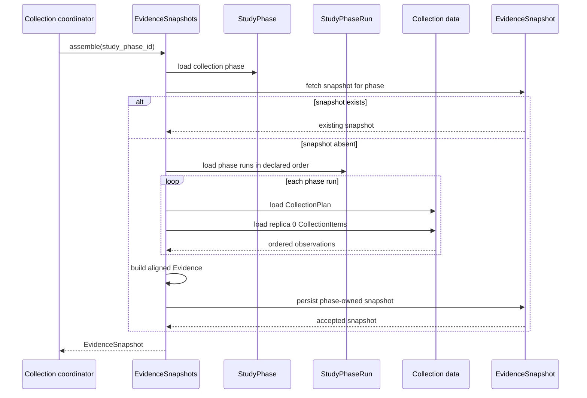
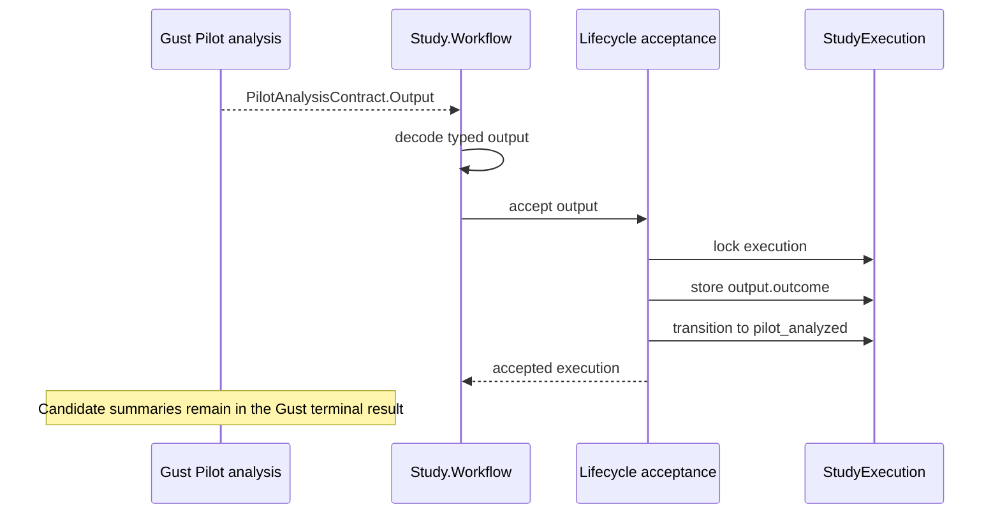
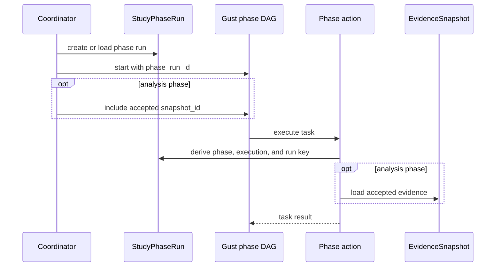
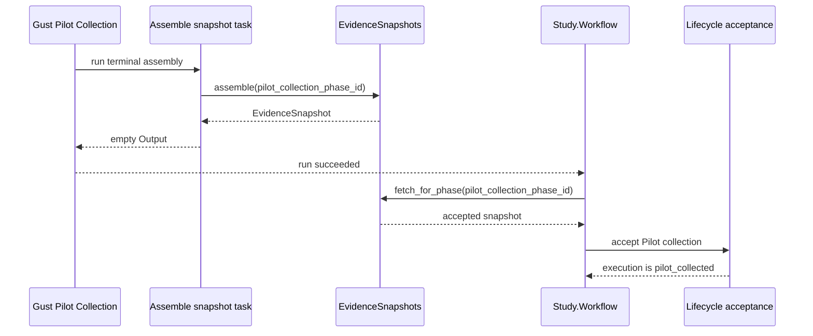
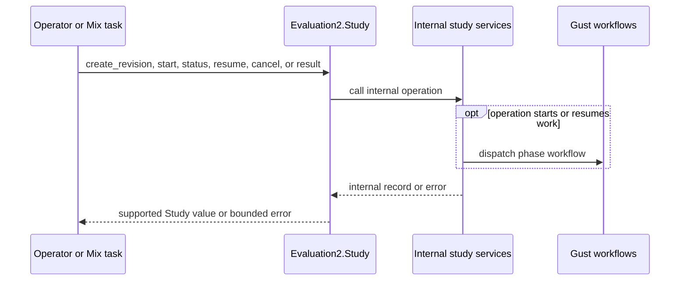

# Evaluation2 redesign — internal APIs

> Design-interview history. Later decisions can supersede earlier proposals and example interfaces.
> Use the [native operator guide](../evaluation2.md), [current architecture](../architecture/evaluation-architecture.md) and [stable verification record](../history/evaluation2-verification.md) for implemented behavior and status.

> Part of the [Evaluation2 redesign index](grilling-evaluation-redesign.md).
> Covers Q32–Q42.

## Core service shape — internal APIs

### Q32 — Collection plan public API

The approved model requires one persisted `CollectionPlan` per collection `StudyPhaseRun`. Two public API shapes can create it.

Planner and persistence separated:

```elixir
items = Plan.final(definition, selection, tier)
CollectionPlans.create_once(phase_run_id, items)
```

One application operation:

```elixir
CollectionPlans.prepare_final(
  phase_run_id,
  definition,
  selection,
  tier
)
```

The first form permits callers to construct an unowned plan value before persistence. The second form lets one operation construct and persist the authoritative plan. A repeated call returns the plan already owned by the phase run.

Proposed public signatures:

```elixir
@spec prepare_pilot(StudyPhaseRun.id(), Definition.t()) ::
        {:ok, CollectionPlan.t()} | {:error, StudyError.t()}

@spec prepare_final(
        StudyPhaseRun.id(),
        Definition.t(),
        Selection.t(),
        Tier.t()
      ) :: {:ok, CollectionPlan.t()} | {:error, StudyError.t()}

@spec fetch_for_run!(StudyPhaseRun.id()) :: CollectionPlan.t()
```

`CollectionPlan.t()` contains its ID, owner ID, and complete ordered work requests. `fetch_item!/2` remains a pure operation on that value.

**Question:** Should the public collection-plan service construct and persist the plan in one idempotent operation, instead of exposing a separate public pure planner?

**Recommendation:** Use one application operation. Keep the lower-level item-construction function private. This gives plan construction one owner and prevents an unpersisted plan from becoming a second public representation.

**Answer:** Use one idempotent public operation that constructs and persists the authoritative plan. Keep lower-level item construction private.

### Q33 — Collection item public API

A collection plan fixes the complete ordered work list. Collection items add one replica coordinate and the retry-safe effect links.

Individual creation lets a caller supply positions:

```elixir
CollectionItems.create(plan.id,
  replica_position: 0,
  item_position: 12
)
```

This API can create an incomplete replica or omit an item position.

Replica preparation derives the exact rows from the plan:

```elixir
CollectionItems.prepare_replica(
  plan.id,
  replica_position
)
```

Proposed signatures:

```elixir
@spec prepare_replica(CollectionPlan.id(), CollectionItem.replica_position()) ::
        {:ok, [CollectionItem.t()]} | {:error, StudyError.t()}

@spec fetch!(CollectionItem.id()) :: CollectionItem.t()

@spec list_replica(
        StudyPhaseRun.id(),
        CollectionItem.replica_position()
      ) :: [CollectionItem.t()]
```

`prepare_replica/2` creates one row for every plan item. The plan index becomes `item_position`. A repeated call returns the same ordered rows. The caller cannot create an arbitrary partial set through the public API.

Pilot calls the operation for replica `0`. Final calls it for warm-up `-1` and measured replicas `0..4`.

**Question:** Should the public collection-item API create the complete replica batch from a plan, with individual row creation kept private?

**Recommendation:** Yes. The plan already owns the complete ordered work set. Batch preparation preserves that construction guarantee and removes a later completeness check against caller-created rows.

**Answer:** `CollectionItems.prepare_replica/2` creates or returns the complete ordered item batch for one replica. Individual row creation remains private.

### Q34 — Effect reservation public API

The existing reservation functions accept both a collection-item ID and a caller-built request:

```elixir
Reservations.reserve_optimization(item_id, optimization_request)
Reservations.reserve_experiment(item_id, simulation_request)
```

This boundary must check that the caller-built request agrees with the planned item.

The immutable `CollectionPlan` now owns the complete resolved request. A narrower API can derive each domain request internally:

```elixir
Reservations.reserve_optimization(item_id)
Reservations.reserve_experiment(item_id)
```

Proposed signatures:

```elixir
@spec reserve_optimization(CollectionItem.id()) ::
        {:ok, OptimizationRun.t()} | {:error, StudyError.t()}

@spec reserve_experiment(CollectionItem.id()) ::
        {:ok, Experiment.t()} | {:error, StudyError.t()}
```

The reservation service loads the collection item, loads its phase-run plan, selects the stored `WorkItem`, and builds the domain request. For simulation, it also loads the completed optimization linked to the item. The row lock and create-or-reuse transaction remain copied from the existing reservation mechanism.

**Question:** Should the public reservation API accept only `CollectionItem.id()` and derive requests from the authoritative plan?

**Recommendation:** Yes. This prevents callers from supplying a second request representation and removes request-versus-plan equality checks from the reservation boundary.

**Answer:** Both reservation functions accept only `CollectionItem.id()`. They load the authoritative plan and derive the domain requests internally.

### Q35 — Collection execution public API

The current scaffold exposes one operation that runs both effects and returns one UUID:

```elixir
@spec run(CollectionItem.id()) ::
        {:ok, Ecto.UUID.t()} | {:error, StudyError.t()}
```

The phase DAG owns two distinct mapped stages. Final timing also measures them separately:

```text
run optimization batch
        ↓
optimization completion marker
        ↓
run simulation batch
```

A split API matches those task boundaries:

```elixir
@spec run_optimization(CollectionItem.id()) ::
        :ok | {:error, StudyError.t()}

@spec run_simulation(CollectionItem.id()) ::
        :ok | {:error, StudyError.t()}
```

Each operation reserves or reuses its linked domain record, runs it, and waits for completion. It returns `:ok` because `CollectionItem` already owns the optimization and experiment IDs. Gust task results do not need to copy those IDs.

**Question:** Should collection execution expose two operations, `run_optimization/1` and `run_simulation/1`, and return only `:ok` on success?

**Recommendation:** Yes. This matches the Gust DAG, preserves separate timing boundaries, gives each mapped stage its own retry unit, and avoids duplicate result IDs.

**Answer:** Expose `run_optimization/1` and `run_simulation/1`. Each operation returns `:ok` after its linked effect completes.

Accepted sequence:



### Q36 — Evidence assembly public API

The current scaffold exposes caller-selected role and replica values:

```elixir
Evidence.build(definition, role, collection_items)
Evidence.assemble(execution_id, role, replica_position)
```

The approved ownership model already determines these values:

```text
StudyPhase.phase                 -> Pilot or Final role
StudyPhaseRun records            -> collection runs
CollectionPlan                   -> ordered work
CollectionItem records           -> completed effects
accepted evidence replica policy -> replica 0
StudyRevision                    -> immutable definition
```

A phase-owned API can load these values internally:

```elixir
@spec assemble(StudyPhase.id()) ::
        {:ok, EvidenceSnapshot.t()} | {:error, StudyError.t()}

@spec fetch_for_phase!(StudyPhase.id()) :: EvidenceSnapshot.t()
```

`assemble/1` accepts only a collection phase. Pilot assembly reads the single run. Final assembly reads all tier runs in `Tier.all/0` order and uses measured replica `0`. A retry returns the existing phase-owned snapshot.

The lower-level matrix-building function remains private because its inputs are application-owned records, not a separate public boundary.

**Question:** Should the public evidence API accept only `StudyPhase.id()` and derive role, runs, definition, and accepted replica internally?

**Recommendation:** Yes. This gives snapshot assembly one authoritative input and removes caller-selected role and replica arguments.

**Answer:** `EvidenceSnapshots.assemble/1` accepts only `StudyPhase.id()`. It derives the role, phase runs, definition, and accepted replica from application-owned records.

Accepted sequence:



### Q37 — Evidence public value type

After Q19 and Q20, evidence no longer owns a role, family ID, or comparison identities. Two shapes remain possible.

Wrapper value:

```elixir
%Evidence{
  comparisons: [
    %ComparisonEvidence{
      attack_seeds: seeds,
      alternative: alternative_matrix,
      reference: reference_matrix
    }
  ]
}
```

Direct snapshot list:

```elixir
%EvidenceSnapshot{
  study_phase_id: phase_id,
  observations: [
    %ComparisonEvidence{
      attack_seeds: seeds,
      alternative: alternative_matrix,
      reference: reference_matrix
    }
  ]
}
```

The wrapper adds one type, but it can own evidence operations without coupling them to persistence:

```elixir
Evidence.fetch_comparison!(evidence, comparison_position)
Evidence.comparison_count(evidence)
Evidence.plan_counts(evidence)
Evidence.attack_count(evidence, comparison_position)
```

The snapshot remains the persistence identity. `Evidence` remains the accepted scientific value.

**Question:** Should Evaluation2 retain a small `Evidence` value object containing only the ordered comparison observations?

**Recommendation:** Yes. Remove copied identity fields, but retain the value object. It gives matrix and sample-dimension operations a clear public owner while keeping `EvidenceSnapshot` focused on persistence ownership.

**Answer:** Retain `Evidence` as the accepted scientific value. It contains only ordered `ComparisonEvidence` observations. `EvidenceSnapshot` owns its persistent identity and collection phase.

### Q38 — Pilot terminal output type

The current Pilot contract flattens the compact outcome into nullable fields beside detailed candidate summaries:

```elixir
%PilotAnalysisContract.Output{
  outcome: :recommended,
  candidate_id: candidate_id,
  plan_count_per_side: plan_count,
  attacks_per_plan: attack_count,
  summaries: candidate_summaries
}
```

Evaluation2 already has the approved compact outcome type:

```elixir
%PilotOutcome{
  outcome: :recommended,
  candidate_id: candidate_id,
  plan_count_per_side: plan_count,
  attacks_per_plan: attack_count
}
```

A nested terminal result can reuse it:

```elixir
%PilotAnalysisContract.Output{
  outcome: %PilotOutcome{...},
  candidates: candidate_summaries
}
```

Proposed type:

```elixir
@type t :: %__MODULE__{
        outcome: PilotOutcome.t(),
        candidates: [CandidateSummary.t()]
      }
```

The Gust terminal result retains the detailed candidate summaries. Lifecycle acceptance stores only `result.outcome` on `StudyExecution`.

**Question:** Should the Pilot-analysis terminal output use a nested `PilotOutcome.t()` plus the complete candidate summaries?

**Recommendation:** Yes. This reuses one compact outcome type, removes four flattened nullable fields from the phase contract, and makes the acceptance boundary explicit.

**Answer:** `PilotAnalysisContract.Output` contains `outcome: PilotOutcome.t()` and `candidates: [CandidateSummary.t()]`.

Accepted sequence:



### Q39 — Phase contract root inputs

Every Gust run now has a `StudyPhaseRun` record. The current contracts use different duplicated inputs, such as phase ID, tier, or execution ID.

A uniform root convention can use the current run link plus only the accepted upstream record that the run consumes:

```elixir
%PilotCollectionContract.Input{
  phase_run_id: phase_run_id
}

%PilotAnalysisContract.Input{
  phase_run_id: phase_run_id,
  snapshot_id: pilot_snapshot_id
}

%FinalTierContract.Input{
  phase_run_id: phase_run_id
}

%FinalAnalysisContract.Input{
  phase_run_id: phase_run_id,
  snapshot_id: final_snapshot_id
}
```

The run link derives the execution, phase kind, and run key. A Final tier run derives its tier from `StudyPhaseRun.key`. Collection runs derive the immutable definition and frozen selection through their execution. Analysis inputs name the exact accepted snapshot they consume.

**Question:** Should all four phase contracts use `phase_run_id` as their root identity and add only `snapshot_id` for analysis phases?

**Recommendation:** Yes. This creates one stable convention, removes copied execution/tier fields, and keeps the cross-phase evidence dependency explicit.

**Answer:** Every phase contract uses `phase_run_id` as its root identity. Pilot and Final analysis inputs also contain the accepted `snapshot_id`.

Accepted input flow:



### Q40 — Pilot Collection terminal output

The current Pilot Collection contract returns the snapshot ID:

```elixir
%PilotCollectionContract.Output{
  snapshot_id: snapshot_id
}
```

The accepted ownership model already stores that relationship:

```elixir
%EvidenceSnapshot{
  id: snapshot_id,
  study_phase_id: pilot_collection_phase_id
}
```

An empty terminal output can signal successful DAG completion without copying the snapshot ID:

```elixir
%PilotCollectionContract.Output{}
```

After Gust succeeds, the coordinator loads the phase-owned snapshot:

```elixir
snapshot = EvidenceSnapshots.fetch_for_phase!(pilot_collection_phase_id)
```

If snapshot assembly fails, the Gust terminal task fails. A successful run therefore means the snapshot is available.

**Question:** Should Pilot Collection use an empty typed terminal output, like the approved Final-tier contract?

**Recommendation:** Yes. Let `EvidenceSnapshot` own its ID and phase relationship. Use Gust success as the receipt, then load the snapshot through its owner.

**Answer:** `PilotCollectionContract.Output` is an empty typed struct. Gust success is the completion receipt, and the coordinator loads the phase-owned snapshot.

Accepted sequence:



### Q41 — Pilot analysis public module

The scaffold splits Pilot analysis across `Pilot.Analyze` and `Pilot.Decide`. Their public functions accept a mixture of definitions, phase IDs, settings, and runtime evidence.

```elixir
Pilot.Analyze.prepare(definition)
Pilot.Analyze.run(phase_id, job)
Pilot.Decide.summarize(assessments, pilot, family, runtime)
Pilot.Decide.select(summaries, rule)
```

The accepted snapshot identifies the evidence and leads to the immutable definition. A single public phase service can expose the three Gust task boundaries:

```elixir
@spec prepare(EvidenceSnapshot.id()) ::
        {:ok, [PilotJob.t()]} | {:error, StudyError.t()}

@spec evaluate(EvidenceSnapshot.id(), PilotJob.t()) ::
        {:ok, CandidateAssessment.t()} | {:error, StudyError.t()}

@spec decide(EvidenceSnapshot.id(), [CandidateAssessment.t()]) ::
        {:ok, PilotAnalysisContract.Output.t()} | {:error, StudyError.t()}
```

`prepare/1` builds the ordered candidate/comparison jobs. `evaluate/2` reads one comparison's matrices and performs the Pilot calculation. `decide/2` creates complete candidate summaries and selects the outcome.

The public module is:

```elixir
NetworkDefense.Evaluation2.Study.Pilot.Analysis
```

Lower-level statistical and runtime-estimation functions can remain internal or reuse existing modules.

**Question:** Should one public `Pilot.Analysis` module own `prepare/1`, `evaluate/2`, and `decide/2`, with `snapshot_id` as their study context?

**Recommendation:** Yes. This matches the three Gust task stages, removes caller-supplied definition fragments, and reduces the public helper-module count.

**User correction:** Pilot analysis is a phase implementation detail. It should not be part of the supported external API. Only complete study operations should be public.

**Answer:** Keep `Pilot.Analysis` internal. Its cross-module functions remain ordinary Elixir `def` functions because Gust actions call them, but mark the module as internal and exclude it from supported API documentation.

Supported boundary:


### Q42 — Supported study facade

The current scaffold exposes `NetworkDefense.Evaluation2` with study-prefixed functions:

```elixir
Evaluation2.create_study_revision(document)
Evaluation2.start_study(revision_id)
Evaluation2.study_status(execution_id)
Evaluation2.resume_study(execution_id, selection)
Evaluation2.cancel_study(execution_id)
Evaluation2.study_result(execution_id)
```

Because Q1 limits the subsystem to complete studies, a dedicated facade can use shorter names:

```elixir
NetworkDefense.Evaluation2.Study.create_revision(document)
NetworkDefense.Evaluation2.Study.start(revision_id)
NetworkDefense.Evaluation2.Study.status(execution_id)
NetworkDefense.Evaluation2.Study.resume(execution_id, selection)
NetworkDefense.Evaluation2.Study.cancel(execution_id)
NetworkDefense.Evaluation2.Study.result(execution_id)
```

All collection, evidence, analysis, lifecycle, phase-contract, and Gust-action modules remain internal. Only types returned or accepted by this facade form the supported contract.

**Question:** Should `NetworkDefense.Evaluation2.Study` be the single supported public facade, replacing the current top-level `NetworkDefense.Evaluation2` facade?

**Recommendation:** Yes. The namespace states the only supported operation scope and removes repeated `_study` suffixes from every function.

**Answer:** `NetworkDefense.Evaluation2.Study` is the only supported public facade. Remove the equivalent top-level `NetworkDefense.Evaluation2` facade. Internal modules can expose typed cross-module functions, but they are not supported external APIs.

Accepted boundary sequence:


