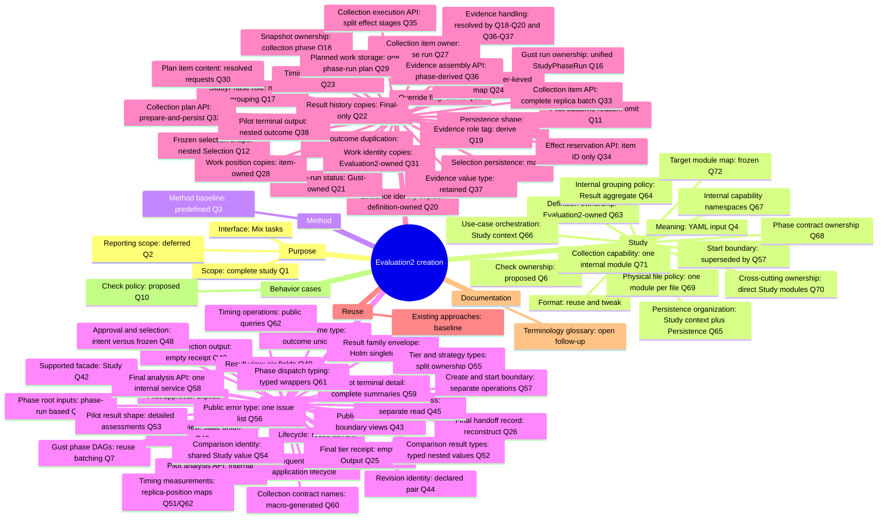
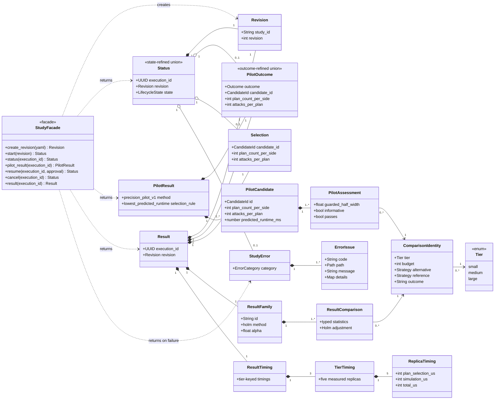

# Evaluation2 redesign — overview and approved structure

> Design-interview history. Later decisions can supersede earlier proposals and example interfaces.
> Use the [native operator guide](../evaluation2.md), [current architecture](../architecture/evaluation-architecture.md) and [stable verification record](../history/evaluation2-verification.md) for implemented behavior and status.

> Part of the [Evaluation2 redesign index](grilling-evaluation-redesign.md).

## Status

Working design interview for the new Evaluation2 study subsystem. Reuse the established methodology, YAML study definition, scenarios, comparisons, strategies, and supporting code. Adjust existing contracts where the simpler Evaluation2 design needs it.

**Implementation framing:** Create Evaluation2 as a new subsystem. Do not describe this work as a refactor of the legacy Evaluation subsystem. Treat legacy source as a library of proven mechanisms and calculations that Evaluation2 can copy or reuse selectively. Evaluation2 must not depend on modules in the legacy `NetworkDefense.Evaluation` namespace.

**Agreed interview scope:** Reuse the existing evaluation approaches. Create simpler code and mechanisms that make them work.

Preserve the methodology, current YAML, domain concepts, and scientific flow as the baseline. Interview decisions should focus on unnecessary implementation layers, repeated checks, orchestration, handoffs, and supporting code. Propose input or interface adjustments only when a concrete simplification requires them.

Study means the existing YAML input, reused and tweaked as needed. Source exploration should answer questions about existing concepts before the interview introduces design choices.

The study pipeline and its Gust phase DAGs are the current design focus. Treat proposed application modules as placeholders. Assume they do not exist yet.

Gust already owns mapped batches, dependency fan-in, and task retry. Do not duplicate these features in application code.

Use existing source as a mechanism library. Reuse or copy the current lifecycle, phase sequencing, explicit resume policy, stable effect links, Final tier DAG, timing rules, and scientific calculations.

Design order: define the phase DAGs and the application boundaries between them. Then assign placeholder actions, inputs, outputs, and persistence.

**User correction:** The initial Pilot/Final diagram was already too detailed for the bird's-eye view.

### Interview mode

The user asked the assistant to continue without waiting for an answer at every step.

- Inspect existing code before asking factual questions.
- Keep established approaches as the baseline.
- Refine one implementation responsibility at a time.
- Prefer module trees, function signatures, data shapes, and short code sketches.
- Introduce each design question with a concrete worked example and explain its effect before asking.
- Keep prose short outside the worked example and decision rationale.
- Keep behavior cases. Defer automated test design.
- Record implementation recommendations as proposals, separate from confirmed requirements.
- Ask when a remaining choice needs user input.

## Decision tree

Leaves summarize questions and answers. `Open` marks an unresolved decision. The interview follows one branch at a time.

## Approved structures

The structural design is frozen through Q57. Evaluation2 is a new subsystem. The diagrams show the target structures, not the current scaffold.

### Supported Study API

Public structure rules:

- `NetworkDefense.Evaluation2.Study` is the only supported facade.
- Public views are transient. They do not add persistence records.
- `Status` and `PilotOutcome` use discriminated unions.
- Pilot and Final results share `Study.Comparison` identities.
- Public statistics are typed values. Python maps stay at the transport boundary.

### Internal persistence and execution ownership

```mermaid
classDiagram
    direction LR

    class StudyRevision {
        +UUID id
        +String study_id
        +int revision
        +Definition definition
    }

    class StudyExecution {
        +UUID id
        +UUID study_revision_id
        +LifecycleState state
        +PilotOutcome pilot_outcome
        +Selection selection
        +StudyError error
    }

    class StudyPhase {
        +UUID id
        +UUID study_execution_id
        +PhaseKind phase
    }

    class StudyPhaseRun {
        +UUID id
        +UUID study_phase_id
        +RunKey key
        +GustRunId gust_run_id
    }

    class CollectionPlan {
        +UUID id
        +UUID study_phase_run_id
        +WorkItem items
    }

    class WorkItem {
        +int comparison_position
        +Side side
        +GraphRevision graph_revision
        +Strategy strategy
        +Seed selection_seed
        +Seed evaluation_root
        +int attack_count
    }

    class CollectionItem {
        +UUID id
        +UUID study_phase_run_id
        +ReplicaPosition replica_position
        +int item_position
        +UUID optimization_run_id
        +UUID experiment_id
    }

    class EvidenceSnapshot {
        +UUID id
        +UUID study_phase_id
        +Evidence evidence
    }

    class Evidence {
        +ordered comparison observations
    }

    class StudyResult {
        +UUID id
        +UUID study_execution_id
        +CorrectedFamily family
        +Timing timing
    }

    class GustRun {
        <<external>>
    }

    class OptimizationRun {
        <<external>>
    }

    class SimulationExperiment {
        <<external>>
    }

    StudyRevision "1" *-- "0..*" StudyExecution : executions
    StudyExecution "1" *-- "0..4" StudyPhase : phase groups
    StudyExecution "1" *-- "0..1" StudyResult : successful Final output

    StudyPhase "1" *-- "1..*" StudyPhaseRun : run links
    StudyPhase "1" *-- "0..1" EvidenceSnapshot : collection evidence

    StudyPhaseRun "1" --> "1" GustRun : identifies
    StudyPhaseRun "1" *-- "0..1" CollectionPlan : collection runs only
    StudyPhaseRun "1" *-- "0..*" CollectionItem : replica effects

    CollectionPlan "1" *-- "1..*" WorkItem : resolved requests
    CollectionItem ..> CollectionPlan : selects by item_position
    CollectionItem "0..*" --> "0..1" OptimizationRun : reserves and reuses
    CollectionItem "0..*" --> "0..1" SimulationExperiment : reserves and reuses

    EvidenceSnapshot "1" *-- "1" Evidence : contains
```

Internal structure rules:

- The internal UUID of `StudyRevision` stays private. Public code uses `{study_id, revision}`.
- Every Gust run has one `StudyPhaseRun`; `StudyPhase` stores no run or output cache.
- Collection phases own snapshots. Collection phase runs own plans and items.
- One immutable `CollectionPlan` stores resolved Evaluation2 `WorkItem` requests.
- `CollectionItem` stores positions and retry-safe effect links, not work copies.
- Gust owns detailed run and task status. Evaluation2 owns study lifecycle state.
