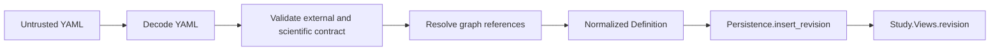
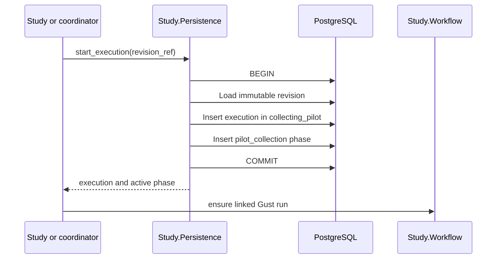
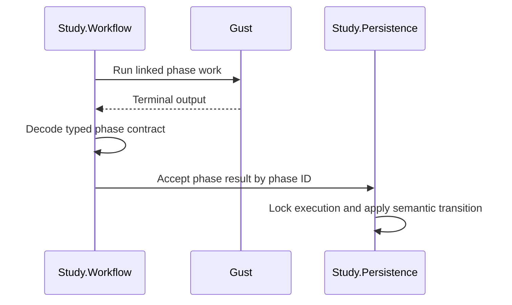
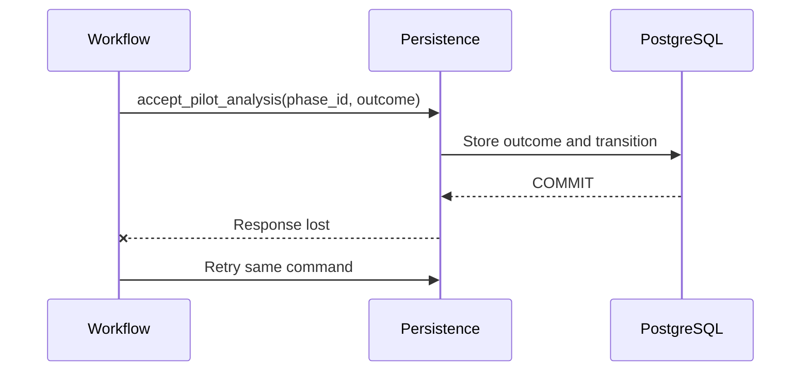
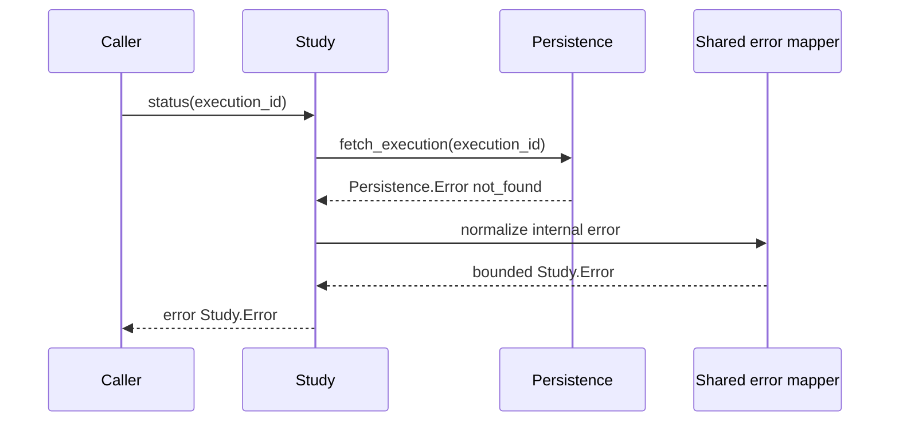
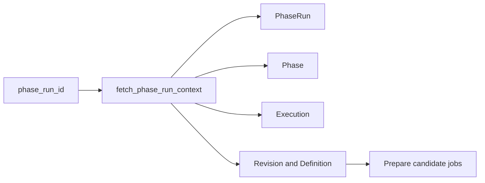
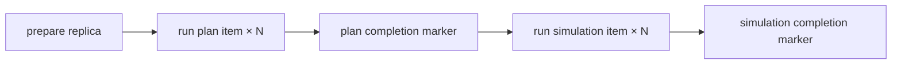

# Evaluation2 redesign — modules and persistence implementation

> Design-interview history. Later decisions can supersede earlier proposals and example interfaces.
> Use the [native operator guide](../evaluation2.md), [current architecture](../architecture/evaluation-architecture.md) and [stable verification record](../history/evaluation2-verification.md) for implemented behavior and status.

> Part of the [Evaluation2 redesign index](grilling-evaluation-redesign.md).
> Covers Q58–Q81.

## Core service shape — modules and persistence

### Q58 — Internal Final Analysis module

Final Analysis has the same three Gust stages as Pilot Analysis: prepare jobs, evaluate mapped jobs, and combine the complete family. The current scaffold splits context across definitions, phase IDs, and family values.

Use one internal phase service with the accepted Final snapshot as context:

```elixir
@spec Final.Analysis.prepare(EvidenceSnapshot.id()) ::
        {:ok, [FinalJob.t()]} | {:error, Study.Error.t()}

@spec Final.Analysis.evaluate(EvidenceSnapshot.id(), FinalJob.t()) ::
        {:ok, Study.Result.Comparison.Statistics.t()} | {:error, Study.Error.t()}

@spec Final.Analysis.correct(
        EvidenceSnapshot.id(),
        [Study.Result.Comparison.Statistics.t()]
      ) :: {:ok, FinalAnalysisContract.Output.t()} | {:error, Study.Error.t()}
```

`prepare/1` creates one ordered job per declared comparison. `evaluate/2` loads the comparison matrices and runs the corrected crossed bootstrap. `correct/2` applies Holm exactly once across the complete ordered family and returns the typed family output.

The module is internal:

```elixir
defmodule NetworkDefense.Evaluation2.Study.Final.Analysis do
  @moduledoc false
end
```

**Question:** Should one internal `Final.Analysis` module own `prepare/1`, `evaluate/2`, and `correct/2`, with `snapshot_id` as the study context?

**Recommendation:** Yes. This mirrors the accepted Pilot Analysis boundary and maps directly to the three Gust stages.

**Answer:** One internal `Final.Analysis` module owns `prepare/1`, `evaluate/2`, and `correct/2`, with the accepted snapshot ID as study context.

### Q59 — Complete internal Pilot candidate summary

The Pilot terminal output must be the source of the complete supported Pilot report. Each internal candidate summary therefore retains its ordered per-comparison assessments.

```elixir
%CandidateSummary{
  candidate_position: candidate_position,
  candidate_id: candidate_id,
  plan_count_per_side: plan_count,
  attacks_per_plan: attack_count,
  predicted_runtime_ms: predicted_runtime,
  comparisons: [
    %CandidateSummary.Comparison{
      comparison_position: comparison_position,
      guarded_half_width: guarded_half_width,
      informative: informative,
      passes: passes
    }
  ]
}
```

`worst_guarded_half_width`, `informative?`, `non_informative_comparisons`, and `passes?` are derived operations. `Study.pilot_result/1` joins declared comparison identities without reading mapped Gust task results.

**Answer:** Use this complete `CandidateSummary` shape. Remove stored aggregate fields.

### Q60 — Collection phase contract names

Pilot Collection and Final tier collection have identical data shapes:

```elixir
Input  -> phase_run_id
Output -> empty typed struct
```

The current scaffold puts the structs in `CollectionPhaseShape` and keeps two delegating contract modules. This removes source duplication but also removes the approved names `%PilotCollectionContract.Output{}` and `%FinalTierContract.Output{}`.

A shared macro can define the implementation once while generating contract-named types:

```elixir
defmodule CollectionPhaseContract do
  defmacro __using__(_options) do
    quote do
      defmodule Input do
        defstruct [:phase_run_id]
      end

      defmodule Output do
        defstruct []
      end

      # Shared typed codec implementation.
    end
  end
end
```

```elixir
defmodule PilotCollectionContract do
  use CollectionPhaseContract
end

defmodule FinalTierContract do
  use CollectionPhaseContract
end
```

ExDNA sees one source implementation. Gust actions retain phase-specific struct names and Dialyzer types.

**Question:** Should Evaluation2 use the macro-generated per-contract `Input` and `Output` modules?

**Recommendation:** Yes. It preserves the Q25/Q40 typed contract convention without source duplication or ExDNA suppression.

**Answer:** Use one `CollectionPhaseContract` macro that generates contract-specific `Input`, `Output`, and codec functions inside `PilotCollectionContract` and `FinalTierContract`.

### Q61 — Typed phase dispatch

The current generic behaviour erases phase types:

```elixir
@callback to_params(term()) :: map()
@callback decode_output!(map()) :: term()

@spec Workflow.run_phase(module(), map(), atom(), function()) ::
        {:ok, term()} | {:error, Study.Error.t()}
```

A simpler boundary is to remove the generic public behaviour and expose one typed internal workflow function per phase:

```elixir
@spec Workflow.run_pilot_collection(PilotCollectionContract.Input.t()) ::
        {:ok, PilotCollectionContract.Output.t()} | {:error, Study.Error.t()}

@spec Workflow.run_pilot_analysis(PilotAnalysisContract.Input.t()) ::
        {:ok, PilotAnalysisContract.Output.t()} | {:error, Study.Error.t()}

@spec Workflow.run_final_tier(FinalTierContract.Input.t()) ::
        {:ok, FinalTierContract.Output.t()} | {:error, Study.Error.t()}

@spec Workflow.run_final_analysis(FinalAnalysisContract.Input.t()) ::
        {:ok, FinalAnalysisContract.Output.t()} | {:error, Study.Error.t()}
```

One private dispatcher can still own the common Gust mechanics:

```elixir
@spec dispatch(module(), map(), atom()) ::
        {:ok, map()} | {:error, Study.Error.t()}
```

Each typed wrapper encodes its input, calls `dispatch/3`, and decodes its own output. Dialyzer sees concrete types at every cross-module call.

**Question:** Should Evaluation2 remove the generic `PhaseContract` behaviour and `run_phase/4` API in favor of four typed workflow functions over one private dispatcher?

**Recommendation:** Yes. This removes `term()` from the phase boundary and keeps shared Gust mechanics private.

**Answer:** Remove the generic `PhaseContract` behaviour and `run_phase/4`. Use four typed workflow functions over one private Gust dispatcher.

### Q62 — Public timing operations

The public `Study.Result.Timing` value contains the raw five-replica measurements. Median and range are required report outputs, but the current scaffold places those operations only in the internal Final collection module.

Put pure read operations on the value that callers receive:

```elixir
@type Study.Result.Timing.boundary ::
        :plan_selection | :simulation | :total

@type Study.Result.Timing.measurements :: %{
        required(0) => non_neg_integer(),
        required(1) => non_neg_integer(),
        required(2) => non_neg_integer(),
        required(3) => non_neg_integer(),
        required(4) => non_neg_integer()
      }

@spec Study.Result.Timing.measurements(
        Study.Result.Timing.t(),
        Study.Tier.t(),
        Study.Result.Timing.boundary()
      ) :: Study.Result.Timing.measurements()

@spec Study.Result.Timing.median(
        Study.Result.Timing.t(),
        Study.Tier.t(),
        Study.Result.Timing.boundary()
      ) :: non_neg_integer()

@spec Study.Result.Timing.range(
        Study.Result.Timing.t(),
        Study.Tier.t(),
        Study.Result.Timing.boundary()
      ) :: {non_neg_integer(), non_neg_integer()}
```

The internal `Final.Timing` module owns collection and assembly. The public value owns deterministic queries over accepted raw measurements.

**Answer:** `Study.Result.Timing` owns `measurements/3`, `median/3`, and `range/3`. `measurements/3` returns a map keyed by measured replica positions `0..4`, not a tuple.

### Q63 — Evaluation2 definition ownership

The first scaffold aliased the complete normalized definition from the legacy subsystem:

```elixir
alias NetworkDefense.Evaluation.Study.Contracts.Definition,
  as: StoredDefinition
```

That makes the new subsystem depend on legacy Evaluation types even when it does not call the legacy parser.

Evaluation2 instead owns plain typed definition values under:

```text
NetworkDefense.Evaluation2.Study.Definition
NetworkDefense.Evaluation2.Study.Definition.*
```

The owned tree preserves the established YAML shape: study identity, graph and strategy declarations, simulation controls, comparison family, Pilot settings, pause handoff, and Final settings. It reuses neutral domain types such as optimization strategies, simulation objectives, rules, and defense-action registries.

It does not copy the legacy parser, changesets, schema validator, consistency checker, JSON boundary, or legacy error envelope. `Study.Definition.parse/1` and `decode_stored!/1` remain Evaluation2 boundary placeholders.

**Answer:** Evaluation2 owns its complete normalized definition value tree and has no source dependency on `NetworkDefense.Evaluation.*`.

### Q64 — Public Result and internal result persistence

The scaffold has three Result modules:

```text
Study.Result    public six-field result view
Study.Results   internal persistence service
StudyResult     internal persisted record
```

The public view must remain separate from persistence. The two internal responsibilities belong to one private aggregate module:

```text
Study.Result
  public boundary value

Study.Internal.Result
  internal persisted fields
  store/3
  fetch!/1
  get/1
```

`Study.Internal.Result.get/1` joins its persisted Final output with the execution-owned Pilot outcome and frozen selection to return `Study.Result.t()`.

**Answer:** Initially chose `Study.Internal.Result` as a combined record and service. Q65 supersedes this choice with the community context-and-schema pattern.

### Q65 — Study context and internal persistence boundary

Phoenix contexts separate the API boundary from persisted schemas. `Study` is already the supported Evaluation2 context, so Evaluation2 does not need a separate context module for each persisted record.

```text
Study                         supported context and use-case API
Study.Result                  public return value
Study.Status                  public return value
Study.Revision                public return value

Study.Persistence             internal data-access boundary
Study.Persistence.Result      internal persisted result
Study.Persistence.Execution   internal persisted execution
Study.Persistence.Revision    internal persisted revision
Study.Persistence.Phase       internal persisted phase
Study.Persistence.PhaseRun    internal Gust-run link
Study.Persistence.CollectionPlan
Study.Persistence.CollectionItem
Study.Persistence.EvidenceSnapshot
```

`Study.Persistence` returns internal records and performs transactions. It does not construct public views. `Study.Views` converts accepted records and workflow outputs into public values.

This replaces the plural record-specific service modules such as `Study.Results`, `Study.Revisions`, `Study.Executions`, `Study.Phases`, `Study.Collection.Plans`, `Study.Collection.Items`, and `Study.Collection.EvidenceSnapshots`.

**Answer:** Follow the context-and-schema pattern. Keep `Study` as the supported context, use one internal `Study.Persistence` API, and keep internal persisted record structs under `Study.Persistence.*`.

### Q66 — Supported use-case orchestration

The `Study` module is the Evaluation2 context and supported API. It owns the short application flows for its seven public operations:

```elixir
def result(execution_id) do
  with {:ok, execution} <- Persistence.fetch_execution(execution_id),
       {:ok, result} <- Persistence.fetch_result(execution_id) do
    {:ok, Views.result(execution, result)}
  end
end
```

Complex scientific and phase work remains delegated to focused internal modules such as `Workflow`, `Pilot.Analysis`, `Final.Analysis`, and `Collection`.

This removes thin use-case modules whose only purpose is facade delegation: `Study.Revisions`, `Study.Executions`, `Study.Results`, `Study.Cancel`, and `Study.Resume`.

**Answer:** The supported `Study` context owns create, start, status, Pilot-result read, resume, cancel, and Final-result read orchestration. Persistence and scientific workflow responsibilities remain internal dependencies.

### Q67 — Capability namespaces for non-persistence modules

Internal modules that are not persisted records or data-access operations are grouped by their scientific or workflow owner:

```text
Study.Collection
  WorkItem
  effect execution and reservation

Study.Evidence
  Comparison

Study.Pilot
  Job
  Assessment
  Summary
  Analysis

Study.Final
  ComparisonJob
  TierRun
  CorrectedFamily
  Collect
  Timing
  Analysis
```

Shared scientific primitives remain at the lowest common Study namespace, for example `Study.Matrix` and `Study.Seed`. A side value used only by collection work becomes a type owned by `Study.Collection.WorkItem` instead of a separate module.

Avoid generic buckets such as `Study.Internal.Values`, `Study.Types`, `Study.Helpers`, and `Study.Utils`. They hide the domain owner.

**Answer:** Group non-persistence internal modules by capability namespace. Keep public result values under `Study.Result` and `Study.PilotResult`; keep phase-specific internal values and services under `Study.Collection`, `Study.Evidence`, `Study.Pilot`, and `Study.Final`.

### Q68 — Gust phase contract ownership

Each phase contract belongs beside the workflow stage that owns its input and terminal output:

```text
Study.Pilot.CollectionContract
Study.Pilot.AnalysisContract
Study.Final.TierContract
Study.Final.AnalysisContract
```

The macro that generates the two identical empty collection contracts is shared by the cross-phase workflow layer:

```text
Study.Workflow.CollectionContract
```

This removes the top-level `Evaluation2.Contracts` namespace. Contract-specific modules remain distinct because Gust task parameters and terminal outputs are phase boundaries.

**Answer:** Place contracts with their Pilot or Final phase owner. Keep only the shared collection-contract generator under `Study.Workflow`.

### Q69 — Physical file policy

Evaluation2 keeps one Elixir module per source file. The reorganization reduces redundant modules and moves modules under coherent namespaces; it does not co-locate several modules in one file only to reduce file count.

```text
study/pilot/job.ex
study/pilot/assessment.ex
study/pilot/summary.ex
study/persistence/revision.ex
study/persistence/execution.ex
study/persistence/result.ex
```

This keeps module search, compilation dependencies, and file ownership direct.

**Answer:** Use one module per file. Reduce the number of modules through ownership changes such as one `Study.Persistence` context, not through multi-module files.

### Q70 — Cross-cutting module ownership

Subsystem-wide responsibilities live directly under `Study` with specific names:

```text
Study.Persistence
Study.Workflow
Study.Lifecycle
Study.Views
Study.Definition
Study.Matrix
Study.Seed
```

Do not add a generic `Study.Core` namespace, and do not fold these responsibilities into the supported `Study` context. `Study` owns public use-case orchestration; these modules own focused cross-cutting mechanisms.

**Answer:** Keep cross-cutting capabilities as direct, specifically named `Study` modules.

### Q71 — Collection capability boundary

One internal `Study.Collection` module owns collection application logic:

```elixir
prepare_pilot(phase_run_id, definition)
prepare_final(phase_run_id, definition, selection, tier)
prepare_replica(plan_id, replica_position)
run_optimization(collection_item_id)
run_simulation(collection_item_id)
assemble_evidence(study_phase_id)
```

`Study.Persistence` owns plan, item, and snapshot records; data access; and transactional reservation of optimization and simulation effect links. `Study.Collection` builds requests and invokes the optimization and simulation domains.

This removes `Study.Collection.Plans`, `Items`, `Execute`, `Reservations`, and `EvidenceSnapshots`.

**Answer:** Use one internal Collection capability module and one Persistence boundary. Keep scientific `Study.Evidence` as a separate accepted value used by Pilot and Final analysis.

### Q72 — Frozen module organization

The supported context and public values remain under `Study`:

```text
Study
Study.Revision
Study.Status
Study.Selection
Study.PilotOutcome
Study.Comparison
Study.Tier
Study.Error
Study.PilotResult.*
Study.Result.*
```

Internal persistence uses one context plus one record module per persisted shape:

```text
Study.Persistence
Study.Persistence.Revision
Study.Persistence.Execution
Study.Persistence.Phase
Study.Persistence.PhaseRun
Study.Persistence.Result
Study.Persistence.CollectionPlan
Study.Persistence.CollectionItem
Study.Persistence.EvidenceSnapshot
```

Internal scientific and workflow modules use capability namespaces:

```text
Study.Collection
Study.Collection.WorkItem

Study.Evidence
Study.Evidence.Comparison

Study.Pilot.Job
Study.Pilot.Assessment
Study.Pilot.Summary
Study.Pilot.Summary.Comparison
Study.Pilot.Analysis
Study.Pilot.CollectionContract
Study.Pilot.AnalysisContract

Study.Final.ComparisonJob
Study.Final.TierRun
Study.Final.CorrectedFamily
Study.Final.Collection
Study.Final.Timing
Study.Final.Analysis
Study.Final.TierContract
Study.Final.AnalysisContract

Study.Workflow
Study.Workflow.CollectionContract
Study.Lifecycle
Study.Views
Study.Definition.*
Study.Matrix
Study.Seed
```

`Study` owns supported use-case orchestration. `Study.Persistence` owns data access and transactions. `Study.Collection`, `Pilot`, `Final`, and `Workflow` own scientific and phase behavior. One module is stored in each source file.

**Answer:** Freeze this module map for the next structural implementation. After it is applied, continue the design with migration squashing and then the exact Persistence API.

### Scaffold alignment after DeepSeek review

The following points require no additional design choice:

- `WorkItem` includes `initial_foothold_node_id` so a stored collection plan is a complete resolved request.
- `FinalTierRunResult` contains the tier coordinate, Gust run identity, and timing. It does not contain an empty receipt.
- Evaluation2 revision creation accepts exactly the declared tiers `small`, `medium`, and `large`; internal `Study.Definition.decode_tier!/1` converts their accepted stored strings to `Study.Tier` atoms.
- `Study.Comparison.outcome` remains an open declared string owned by the Evaluation2 definition contract.
- Public value types use the `Study.candidate_id()` and `Study.strategy()` aliases consistently.
- Scaffold-only `Placeholder` and `NotImplementedError` modules must be removed when the corresponding operations are implemented.

### Q73 — Evaluation2 table ownership

The squashed database baseline still contains the active legacy Evaluation tables:

```text
evaluation_study_revisions
evaluation_study_executions
evaluation_study_phases
evaluation_study_phase_runs
evaluation_study_collection_items
evaluation_evidence_snapshots
evaluation_study_results
```

Legacy `NetworkDefense.Evaluation` Ecto schemas still own and use those tables. Their fields also conflict with the approved Evaluation2 model. For example, the legacy execution stores four Final-selection scalar columns, while Evaluation2 owns one `Selection` value. The legacy phase stores Gust run, snapshot, result, and error fields, while Evaluation2 defines a minimal phase identity and separate phase-run links.

A shared-table implementation would therefore require both subsystems to accept one compromise schema:

```text
legacy execution ─┐
                  ├─ evaluation_study_executions
Evaluation2 ──────┘
```

An isolated implementation gives each subsystem its own storage contract:

```text
legacy Evaluation  → evaluation_study_*
Evaluation2        → evaluation2_study_*
```

The proposed Evaluation2 tables are:

```text
evaluation2_study_revisions
evaluation2_study_executions
evaluation2_study_phases
evaluation2_study_phase_runs
evaluation2_collection_plans
evaluation2_collection_items
evaluation2_evidence_snapshots
evaluation2_study_results
```

**Recommendation:** Create new Evaluation2-owned tables. Keep the storage contracts separate so the new design does not inherit legacy lifecycle fields.

**Question:** Should Evaluation2 create its own tables now, share the active legacy tables, or postpone persistence until a legacy cutover?

**Answer:** Evaluation2 owns new `evaluation2_*` tables. Remove the legacy Evaluation subsystem and its `evaluation_*` tables completely; they are not a compatibility target for Evaluation2.

### Q74 — Persistence records and Ecto schemas

For example, the execution record can map directly to its table:

```elixir
defmodule Study.Persistence.Execution do
  use Ecto.Schema

  schema "evaluation2_study_executions" do
    field :state, Ecto.Enum, values: Study.Lifecycle.states()
    field :pilot_outcome, :map
    field :selection, :map
    field :error, :map
  end
end
```

`Study.Persistence` would query and transact with this internal record. `Study.Views` would still convert it to the public `Study.Status` value.

A separate mapping layer would use two internal types for the same row:

```text
Persistence.Schema.Execution  Ecto row
Persistence.Execution         mapped internal value
```

That extra layer can isolate Ecto, but it duplicates fields and mapping code without creating a public boundary because both modules remain private.

**Recommendation:** Make each `Study.Persistence.*` record an Ecto schema directly. Keep changesets and queries in `Study.Persistence`, and keep public values in `Study.Views`.

**Question:** Should `Study.Persistence.*` records be the Ecto schemas, or should Persistence add a separate private Ecto-schema layer?

**Answer:** Convert the existing `Study.Persistence.*` structs into the Ecto schemas. Do not add a second private schema layer.

### Q75 — Typed values in JSONB columns

The persistence schemas contain immutable typed values such as `Definition`, `PilotOutcome`, `Selection`, `Evidence`, `CorrectedFamily`, and `Timing`. PostgreSQL stores these values as JSONB.

One approach keeps the value modules independent of Ecto:

```text
write
  typed value → strict codec → JSON map → Ecto changeset

read
  Ecto JSON map → strict codec → typed value
```

Only `Study.Persistence` can query these schemas. It decodes JSON fields before it returns a record, so downstream code receives the typed field shapes declared by the persistence modules. Creation-time validation remains separate from trusted stored-value decoding.

A second approach converts every nested value module into an `embedded_schema` tree. That gives Ecto-native casting, but it adds Ecto changesets and embed declarations to the scientific value tree. A third approach adds custom parameterized `Ecto.Type` infrastructure for each JSON value family.

**Recommendation:** Keep JSONB columns as `:map` fields and use explicit strict codecs at the `Study.Persistence` boundary. Do not convert the scientific value tree into Ecto embeds and do not add custom Ecto types unless repetitive codec calls later prove that one generic type reduces code.

**Question:** Should Persistence use explicit JSON codecs, Ecto embeds, or custom Ecto types for typed JSONB fields?

**Answer:** Store the values in PostgreSQL JSONB and use Spectral for type-driven encoding and decoding. `Study.Persistence` calls Spectral with `:pre_encoded` before Ecto writes and `:pre_decoded` after Ecto reads. The Ecto schemas keep `:map` fields; Evaluation2 does not add embedded schemas or custom Ecto types for these payloads. Spectral is a new dependency because the repository does not currently contain it.

```text
typed Evaluation2 value
  -> Spectral :pre_encoded
  -> Elixir map
  -> Ecto :map
  -> PostgreSQL JSONB

PostgreSQL JSONB
  -> Ecto map
  -> Spectral :pre_decoded
  -> typed Evaluation2 value
```

### Q76 — Spectral type metadata in releases

Spectral reads the type definitions that are reachable from each persisted root. The current Mix release does not configure `:strip_beams`, whose default value is `true`. A production release therefore removes the `Dbgi` chunk that Spectral normally reads.

The persisted type graph also reaches neutral modules outside Evaluation2, including optimization strategy types, rule and action registries, simulation objectives, and `Ecto.UUID.t()`. Adding `use Spectral` only to the eight JSONB root modules does not provide metadata for those referenced modules.

Two practical choices are:

```text
keep Dbgi
  release keeps type metadata for application and dependency modules
  -> Spectral follows the existing nested type references

embed selectively
  every reachable application module uses Spectral
  + external types need embedded metadata or custom codecs
  -> release can remove Dbgi
```

**Recommendation:** Configure the release with `strip_beams: [keep: ["Dbgi"]]`. This keeps the type metadata that Spectral requires while still removing other optional BEAM chunks. It avoids adding `use Spectral` across the complete Evaluation2 type tree and avoids custom codecs whose only purpose is to recover stripped remote type aliases.

Regardless of this choice, manually verify round trips for every JSONB root. The checks must include both Pilot outcome variants, UUID-containing work items, nested definition values, and timing maps. Do not add permanent automated tests at this stage. A disposable automated probe is permitted only when it runs from a temporary location, leaves no repository file, is removed after execution, and has its command and result recorded.

**Question:** Should the release retain the `Dbgi` chunk for Spectral, or should every reachable type module embed Spectral metadata and provide codecs for external types?

**Answer:** Strip `Dbgi` and embed Spectral metadata selectively. Add `use Spectral` to every module in the persisted JSONB type graph. Keep the change limited to reachable types rather than every Evaluation2 type module. Use a narrow codec or local JSON-safe boundary for external types such as `Ecto.UUID.t()`. Before accepting the implementation, manually build a stripped release and round-trip the persisted roots so a newly referenced module cannot silently depend on development-only debug information. Do not add permanent automated tests at this design stage. Disposable automated probes are allowed only when they run outside the repository, leave no tracked or untracked project file, are removed after use, and have their command and result recorded.

The current graph contains 40 reachable Evaluation2 modules, including the public `Study` module that owns referenced aliases, plus four shared NetworkDefense type modules. The expected change is mostly one-line metadata declarations; UUID handling and manual release verification contain the substantive work.

A manual isolated Spectral 0.14 check passed for the existing timing shape. The check encoded atom-keyed tier maps and integer-keyed replica maps with `:pre_encoded`, passed the result through the same string-key conversion produced by JSON storage, and decoded it with `:pre_decoded`. The decoded value equaled the original. Keep the approved timing map types; no timing-specific codec or list-shaped storage value is required.

### Q77 — JSON-safe error details

`Study.Error.Issue.details` is currently typed as `map()`. Spectral treats that type as pass-through data, so it cannot reject tuples, processes, structs, atom keys, or other values that PostgreSQL JSONB cannot safely store.

A bounded flat shape can keep useful structured facts without becoming a second error-document format:

```elixir
@type detail_scalar :: nil | boolean() | integer() | float() | String.t()
@type detail_value :: detail_scalar() | [detail_scalar()]
@type details :: %{optional(String.t()) => detail_value()}
```

Examples:

```text
%{"expected" => "positive integer", "actual" => -1}
%{"allowed" => ["small", "medium", "large"]}
```

The boundary that creates an issue also limits entry counts and string/list lengths. Submitted documents, stack traces, changesets, and nested internal diagnostics stay outside this public and persisted value.

**Recommendation:** Keep `details`, but restrict it to a flat string-keyed map whose values are JSON scalars or lists of JSON scalars. This retains machine-readable context and gives Spectral a strict JSON-safe contract.

**Question:** Should error details use the bounded flat shape, allow recursive JSON, or be removed?

**Answer:** Remove `details`. `Study.Error.Issue` contains only `code`, `path`, and `message`. Structured parser, storage, lifecycle, and workflow diagnostics remain internal and are normalized into those three public fields.

### Q78 — UUID values inside Spectral JSONB documents

`Collection.WorkItem` stores `graph_revision` and `initial_foothold_node_id` as `Ecto.UUID.t()`. These identifiers become JSON strings, but Option 2 removes dependency debug metadata from the release.

A narrow custom Spectral codec can preserve the current type:

```text
encode
  Ecto.UUID.t()
  -> validate canonical UUID
  -> JSON string

decode
  JSON string
  -> Ecto.UUID.cast
  -> canonical UUID string
```

The codec is registered only for `Ecto.UUID.t()`. Persistence values keep their existing field types, and invalid stored strings fail at the Spectral boundary.

The alternative is to replace the fields with a local `String.t()` alias and validate them when WorkItems are constructed. That removes the codec but weakens the persisted type contract because Spectral then sees only a general string.

**Recommendation:** Add one narrow Spectral codec for `Ecto.UUID.t()` and retain the current WorkItem field types.

**Question:** Should Evaluation2 preserve `Ecto.UUID.t()` through a Spectral codec, or replace JSONB UUID fields with a local string alias?

**Answer:** Preserve `Ecto.UUID.t()` and add one narrow Spectral UUID codec. The codec validates canonical UUID strings during encoding and decoding. `Collection.WorkItem` keeps its current field types.

### Q79 — Transaction commands use IDs or loaded records

The current Persistence placeholders mix stable IDs with preloaded structs. A preloaded struct can become stale before a transaction starts.

For example, effect reservation should use the approved CollectionItem-ID boundary:

```text
reserve_optimization(collection_item_id)
  -> begin transaction
  -> load and lock CollectionItem
  -> return its linked optimization run when present
  -> otherwise load its CollectionPlan and WorkItem
  -> create and link one optimization run
  -> commit
```

Approval follows the same rule:

```text
accept_approval(execution_id, intent)
  -> begin transaction
  -> load and lock StudyExecution
  -> verify the current lifecycle state and Pilot outcome
  -> resolve the declared candidate
  -> persist Selection and the next lifecycle state
  -> commit
```

Read operations can return Ecto schema records. Public transactional commands receive stable IDs and domain input, then reload and lock their authoritative rows inside the transaction. Private helpers may receive already locked records within that transaction.

**Recommendation:** Use IDs for every public Persistence command that changes state. Do not accept caller-loaded Ecto structs as mutation authority. This aligns effect reservation with Q34 and prevents stale structs from bypassing lifecycle checks.

**Question:** Should transactional Persistence commands accept stable IDs and reload their records, or accept preloaded Ecto structs from callers?

**Answer:** Use stable IDs. Every public Persistence command that changes state reloads and locks its authoritative rows inside the transaction. Caller-loaded Ecto structs are read-only snapshots. Private helpers may receive records that the current transaction already locked. Update stale placeholder signatures such as effect reservation and result storage to accept their owning IDs.

### Q80 — Semantic lifecycle transactions or independent setters

Lifecycle-owned values and their transitions form one fact. Writing them through independent setters permits partial states after a crash or concurrent action.

Examples of atomic semantic commands:

```text
accept_pilot_outcome(execution_id, outcome)
  -> lock execution
  -> require :analyzing_pilot
  -> store PilotOutcome
  -> transition to :awaiting_final
  -> commit once

accept_approval(execution_id, intent)
  -> lock execution
  -> require :awaiting_final
  -> resolve candidate from immutable revision
  -> store frozen Selection
  -> transition to :collecting_final
  -> commit once

store_final_result(execution_id, family, timing)
  -> lock execution
  -> require :analyzing_final
  -> insert one StudyResult
  -> transition to :succeeded
  -> commit once
```

Snapshot acceptance follows the same rule. Persistence derives Pilot or Final role from the owning phase, stores or reuses the phase-owned snapshot, and advances the matching lifecycle state in the same transaction. Late completion after cancellation cannot insert an accepted snapshot or advance the execution.

Generic idempotent storage remains appropriate for facts that do not independently advance lifecycle state, such as creating a phase, linking a phase run, storing an immutable CollectionPlan, or preparing CollectionItems.

**Recommendation:** Remove independent lifecycle setters such as `put_pilot_outcome/2` and `put_selection/2`. Expose semantic transaction commands that atomically persist the owned value and lifecycle transition. Keep ordinary idempotent insert/read operations for non-lifecycle records.

**Question:** Should Persistence use semantic lifecycle transactions, or keep generic setters and let callers coordinate transitions?

**Answer:** Use semantic lifecycle transactions. Gust produces and durably stores phase execution results. The application coordinator observes and decodes the terminal result, then calls one Persistence command that locks the current execution, verifies phase ownership and lifecycle state, stores or accepts the lifecycle-owned value, and applies the transition in one transaction. After commit, Workflow idempotently ensures the next required Gust run. Gust task execution and dispatch never occur inside the database transaction.

Prepared artifacts may exist before lifecycle acceptance. For example, a terminal collection task can assemble the phase-owned EvidenceSnapshot. The acceptance transaction verifies that the expected phase and snapshot exist and makes that phase completion authoritative by advancing the lifecycle state. A crash before acceptance leaves a retryable prepared artifact rather than an ambiguous accepted state.

Remove generic lifecycle setters such as `put_pilot_outcome/2` and `put_selection/2`. Keep ordinary idempotent persistence operations for phase identities, phase-run links, CollectionPlans, CollectionItems, and other records that do not independently declare a lifecycle boundary complete.

### Q81 — Linking and dispatching a Gust run

Gust run creation and dispatch are separate operations, and Gust uses a separate repository boundary. Evaluation2 cannot atomically create a Gust run, persist its StudyPhaseRun link, and dispatch it.

**Option A — create, link, then dispatch:** Workflow first checks for an existing PhaseRun. When absent, it creates an undispatched Gust run, transactionally inserts the unique `(study_phase_id, run_key)` PhaseRun link, and dispatches only the linked run. A concurrent losing run is deleted before dispatch. A crash after Gust creation but before linking can leave an inert `:created` Gust row; a manual reconciliation command can remove old unlinked created runs. A crash after linking but before dispatch is recovered by dispatching the linked run.

**Option B — durable empty PhaseRun slot:** Insert a PhaseRun with nullable `gust_run_id`, create the Gust run, and attach it. Robust recovery then needs lookup by application parameters plus a provisioning state or lease to prevent two coordinators from creating runs from the same empty slot.

**Option C — extend Gust:** Add a unique application idempotency key and an `ensure_run` API to Gust. This provides the cleanest cross-system retry contract but requires a Gust schema and API change.

**Recommendation:** Use create, link, then dispatch. Keep `StudyPhaseRun.gust_run_id` required and preserve the minimal PhaseRun shape. Never dispatch an unlinked run. Accept the narrow possibility of an inert created-row orphan and provide manual reconciliation rather than adding a second provisioning state machine or changing Gust.

**Question:** Which Gust run-provisioning approach should Evaluation2 use?

**Answer:** Use Option A: create, link, then dispatch. Keep the provisioning logic behind one private Workflow adapter. Create an undispatched Gust run, transactionally link the unique `(study_phase_id, run_key)` PhaseRun, delete a concurrent losing run before dispatch, and dispatch only the linked winner. A crash before linking may leave an inert `:created` Gust row; identify it through Evaluation2 correlation parameters and remove it through manual reconciliation. Do not add PhaseRun provisioning state and do not fork Gust. Record an idempotent Gust `ensure_run` API as a possible upstream improvement only.

### Q82 — Revision creation and Persistence input

The public operation accepts untrusted YAML:

```elixir
Study.create_revision(yaml)
```

The current scaffold passes that binary directly to `Study.Persistence.create_revision/1`. This makes the database context responsible for YAML decoding, external validation, scientific consistency, graph lookup, normalization, Spectral encoding, and insertion.

A boundary-focused flow keeps those responsibilities separate:



Illustrative orchestration:

```elixir
def create_revision(document) do
  with {:ok, attrs} <- Definition.decode_yaml(document),
       {:ok, definition} <- Definition.parse(attrs),
       {:ok, resolved} <- Definition.resolve_graphs(definition),
       {:ok, stored} <- Persistence.insert_revision(resolved) do
    {:ok, Views.revision(stored)}
  end
end
```

The function names are illustrative. The ownership is the decision:

- `Study` owns the short use-case sequence and public error mapping.
- `Study.Definition` owns YAML-to-normalized-definition rules.
- Existing graph/domain contexts own graph reference lookup.
- `Study.Persistence` owns Spectral encoding, uniqueness, insertion, and stored-value decoding.

Persistence receives a `Definition.t()`, not external text. It derives the declared `{study_id, revision}` from `definition.study` rather than accepting duplicate identity arguments.

#### Invalid input example

```text
YAML has an unknown field
  -> Definition rejects it
  -> Study returns :validation_failed
  -> no revision transaction starts
```

#### Missing graph example

```text
definition names a graph revision that does not exist
  -> graph lookup fails before insertion
  -> Study returns the normalized boundary error
  -> no partial StudyRevision exists
```

#### Concurrent identical creation

Two callers submit the same accepted definition:

```text
caller A inserts {study_id, revision}
caller B reaches the unique constraint
caller B loads the existing revision
existing definition equals submitted definition
  -> return the existing immutable revision
```

#### Conflicting revision identity

Two accepted documents declare the same `{study_id, revision}` but contain different normalized definitions:

```text
unique identity already exists
existing definition differs
  -> return :conflict
  -> never replace the immutable revision
```

JSONB structural equality ignores object-key order. Persistence can compare the Spectral-encoded normalized values after the unique conflict. It does not rerun YAML validation or graph resolution when it reads an application-written definition.

**Recommendation:** Keep raw YAML out of `Study.Persistence`. Let `Study` orchestrate `Study.Definition` and existing graph/domain services, then call `Persistence.insert_revision/1` with the accepted normalized `Definition.t()`. Make insertion idempotent only when both the declared identity and normalized definition are equal.

**Question:** Should Persistence receive only a normalized Definition, or keep accepting raw YAML and own the full creation boundary?

**Answer:** Persistence receives only the accepted normalized `Definition.t()`. `Study` orchestrates YAML decoding, definition validation, scientific consistency checks, and graph-reference resolution through `Study.Definition` and existing domain services. `Persistence.insert_revision/1` derives the declared identity, Spectral-encodes the definition, and inserts or returns an equal immutable revision. The same declared identity with a different normalized definition returns `:conflict`.

### Q83 — Create the active phase with the lifecycle state

Every active lifecycle state has one application-owned phase identity:

| Lifecycle state | Required StudyPhase |
|---|---|
| `:collecting_pilot` | `:pilot_collection` |
| `:analyzing_pilot` | `:pilot_analysis` |
| `:awaiting_final` | none; explicit operator gate |
| `:collecting_final` | `:final_collection` |
| `:analyzing_final` | `:final_analysis` |
| `:succeeded`, `:failed`, `:cancelled` | none |

`StudyExecution` and `StudyPhase` use the same application repository. Unlike Gust creation, these records can be committed atomically.

#### Atomic phase creation



The same rule applies when a semantic transaction enters another active state:

```text
accept Pilot snapshot
  -> collecting_pilot to analyzing_pilot
  -> create/load pilot_analysis phase in the same transaction

accept approval
  -> awaiting_final to collecting_final
  -> create/load final_collection phase in the same transaction

accept Final snapshot
  -> collecting_final to analyzing_final
  -> create/load final_analysis phase in the same transaction
```

The transaction does not create or dispatch a Gust run. After commit, Workflow applies Q81 to the phase that now exists.

#### Crash after commit, before Gust creation

The database contains:

```text
execution.state = analyzing_pilot
pilot_analysis phase = present
PhaseRun = absent
```

Recovery does one operation:

```text
load active phase
  -> ensure linked Gust run
```

#### Lazy phase creation alternative

The lifecycle transaction can commit only the new state, after which Workflow creates the phase:

```text
commit analyzing_pilot
  -> crash
pilot_analysis phase remains absent
```

Recovery must derive the expected phase from the lifecycle state, create it, and then provision Gust. This is recoverable, but it permits an active state without its application phase identity and adds another repair branch.

#### Database constraints

Use one unique constraint:

```text
(study_execution_id, phase)
```

A retry returns the existing phase. StudyPhase remains minimal: identity, owning execution, and phase kind only. It gains no Gust status, provisioning state, output, or error fields.

**Recommendation:** Create or load the required StudyPhase inside the same semantic transaction that enters its active lifecycle state. Return the phase with the updated execution. Provision the PhaseRun and Gust run only after commit.

**Question:** Should lifecycle transactions create their required StudyPhase atomically, or should Workflow create phases lazily after each transition?

**Answer:** Create or load the required StudyPhase in the same transaction that enters its active lifecycle state. `start_execution` commits the initial `:collecting_pilot` execution with its `:pilot_collection` phase. Pilot snapshot acceptance creates `:pilot_analysis`; approval creates `:final_collection`; Final snapshot acceptance creates `:final_analysis`. Return the active phase with the execution, then apply Q81 to create, link, and dispatch its Gust run after commit.

### Q84 — Use StudyPhase identity for lifecycle acceptance

Workflow is an internal trusted component. It creates or loads the canonical `StudyPhaseRun`, dispatches only the linked Gust run, and decodes the typed terminal result. Persistence does not need to query Gust again or reconstruct application-controlled run identities on every normal acceptance call.

Use the application-owned `StudyPhase.id` as the lifecycle acceptance identity:

```elixir
accept_pilot_collection(phase_id)
accept_pilot_analysis(phase_id, outcome)
accept_final_collection(phase_id)
accept_final_analysis(phase_id, family, timing)
```

Operator actions continue to use `execution_id`:

```elixir
accept_approval(execution_id, intent)
cancel_execution(execution_id)
```

#### Normal path



Workflow already owns the relationship:

```text
StudyPhase
  -> canonical StudyPhaseRun or PhaseRuns
  -> linked Gust run or runs
  -> typed terminal output
```

Persistence does not repeat that derivation during the normal call.

#### Recovery path

If the process crashes after Gust succeeds but before lifecycle acceptance, the coordinator uses the durable links:

```text
load active StudyPhase
  -> load its StudyPhaseRun links
  -> read durable Gust terminal result
  -> decode phase contract
  -> retry acceptance by StudyPhase ID
```

The PhaseRun link is therefore used for dispatch, waiting, recovery, and diagnosis. It does not need to be repeated as the acceptance command input.

#### Persistence checks

Persistence checks only application-owned facts that can change or conflict:

1. The phase exists and belongs to one execution.
2. The phase kind matches the semantic command.
3. The execution is still in the required lifecycle state, unless the same value was already accepted.
4. Cancellation or failure did not win before acceptance.
5. A different immutable value was not already accepted.
6. A required phase-owned snapshot exists at a collection boundary.

These checks protect concurrency and idempotency. They do not treat the internal Workflow as hostile.

#### Cancellation race

```text
Gust finishes
  -> operator cancellation commits
  -> Workflow submits phase acceptance
  -> Persistence locks execution and sees cancelled
  -> reject late acceptance
```

#### Final Collection

Final Collection has three linked tier runs. `StudyPhase.id` is the natural aggregate identity:

```text
Final Collection StudyPhase
  -> small PhaseRun
  -> medium PhaseRun
  -> large PhaseRun
  -> phase-owned Final snapshot
```

Workflow observes all linked tier results and assembles the snapshot. Persistence accepts the phase boundary by Phase ID and transitions to `:analyzing_final`.

**Question:** Should all phase-completion commands use the StudyPhase ID with split Workflow/Persistence ownership?

**Answer:** Yes. Use `StudyPhase.id` for every phase-completion command. Trust Workflow to supply the typed result from the linked Gust work. Persistence verifies phase kind, current lifecycle authority, concurrency, idempotency, and required application records only. Use PhaseRun links for Gust dispatch, waiting, crash recovery, and diagnosis rather than as repeated acceptance inputs.

### Q85 — Idempotency after a committed acceptance

A semantic transaction can commit successfully while its response is lost:



At retry time, the execution is no longer in the command's original expected state. A state-only implementation returns a conflict even though the requested fact already committed.

#### Same immutable value

```text
stored Pilot outcome = recommended medium
retried Pilot outcome = recommended medium
```

Persistence returns the current execution without applying another transition:

```text
state may be awaiting_final, collecting_final, or later
accepted value is equal
  -> idempotent success
  -> return current state
```

The caller chooses the next action from the returned current lifecycle state. It does not assume that this retry performed a new transition.

#### Different immutable value

```text
stored Pilot outcome = recommended medium
retried Pilot outcome = insufficient
```

Return `:conflict`. An accepted scientific decision is immutable.

The same rule applies to:

- phase-owned Pilot and Final snapshots;
- the frozen Selection;
- corrected Final family outputs;
- raw timing measurements;
- retry-safe optimization and experiment links.

#### Cancellation before acceptance

```text
execution = cancelled
accepted outcome = absent
late acceptance arrives
  -> conflict
```

No equal accepted value exists, so this is not an idempotent retry.

#### Cancellation after earlier acceptance

```text
outcome was accepted
execution later became cancelled
same acceptance retry arrives
  -> return current cancelled execution
  -> do not restart work
```

This confirms the earlier accepted fact while preserving cancellation as the current authority. Workflow continues from the returned state and therefore schedules nothing.

#### Broken invariant

```text
execution is awaiting_final
pilot_outcome is absent
```

This is neither a normal retry nor an operator conflict. It is an internal persistence invariant failure and maps to `:unavailable` with internal diagnostics retained outside the public issue.

#### Decision table

| Current record | Retried value | Result |
|---|---|---|
| Expected state; no accepted value | valid new value | store, transition, return current record |
| Any later state; equal accepted value | equal | idempotent success; no transition |
| Any state; different accepted value | different | `:conflict` |
| Cancelled/failed; no accepted value | any late value | `:conflict` |
| Later state that requires a missing value | missing invariant | `:unavailable` |

**Recommendation:** Make semantic acceptance commands compare-and-return idempotent. Equal immutable values return the current authoritative execution and records even when the lifecycle has advanced. Different values conflict. Orchestration always follows the returned current state rather than assuming the command advanced it now.

**Question:** Should equal repeated acceptance return idempotent success, or should any retry after the lifecycle state advanced return a conflict?

**Answer:** Return the current authoritative state when the same immutable value was already accepted. Do not replay the transition. A different value returns `:conflict`; a late value with no prior accepted fact after cancellation or failure also conflicts; and a later lifecycle state missing its required accepted value is an internal `:unavailable` invariant failure. This makes explicit the idempotency already implied by Q80, Q84, and the lifecycle rule for repeated events.

### Q86 — Internal Persistence error representation

Q56 already decides that parser, storage, lifecycle, and Gust diagnostics map once into the bounded public `Study.Error`. Persistence must therefore avoid constructing public errors directly.

The current scaffold violates that boundary:

```elixir
@spec fetch_execution(id()) ::
        {:ok, records()} | {:error, Study.Error.t()}
```

A typed internal error keeps storage diagnostics inside Persistence:

```elixir
%Study.Persistence.Error{
  kind: :not_found | :conflict | :storage | :corrupt_data,
  operation: :fetch_execution,
  resource: :execution,
  cause: internal_term
}
```

`cause` can contain an Ecto changeset, PostgreSQL exception, Spectral decoding errors, or other diagnostic data. It is used for logging and diagnosis only. It is never persisted in `StudyExecution.error` and never returned through the public Study API.

#### Public call example



#### Background workflow failure

An asynchronous Gust phase failure does not pass through a caller-facing Study function. It uses the same mapper before Persistence stores the bounded terminal error:

```text
Gust or Workflow internal failure
  -> shared error mapper
  -> bounded Study.Error
  -> fail_phase(phase_id, Study.Error)
  -> StudyExecution.state = failed
```

Thus, "map once" means one shared normalization module or operation, not that every failure must occur during a synchronous facade call.

#### Tagged-tuple alternative

Persistence functions can return values such as:

```elixir
{:error, {:not_found, :execution}}
{:error, {:conflict, :revision}}
{:error, {:storage, :insert_result, changeset}}
{:error, {:corrupt_data, :definition, spectral_errors}}
```

This avoids one struct module, but each function can invent a different tuple shape. Specs, logging, and public normalization must pattern-match many forms.

#### Mapping examples

The shared mapper uses operation context:

| Internal failure | Public category example |
|---|---|
| submitted revision reference not found | `:validation_failed` with `revision_not_found` issue |
| immutable revision identity has different content | `:conflict` |
| lifecycle state changed concurrently | `:conflict` |
| database unavailable | `:unavailable` |
| application-written JSONB cannot decode | `:unavailable` and internal corruption diagnostics |

The public mapping does not expose Ecto, PostgreSQL, Spectral, or Gust values.

**Recommendation:** Add one internal `Study.Persistence.Error` struct and return it from Persistence error tuples. Use one shared Study error-normalization operation for both synchronous facade calls and asynchronous workflow failures. Remove direct `Study.Error` construction from Persistence.

**Question:** Should Persistence use one typed internal error struct, or use operation-specific tagged tuples?

**Answer:** Use one internal `Study.Persistence.Error` struct with `kind`, `operation`, `resource`, and internal `cause` fields. Persistence functions return it in error tuples. The cause can retain Ecto, PostgreSQL, or Spectral diagnostics for internal logging but never crosses the public boundary or enters persisted `StudyExecution.error`. One shared normalization operation maps it into the bounded `Study.Error`.

### Q87 — Owner of public error normalization

`Study.Views` already converts internal persistence records into the supported public values:

```text
Persistence.Revision -> Study.Revision
Persistence.Execution -> Study.Status
Persistence.Result + Execution -> Study.Result
```

Public errors are another boundary value. The same module can own:

```elixir
Study.Views.error(internal_error)
```

#### Synchronous facade example

```elixir
def status(execution_id) do
  case Persistence.fetch_execution(execution_id) do
    {:ok, records} -> {:ok, Views.status(records)}
    {:error, internal} -> {:error, Views.error(internal)}
  end
end
```

#### Asynchronous phase failure example

```elixir
public_error = Views.error(workflow_failure)
Persistence.fail_phase(phase_id, public_error)
```

This produces the same bounded `Study.Error` for a synchronous caller and a stored failed status. The error value contains only category plus code, path, and message issues. Internal causes are logged separately.

#### Separate mapper alternative

A new module such as `Study.ErrorMapper` can own the same conversion. It gives error mapping a specific name, but it adds another thin cross-cutting module beside `Study.Views`, whose approved purpose already includes building supported boundary values.

**Recommendation:** Put `error/1` in `Study.Views`. Do not add a separate error-mapper module. `Study.Error` remains the value type; `Study.Views` remains the one internal-to-public mapping boundary.

**Question:** Should `Study.Views` normalize public errors, or should Evaluation2 add a separate error-mapper module?

**Answer:** Add `Study.Views.error/1` and do not add a separate mapper module. `Study.Views` converts internal records and failures into every supported public boundary value. Both synchronous Study operations and asynchronous workflow failure handling use this operation, so public error categories and issue wording remain consistent.

### Q88 — Tagged Persistence reads or public bang variants

The scaffold exposes duplicate read APIs:

```elixir
fetch_revision/1
fetch_revision!/1

fetch_execution/1
fetch_execution!/1

fetch_result/1
fetch_result!/1
```

It also exposes bang-only reads for phases, phase runs, plans, items, and snapshots. A bang read raises an Ecto or decoding exception before the internal `Persistence.Error` and `Study.Views.error/1` boundaries can classify it.

#### Missing CollectionItem in a Gust task

Tagged result:

```text
fetch_collection_item(item_id)
  -> Persistence.Error kind not_found
  -> Collection classifies permanent missing input
  -> Gust receives a non-retryable task failure
```

Bang result:

```text
fetch_collection_item!(item_id)
  -> Ecto.NoResultsError
  -> generic task exception
  -> can be treated as retryable
  -> repeated retries cannot recreate the authoritative item
```

#### Corrupt stored JSONB

Tagged result:

```text
Spectral decode fails
  -> Persistence.Error kind corrupt_data
  -> internal diagnostics logged
  -> public boundary maps to unavailable
```

Bang result:

```text
Spectral.decode! raises
  -> exception escapes the owning boundary
  -> caller must know which exceptions mean corruption
```

#### Private transaction helpers

Persistence implementation can still use `Repo.get!` privately after an earlier statement in the same transaction guarantees the row. The decision concerns the exposed `Study.Persistence` API used by Study, Workflow, Collection, Evidence, Pilot, and Final modules.

#### Alternative

Keep bang variants for IDs created by the application and non-bang variants only for user-supplied identifiers. This follows a common Ecto context convention, but it duplicates APIs and assumes application-created IDs cannot be missing after deletion, migration problems, or stored-data corruption.

**Recommendation:** Remove public bang variants from `Study.Persistence`. Every exposed read returns `{:ok, value} | {:error, Persistence.Error.t()}`. Reserve raising helpers for private code paths inside a transaction where the invariant was established immediately before use.

**Question:** Should the exposed Persistence API use tagged reads only, or retain public bang variants for internal callers?

**Answer:** Use tagged results only in the exposed `Study.Persistence` API. Missing rows, uniqueness conflicts, storage failures, and Spectral decoding failures return `Persistence.Error`. Remove duplicate public bang variants. Private transaction helpers may raise only when an earlier operation in the same transaction established the required invariant.

### Q89 — Context reads from compact workflow IDs

Phase contracts pass compact authoritative IDs. A caller that receives `phase_run_id` often needs the complete owning chain:

```text
StudyPhaseRun
  -> StudyPhase
  -> StudyExecution
  -> StudyRevision
```

#### Granular reads

```elixir
{:ok, phase_run} = Persistence.fetch_phase_run(phase_run_id)
{:ok, phase} = Persistence.fetch_phase(phase_run.study_phase_id)
{:ok, execution} = Persistence.fetch_execution_record(phase.study_execution_id)
{:ok, revision} = Persistence.fetch_revision_by_id(execution.study_revision_id)
```

Every Workflow or scientific module must repeat the sequence, propagate four errors, and avoid mixing records from different reads.

#### Narrow context read

```elixir
{:ok, context} = Persistence.fetch_phase_run_context(phase_run_id)

context.phase_run
context.phase
context.execution
context.revision
```

Define the context as an internal typed map in `Study.Persistence` rather than another struct module:

```elixir
@type phase_run_context :: %{
  phase_run: PhaseRun.t(),
  phase: Phase.t(),
  execution: Execution.t(),
  revision: Revision.t()
}
```

Persistence performs one explicit join or one transactionally consistent preload and validates the foreign-key chain once. The returned Revision contains the Spectral-decoded normalized Definition.

A phase acceptance command starts from `phase_id`, so a smaller context is useful:

```elixir
@type phase_context :: %{
  phase: Phase.t(),
  execution: Execution.t(),
  revision: Revision.t()
}
```

These are specific context operations, not a generic preload option. Callers cannot request arbitrary database shapes.

#### Pilot Analysis example



#### Relationship ownership

Foreign keys and unique constraints establish the ownership chain. Persistence reads it once. Scientific modules consume the context and do not compare execution, phase, and revision IDs again.

#### Alternative

Expose only granular fetch functions. This keeps each query small but moves join composition and relationship handling into Workflow, Collection, Evidence, Pilot, and Final modules.

**Recommendation:** Add narrow `fetch_phase_context/1` and `fetch_phase_run_context/1` operations with typed-map results. Keep granular record reads only where a caller genuinely needs one record. Do not add generic preload flags or separate context struct modules.

**Question:** Should Persistence provide narrow context reads for Phase and PhaseRun roots, or require callers to compose granular fetches?

**Answer:** Add narrow `fetch_phase_context/1` and `fetch_phase_run_context/1` operations. Return internal typed maps defined in `Study.Persistence`; do not add context struct modules or generic preload options. Persistence loads and validates the foreign-key chain once. Workflow and scientific modules consume the authoritative context without repeating relationship checks.

The approved physical schema, final Persistence API, migration sequence, and DeepSeek implementation stages continue in [Evaluation2 storage implementation](evaluation2-redesign-storage-implementation.md).

### Final collection

The application runs tiers sequentially. Gust runs each tier’s item batches.

```elixir
def run(execution) do
  execution
  |> declared_tiers()
  |> Enum.with_index()
  |> Enum.map(fn {tier, tier_position} ->
    run_tier(execution, tier, tier_position)
  end)
  |> accept_final_collection(execution)
end
```

#### One tier run

```elixir
def run_tier(execution, tier, tier_position) do
  phase_run = TierRuns.create_or_load(execution.id, tier, tier_position)

  GustPhase.run(:final_tier_collection,
    execution_id: execution.id,
    phase_run_id: phase_run.id,
    tier: tier,
    tier_position: tier_position
  )
end
```

#### Gust owns each batch



```elixir
task_action :prepare_0, Placeholder.PrepareReplica,
  downstream: [:mark_plan_dispatch_0],
  store_result: true

task_action :run_plan_0, Placeholder.RunPlanItem,
  map_over: :prepare_0,
  downstream: [:mark_plan_completion_0]

task_action :run_simulation_0, Placeholder.RunSimulationItem,
  map_over: :prepare_0,
  downstream: [:mark_simulation_completion_0]
```

No custom `Task.Supervisor`, batch executor, or retry loop is required.

#### One mapped item

```elixir
def run_plan_item(collection_item_id) do
  ConcurrencyGate.run(fn ->
    item = CollectionItems.fetch!(collection_item_id)
    request = WorkItems.optimization_request(item)
    run = ItemEffects.reserve_optimization(item, request)
    Optimizations.run_reserved(run.id)
  end)
end

def run_simulation_item(collection_item_id) do
  ConcurrencyGate.run(fn ->
    item = CollectionItems.fetch!(collection_item_id)
    optimization = ItemEffects.completed_optimization!(item)
    request = WorkItems.simulation_request(item, optimization)
    experiment = ItemEffects.reserve_experiment(item, request)
    Simulations.run(experiment.id)
  end)
end
```

Gust retries temporary mapped-task failures. `Gust.DAG.NonRecError` stops retry for permanent failures. Stable collection-item links prevent new optimization or experiment records on retry.

#### Timing owner

Reuse the current coordinator-owned recorder. The coordinator awaits the tier run and receives timing markers from the static DAG.

```elixir
{:ok, tier_result, timing} =
  TierAwaiter.await(gust_run_id,
    recorder: TimingRecorder.new(tier, tier_position)
  )
```

Timing boundaries surround Gust’s mapped batches. Queue time and Gust retry delay remain in the measured interval.

#### Final acceptance

```elixir
def accept_final_collection(tier_results, execution) do
  timing = Timing.summarize(tier_results)
  by_replica = FinalReplicas.complete_family_summaries(tier_results)

  FinalReplicas.require_equal!(by_replica)

  snapshot =
    Evidence.assemble_final(
      execution.id,
      replica_position: 0
    )

  {:ok, snapshot, timing}
end
```

Do not compare timing values or run IDs in the replica equality gate.

#### Retry ownership

```text
mapped plan/simulation retry  Gust
retry-safe effect identity    CollectionItem + reservation
batch completion/fan-in       Gust
sequential tier order         application lifecycle
single timing clock           application coordinator
failed tier                   fail Final collection; no replacement replica
```

### Final analysis and result

```elixir
Final.Analyze.prepare(snapshot, definition)
#=> [%FinalComparison{}]

Final.Analyze.run(final_comparison)
#=> %ComparisonStatistics{}

Final.Analyze.correct(statistics, definition.family)
#=> %CorrectedFamily{}

Result.store(execution_id, pilot_decision, selection, family, timing)
#=> {:ok, %StudyResult{}}
```
