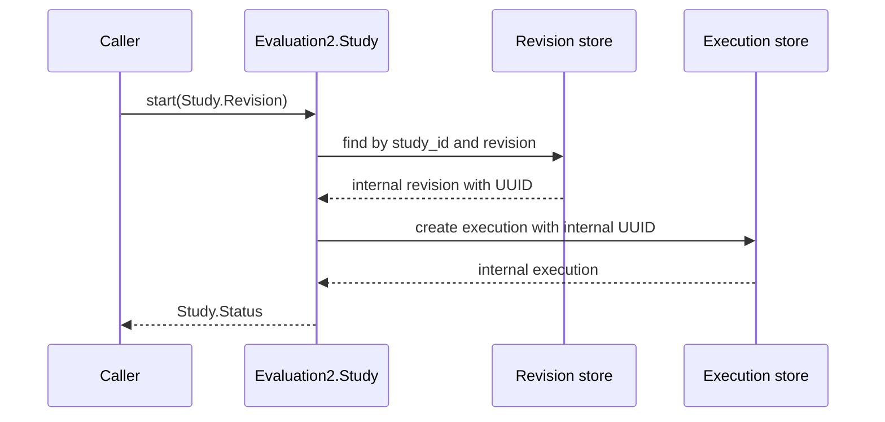
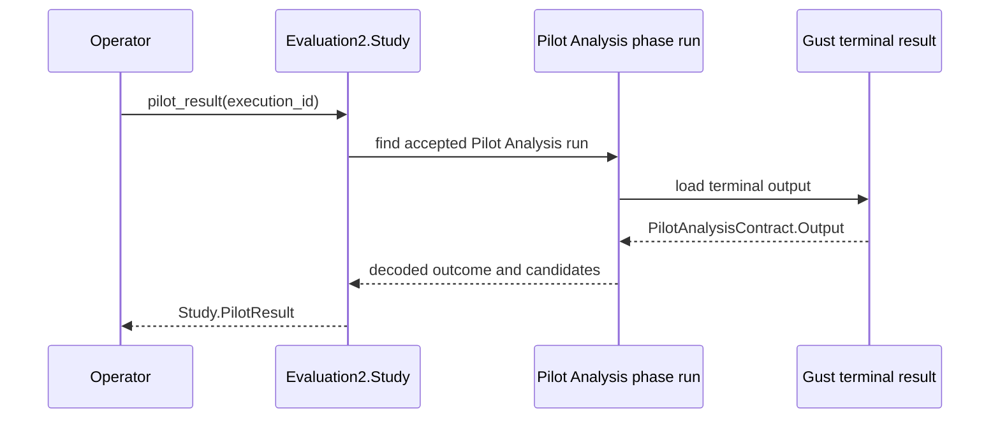
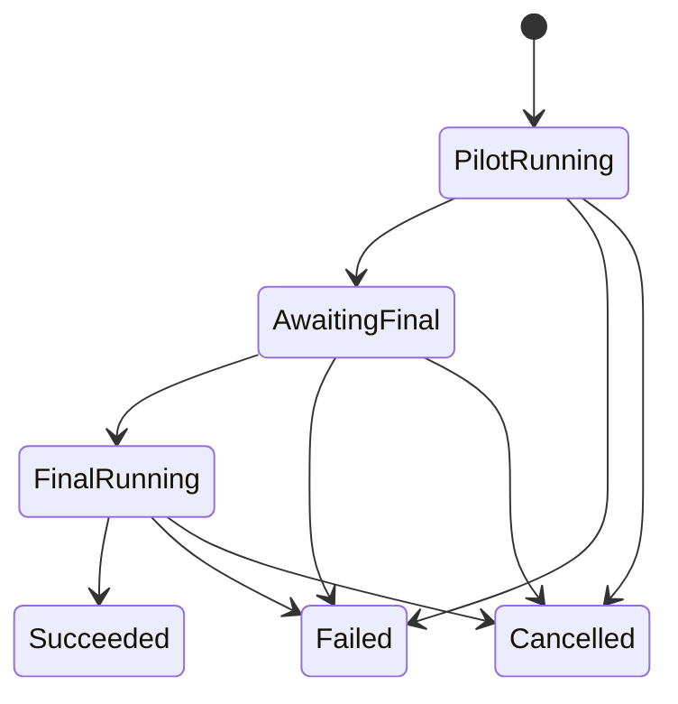
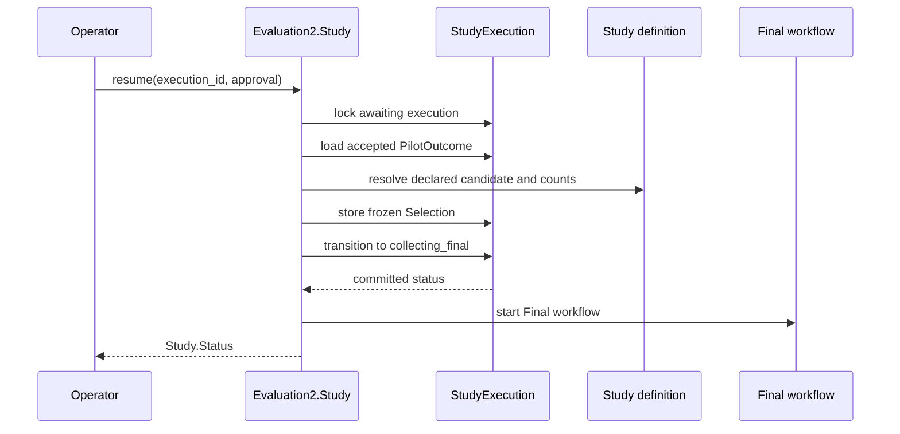
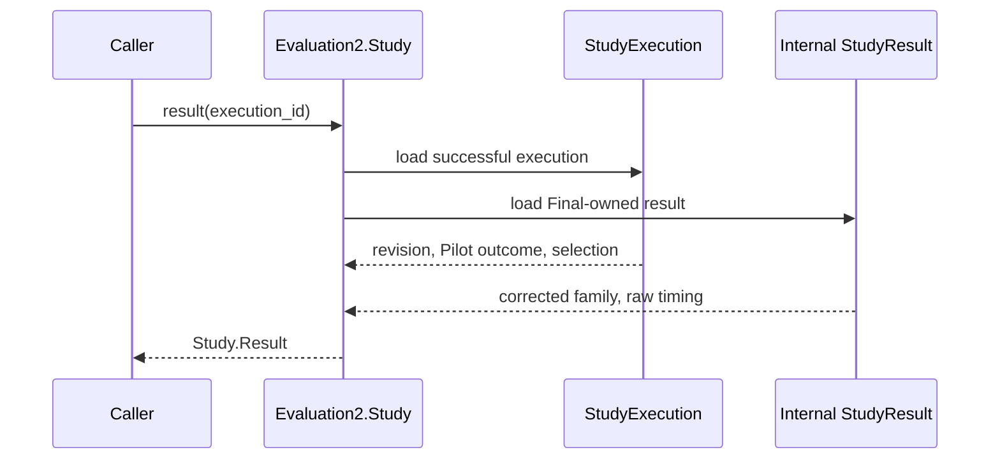
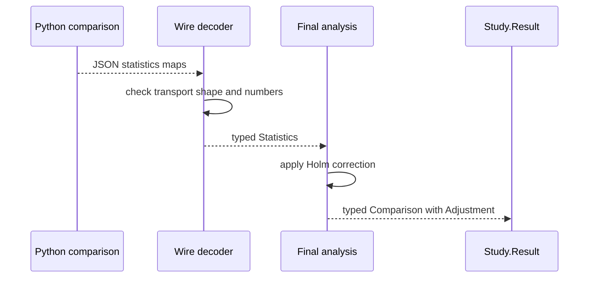
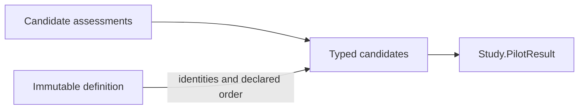
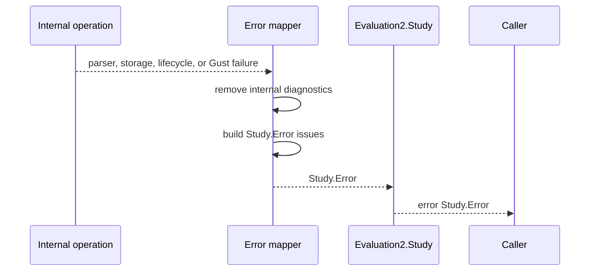
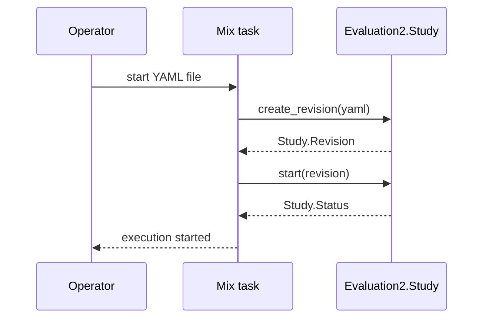

# Evaluation2 redesign — public API

> Design-interview history. Later decisions can supersede earlier proposals and example interfaces.
> Use the [native operator guide](../evaluation2.md), [current architecture](../architecture/evaluation-architecture.md) and [stable verification record](../history/evaluation2-verification.md) for implemented behavior and status.

> Part of the [Evaluation2 redesign index](grilling-evaluation-redesign.md).
> Covers Q43–Q57.

## Core service shape — public API

### Q43 — Public return types

The current facade returns internal persistence structs directly:

```elixir
{:ok, %StudyRevision{...}}
{:ok, %StudyExecution{...}}
{:ok, %StudyResult{...}}
```

This makes persistence fields part of the supported API. The facade can instead return three boundary values under its namespace:

```elixir
%Study.Revision{...}
%Study.Status{...}
%Study.Result{...}
```

Proposed signatures:

```elixir
@spec create_revision(binary()) ::
        {:ok, Study.Revision.t()} | {:error, Study.Error.t()}

@spec start(Study.revision_id()) ::
        {:ok, Study.Status.t()} | {:error, Study.Error.t()}

@spec status(Study.execution_id()) ::
        {:ok, Study.Status.t()} | {:error, Study.Error.t()}

@spec resume(Study.execution_id(), Study.approval()) ::
        {:ok, Study.Status.t()} | {:error, Study.Error.t()}

@spec cancel(Study.execution_id()) ::
        {:ok, Study.Status.t()} | {:error, Study.Error.t()}

@spec result(Study.execution_id()) ::
        {:ok, Study.Result.t()} | {:error, Study.Error.t()}
```

These are transient boundary views. Internal persistence remains `StudyRevision`, `StudyExecution`, and `StudyResult`. Q22 already requires the public result to join execution-owned Pilot history with Final-owned result data.

**Question:** Should the Study facade return public `Revision`, `Status`, and `Result` values instead of internal persistence structs?

**Recommendation:** Yes. This keeps database shape internal while limiting the supported type surface to three study-facing values.

**Answer:** The Study facade returns transient `Study.Revision`, `Study.Status`, and `Study.Result` values. Internal persistence structs remain unsupported implementation details.

### Q44 — Public revision value

The YAML declares `{study_id, revision}`. Persistence also adds a UUID for internal foreign keys. The database already enforces a unique index on the declared pair, so both forms identify the same revision.

Duplicated public identity:

```elixir
%Study.Revision{
  id: internal_uuid,
  study_id: "study-small",
  revision: 1
}
```

Declared public identity only:

```elixir
%Study.Revision{
  study_id: "study-small",
  revision: 1
}
```

Proposed type:

```elixir
@type t :: %__MODULE__{
        study_id: String.t(),
        revision: pos_integer()
      }
```

The internal `StudyRevision` record keeps its UUID for database relationships. The public facade resolves the declared pair when it starts an execution.

```elixir
Study.start(%Study.Revision{study_id: "study-small", revision: 1})
```

**Question:** Should the public API use only the declared `{study_id, revision}` identity and keep the UUID internal?

**Recommendation:** Yes. This removes the duplicate public identifier and gives Mix tasks a readable stable reference.

**Answer:** The public `Study.Revision` contains only `study_id` and `revision`. Internal persistence keeps its UUID for foreign keys.

Accepted sequence:



### Q45 — Public Pilot-result access

`Study.Status` can remain a small lifecycle view, but an operator must inspect the complete Pilot candidate summaries before approval. This is especially necessary when the outcome is insufficient and the operator must choose an override candidate.

Embedding all summaries in every status response makes status reads load and decode the terminal Gust result:

```elixir
Study.status(execution_id)
#=> %Study.Status{pilot_candidates: [...]}
```

A separate complete-study operation keeps status lightweight:

```elixir
Study.pilot_result(execution_id)
#=> {:ok, %Study.PilotResult{outcome: outcome, candidates: summaries}}
```

Proposed signature:

```elixir
@spec pilot_result(Study.execution_id()) ::
        {:ok, Study.PilotResult.t()} | {:error, Study.Error.t()}
```

The implementation follows the accepted Pilot Analysis `StudyPhaseRun`, loads its Gust terminal result, decodes `PilotAnalysisContract.Output`, and maps it to the supported value. It creates no duplicate persistence.

**Question:** Should the Study facade expose `pilot_result/1` as the supported way to read complete Pilot candidate summaries?

**Recommendation:** Yes. Approval needs these details, while `status/1` should remain a small lifecycle read.

**Answer:** The Study facade exposes `pilot_result/1`. It reads the accepted Pilot Analysis Gust output and returns a transient `Study.PilotResult` view.

Accepted sequence:



### Q46 — Public status value

The execution UUID has no declared natural key, so it remains the public execution reference. The status shape depends on the lifecycle state. Use one struct with a state-refined union instead of one broad type with optional fields in every state.

```elixir
@type t ::
        pilot_running()
        | awaiting_final()
        | final_running()
        | succeeded()
        | failed()
        | cancelled()

@type pilot_running :: %__MODULE__{
        execution_id: Study.execution_id(),
        revision: Study.Revision.t(),
        state: :collecting_pilot | :analyzing_pilot,
        pilot_outcome: nil,
        selection: nil,
        error: nil
      }

@type awaiting_final :: %__MODULE__{
        execution_id: Study.execution_id(),
        revision: Study.Revision.t(),
        state: :awaiting_final,
        pilot_outcome: Study.PilotOutcome.t(),
        selection: nil,
        error: nil
      }

@type final_running :: %__MODULE__{
        execution_id: Study.execution_id(),
        revision: Study.Revision.t(),
        state: :collecting_final | :analyzing_final,
        pilot_outcome: Study.PilotOutcome.t(),
        selection: Study.Selection.t(),
        error: nil
      }

@type succeeded :: %__MODULE__{
        execution_id: Study.execution_id(),
        revision: Study.Revision.t(),
        state: :succeeded,
        pilot_outcome: Study.PilotOutcome.t(),
        selection: Study.Selection.t(),
        error: nil
      }

@type failed :: %__MODULE__{
        execution_id: Study.execution_id(),
        revision: Study.Revision.t(),
        state: :failed,
        pilot_outcome: Study.PilotOutcome.t() | nil,
        selection: Study.Selection.t() | nil,
        error: Study.Error.t()
      }

@type cancelled :: %__MODULE__{
        execution_id: Study.execution_id(),
        revision: Study.Revision.t(),
        state: :cancelled,
        pilot_outcome: Study.PilotOutcome.t() | nil,
        selection: Study.Selection.t() | nil,
        error: nil
      }
```

Failed and cancelled executions can occur at different stages, so only those variants retain optional accepted context. A failed execution remains a successful status read. An inability to perform the read uses the outer error tuple.

Complete candidate summaries remain in `Study.pilot_result/1` and do not appear in status.

**Question:** Should `Study.Status.t()` be this state-refined union over one public struct?

**Recommendation:** Yes. It encodes valid field combinations without introducing one struct module for every lifecycle state.

**Answer:** `Study.Status.t()` is a state-refined union over one public struct. Only failed and cancelled variants retain optional accepted context.

Accepted state model:



### Q47 — Public Pilot outcome type

`Study.PilotOutcome` has the same optional-field problem. A recommendation requires a candidate and sample counts. An insufficient outcome contains only its tag under Q11.

Use one struct with an outcome-refined union:

```elixir
@type t :: recommended() | insufficient()

@type recommended :: %__MODULE__{
        outcome: :recommended,
        candidate_id: Study.candidate_id(),
        plan_count_per_side: pos_integer(),
        attacks_per_plan: pos_integer()
      }

@type insufficient :: %__MODULE__{
        outcome: :insufficient,
        candidate_id: nil,
        plan_count_per_side: nil,
        attacks_per_plan: nil
      }
```

This same shape can serve as the internal compact outcome and the supported public value. The public boundary does not need a second mapped representation.

**Question:** Should `Study.PilotOutcome.t()` be this outcome-refined union over one struct?

**Recommendation:** Yes. It makes invalid combinations visible to Dialyzer and preserves the compact insufficient outcome approved in Q11.

**Answer:** `Study.PilotOutcome.t()` is an outcome-refined union over one struct. Recommended outcomes require a candidate and counts. Insufficient outcomes contain only the tag.

### Q48 — Approval input and frozen selection

Approval input expresses operator intent. Frozen selection records the accepted sample-size choice. They are different types.

```elixir
@type Study.approval ::
        :recommended
        | {:override_insufficient, Study.candidate_id()}
```

```elixir
@type Study.Selection.t() :: %Study.Selection{
        candidate_id: Study.candidate_id(),
        plan_count_per_side: pos_integer(),
        attacks_per_plan: pos_integer()
      }
```

The public resume signature is:

```elixir
@spec Study.resume(
        Study.execution_id(),
        Study.approval()
      ) :: {:ok, Study.Status.t()} | {:error, Study.Error.t()}
```

The operator never supplies sample counts. Resume loads the declared candidate and freezes its counts. `Selection` stores no `pilot_override` field. Override status is derived from the accepted `PilotOutcome` and `Selection` under Q13.

**Question:** Should the public boundary keep this intent-versus-frozen-value split?

**Recommendation:** Yes. It prevents callers from supplying unverified counts and preserves one compact selection representation.

**Answer:** `Study.approval()` represents operator intent. `Study.Selection.t()` represents the validated frozen candidate and counts. Selection stores no override flag.

Accepted sequence:



### Q49 — Public result value

A successful public result joins execution-owned Pilot history with Final-owned scientific output. It does not copy detailed Pilot candidate summaries, raw evidence, phase runs, or Gust history.

```elixir
%Study.Result{
  execution_id: execution_id,
  revision: revision,
  pilot_outcome: pilot_outcome,
  selection: selection,
  family: corrected_family,
  timing: timing
}
```

Proposed type:

```elixir
@type t :: %__MODULE__{
        execution_id: Study.execution_id(),
        revision: Study.Revision.t(),
        pilot_outcome: Study.PilotOutcome.recommended() | Study.PilotOutcome.insufficient(),
        selection: Study.Selection.t(),
        family: Study.Result.Family.t(),
        timing: Study.Result.Timing.t()
      }
```

`Study.result/1` returns this value only after success. Before success it returns a bounded result-not-available error. Full Pilot candidate summaries remain available through `Study.pilot_result/1`.

The public value is assembled from:

```text
StudyExecution -> revision, Pilot outcome, selection
StudyResult    -> corrected family, raw timings
```

**Question:** Should `Study.Result` contain exactly these six fields?

**Recommendation:** Yes. They form the complete successful study result without exposing execution machinery or duplicating the detailed Pilot report.

**Answer:** `Study.Result` contains `execution_id`, `revision`, `pilot_outcome`, `selection`, `family`, and `timing`. All fields are required because the value exists only after success.

Accepted read sequence:



### Q50 — Public corrected-family envelope

The current internal value stores `method` and `family_size`:

```elixir
%CorrectedFamily{
  family_id: family_id,
  method: "holm",
  alpha: alpha,
  family_size: family_size,
  comparisons: comparisons
}
```

Evaluation2 has one fixed correction method, Holm. Keep that method explicit as a singleton type. `family_size` remains the length of `comparisons` and is derived.

```elixir
%Study.Result.Family{
  id: family_id,
  method: :holm,
  alpha: alpha,
  comparisons: comparisons
}
```

```elixir
@type method :: :holm

@type t :: %__MODULE__{
        id: String.t(),
        method: method(),
        alpha: float(),
        comparisons: [Study.Result.Comparison.t()]
      }
```

The public result builder joins `id`, `method`, and `alpha` from the immutable definition with the corrected comparison outputs. `size/1` derives the family size.

**Answer:** Keep `method` as the singleton type `:holm`. Omit only the derived `family_size` field.

### Q51 — Public timing measurements

The current timing type stores three parallel lists. Their lengths and positions can disagree:

```elixir
%TierTiming{
  plan_selection_us: [p0, p1, p2, p3, p4],
  simulation_us: [s0, s1, s2, s3, s4],
  total_us: [t0, t1, t2, t3, t4]
}
```

The methodology measures three boundaries for each of exactly five replicas. Group the three values by replica and key them by the measured replica position:

```elixir
%Study.Result.Timing.Tier{
  replicas: %{
    0 => %Study.Result.Timing.Replica{plan_selection_us: p0, simulation_us: s0, total_us: t0},
    1 => %Study.Result.Timing.Replica{plan_selection_us: p1, simulation_us: s1, total_us: t1},
    2 => %Study.Result.Timing.Replica{plan_selection_us: p2, simulation_us: s2, total_us: t2},
    3 => %Study.Result.Timing.Replica{plan_selection_us: p3, simulation_us: s3, total_us: t3},
    4 => %Study.Result.Timing.Replica{plan_selection_us: p4, simulation_us: s4, total_us: t4}
  }
}
```

```elixir
@type replicas :: %{
        required(0) => Replica.t(),
        required(1) => Replica.t(),
        required(2) => Replica.t(),
        required(3) => Replica.t(),
        required(4) => Replica.t()
      }
```

The complete timing value keeps the approved tier-keyed map:

```elixir
%Study.Result.Timing{
  by_tier: %{
    small: small_timing,
    medium: medium_timing,
    large: large_timing
  }
}
```

Median and range remain derived operations. Warm-up timing remains excluded. Presentation order uses replica positions `0..4`.

**Answer:** Public timing groups the three measured boundaries by replica, uses a map keyed by measured replica positions `0..4` for each tier, and keeps the approved tier-keyed map. This revises the earlier tuple choice. Median and range remain derived operations.

### Q52 — Public corrected-comparison types

The existing comparison statistics contract stores `estimate`, `interval`, `test`, and `assessment` as untyped maps. A supported public result should not expose string-keyed maps.

Preserve the scientific groupings as typed values:

```elixir
%Study.Result.Comparison{
  identity: %Study.Result.Comparison.Identity{
    tier: :small,
    budget: budget,
    alternative: alternative,
    reference: reference,
    outcome: outcome
  },
  statistics: %Study.Result.Comparison.Statistics{
    method: :corrected_crossed_bootstrap_v1,
    estimate: %Estimate{contrast: :alternative_minus_reference, value: estimate},
    interval: %Interval{confidence_level: confidence, lower: lower, upper: upper},
    test: %Test{
      method: :centered_crossed_bootstrap,
      alternative: :two_sided,
      raw_p_value: raw_p_value
    },
    assessment: %Assessment{
      status: :informative,
      warnings: []
    }
  },
  adjustment: %Study.Result.Comparison.Adjustment{
    adjusted_p_value: adjusted_p_value,
    reject_null: reject_null
  }
}
```

All fixed strings become singleton atom types. Assessment status remains `:informative | :non_informative`, and the only current warning is `:zero_width_interval`. The Python wire decoder performs the external shape and numeric checks once, then constructs these typed values.

The public value omits the Python wire `schema_version`; that version belongs to the transport decoder rather than the scientific result.

**Question:** Should the supported corrected comparison use typed nested values instead of the legacy string-keyed statistics maps?

**Recommendation:** Yes. This gives the public result precise types while preserving the established scientific grouping and calculations.

**Answer:** Supported corrected comparisons use typed nested identity, statistics, and adjustment values. Fixed wire literals become singleton atom types. Python schema versions and string-keyed maps remain at the transport boundary.

Accepted boundary sequence:



### Q53 — Public Pilot result shape

The current candidate summary copies several values that are derived from its comparison assessments: worst half-width, all-informative, non-informative positions, and all-passed. It also omits the full per-comparison details needed to understand an insufficient outcome.

Use one complete typed view:

```elixir
%Study.PilotResult{
  method: :precision_pilot_v1,
  selection_rule: :lowest_predicted_runtime,
  outcome: pilot_outcome,
  candidates: candidates
}
```

```elixir
%Study.PilotResult.Candidate{
  id: candidate_id,
  plan_count_per_side: plan_count,
  attacks_per_plan: attack_count,
  predicted_runtime_ms: predicted_runtime_ms,
  comparisons: comparison_assessments
}
```

```elixir
%Study.PilotResult.Comparison{
  identity: comparison_identity,
  guarded_half_width: guarded_half_width,
  informative: informative,
  passes: passes
}
```

Candidate list order and comparison list order follow the immutable definition. Public values omit internal candidate and comparison positions. Operations derive `worst_guarded_half_width`, `informative?`, `non_informative_comparisons`, and `passes?` from the comparison list.

**Question:** Should `Study.PilotResult` expose full per-comparison assessments and derive the candidate aggregate fields instead of storing them?

**Recommendation:** Yes. This makes insufficient outcomes explainable while removing copied aggregate values.

**Answer:** `Study.PilotResult` contains the compact outcome, fixed method and selection rule, and complete candidates with per-comparison assessments. Candidate aggregate values are derived operations.

Accepted construction:



### Q54 — Shared public comparison identity

Pilot and Final results identify the same declared family comparisons. A result-specific identity type would duplicate that contract.

Use one public study value:

```elixir
%Study.Comparison{
  tier: :small,
  budget: budget,
  alternative: alternative,
  reference: reference,
  outcome: outcome
}
```

```elixir
@type t :: %__MODULE__{
        tier: Study.Tier.t(),
        budget: pos_integer(),
        alternative: Study.strategy(),
        reference: Study.strategy(),
        outcome: String.t()
      }
```

Both result paths reuse it:

```elixir
%Study.PilotResult.Comparison{identity: %Study.Comparison{...}}
%Study.Result.Comparison{identity: %Study.Comparison{...}}
```

The immutable definition remains the source. Public view builders join the identity by declared position. Evidence values continue to store no comparison identity.

**Question:** Should `Study.Comparison` be the one supported comparison-identity type shared by Pilot and Final results?

**Recommendation:** Yes. It removes a duplicated result-specific identity type while keeping evidence identity-free.

**Answer:** `Study.Comparison` is the single supported comparison identity. Pilot and Final result views join it from the immutable definition. Evidence remains identity-free.

### Q55 — Public tier and strategy types

`Study.Comparison` and result timing expose tiers and strategies. The tier vocabulary belongs to Evaluation2 and has a required order. The strategy vocabulary already belongs to the optimization domain.

Expose a Study tier module:

```elixir
@type Study.Tier.t() :: :small | :medium | :large

@spec Study.Tier.all() :: [Study.Tier.t()]
@spec Study.Tier.position(Study.Tier.t()) :: 0..2
@spec Study.Tier.from_position(0..2) :: Study.Tier.t()
```

Reuse the existing strategy type through an alias:

```elixir
@type Study.strategy() ::
        NetworkDefense.Optimization.Contracts.OptimizationParams.strategy()
```

Do not create a second `Study.Strategy` enum or wrapper. Public values use atoms from the established optimization vocabulary.

**Question:** Should Evaluation2 own `Study.Tier` with ordering operations while `Study.strategy()` aliases the existing domain type?

**Recommendation:** Yes. Tier has Evaluation2-specific closed ordering behavior. Strategy already has a domain owner and should not be copied.

**Answer:** Evaluation2 owns the closed ordered `Study.Tier` module. `Study.strategy()` aliases the existing optimization strategy type without adding a wrapper.

### Q56 — Public study error type

The existing error envelope has string categories plus separate `issues` and `schema_errors` lists. Evaluation2 uses only four outer categories:

```elixir
@type Study.Error.category ::
        :validation_failed
        | :request_too_large
        | :conflict
        | :unavailable
```

Use one supported envelope and normalize schema diagnostics into the same issue list:

```elixir
%Study.Error{
  category: :validation_failed,
  issues: [
    %Study.Error.Issue{
      code: "invalid_yaml",
      path: ["pilot", "candidates", 0],
      message: "The YAML value is invalid.",
      details: %{}
    }
  ]
}
```

```elixir
@type t :: %__MODULE__{
        category: category(),
        issues: [Issue.t()]
      }
```

```elixir
@type Issue.path_component :: String.t() | non_neg_integer()

@type Issue.t() :: %Issue{
        code: String.t(),
        path: [Issue.path_component()],
        message: String.t(),
        details: map()
      }
```

The boundary exposes no parser diagnostics, submitted values, stack traces, Ecto changesets, or Gust errors. Internal failures map once into this bounded type. The same type appears in facade error tuples and terminal `Study.Status.failed()` values.

**Question:** Should `Study.Error` use this one-list typed envelope instead of exposing the existing internal error contract?

**Recommendation:** Yes. It gives the only public facade one stable error shape and removes the special public distinction between schema errors and other issues.

**Answer:** `Study.Error` has one typed issue list and the four closed categories `:validation_failed`, `:request_too_large`, `:conflict`, and `:unavailable`. Internal diagnostics map into this boundary once.

Accepted error flow:



### Q57 — Create and start boundary

The public library can freeze a revision and start an execution as two operations, or combine them.

Separate operations:

```elixir
{:ok, revision} = Study.create_revision(yaml)
{:ok, status} = Study.start(revision)
```

Combined operation:

```elixir
{:ok, status} = Study.start(yaml)
```

A stored immutable revision can support multiple executions. Combining the operations makes duplicate revision handling and repeated execution intent ambiguous. The Mix interface can still provide a convenience command that calls both library operations in sequence.

Proposed public signatures:

```elixir
@spec Study.create_revision(binary()) ::
        {:ok, Study.Revision.t()} | {:error, Study.Error.t()}

@spec Study.start(Study.Revision.t()) ::
        {:ok, Study.Status.t()} | {:error, Study.Error.t()}
```

**Question:** Should the supported Study API keep revision creation and execution start as separate operations?

**Recommendation:** Yes. This preserves revision reuse and one clear responsibility per operation. Operator tooling can compose them without adding a second library contract.

**Answer:** Keep `Study.create_revision/1` and `Study.start/1` as separate supported operations. A Mix task can compose them for a one-command operator workflow.

Accepted composition:


