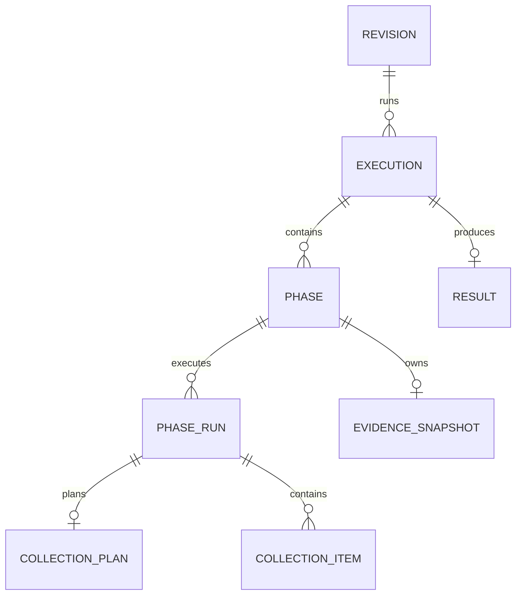

# Evaluation2 redesign — storage implementation

> Design-interview history. Later decisions can supersede earlier proposals and example interfaces.
> Use the [native operator guide](../evaluation2.md), [current architecture](../architecture/evaluation-architecture.md) and [stable verification record](../history/evaluation2-verification.md) for implemented behavior and status.

> Part of the [Evaluation2 redesign index](grilling-evaluation-redesign.md).
> Continues the persistence decisions after Q89.

## Q90 — Physical Evaluation2 schema

Evaluation2 uses eight new application tables:



| Table | Required fields | Main uniqueness rule |
|---|---|---|
| `evaluation2_study_revisions` | study ID, revision, definition JSONB | study ID plus revision |
| `evaluation2_study_executions` | revision ID, state, Pilot outcome, Selection, error | primary key |
| `evaluation2_study_phases` | execution ID, phase kind | execution plus phase kind |
| `evaluation2_study_phase_runs` | phase ID, run key, Gust run ID | phase plus run key; Gust run ID |
| `evaluation2_collection_plans` | phase-run ID, WorkItem list JSONB | phase-run ID |
| `evaluation2_collection_items` | phase-run ID, replica position, item position, effect links | phase-run plus both positions |
| `evaluation2_evidence_snapshots` | phase ID, Evidence JSONB | phase ID |
| `evaluation2_study_results` | execution ID, corrected family JSONB, timing JSONB | execution ID |

### PhaseRun key

Replace the scaffold tuple:

```elixir
@type run_key :: :single | {:tier, Tier.t()}
```

with this internal scalar type:

```elixir
@type run_key :: :single | Tier.t()
```

The database stores one of:

```text
single
small
medium
large
```

`:single` identifies a single-run phase. A tier atom identifies one Final Collection tier run. This representation needs one enum column and no custom Ecto type.

### Migration shape

The migration below is the approved physical design. The implementation can adjust generated constraint names when required by Ecto or PostgreSQL, but it must preserve the shown invariants.

```elixir
defmodule NetworkDefense.Repo.Migrations.CreateEvaluation2StudyTables do
  use Ecto.Migration

  def change do
    create table(:evaluation2_study_revisions, primary_key: false) do
      add :id, :binary_id, primary_key: true
      add :study_id, :string, null: false
      add :revision, :integer, null: false
      add :definition, :map, null: false

      timestamps(type: :utc_datetime_usec, updated_at: false)
    end

    create unique_index(
             :evaluation2_study_revisions,
             [:study_id, :revision]
           )

    create constraint(
             :evaluation2_study_revisions,
             :evaluation2_revision_is_positive,
             check: "revision > 0"
           )

    create table(:evaluation2_study_executions, primary_key: false) do
      add :id, :binary_id, primary_key: true

      add :study_revision_id,
          references(
            :evaluation2_study_revisions,
            type: :binary_id,
            on_delete: :restrict
          ),
          null: false

      add :state, :string, null: false
      add :pilot_outcome, :map
      add :selection, :map
      add :error, :map

      timestamps(type: :utc_datetime_usec)
    end

    create index(
             :evaluation2_study_executions,
             [:study_revision_id]
           )

    create constraint(
             :evaluation2_study_executions,
             :evaluation2_execution_state,
             check: """
             state IN (
               'collecting_pilot',
               'analyzing_pilot',
               'awaiting_final',
               'collecting_final',
               'analyzing_final',
               'succeeded',
               'failed',
               'cancelled'
             )
             """
           )

    create constraint(
             :evaluation2_study_executions,
             :evaluation2_selection_requires_outcome,
             check: "selection IS NULL OR pilot_outcome IS NOT NULL"
           )

    create constraint(
             :evaluation2_study_executions,
             :evaluation2_awaiting_requires_outcome,
             check: "state <> 'awaiting_final' OR pilot_outcome IS NOT NULL"
           )

    create constraint(
             :evaluation2_study_executions,
             :evaluation2_final_requires_selection,
             check: """
             state NOT IN (
               'collecting_final',
               'analyzing_final',
               'succeeded'
             )
             OR (
               pilot_outcome IS NOT NULL
               AND selection IS NOT NULL
             )
             """
           )

    create constraint(
             :evaluation2_study_executions,
             :evaluation2_failed_requires_error,
             check: "state <> 'failed' OR error IS NOT NULL"
           )

    create table(:evaluation2_study_phases, primary_key: false) do
      add :id, :binary_id, primary_key: true

      add :study_execution_id,
          references(
            :evaluation2_study_executions,
            type: :binary_id,
            on_delete: :delete_all
          ),
          null: false

      add :phase, :string, null: false

      timestamps(type: :utc_datetime_usec, updated_at: false)
    end

    create unique_index(
             :evaluation2_study_phases,
             [:study_execution_id, :phase]
           )

    create constraint(
             :evaluation2_study_phases,
             :evaluation2_phase_kind,
             check: """
             phase IN (
               'pilot_collection',
               'pilot_analysis',
               'final_collection',
               'final_analysis'
             )
             """
           )

    create table(:evaluation2_study_phase_runs, primary_key: false) do
      add :id, :binary_id, primary_key: true

      add :study_phase_id,
          references(
            :evaluation2_study_phases,
            type: :binary_id,
            on_delete: :delete_all
          ),
          null: false

      add :run_key, :string, null: false
      add :gust_run_id, :bigint, null: false

      timestamps(type: :utc_datetime_usec, updated_at: false)
    end

    create unique_index(
             :evaluation2_study_phase_runs,
             [:study_phase_id, :run_key]
           )

    create unique_index(
             :evaluation2_study_phase_runs,
             [:gust_run_id]
           )

    create constraint(
             :evaluation2_study_phase_runs,
             :evaluation2_run_key,
             check: "run_key IN ('single', 'small', 'medium', 'large')"
           )

    create table(:evaluation2_collection_plans, primary_key: false) do
      add :id, :binary_id, primary_key: true

      add :study_phase_run_id,
          references(
            :evaluation2_study_phase_runs,
            type: :binary_id,
            on_delete: :delete_all
          ),
          null: false

      add :items, :map, null: false

      timestamps(type: :utc_datetime_usec, updated_at: false)
    end

    create unique_index(
             :evaluation2_collection_plans,
             [:study_phase_run_id]
           )

    create table(:evaluation2_collection_items, primary_key: false) do
      add :id, :binary_id, primary_key: true

      add :study_phase_run_id,
          references(
            :evaluation2_study_phase_runs,
            type: :binary_id,
            on_delete: :delete_all
          ),
          null: false

      add :replica_position, :integer, null: false
      add :item_position, :integer, null: false

      add :optimization_run_id,
          references(
            :optimization_runs,
            type: :binary_id,
            on_delete: :restrict
          )

      add :experiment_id,
          references(
            :experiments,
            type: :binary_id,
            on_delete: :restrict
          )

      timestamps(type: :utc_datetime_usec)
    end

    create unique_index(
             :evaluation2_collection_items,
             [:study_phase_run_id, :replica_position, :item_position],
             name: :evaluation2_collection_item_position
           )

    create unique_index(
             :evaluation2_collection_items,
             [:optimization_run_id],
             where: "optimization_run_id IS NOT NULL"
           )

    create unique_index(
             :evaluation2_collection_items,
             [:experiment_id],
             where: "experiment_id IS NOT NULL"
           )

    create constraint(
             :evaluation2_collection_items,
             :evaluation2_replica_position,
             check: "replica_position BETWEEN -1 AND 4"
           )

    create constraint(
             :evaluation2_collection_items,
             :evaluation2_item_position,
             check: "item_position >= 0"
           )

    create table(:evaluation2_evidence_snapshots, primary_key: false) do
      add :id, :binary_id, primary_key: true

      add :study_phase_id,
          references(
            :evaluation2_study_phases,
            type: :binary_id,
            on_delete: :delete_all
          ),
          null: false

      add :evidence, :map, null: false

      timestamps(type: :utc_datetime_usec, updated_at: false)
    end

    create unique_index(
             :evaluation2_evidence_snapshots,
             [:study_phase_id]
           )

    create table(:evaluation2_study_results, primary_key: false) do
      add :id, :binary_id, primary_key: true

      add :study_execution_id,
          references(
            :evaluation2_study_executions,
            type: :binary_id,
            on_delete: :delete_all
          ),
          null: false

      add :family, :map, null: false
      add :timing, :map, null: false

      timestamps(type: :utc_datetime_usec, updated_at: false)
    end

    create unique_index(
             :evaluation2_study_results,
             [:study_execution_id]
           )
  end
end
```

`gust_run_id` is a plain bigint instead of a SQL foreign key. The main repository migrates before Gust on a fresh database, so `gust_runs` might not exist when this migration runs. Q81 owns the application-level link.

### Ecto schema pattern

Persistence records become direct Ecto schemas. They remain the internal records returned by `Study.Persistence`.

```elixir
defmodule NetworkDefense.Evaluation2.Study.Persistence.Revision do
  use Ecto.Schema

  alias NetworkDefense.Evaluation2.Study.Definition

  @primary_key {:id, :binary_id, autogenerate: true}
  @foreign_key_type :binary_id

  schema "evaluation2_study_revisions" do
    field :study_id, :string
    field :revision, :integer
    field :definition, :map

    timestamps(type: :utc_datetime_usec, updated_at: false)
  end

  @type t :: %__MODULE__{
          id: Ecto.UUID.t(),
          study_id: String.t(),
          revision: pos_integer(),
          definition: Definition.t(),
          inserted_at: DateTime.t()
        }
end
```

Ecto loads a JSONB field as a map. Persistence uses Spectral and replaces that field with the typed value before it returns the schema record. Direct Repo access remains private to Persistence.

### Spectral UUID codec

`Ecto.UUID.t()` remains the WorkItem field type. Add one Spectral codec and register it for `{Ecto.UUID, {:type, :t, 0}}`. The codec validates both encoded and decoded UUID strings through `Ecto.UUID.cast/1`.

### Error issue shape

Remove `details` from `Study.Error.Issue`:

```elixir
@type t :: %__MODULE__{
        code: String.t(),
        path: path(),
        message: String.t()
      }

defstruct [:code, :path, :message]
```

### Decision

**Question:** Should Evaluation2 use this eight-table schema, scalar PhaseRun key, constraints, and direct Ecto-schema pattern?

**Answer:** Yes. The proposal package is approved. Implement the tables and constraints above. Use direct `Study.Persistence.*` Ecto schemas, a scalar `run_key`, Spectral JSONB conversion at the Persistence boundary, and the approved UUID codec.

## Q91 — Final Study.Persistence API

### Internal result types

```elixir
@type response(value) ::
        {:ok, value}
        | {:error, Persistence.Error.t()}

@type lifecycle_context :: %{
        execution: Execution.t(),
        active_phase: Phase.t() | nil
      }

@type phase_context :: %{
        phase: Phase.t(),
        execution: Execution.t(),
        revision: Revision.t()
      }

@type phase_run_context :: %{
        phase_run: PhaseRun.t(),
        phase: Phase.t(),
        execution: Execution.t(),
        revision: Revision.t()
      }
```

These types stay in `Study.Persistence`. Do not add context struct modules.

### Revision operations

```elixir
insert_revision(definition)
fetch_revision(revision_ref)
```

`insert_revision/1` derives study ID and revision from the normalized Definition. Equal repeated insertion returns the existing immutable record. The same declared identity with different normalized content returns `:conflict`.

### Lifecycle operations

```elixir
start_execution(revision_ref)
fetch_execution(execution_id)
accept_pilot_collection(phase_id)
accept_pilot_analysis(phase_id, outcome)
accept_approval(execution_id, intent)
accept_final_collection(phase_id)
accept_final_analysis(phase_id, family, timing)
fail_phase(phase_id, public_error)
cancel_execution(execution_id)
fetch_result(execution_id)
```

Every lifecycle mutation accepts a stable ID, locks its authoritative rows, applies compare-and-return idempotency, and returns the current `lifecycle_context`.

A transition that enters an active state creates or loads the required StudyPhase in the same transaction. Gust provisioning occurs after commit.

### Context and Gust-link operations

```elixir
fetch_phase_context(phase_id)
fetch_phase_run_context(phase_run_id)
fetch_phase_run(phase_id, run_key)
list_phase_runs(phase_id)
link_phase_run(phase_id, run_key, gust_run_id)
```

`link_phase_run/3` returns the canonical row. Workflow compares its Gust run ID with the newly created run ID. It deletes an undispatched loser and dispatches only the canonical linked run.

### Collection operations

```elixir
insert_collection_plan(phase_run_id, work_items)
fetch_collection_plan(phase_run_id)
prepare_collection_items(plan_id, replica_position)
fetch_collection_item(item_id)
list_replica_items(phase_run_id, replica_position)
reserve_optimization(item_id)
reserve_experiment(item_id)
```

### Evidence operations

```elixir
insert_evidence_snapshot(phase_id, evidence)
fetch_evidence_snapshot(phase_id)
```

The snapshot is a prepared phase artifact. Lifecycle acceptance is a separate semantic transaction.

### Removed scaffold operations

Remove these public internal APIs:

```text
create_revision(raw_yaml)
load_definition!
fetch_revision!
fetch_execution!
put_pilot_outcome
put_selection
store_result
fetch_result!
create_or_load_phase
fetch_phase!
create_or_load_phase_run
fetch_phase_run!
fetch_collection_plan!
fetch_collection_item!
fetch_evidence_snapshot!
```

### Persistence error

```elixir
defmodule NetworkDefense.Evaluation2.Study.Persistence.Error do
  @type kind ::
          :not_found
          | :conflict
          | :storage
          | :corrupt_data

  @type t :: %__MODULE__{
          kind: kind(),
          operation: atom(),
          resource: atom(),
          cause: term()
        }

  defstruct [:kind, :operation, :resource, :cause]
end
```

`Study.Views.error/1` maps internal errors into the bounded public `Study.Error`. It also maps background Workflow failures before `fail_phase/2` stores them on StudyExecution.

### Tagged reads

All exposed reads return `response(value)`. Remove public bang variants. Private transaction helpers may raise only after an invariant was established earlier in the same transaction.

### Decision

**Question:** Should DeepSeek implement this final Persistence API and remove the stale scaffold functions?

**Answer:** Yes. The proposal package is approved. Preserve the function groups and ownership above. Small name changes are allowed only when required by Elixir conventions and must be reported for review.

## Q92 — Migration sequence and DeepSeek implementation stages

### Legacy removal order

Use two migrations:

```text
Migration A
  create evaluation2_* tables

Implement and manually verify Evaluation2.

Migration B
  drop legacy evaluation_* tables
```

Do not drop legacy tables during the storage-foundation task. The final subsystem still removes legacy code and tables completely after Evaluation2 works.

### DeepSeek Task 1 — Storage foundation

Use `deepseek/deepseek-flash`.

Implement:

- the Evaluation2 migration;
- eight Ecto schemas;
- scalar PhaseRun key;
- Spectral UUID codec and configuration;
- removal of `Study.Error.Issue.details`;
- `Study.Persistence.Error`;
- `Study.Views.error/1`;
- Spectral encode/decode helpers;
- tagged phase and phase-run context reads;
- the approved Persistence specs and placeholders needed to keep compilation successful.

Do not implement full lifecycle transactions, Collection effect reservations, or Gust provisioning in Task 1.

### Independent review gate

After Task 1, run a read-only review with `openai/gpt-6.1-sol` before Task 2 starts.

The reviewer must compare the implementation with the complete approved design and assess:

- migration and schema correctness;
- ownership boundaries and API conformance;
- Spectral integration and stored-value safety;
- unnecessary modules, helpers, checks, or representations;
- whether the implementation can be smaller without losing an invariant;
- whether an approved design decision itself creates avoidable complexity.

The reviewer can recommend a design change. It must separate:

1. required implementation fixes;
2. design decisions that should be reconsidered;
3. optional polish.

The review is read-only. Do not start Task 2 until required findings are resolved or explicitly accepted.


### DeepSeek Task 2 — Persistence behavior

Resume the same worker and implement:

- immutable revision insertion;
- execution start;
- semantic lifecycle transactions;
- idempotent repeated acceptance;
- atomic active-phase creation;
- CollectionPlan and CollectionItem persistence;
- retry-safe effect reservations;
- EvidenceSnapshot persistence;
- Final result persistence.

### DeepSeek Task 3 — Gust integration

Resume the worker and implement:

- Q81 create-link-dispatch;
- Final tier sequencing support;
- phase completion recovery;
- manual orphan-run reconciliation.

### Verification policy

Do not add permanent automated tests at this stage.

Allowed verification:

- formatter;
- warnings-as-errors compilation;
- strict Credo;
- Dialyzer;
- scoped diff check;
- migration on a disposable PostgreSQL database;
- disposable Spectral and persistence probes outside the repository.

Remove each disposable probe after execution and record its command and result.

### Decision

**Question:** Should implementation use the staged migration and three DeepSeek tasks above?

**Answer:** Yes. The proposal package is approved. Implement Task 1 first, review it with `openai/gpt-6.1-sol` against both the implementation and the design's simplicity, resolve or accept the findings, and only then resume the same DeepSeek session for Tasks 2 and 3.

## Q93 — Storage-foundation review disposition

The independent `openai/gpt-6.1-sol` review returned **approve after fixes**. The physical schema and migration design remain accepted.

Required implementation corrections:

1. contain expected Repo and connection failures inside the tagged Persistence error boundary;
2. classify malformed stored JSONB load failures as `:corrupt_data`;
3. make the UUID codec JSON-only for the owned `Ecto.UUID.t()` type;
4. reject non-string UUID JSON values without loading external type metadata;
5. require a canonical 36-byte UUID string before `Ecto.UUID.cast/1`;
6. load each Phase or PhaseRun context with one joined query;
7. define the CollectionPlan JSONB envelope as a named payload type on the existing CollectionPlan module.

The lifecycle command result is simplified to include the authoritative Revision loaded by the transaction:

```elixir
@type lifecycle_context :: %{
        execution: Execution.t(),
        revision: Revision.t(),
        active_phase: Phase.t() | nil
      }
```

`Study.start/1`, `Study.resume/2`, and `Study.cancel/1` build the public Status from this transaction result. They do not perform a separate preflight Revision read.

The CollectionPlan envelope remains accepted because an Ecto `:map` field requires a JSON object. Define the payload on CollectionPlan rather than adding a wrapper module:

```elixir
@type payload :: %{items: [WorkItem.t()]}
```

Spectral can encode that atom-keyed typed map into the string-keyed JSONB object. The persisted schema record continues to expose its in-memory `items` field as the ordered WorkItem list after decoding.

**Question:** Should these review fixes and the Revision-bearing lifecycle context be applied before Task 2?

**Answer:** Yes. Resume the same DeepSeek storage-foundation session, apply the required fixes, repeat the static and disposable checks, and keep Task 2 blocked until the fixes are reviewed.

The final `openai/gpt-6.1-sol` source review returned **approve Task 2**. It found no remaining storage-foundation blocker. The approved migration, eight schemas, tagged error boundary, Spectral metadata, UUID codec, joined context reads, Revision-bearing lifecycle context, and API placeholders remain suitable for Task 2.

## Q94 — Evidence snapshot read identities

Collection assembly and lifecycle acceptance operate from a collection `StudyPhase` ID. Pilot and Final Analysis phase contracts carry the accepted `EvidenceSnapshot` ID. Persistence exposes two explicit reads instead of overloading one UUID argument:

```elixir
fetch_phase_evidence_snapshot(phase_id)
fetch_evidence_context(snapshot_id)
```

The phase-keyed read supports idempotent assembly and lifecycle acceptance. The snapshot-keyed context read loads the authoritative analysis input with one joined query:

```elixir
@type evidence_context :: %{
        snapshot: EvidenceSnapshot.t(),
        phase: Phase.t(),
        execution: Execution.t(),
        revision: Revision.t()
      }
```

The snapshot contains typed Evidence. The owning Phase supplies the Pilot or Final role. The Revision supplies the immutable Definition. Analysis does not reconstruct collection history or accept a caller-built context.

Do not keep the ambiguous scaffold function `fetch_evidence_snapshot/1`. Do not change the approved analysis phase contracts back to Phase IDs.

**Question:** Should Persistence use the two explicit evidence reads and the snapshot-keyed joined analysis context above?

**Answer:** Yes. Implement both operations in Task 2. Use one joined query for `fetch_evidence_context/1`, following the same tagged-error and typed-decoding boundary as the Phase and PhaseRun context reads.

## Q95 — Persistence behavior review disposition

The independent `openai/gpt-6.1-sol` review returned **approve after fixes**. Gust integration remains blocked until the fixes are applied and reviewed.

### Lifecycle-phase proof of collection acceptance

A prepared EvidenceSnapshot does not prove that the lifecycle accepted the collection phase. Collection acceptance is determined by the lifecycle phase that the transaction entered:

```text
Pilot Collection accepted
  ⇔ Pilot Analysis StudyPhase exists

Final Collection accepted
  ⇔ Final Analysis StudyPhase exists
```

The acceptance transaction creates the successor StudyPhase and advances StudyExecution atomically. The successor phase is therefore the durable lifecycle-phase witness. Do not add an `accepted` flag or timestamp to StudyPhase.

For a failed or cancelled execution:

- a successor phase means the earlier collection acceptance committed, so an equal retry returns the current terminal state;
- no successor phase means the first acceptance never committed, so a late submission conflicts.

For a later successful lifecycle state, a missing required successor phase or accepted value is an internal invariant failure.

Do not use EvidenceSnapshot existence as the acceptance witness. Remove the general total-order dependency for failed and cancelled states; use explicit successful progress and lifecycle-phase witnesses.

### Complete WorkItem foothold

A stored CollectionPlan contains complete resolved WorkItems. The immutable Definition requires an initial foothold, and every WorkItem is later used for simulation. Change the field to:

```elixir
initial_foothold_node_id: Ecto.UUID.t()
```

Reject nil before plan persistence. Remove separate reservation-time nil branches. This keeps invalid plans out of durable storage and makes optimization and simulation reservations consume the same complete request.

### Required implementation fixes

1. Build public `Study.Result.Family` and comparison identities by joining the immutable Definition with stored corrected outputs.
2. Resolve the declared candidate for recommended and insufficient approvals. Construct Selection only from Definition counts. Treat an inconsistent stored recommendation as an internal invariant failure.
3. Use successor StudyPhase existence as collection-acceptance history.
4. Handle the global `gust_run_id` unique constraint as a tagged conflict instead of allowing `Ecto.ConstraintError` to escape.
5. Require a non-null WorkItem foothold before plan persistence.
6. Classify approval attempts from Pilot-running states as lifecycle conflicts, not missing-storage failures.
7. Guard the two-read public result path with `execution.state == :succeeded` before reading the immutable Result.
8. Classify a succeeded execution missing its required Result, snapshot, or accepted lifecycle fact as an internal invariant failure. Failed or cancelled execution without prior acceptance remains a late conflict.

**Question:** Should collection acceptance use lifecycle-phase history, and should persisted WorkItems require a resolved foothold?

**Answer:** Yes. Use successor StudyPhase records as lifecycle acceptance witnesses. Require a resolved foothold UUID in every persisted WorkItem. Apply all listed review fixes before Gust integration.

## Q96 — Final persistence lifecycle corrections

The second `openai/gpt-6.1-sol` review found three remaining Evaluation2 implementation issues. The design remains accepted.

### Successful completion is not an abort state

`:failed` and `:cancelled` are terminal aborts. `:succeeded` is the last state of the successful lifecycle chain:

```text
collecting_pilot
→ analyzing_pilot
→ awaiting_final
→ collecting_final
→ analyzing_final
→ succeeded
```

Acceptance classification must therefore treat:

- `:failed` and `:cancelled` as terminal aborts;
- `:succeeded` as later successful progress.

A succeeded execution missing a required accepted value, successor phase, snapshot, or Result is an internal invariant failure. A failed or cancelled execution without evidence that the acceptance committed is a late conflict.

### Lifecycle phase and snapshot are both required

The successor StudyPhase proves that collection acceptance committed. The phase-owned EvidenceSnapshot remains the required scientific artifact. An idempotent collection retry must require both:

```text
successor StudyPhase exists
AND
phase-owned EvidenceSnapshot exists
```

For failed or cancelled execution:

- no successor phase means the acceptance never committed, so return conflict;
- successor phase present but snapshot missing means accepted state is corrupt, so return an internal storage error;
- both present means return the current terminal state.

For later successful progress, a missing successor phase or snapshot is always an internal invariant failure.

### Bounded tier decoding in public Results

Stored Definition comparison tiers are strings. Result construction must convert only `small`, `medium`, and `large`. An unknown stored tier is corrupt application data and must return the bounded public unavailable error. It must not call a partial bang decoder that can raise through `Study.result/1`.

### Unrelated precommit state

The commented `test` entry in `src/mix.exs` is an explicit user-owned change from an earlier task. Evaluation2 work must preserve it unchanged. It is not a persistence-review fix.

**Question:** Should succeeded follow successful progress, should collection retries require both lifecycle-phase witness and snapshot, and should invalid stored tiers map to the bounded corruption error?

**Answer:** Yes. Apply these three corrections and preserve the user-owned precommit change.
