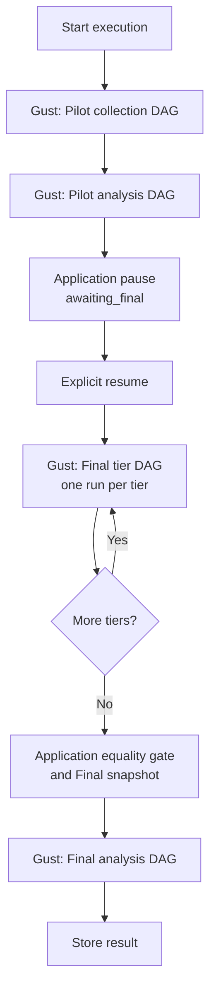
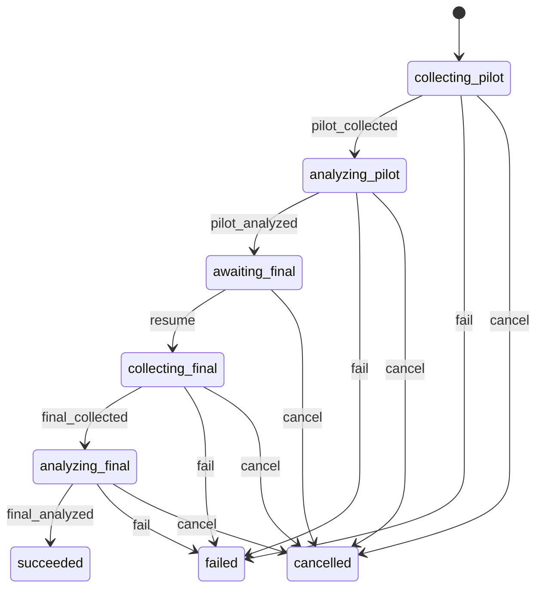
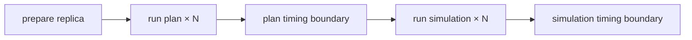
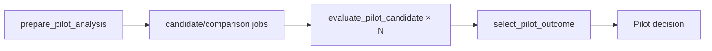

# Evaluation2 redesign — workflow and phase contracts

> Design-interview history. Later decisions can supersede earlier proposals and example interfaces.
> Use the [native operator guide](../evaluation2.md), [current architecture](../architecture/evaluation-architecture.md) and [stable verification record](../history/evaluation2-verification.md) for implemented behavior and status.

> Part of the [Evaluation2 redesign index](grilling-evaluation-redesign.md).

## Workflow

### Pilot approval

**Question:** Should Final collection start automatically after a passing Pilot?

**Answer:** Keep explicit approval. The user selected this option during the initial discussion.

Collection and analysis run automatically within each phase. Every valid Pilot outcome pauses before Final collection.

### Q7 — Study pipeline and Gust phase DAGs

Gust owns each batch. The application lifecycle coordinates the phases and the runtime tier list.



This keeps dynamic tiers sequential without implementing a second batch executor.

Lifecycle events reuse the current pure state machine:



```text
assemble_pilot_snapshot  -> :pilot_collected
accept_pilot_outcome     -> :pilot_analyzed
resume_study             -> :resume
accept_final_snapshot    -> :final_collected
store_result             -> :final_analyzed
task/run failure         -> :fail
cancel_study             -> :cancel
```

#### Pilot collection DAG

```elixir
defmodule PilotCollectionDAG do
  use Gust.DSL

  task_action :prepare_pilot_collection, Placeholder.PreparePilotCollection,
    downstream: [:collect_pilot_item],
    store_result: true

  task_action :collect_pilot_item, Placeholder.CollectPilotItem,
    map_over: :prepare_pilot_collection,
    downstream: [:assemble_pilot_snapshot]

  task_action :assemble_pilot_snapshot, Placeholder.AssemblePilotSnapshot,
    store_result: true
end
```

Gust creates one mapped task per collection item. It runs the batch and retries failed mapped tasks.

#### Pilot analysis DAG

```elixir
defmodule PilotAnalysisDAG do
  use Gust.DSL

  task_action :prepare_pilot_analysis, Placeholder.PreparePilotAnalysis,
    downstream: [:evaluate_pilot_candidate],
    store_result: true

  task_action :evaluate_pilot_candidate, Placeholder.EvaluatePilotCandidate,
    map_over: :prepare_pilot_analysis,
    downstream: [:select_pilot_outcome],
    store_result: true

  task_action :select_pilot_outcome, Placeholder.SelectPilotOutcome,
    store_result: true
end
```

#### Final tier collection DAG

One Gust run collects one tier. The static DAG owns warm-up and the five measured replicas.

```elixir
defmodule FinalTierCollectionDAG do
  use Gust.DSL

  task_action :check_environment_before_warm_up, Placeholder.CheckEnvironment,
    downstream: [:prepare_warm_up]

  task_action :prepare_warm_up, Placeholder.PrepareReplica,
    downstream: [:run_plan_warm_up],
    store_result: true

  task_action :run_plan_warm_up, Placeholder.RunPlan,
    map_over: :prepare_warm_up,
    downstream: [:run_simulation_warm_up]

  task_action :run_simulation_warm_up, Placeholder.RunSimulation,
    map_over: :prepare_warm_up,
    downstream: [:check_environment_before_0]

  measured_replica(0, after: :check_environment_after_0)
  measured_replica(1, after: :check_environment_after_1)
  measured_replica(2, after: :check_environment_after_2)
  measured_replica(3, after: :check_environment_after_3)
  measured_replica(4, after: :check_environment_after_4)

  task_action :complete_final_tier, Placeholder.CompleteFinalTier,
    store_result: true
end
```

Each `measured_replica/2` expands to:



#### Final analysis DAG

```elixir
defmodule FinalAnalysisDAG do
  use Gust.DSL

  task_action :prepare_final_analysis, Placeholder.PrepareFinalAnalysis,
    downstream: [:compare_final_member],
    store_result: true

  task_action :compare_final_member, Placeholder.CompareFinalMember,
    map_over: :prepare_final_analysis,
    downstream: [:correct_final_family],
    store_result: true

  task_action :correct_final_family, Placeholder.CorrectFinalFamily,
    store_result: true
end
```

#### Application sequencing

```elixir
def run_pilot(execution) do
  with {:ok, pilot_snapshot} <- GustPhase.run(:pilot_collection, execution),
       {:ok, pilot_outcome} <- GustPhase.run(:pilot_analysis, execution, pilot_snapshot),
       {:ok, execution} <- State.accept_pilot_outcome(execution, pilot_outcome) do
    {:paused, execution}
  end
end

def run_final(execution) do
  tier_results =
    execution
    |> declared_tiers()
    |> Enum.map(&GustPhase.run(:final_tier_collection, execution, &1))

  with {:ok, final_snapshot, timing} <- FinalCollection.accept(tier_results),
       {:ok, final_result} <- GustPhase.run(:final_analysis, execution, final_snapshot),
       {:ok, result} <- Results.store(execution, final_result, timing) do
    {:completed, result}
  end
end
```

Proposed placeholder files:

```text
src/priv/gust/dags/
├── evaluation_study_pilot_collection.exs
├── evaluation_pilot.exs
├── evaluation_study_final_tier_collection.exs
└── evaluation_final.exs

src/lib/network_defense/evaluation/study/pipeline/
├── lifecycle.ex
├── coordinator.ex
├── runner.ex
├── state.ex
├── pilot_collection.ex
├── pilot_analysis.ex
├── final_collection.ex
├── final_analysis.ex
└── actions/...
```

Reuse the lifecycle and sequencing mechanisms. Simplify the task contracts and repeated validation inside them.

### Data ownership


```text
StudyRevision      normalized definition
StudyExecution     lifecycle, Pilot outcome, frozen selection
Phase/tier record  accepted Gust run and stage output
CollectionItem     retry-safe optimization/simulation links
EvidenceSnapshot   accepted matrices
Gust task results  outputs within one phase run
StudyResult        successful final output
```

### Data between phase DAGs

Application records carry accepted data across Gust runs.

```mermaid
flowchart LR
    PC["Pilot collection run"] -->|snapshot ID| APP1["Application accepts snapshot"]
    APP1 --> PA["Pilot analysis run"]
    PA -->|Pilot outcome| APP2["Application stores outcome and pauses"]
    APP2 --> FC["Final tier runs"]
    FC -->|tier receipts + timing| APP3["Application equality gate and snapshot"]
    APP3 --> FA["Final analysis run"]
    FA -->|corrected family| RESULT["Application stores result"]
```



Do not load task results from an earlier Gust run inside a later run. Pass an accepted application reference instead.

### Phase input/output contracts

Each Gust run has:

```text
one compact root input
one terminal success output
Gust-owned failure state
```

Task results do not store an error union. A failed task or run uses Gust status and its persisted error.

#### Pilot collection

```elixir
defmodule PilotCollectionContract do
  defmodule Input do
    defstruct [:phase_id]
  end

  defmodule Output do
    defstruct [:snapshot_id]
  end
end
```

```elixir
# Gust run params
%{"study_phase_id" => phase_id}

# Terminal task: assemble_pilot_snapshot
%{"snapshot_id" => snapshot_id}
```

Application interface:

```elixir
GustPhase.run(:pilot_collection, %PilotCollectionContract.Input{
  phase_id: phase.id
})
#=> {:ok, %PilotCollectionContract.Output{snapshot_id: snapshot_id}}
```

#### Pilot analysis

```elixir
defmodule PilotAnalysisContract do
  defmodule Input do
    defstruct [:phase_id]
  end

  defmodule Output do
    defstruct [
      :outcome,
      :candidate_id,
      :plan_count_per_side,
      :attacks_per_plan,
      :candidate_summaries
    ]
  end
end
```

```elixir
# Gust run params
%{"study_phase_id" => phase_id}

# Terminal task: select_pilot_outcome
%{
  "outcome" => "recommended" | "insufficient",
  "candidate_id" => candidate_id | nil,
  "plan_count_per_side" => integer | nil,
  "attacks_per_plan" => integer | nil,
  "candidate_summaries" => summaries
}
```

The phase loader obtains the accepted Pilot snapshot through the execution’s Pilot collection phase. The run input does not repeat the snapshot ID.

#### Final tier collection

```elixir
defmodule FinalTierContract do
  defmodule Input do
    defstruct [:phase_run_id]
  end

  defmodule Output do
    defstruct [:tier, :tier_position, :measured_positions]
  end
end
```

```elixir
# Gust run params
%{"study_phase_run_id" => phase_run_id}

# Terminal task: complete_final_tier
%{
  "tier" => tier,
  "tier_position" => tier_position,
  "measured_positions" => [0, 1, 2, 3, 4]
}
```

The phase-run record owns the execution, tier, position, and Gust run ID. Tasks load the frozen selection from `StudyExecution`.

The application runner combines the Gust receipt with coordinator-owned timing:

```elixir
%FinalTierRunResult{
  gust_run_id: gust_run_id,
  receipt: %FinalTierContract.Output{},
  timing: %TierTiming{}
}
```

#### Final collection aggregate

This is an application-stage output, not a separate Gust DAG output.

```elixir
%FinalCollectionOutput{
  snapshot_id: snapshot_id,
  tier_runs: [
    %{
      tier: tier,
      tier_position: tier_position,
      gust_run_id: gust_run_id
    }
  ],
  timing: %TimingSummary{}
}
```

It is created after all tier runs pass the replica equality gate.

#### Final analysis

```elixir
defmodule FinalAnalysisContract do
  defmodule Input do
    defstruct [:phase_id]
  end

  defmodule Output do
    defstruct [:family_result]
  end
end
```

```elixir
# Gust run params
%{"study_phase_id" => phase_id}

# Terminal task: correct_final_family
%{"family_result" => corrected_family}
```

The phase loader obtains the accepted Final snapshot and collection aggregate from the Final collection phase.

#### Generic phase runner

```elixir
def run_phase(dag, input, terminal_task, decode_output) do
  with {:ok, run} <- GustRun.create(dag, Contract.to_params(input)),
       :ok <- GustRun.dispatch(run),
       {:ok, :succeeded} <- GustRun.await(run.id),
       stored <- Gust.Flows.get_task_result_by_name_run!(terminal_task, run.id) do
    {:ok, decode_output.(stored)}
  end
end
```

The real runner also links the run to its phase before dispatch and maps Gust failure to a bounded `StudyError`.

#### Contract rules

```text
root input       phase or phase-run ID
mapped input     item ID or declared position
terminal output  one typed success value
failure output   none; use Gust failure state
large evidence   EvidenceSnapshot, referenced by ID
lifecycle data   StudyExecution and phase records
```

Do not add a schema version to every internal task map. Keep versioning on durable public or evidence contracts that need it.

Phase acceptance checks the expected lifecycle state and decodes the terminal result. The task that creates the result owns its scientific checks.

### Data inside one phase DAG

`map_over` receives compact work identity.

```elixir
# Pilot or Final collection prepare result
[
  %{collection_item_id: item_id}
]

# Pilot analysis prepare result
[
  %{
    candidate_position: candidate_position,
    comparison_position: comparison_position
  }
]

# Final analysis prepare result
[
  %{comparison_position: comparison_position}
]
```

Mapped tasks store only outputs needed by the same run’s fan-in task.

```elixir
# Pilot candidate assessment
%{
  candidate_position: candidate_position,
  comparison_position: comparison_position,
  guarded_half_width: half_width,
  informative: informative,
  passes: passes
}

# Final comparison result
%{
  comparison_position: comparison_position,
  statistics: statistics
}
```

### Gust fan-in

```elixir
def mapped_results!(run_id, task_name) do
  task_name
  |> Gust.Flows.get_tasks_by_name(run_id)
  |> Enum.map(& &1.result)
end
```

```elixir
def select_pilot_outcome(run_id, definition) do
  run_id
  |> mapped_results!(:evaluate_pilot_candidate)
  |> Enum.map(&PilotAssessment.decode_stored!/1)
  |> Pilot.Decide.run(definition.pilot)
end
```

The fan-in task owns family completeness and ordering checks.

### Lifecycle acceptance

The application accepts a completed phase result under the existing state lock.

```elixir
def accept_pilot_analysis(execution_id, run_id) do
  outcome = GustResult.fetch!(run_id, :select_pilot_outcome)

  State.transaction(execution_id, :analyzing_pilot, fn execution ->
    execution
    |> Executions.put_pilot_outcome(outcome)
    |> State.transition!(:pilot_analyzed)
  end)
end
```

Late completion cannot advance a cancelled or failed execution.

### Error interface

```text
ordinary task exception  Gust retries the task
Gust.DAG.NonRecError     Gust fails the task immediately
failed phase run         application applies lifecycle :fail
bounded StudyError       public status and terminal reporting
```

## Phase task interfaces

### Pilot collection


#### Collection item shape

Prepare the immutable work once. Later tasks use the stored work instead of rebuilding it from the complete definition.

```elixir
%CollectionItem{
  id: item_id,
  phase_id: phase_id,
  replica_position: 0,
  item_position: item_position,
  work: %WorkItem{},
  optimization_run_id: optimization_run_id | nil,
  experiment_id: experiment_id | nil
}
```

`work` is application-written and immutable.

#### `prepare_pilot_collection`

```elixir
@spec run(phase_id()) :: [map()]

def run(phase_id) do
  phase = Phases.fetch!(phase_id)
  execution = Executions.fetch!(phase.execution_id)
  definition = Revisions.load!(execution.study_revision_id)

  definition
  |> Collection.Plan.pilot()
  |> Collection.Limits.check_phase!()
  |> CollectionItems.create_or_load(phase.id)
  |> Enum.map(&%{"collection_item_id" => &1.id})
end
```

Owns:

```text
Pilot work planning
phase work-count limit
stable item positions
immutable stored WorkItem
```

Does not run optimization or simulation.

#### `collect_pilot_item`

```elixir
@spec run(collection_item_id()) :: :ok

def run(item_id) do
  item = CollectionItems.fetch!(item_id)

  optimization =
    item
    |> ItemEffects.reserve_optimization()
    |> Optimizations.run_reserved!()

  item
  |> ItemEffects.reserve_experiment(optimization)
  |> Simulations.run!()

  :ok
end
```

Gust interface:

```elixir
task_action :collect_pilot_item, Placeholder.CollectPilotItem,
  map_over: :prepare_pilot_collection,
  downstream: [:assemble_pilot_snapshot]
```

The task stores no result. Success means the linked domain records completed. Gust owns retry. Reservation reuses existing links.

#### `assemble_pilot_snapshot`

Build valid evidence directly. Do not build it and then run a second validation pipeline.

```elixir
@spec run(run_id(), phase_id()) :: PilotCollectionContract.Output.t()

def run(run_id, phase_id) do
  phase = Phases.fetch!(phase_id)
  execution = Executions.fetch!(phase.execution_id)
  definition = Revisions.load!(execution.study_revision_id)

  item_ids =
    GustResult.fetch!(run_id, :prepare_pilot_collection)
    |> CollectionItemRefs.decode!()

  items = CollectionItems.fetch_many!(item_ids)
  evidence = Evidence.build_pilot!(definition, items)

  snapshot =
    EvidenceSnapshots.create_or_load(
      phase.id,
      :pilot,
      evidence
    )

  %PilotCollectionContract.Output{snapshot_id: snapshot.id}
end
```

`Evidence.build_pilot!/2` constructs:

```text
comparisons in declared order
rows from stored WorkItem positions
one attack-column list shared by both sides
exact Pilot row and column counts from the plan
```

Separate checks are unnecessary because:

```text
complete family         created by Collection.Plan.pilot/1
exact item set          item IDs come from the prepare task
completed work          Gust starts assembly after mapped tasks succeed
shared attack columns   builder creates one column list for both matrices
Pilot capacity          planner creates the declared dimensions
```

Keep only:

```text
missing referenced record -> fail while loading
malformed external result -> fail at its boundary decoder
snapshot retry            -> create_or_load returns the same snapshot
```

#### Gust boundary adapters

```elixir
def prepare_from_run(run_id) do
  run_id
  |> PhaseContext.phase_id!()
  |> PreparePilotCollection.run()
end

def collect_from_map(%{"collection_item_id" => item_id}) do
  CollectPilotItem.run(item_id)
end

def assemble_from_run(run_id) do
  phase_id = PhaseContext.phase_id!(run_id)

  run_id
  |> AssemblePilotSnapshot.run(phase_id)
  |> PilotCollectionContract.to_params()
end
```

#### Acceptance

```elixir
def accept_pilot_collection(execution_id, run_id) do
  output = GustResult.fetch!(run_id, :assemble_pilot_snapshot)
  snapshot_id = PilotCollectionContract.decode_output!(output).snapshot_id

  State.transaction(execution_id, :collecting_pilot, fn execution ->
    execution
    |> Phases.accept_snapshot!(:pilot_collection, run_id, snapshot_id)
    |> State.transition!(:pilot_collected)
  end)
end
```

Acceptance checks lifecycle ownership. Snapshot scientific checks remain owned by assembly.

### Pilot analysis tasks



#### Job shape

```elixir
%PilotJob{
  candidate_position: candidate_position,
  comparison_position: comparison_position,
  stream_seed: stream_seed
}
```

The job carries positions and the derived analysis stream. It does not repeat study, family, snapshot, identity, candidate, or analysis settings.

#### `prepare_pilot_analysis`

```elixir
@spec run(phase_id()) :: [map()]

def run(phase_id) do
  phase = Phases.fetch!(phase_id)
  execution = Executions.fetch!(phase.execution_id)
  definition = Revisions.load!(execution.study_revision_id)

  for {_candidate, candidate_position} <-
        Enum.with_index(definition.pilot.candidates),
      {comparison, comparison_position} <-
        Enum.with_index(definition.family.comparisons) do
    %PilotJob{
      candidate_position: candidate_position,
      comparison_position: comparison_position,
      stream_seed:
        PilotSeeds.comparison_stream_seed(
          definition,
          comparison,
          comparison_position
        )
    }
    |> PilotJob.to_params()
  end
end
```

Candidate eligibility is already owned by study creation:

```text
candidate counts <= Pilot collection capacity
Pilot snapshot == declared collection capacity
```

The prepare task does not recheck capacity.

#### Compute request

The Python request contains only numerical inputs:

```elixir
%PilotComputeRequest{
  alternative: alternative_matrix,
  reference: reference_matrix,
  plan_count: candidate.plan_count_per_side,
  attacks_per_plan: candidate.attacks_per_plan,
  outer_subsamples: settings.outer_subsamples,
  stream_seed: job.stream_seed,
  guard_quantile: settings.guard_quantile,
  confidence_level: settings.confidence_level,
  bootstrap_replicates: settings.bootstrap_replicates
}
```

Do not send these values to Python:

```text
study revision ID
family ID
snapshot ID
candidate ID
comparison identity
selection rule
target half-width
```

They are application-owned metadata or decision policy.

The compute service combines `stream_seed`, `plan_count`, and `attacks_per_plan` in its deterministic seed sequence.

Python response:

```elixir
%PilotComputeResponse{
  guarded_half_width: guarded_half_width,
  informative: informative
}
```

#### `evaluate_pilot_candidate`

```elixir
@spec run(phase_id(), PilotJob.t()) :: CandidateAssessment.t()

def run(phase_id, job) do
  {definition, snapshot} = PilotAnalysis.load_inputs!(phase_id)
  candidate = Enum.fetch!(definition.pilot.candidates, job.candidate_position)
  evidence = Evidence.comparison!(snapshot, job.comparison_position)
  settings = definition.pilot.analysis

  response =
    evidence
    |> PilotComputeRequest.build(candidate, settings, job.stream_seed)
    |> EvaluationCompute.evaluate_pilot_candidate!()

  %CandidateAssessment{
    candidate_position: job.candidate_position,
    comparison_position: job.comparison_position,
    guarded_half_width: response.guarded_half_width,
    informative: response.informative,
    passes:
      response.informative and
        response.guarded_half_width <= settings.target_half_width
  }
end
```

The Python request boundary checks strict types, rectangular matrices, equal attack-column counts, eligible sample counts, and resource limits. The response boundary checks `guarded_half_width` and `informative` once. There is no echoed metadata to compare.

#### Mapped result

```elixir
%{
  "candidate_position" => candidate_position,
  "comparison_position" => comparison_position,
  "guarded_half_width" => guarded_half_width,
  "informative" => informative,
  "passes" => passes
}
```

#### `select_pilot_outcome`

```elixir
@spec run(run_id(), phase_id()) :: PilotAnalysisContract.Output.t()

def run(run_id, phase_id) do
  {definition, pilot_snapshot} = PilotAnalysis.load_inputs!(phase_id)

  assessments =
    Gust.Flows.get_tasks_by_name(:evaluate_pilot_candidate, run_id)
    |> Enum.map(&CandidateAssessment.decode_stored!(&1.result))

  summaries =
    Pilot.Decide.summarize(
      assessments,
      definition.pilot.candidates,
      definition.family.comparisons,
      pilot_snapshot.runtime_evidence
    )

  Pilot.Decide.select(summaries, definition.pilot.analysis.selection_rule)
end
```

Gust creates one mapped task per prepare item and starts fan-in only after all mapped tasks succeed. The selector does not compare preparation output with a separately rebuilt job list.

#### Candidate summary

```elixir
%CandidateSummary{
  candidate_position: candidate_position,
  candidate_id: candidate_id,
  plan_count_per_side: plan_count,
  attacks_per_plan: attacks,
  worst_guarded_half_width: worst_half_width,
  all_comparisons_informative: informative,
  non_informative_comparison_positions: positions,
  all_comparisons_passed: passed,
  predicted_runtime_ms: predicted_runtime
}
```

Runtime follows the methodology definition:

```elixir
predicted_runtime =
  tier_count *
    largest_strategy_group_count_in_one_tier *
    plan_count *
    (median_plan_selection_ms + attacks_per_plan * median_attack_trial_ms)
```

This resolves the documented group-count discrepancy in favor of the methodology.

#### Selection

```elixir
passing = Enum.filter(summaries, & &1.all_comparisons_passed)

case Enum.min_by(passing, &Pilot.Decide.selection_key/1, fn -> nil end) do
  nil ->
    %PilotAnalysisContract.Output{
      outcome: :insufficient,
      candidate_id: nil,
      candidate_summaries: summaries
    }

  summary ->
    %PilotAnalysisContract.Output{
      outcome: :recommended,
      candidate_id: summary.candidate_id,
      plan_count_per_side: summary.plan_count_per_side,
      attacks_per_plan: summary.attacks_per_plan,
      candidate_summaries: summaries
    }
end
```

Tie-break key:

```elixir
{
  summary.predicted_runtime_ms,
  -summary.plan_count_per_side,
  summary.attacks_per_plan,
  summary.candidate_position
}
```

#### Application acceptance and pause

```elixir
def accept_pilot_analysis(execution_id, run_id) do
  output =
    run_id
    |> GustResult.fetch!(:select_pilot_outcome)
    |> PilotAnalysisContract.decode_output!()

  State.transaction(execution_id, :analyzing_pilot, fn execution ->
    execution
    |> Executions.put_pilot_outcome(PilotOutcome.compact(output))
    |> Phases.accept_result!(:pilot_analysis, run_id)
    |> State.transition!(:pilot_analyzed)
  end)
end
```

The complete candidate summaries stay in the terminal Gust result. `StudyExecution` stores only the compact outcome required for status and resume.
