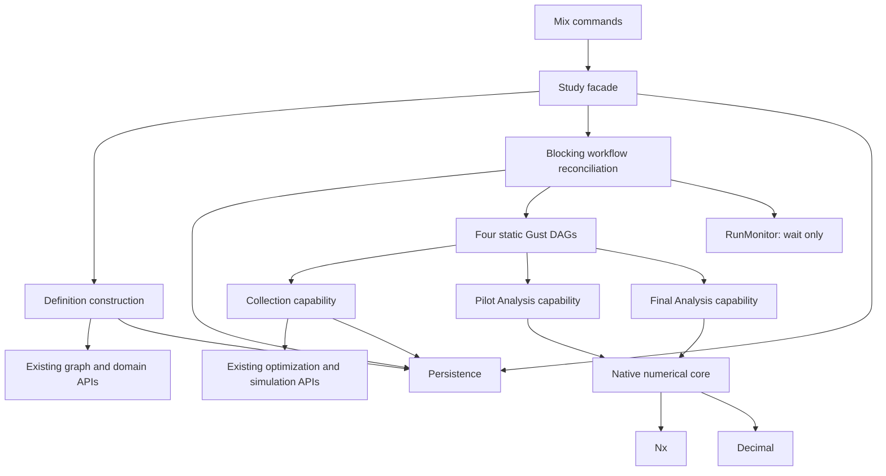
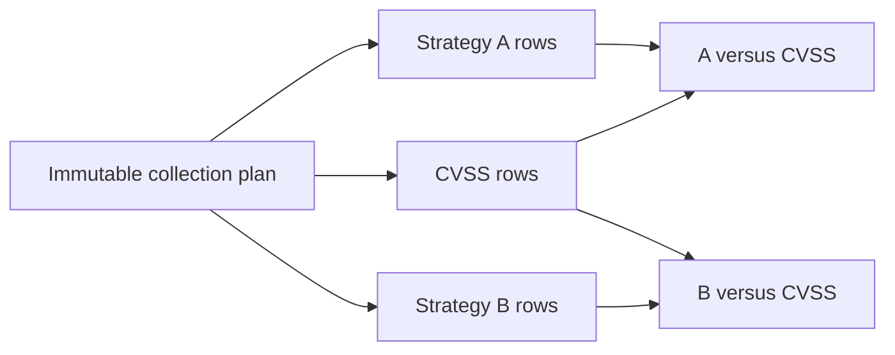
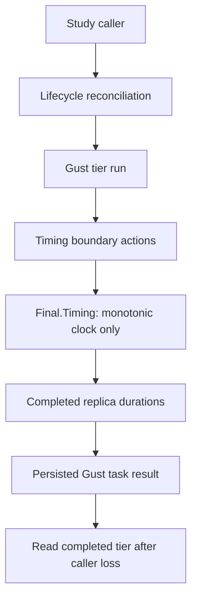

# Evaluation2 refactor sketches

> Recorded design and delivery constraints. Dependency-ordered batches supersede Q131's original single-batch choice.
> The native full-study milestone is implemented; see [current usage](../evaluation2.md) and [stable verification evidence](../history/evaluation2-verification.md).
> Interface snippets below are design sketches. Current source and guides define supported calls.
> See the [redesign index](grilling-evaluation-redesign.md) and [coordination decisions](grilling-evaluation2-gust-coordination.md).

## Status and boundaries

This document contains the recorded scientific/operator constraints and concrete engineering sketches. It does not start implementation. Execute the approved scope through dependency-ordered goals, each with a three-hour total limit, 1–2 initial scaffolding workers, and substantive implementation by its owner.

Approved constraints:

- Goal batches replace the earlier single assignment. Preserve parser-first dependencies and completed behavior across goals; do not advance past an unmet predecessor.
- New format only. The local development database has been reset and sample graphs recreated. No compatibility readers or migration adapters.
- Minimal JSON Schema at the YAML boundary. Ignore unknown keys and drop them during typed construction.
- Declare independent facts once. Derive Pilot capacity, comparison membership, and seed schedules.
- Candidate sizes plus non-negative extra pool capacity.
- One study seed and role-specific deterministic streams.
- Primary alternatives versus CVSS, expanded over each tier's budget list.
- Fixed tier order: small, medium, large. One Final Gust run per tier.
- Native Nx float64 calculations and Decimal Holm arithmetic. Q141 selects matching-based bounded-mean betting inference. Add CPU EXLA only if measured work needs it.
- Separate explicit Final approval command.
- Study Mix commands start the normal application, including execution-capable Gust and the domain timing capability. No remote attachment/RPC mode. Mix owns no timing or replica logic.
- One study-level simulation model shared by scoring and evidence collection. Objective and scoring effort remain strategy-specific.
- One study-level permitted defense-action set. Each strategy uses the intersection with its intrinsic capabilities; no per-strategy permission overrides.
- One study-wide feasibility policy: `required` by default or explicitly `unrestricted`. Optimization, scoring, and evidence simulation inherit it.
- Collect unique tier/budget/strategy groups once per replica. Multiple comparisons project the same collected CVSS group. Never share effect links between distinct CollectionItem rows or timing replicas.
- Remove the ten mandatory revision-label assertions. Capture minimal actual identities and available runtime metadata, with the configured environment label clearly identified as a deployment assertion.
- Behavior-focused unit and integration tests, manual study validation, and independent code/test review are required. Add cases per concern without duplicating every case across layers. Q140 explicitly permits isolated local `network_defense_test`; preserve development as the manual-study target. No commits or production-hardening test framework.
- Keep Python and legacy analysis only until native replacement verification; retire obsolete analysis schemas with them. Retain the new input schema and its validator dependency.

## 1. System boundaries



Study owns supported operations. Workflow owns phase and tier progression. Persistence owns locked state changes and durable identity. Gust owns task scheduling and fan-in. Numerical functions own matching/betting arithmetic and Pilot planning samples, with no database or workflow access.

## 2. Proposed input shape

The following is a structural sketch. Values are illustrative; graph identifiers and the rule label are placeholders. The shared confidence level describes the intervals that Pilot plans and Final reports. Family alpha remains a separate testing control. Frozen provenance is captured by the application, not supplied in YAML.

```yaml
study:
  id: example-study
  revision: 1
seed: 31415

family:
  id: primary-family
  alpha: 0.05

analysis:
  confidence_level: 0.95

defense:
  feasibility: required
  allowed_action_types:
    - patch_vulnerability
    - block_segment_reachability
    - revoke_credential

simulation:
  iterations_per_run: 12
  max_attempts: 3
  rules: [example-rule]

tiers:
  small:
    graph_revision_id: "<graph-revision-uuid>"
    foothold_node_id: "<host-node-uuid>"
    budgets: [4, 8]
    alternatives:
      - strategy: random
      - strategy: simulation_informed
        scoring:
          objective: mission_impact_only
          monte_carlo_trials: 50
  medium:
    graph_revision_id: "<medium-graph-revision-uuid>"
    foothold_node_id: "<medium-host-node-uuid>"
    budgets: [4, 8]
    alternatives:
      - strategy: random
      - strategy: simulation_informed
        scoring:
          objective: mission_impact_only
          monte_carlo_trials: 50
  large:
    graph_revision_id: "<large-graph-revision-uuid>"
    foothold_node_id: "<large-host-node-uuid>"
    budgets: [4, 8]
    alternatives:
      - strategy: random
      - strategy: simulation_informed
        scoring:
          objective: mission_impact_only
          monte_carlo_trials: 50

pilot:
  candidates:
    - id: smaller
      plans: 10
      attacks: 20
    - id: larger
      plans: 20
      attacks: 40
  extra_pool:
    plans: 10
    attacks: 20
  precision:
    outer_subsamples: 50
    target_half_width: 0.05
    guard_quantile: 0.90
```

Graph references in this first sketch use persisted identities. No second input form or compatibility selector is proposed. Creation resolves the graph and verifies that the foothold is a Host in that frozen revision.

### Independent and derived facts

| Operator input | Constructed value |
|---|---|
| Candidate sizes and extra pool | Pilot collection dimensions |
| Tier setup, budgets, alternatives | Ordered primary comparisons |
| One study seed | Selection schedules, tier roots, analysis streams |
| Family alpha | One correction threshold used by Final |
| Analysis confidence | One interval level used by Pilot planning and Final inference |
| Frozen graph and foothold | Resolved collection inputs |
| Fixed scientific method | Holm, two-sided test, mission-impact primary outcome |
| Approved execution protocol | Warm-up, five measured replicas, explicit approval boundary |

The fixed method and execution protocol belong to code and recorded provenance. Do not expose configuration switches for unsupported alternatives.

For the illustrative candidates, the collected matrix dimensions are 30 plans per side and 60 attacks per plan. Candidate counts remain pairs; do not turn separate plan and attack lists into an implicit candidate grid.

## 3. Minimal schema boundary

A schema excerpt illustrates the policy; it is not the complete validator:

```json
{
  "type": "object",
  "required": ["study", "seed", "family", "analysis", "defense", "simulation", "tiers", "pilot"],
  "properties": {
    "seed": {"type": "integer", "minimum": 0},
    "tiers": {
      "type": "object",
      "required": ["small", "medium", "large"]
    }
  }
}
```

Do not add `additionalProperties: false`. Typed construction reads declared fields and drops other keys.

Schema responsibilities:

- Required known fields, strict primitive types, supported enum values, and local numeric bounds.
- Non-empty budgets and alternatives, and non-negative extra capacity.
- Positive sample dimensions. The selected method does not inherit the old five-plan/ten-attack eligibility floors. Small valid samples can yield wide intervals and no rejection.

Field sketch for the complete input schema:

| Input | Required shape or local constraint |
|---|---|
| Study identity | Non-empty study ID and positive revision number within its stored integer range |
| Study seed | Non-negative supported integer seed |
| Family | Non-empty ID and finite alpha strictly between zero and one |
| Defense permission | Non-empty, unique registered action types |
| Feasibility | `required` by default; explicit `unrestricted` allowed |
| Simulation | Positive horizon and attempt count; non-empty registered rule list |
| Tiers | Exactly the supported small/medium/large slots after unknown-key projection |
| Tier graph inputs | Graph-revision and foothold UUID strings, resolved during construction |
| Budgets | Non-empty unique positive integer list, preserving declaration order |
| Alternatives | Non-empty ordered list; supported primary kinds, unique within a tier |
| Scored alternative | Objective and positive scoring Monte Carlo trial count |
| Simple alternative | No scoring data in its constructed variant |
| Candidates | Non-empty ordered list; unique IDs and count pairs; positive plan and attack counts within storage limits |
| Extra pool | Required non-negative plan and attack counts; zero is valid |
| Pilot precision | Positive outer count and target half-width; guard quantile strictly between zero and one |
| Shared inference | Finite confidence level strictly between zero and one; no bootstrap count or operator betting/matching settings |

CVSS is implicit as the fixed reference, so no reference-selection block is needed. Primary alternative kinds exclude CVSS and the descriptive no-defense strategy. Keep strategy names owned by the existing optimization vocabulary rather than introducing another enum registry.

Construction responsibilities:

- Resolve graph revisions and foothold membership/type. Establish finite positive capability weights and freeze the derived mission-impact range with the resolved tier inputs. Never estimate this range from observations.
- Construct the appropriate strategy variant and its required settings.
- Establish any remaining uniqueness constraints in the chosen collection representation.
- Derive valid capacity, comparison order, and seed schedules.
- Reject irreducible contradictions once, before storing the revision or starting effects.

Do not port the full legacy validation suite without a current requirement. Do not repeat creation-owned checks in every task.

## 4. Trusted model and derived views

Illustrative aggregate; names remain provisional:

```elixir
%Definition{
  study: %StudyIdentity{},
  seed: seed,
  family: %FamilySettings{},
  analysis: %InferenceSettings{},
  defense: %DefensePolicy{},
  simulation: %SimulationSettings{},
  tiers: %TierSet{small: ..., medium: ..., large: ...},
  pilot: %PilotSettings{},
  provenance: %FrozenProvenance{}
}
```

The model stores independent declarations. Consumers request derived views instead of storing another independently editable declaration:

```elixir
Definition.pilot_capacity(definition)
# => SampleSize

Definition.comparisons(definition)
# => ordered resolved comparisons
```

Comparison order follows `Tier.all/0`, then declared budget order, then alternative order. The primary reference and both sides' budget come from the same tier/budget context. Group order is tier order, declared budget order, then CVSS followed by declared alternatives. WorkItems carry the definition's global group position; CollectionItem item positions remain local to their phase-run plan. Do not confuse these two coordinate spaces.

Ordinary Elixir structs and typespecs do not make construction safe by themselves. The supported creation path must establish the model invariants.

### Internal capability organization

Proposed organization for the implementation batch; these names describe responsibilities, not a claim that all functions already work. Map them onto existing owners before adding modules.

```text
Study                         supported external facade
├─ Definition                 construct trusted input and derive views
├─ Workflow                   ensure/reconcile the next durable phase run
├─ RunMonitor                 wait and notify only
├─ Collection                 Pilot/shared plans, items, effects, evidence
├─ Pilot.Analysis             jobs, assessments, selection
├─ Final
│  ├─ Collection              tier/replica proof, equality, final evidence
│  ├─ Timing                  clock-only domain service
│  └─ Analysis                comparison jobs and corrected family
├─ Compute                    pure numerical entrypoints
│  ├─ Matching                fixed independent-pair cover
│  ├─ Betting                 past-only capitals and stable averaging
│  ├─ Intervals               monotone inversion and conservative policy
│  ├─ PilotPrecision          outer subsets and guarded interval sizes
│  └─ Holm                    Decimal family correction
├─ Randomness                 scientific stream allocation
├─ Persistence                existing durable owners and transactions
└─ Views                      transient public values/reports and error mapping
```

This is a responsibility map, not a requirement to add one wrapper per label. Reuse existing modules and typed values. Keep small helpers private; split a module when responsibility or data ownership justifies it. Do not add a second orchestration framework, duplicate strategy registry, or repository abstraction.

Narrow internal entrypoints, with illustrative names:

```elixir
Definition.parse(yaml)
Definition.comparisons(definition)
Definition.collection_groups(definition)

Workflow.ensure_next_run(execution_id)
Workflow.continue(execution_id, options)

Pilot.Analysis.prepare(snapshot_id)
Pilot.Analysis.evaluate(snapshot_id, job)
Pilot.Analysis.decide(snapshot_id, assessments)

Final.Analysis.prepare(snapshot_id)
Final.Analysis.evaluate(snapshot_id, job)
Final.Analysis.correct(snapshot_id, comparisons)

Collection.prepare_pilot(phase_run_id, definition)
Collection.prepare_final(phase_run_id, definition, selection, tier)
Collection.prepare_replica(plan_id, replica_position)
Collection.run_optimization(item_id)
Collection.run_simulation(item_id)
Collection.assemble_evidence(phase_id)

Final.Collection.prepare_snapshot(tier_results, execution)
Final.Timing.summarize(tier_results)
```

`ensure_next_run` provisions only the first needed run in the already committed active phase. It never accepts completion or grants approval. `continue` reconciles canonical completion and requests owned Persistence transitions. Neither needs a background coordinator.

Phase capabilities may take snapshot/item/run IDs because they own data access for their operation. They build narrow typed numerical inputs rather than passing an execution context or full Definition into every helper. For example, a comparison input contains the alternative/reference matrices and frozen outcome range; Compute receives no Repo record or Gust handle.

Persistence owns actual durable lifecycle writes, canonical links, effect reservations, and acceptance transactions. In particular, `Persistence.Collection` owns stored plans/items/effect links; `Persistence.Executions` owns phase acceptance. Collection owns work/evidence behavior, Workflow chooses the next orchestration action, and Timing owns clocks/duration logic. Existing optimization/simulation APIs own scientific effects.

A stored snapshot proves preparation, not acceptance. `Final.Collection.prepare_snapshot/2` checks replica equality and prepares evidence. Workflow then invokes the existing `Persistence.Executions.accept_final_collection/1` with the phase ID. The locked transition and successor phase establish durable acceptance. Final analysis acceptance similarly passes phase ID, corrected family, and timings to the existing transaction owner.

Keep report reads acyclic: Study obtains accepted context and typed completion data, then Views builds the public report. The numerical/phase policy modules do not call the Study facade or orchestration loop to format reports. Refactor the current placeholder `Pilot.Analysis.report/1` if needed rather than add a duplicate reporting service.

Source alignment: shared `Collection` already owns Pilot preparation/effects, so add no `Pilot.Collection` wrapper solely for symmetry. `RunMonitor` is planned. Replace the placeholder phase-wide runners where they duplicate Workflow progression. In particular, do not implement `Final.Collection.run/1` as a second tier-control loop. Rename its placeholder `accept/2` to describe snapshot preparation rather than lifecycle acceptance. Rewrite the old coordinator-owned timing comment to match the approved application-owned clock.

Pure derived functions return values. Operations producing data use `{:ok, value} | {:error, error}`. Effect operations with no return data can use `:ok | {:error, error}`, as the existing collection effects do. No generic result/adapter framework is required.

Gust action modules remain thin adapters into these capabilities. They do not duplicate planning, selection, statistical formulas, or SQL. Creation validates configuration once; current evidence and identity checks stay with the owner that can establish them.

### Provenance storage and capture points

Q134 removes operator revision assertions. Proposed small stored shapes:

```text
Definition.provenance — captured during revision creation
├─ method contract
├─ seed-derivation contract
└─ expected configured environment label

Execution.runtime_facts — captured when starting execution
├─ application version
├─ Elixir and OTP versions
└─ dependency-lock identity, when available
```

Use the existing definition JSON for frozen provenance. Add one small execution JSON field for runtime facts if the current execution schema has no suitable owner; do not add a manifest table. Source/Git information is optional and must account for an uncommitted working tree if recorded. Missing repository or lock metadata is explicit unavailability, not a fabricated identity or an automatic execution failure.

The configured environment label remains a deployment assertion. Final boundaries reread it and stop collection on missing or changed configuration. This provides the existing protocol, not hardware authentication. Existing graph, work, effect, and Gust records continue to own their actual identifiers; do not duplicate all those records in provenance.

Re-entry must preserve the frozen method and seed contracts. Reject a known contract/build/dependency mismatch rather than combine results from different known implementations. Unavailable optional repository facts remain explicitly unknown. Do not add a provenance-history or cross-version migration system. Measured runs assume the operator does not hot-reload code or change the measurement environment without updating its label.

### Physical collection and logical comparisons

Q136 separates executed work from comparison views:



A physical row has one CollectionItem, one optimization link, and one experiment link. Comparison projections refer to the collected group; they do not create another item with the same links.

Illustrative scientific payload:

```elixir
%Evidence{
  groups: [group_a, reference_group, group_b],
  comparisons: [
    %Projection{alternative: 0, reference: 1},
    %Projection{alternative: 2, reference: 1}
  ]
}
```

The immutable definition owns comparison identities. Projection positions only connect group matrices. A comparison accessor returns the approved two-matrix view with shared attack columns. It does not expose CollectionItems to numerical code.

The existing collection SQL shape can remain: one JSON plan per PhaseRun and unique replica/item coordinates. The typed WorkItem payload and evidence representation must change. Preserve unique optimization/experiment ownership across CollectionItem rows.

Warm-up and every measured replica create and execute fresh item rows, even though their scientific inputs match. Pilot and Final also remain separate. Update methodology and runtime estimation to count each budget/strategy group once, including CVSS once per budget; retain independent row resampling within each comparison.

## 5. Randomness sketch

```text
study seed
├─ Pilot selection rows
├─ Pilot evaluation roots by tier
├─ Pilot analysis by comparison
├─ Final selection rows
├─ Final evaluation roots by tier
└─ Final analysis by comparison
```

Proposed role-specific interfaces:

```elixir
Randomness.selection_seed(definition, phase, row)
Randomness.evaluation_root(definition, phase, tier)
Randomness.pilot_planning_seed(definition, comparison)
```

Use logical scientific identity, not database IDs, caller process state, completion order, or Final timing-replica position. Both comparison sides retain aligned attack columns. Pilot candidates retain their intended shared comparison analysis context. Final replicas repeat the same scientific inputs.

### Proposed bounded seed allocation

Use one explicit derivation contract and record its identity with the frozen definition. A version identifies reproducible behavior; it does not introduce old-format readers or compatibility branches.

Proposed exact root rule:

```text
M = 2^63 - 1
master seed range = 0 <= seed < M
payload = UTF-8 JSON array [contract identifier, master seed, context array]
root = unsigned_integer(SHA-256(payload)) modulo M
```

Use fixed context-array field order and string role/phase/tier/strategy names. JSON arrays provide ordered encoding; no scientific seed depends on map iteration. Scalars in the root context are integers, strings, and fixed literals, not floats or runtime IDs.

Role-specific contexts:

| Role | Scientific context |
|---|---|
| Selection row | Phase and row index; shared across strategy groups as required |
| Evaluation root | Phase and tier |
| Pilot planning root | Pilot phase and full comparison identity, including budget |
| Pilot outer sample | Comparison planning root, outer index, and row/column role; shared across candidates |
| Final inference | No random stream: fixed matching cover and deterministic betting arithmetic |

Do not include database UUIDs, replica timing position, process identity, or completion order in these keys. Define canonical encoding explicitly with primitive values and fixed field order; do not depend on JSON object iteration order or arbitrary map serialization. Full comparison identity, rather than comparison position alone, gives existing comparisons stable keys when other declarations are reordered.

Allocate bounded roots for supported downstream integer seed fields. Enumerate the unique logical roots needed by the plan and check their generated values once for required uniqueness and phase separation. Verify produced attack-column schedules with the existing simulation child-seed policy. On an allocation collision, return a bounded construction error before effects; do not silently reuse a root or introduce a hidden random retry. Deliberately shared logical contexts use the same root.

Use phase names `pilot` and `final`. Selection-row indices begin at zero. Analysis contexts contain tier, budget, alternative, CVSS reference, and mission-impact outcome in that order. Domain attack trials retain their existing one-based indices `1..attack_count` and `Simulation.Seed.child_seed/2` behavior.

For Pilot planning, derive row and column permutation keys from the comparison root and outer index, independently of candidate sizes. Each candidate takes the required prefix set of the same permutations, preserving shared planning randomness. Restore selected indices to original logical order before matching. Keep jointly generated strategy rows together. Permutation order is independent of observed values; do not sort selected rows by seed values, plans, or outcomes. Use pinned Nx keys/sampling primitives. Final inference needs no interval/null resampling seed. Do not implement PCG64 or a new PRNG.

Persist only the source seed and derivation identity in the definition. The immutable plan and effect records retain the resolved scalar seeds actually used. Generate enough Final selection rows for the largest declared candidate, then use the approved candidate's prefix.

## 6. Native numerical interface

Q141 selects matching-based bounded-mean betting. The fixed-sample derivation passed independent mathematical review under the stated IID row/column input model. [Statistical validation](evaluation2-statistical-validation.md) records the derivation, baseline counterexamples, and limitations. Implementation and practical precision/power checks remain required.

Illustrative internal signatures:

```elixir
Compute.pilot_precision(input, sample_size, precision, inference, seed)
# => guarded interval-size assessment

Compute.compare(input, inference)
# => typed estimate, interval, and marginal p-value

Compute.holm(comparisons, alpha)
# => corrected family
```

`input` contains equally shaped alternative/reference matrices and the frozen model outcome range. Both sides use the declared plan count; row and column dimensions may differ. Evidence assembly verifies scientific identity, complete alignment, finite observations, and the known range. Persist scientific values, not Nx backend objects. Convert to float64 tensors at the numerical boundary.

### Fixed inferential rules

1. Keep the all-cell mean difference as the point estimate.
2. Form contrast cells and normalize with the known model range. Handle structural zero range as exact equality before division.
3. Partition cells into the fixed cyclic matching cover. Each matching has distinct row/column inputs; every cell appears once across the cover.
4. Use the audited past-only mean/variance proxy and half-range betting caps separately within each matching. Borrow no past from another matching.
5. Average positive capitals arithmetically across matchings; separately average negative capitals. Use stable log-sum-exp arithmetic, not a product of matching capitals or an average of logs.
6. For the two-sided test, use twice the inverse capital in the direction of the all-cell estimate, capped at one. Zero estimate gives p-value one. Retain the factor two.
7. Invert the two monotone one-sided capital functions at `2/confidence_error`. Use conservative outer brackets for endpoints. Enlarge to include the point estimate; an empty inversion returns the full known contrast range and p-value one.
8. Report pointwise confidence intervals. Holm-adjusted tests do not turn them into simultaneous intervals or supply exact interval/test duality.

Matching order uses the immutable logical row/trial coordinates. Never sort by outcomes, selected-plan features, scoring, numerical seed values, cost, timing, or completion order. Optimizer/scoring randomness belongs to independent row inputs; evidence randomness belongs to independent shared attack inputs. A distinct seed label is not a proof of this modeling assumption.

This is fixed-sample inference. Freeze counts, ordering, and tuning before fresh Final data. Timing replicas repeat scientific inputs. Do not stop or increase the scientific sample because interim results look favorable.

Final inference is deterministic for its input. Remove bootstrap repetitions, empirical finite-sample multipliers, centered-null draws, add-one tail estimates, and interval/null RNG streams. There is one method contract, not an operator-selectable engine.

### Pilot precision planning

```text
accepted Pilot pool
  → outcome-independent outer subsets without replacement
  → same matching-based interval at the declared Final confidence level
  → half interval span for each outer sample
  → configured guard quantile of those spans
  → candidate passes the planning target for every comparison
```

Use the same row selection on both sides when they share selection inputs, plus one shared attack-column selection. The current deterministic CVSS reference makes its row seed immaterial. Do not rely on that fact to discard dependence if a supported strategy/reference becomes stochastic.

Define half-width as `(upper-lower)/2`; it measures interval size and does not imply symmetry around the estimate. Guard quantiles use linear interpolation. Empirical zero spread alone is neither exact certainty nor an automatic unusable result: the valid interval expresses the remaining uncertainty.

This is a planning heuristic based on the finite Pilot pool. The guard quantile does not promise that proportion of fresh Final runs will meet the target, either per comparison or jointly. Validate fresh-sample performance and report the limitation. A full-pool outer subset contains the same data apart from ordering.

`Pilot.Analysis.evaluate/2` binds comparison/candidate identity and applies the target. `decide/2` checks complete fan-in and chooses using the approved runtime heuristic and tie-breaks. Kernel arithmetic does not own that policy. An insufficient override gives up the precision target while preserving valid fresh-Final inference.

### Final output

```text
accepted Final matrices + frozen model range
  → all-cell contrast estimate
  → matching-based pointwise interval and marginal p-value
  → Decimal Holm adjustment
  → complete corrected family in canonical order
```

Holm sorts raw p-values with canonical position as the tie-break, applies cumulative Decimal adjustment capped at one, and restores canonical output order. Compute rejection from Decimal values with the inclusive `adjusted <= alpha` rule. If the public result remains float-valued, its emitted adjusted value must imply the same decision as the exact comparison. Preserve the existing smallest-representable-step correction where rounding would contradict the decision.

## 7. Study and workflow interface

```elixir
Study.create_revision(yaml)
Study.start(revision)
Study.continue(execution_id)
Study.pilot_result(execution_id)
Study.resume(execution_id, approval)
Study.status(execution_id)
Study.cancel(execution_id)
Study.result(execution_id)
```

Keep the approved optional bounded wait:

```elixir
Study.continue(execution_id)
Study.continue(execution_id, timeout: milliseconds)
```

Both return the current typed Status on a successful read. A timeout returns active Status without changing, failing, or cancelling the study. It is not a terminal task failure.

Cancellation must also wake or end a blocked continuation across separate command VMs. Do not depend only on a local notification from the cancelling command. RunMonitor can poll the linked execution's terminal state as part of waiting, while retaining its wait-only role. Study/Workflow reloads Status and owns all transitions. Gust has succeeded/failed terminal run statuses; do not invent a Gust cancelled status to implement application cancellation.

### Proposed thin command surface

Command names are a proposal for the final handoff, rather than a second domain API:

```text
mix study.create <file>
mix study.pilot <study-id> <revision>
mix study.final <execution-id> --recommended
mix study.final <execution-id> --override-insufficient <candidate-id>
mix study.continue <execution-id>
mix study.status <execution-id>
mix study.pilot_result <execution-id>
mix study.result <execution-id>
mix study.cancel <execution-id>
```

`create` calls revision creation and prints its declared identity. `pilot` calls start and then continue, prints the execution ID and Pilot report, and exits at awaiting_final. The same frozen revision can start another new execution without reimporting YAML. `final` requires explicit approval, then calls resume and continue. Continuation grants no approval. The remaining commands call their matching facade operation.

Execution commands start the normal application with execution-capable Gust. Read commands must not accidentally start unrelated queued studies; use Gust's existing non-executing role when bootstrapping read-only inspection. This is command startup policy, not a remote attachment mode. Cancel commits the application lifecycle change before best-effort Gust stopping.

Keep formatting and application startup in the command layer. Keep lifecycle transitions, timing, candidate selection, and durable run coordination behind Study. Do not add an interactive prompt or a command registry framework.

Use existing Logger output plus status/Pilot/result reads for prototype observability. Log useful execution/phase/run/tier identifiers and bounded failures. Do not add a monitoring stack, event ledger, progress registry, or exact-log-text test contract.

Execution commands use indefinite `Study.continue/1` to reach their operator/terminal boundary. The optional API wait timeout does not cancel work, but exiting the entire command VM stops its workers and clock. An interrupted measured tier remains subject to the clock-loss failure rule. Do not advertise CLI timeout exit as safe measurement detachment.


`start` and `resume` ensure the first run and return. `continue` owns blocking progression. RunMonitor owns waiting only. Persistence creates successor phases and fences late completions.

### Final clock ownership and durable timing

The legacy recorder keeps timing only in its coordinator process. Do not mistake that implementation for Q104's intended durable timing-task results.

`Study.resume/2` dispatches before `Study.continue/1` starts waiting. The clock owner must therefore be available in the Gust execution runtime independently of the continuation caller.



Use the existing planned `Final.Timing` capability as a small clock-only service inside Evaluation2. It owns no lifecycle transitions or tier dispatch. RunMonitor remains wait-only. Mix tasks contain no timing or replica logic and never call the timing service directly; their supported calls go through the Study facade. The application owns starting the timing capability, whether that application was started by a CLI command or by a long-running server.

Illustrative clock interface:

```elixir
Final.Timing.begin_tier(phase_run_id)
# => clock-session token

Final.Timing.mark(token, replica_position, boundary)
# => marker receipt or completed replica timing
```

Keep raw monotonic readings in memory. Persist plan-selection, simulation, and total elapsed durations in declared Gust timing-task results. Bind the tier to a clock-session identity so a restarted owner cannot silently combine readings from different sessions.

A completed tier has durable timing proof. An incomplete timed tier that loses its clock fails under the existing no-replacement-replica rule. Do not infer missing time from task timestamps or rerun a replacement replica silently.

Q137 selects normal application startup inside each study command. The application owns Gust workers, RunMonitor, and the domain timing capability; the CLI remains an adapter. Do not add a second remote attachment/RPC path. Reject console-only runtime configuration with a useful message rather than leaving a study waiting without execution workers.

Stopping the entire Mix VM stops its engine and clock. Gust 0.1.40 can reclaim eligible leased runs at a later startup, not every persisted active status. A completed tier retains durable timing results. An incomplete timed tier that lost its clock session fails; do not restart its measurements or silently replace replicas.

### Final tier DAG sketch

```text
prepare tier and timing session
  → check environment
  → warm-up replica -1
  → check environment
  → measured replica 0
  → check environment
  → measured replica 1
  → check environment
  → measured replica 2
  → check environment
  → measured replica 3
  → check environment
  → measured replica 4
  → check environment
  → terminal receipt
```

Each replica prepares distinct CollectionItems. Each measured replica then follows:

```text
plan-dispatch marker
  → mapped optimization items
  → plan-completion marker
  → simulation-dispatch marker
  → mapped simulation items
  → simulation-completion marker
  → persist typed replica durations
```

Warm-up executes the same scientific work but contributes no measured timing. Replica positions do not change the scientific seeds. Task-boundary markers call the domain timing capability; the Mix task sees only Study calls and returned results.

After all three tier runs finish:

```text
Workflow proves canonical tier/run completion
  → Final Collection validates durations and measured-replica equality
  → prepare representative evidence from unique strategy groups
  → Persistence stores the prepared snapshot idempotently
  → Workflow requests Persistence.Executions collection acceptance
  → locked transition creates the analyzing_final successor
```

The snapshot can exist before acceptance; the durable transition/successor is the acceptance witness. Completed tier timing receipts remain authoritative and allow summaries to be rebuilt after caller loss, including before Final analysis acceptance. No new timing-history store is required.

The equality gate compares scientific inputs and outputs. It excludes run/item identifiers, clock-session identity, timestamps, and durations. Do not replace unequal or interrupted replicas. Persistence owns accepted state; the timing service owns no phase transitions.

## 8. Goal-batch delivery and verification

The eventual agent receives this entire scope, with internal dependency order:

```text
Definition/schema and consumer adaptation
  → native numerical core
  → complete Pilot path
  → Final tier collection and timing
  → Final Analysis and successful result
  → Mix commands
  → complete-path verification
  → remove Python and obsolete legacy analysis
```

Adapt current consumers when the trusted model changes; do not leave the implemented Pilot Collection boundary broken between old and new representations.

Verification surfaces:

- Compile and focused source checks.
- Persist/reload a new-format definition and inspect derived work.
- Hand-derived matching/capital checks, deterministic native runs, prespecified statistical experiments, and representative performance.
- Local development end-to-end execution through Pilot, explicit approval, Final tiers, and result read.
- Re-entry through `continue` and preservation of cancellation boundaries.
- Compile and call-site checks after legacy/Python/schema retirement.
- Independent review under the prototype review policy.
- Goal 05.5 refreshes guides, ExDoc, examples, diagrams and navigation against the verified native implementation. Goal 06 repeats those checks after deletion; current documentation must not point to removed artifacts or claim unrun calibration passed.

The latest user testing policy supersedes the earlier exclusion of permanent tests. Keep behavior regression tests in the existing test tree, with simple fixtures and requirement IDs. Use manual end-to-end study validation and a reproducible statistical calibration study alongside automated cases. Review both implementation and tests against the design and test plan. See [the behavior-focused test plan](evaluation2-test-plan.md).

Use disposable exploratory probes outside the repository and remove them afterward. The real study runs against local development. Q140 explicitly permits the isolated local test database. Verify both Repo targets before setup and preserve development. No additional development reset or commit is authorized.

Statistical soundness is the acceptance goal. The previous Python implementation is a reference, not an oracle of truth. Exact legacy outputs and old-format compatibility are not requirements. Review the sampling units and dependence assumptions, estimator, interval and null construction, Pilot selection, and family correction. If the old calculation fails that review, revise the method with a clear justification rather than reproduce its defect.

## 9. Review checkpoints before delegation

1. Shared simulation and defense policies map into the retained neutral APIs without recreating independent flags or budgets.
2. Provenance capture is truthful and small, with a clear storage owner and no manifest framework.
3. Seed encoding, integer bounds, role separation, and replay behavior are explicit and implementable with library primitives.
4. Timing sessions cannot mix clock epochs, and completed durations are durable before lifecycle acceptance.
5. Command startup provides an execution runtime where needed and keeps read-only inspection from dispatching work.
6. Constructor validation is limited to local shape and irreducible domain facts after the new representation eliminates duplicated declarations.

The approved lifecycle, reset, and no-compatibility scope are closed decisions.

## 10. Retirement surface

The source audit found no legacy evaluation web/API/RPC route or frontend caller. Retirement therefore does not require a replacement UI.

After native end-to-end and numerical verification:

- Remove the legacy `NetworkDefense.Evaluations` facade, obsolete `NetworkDefense.Evaluation` analysis/pipeline code, comparison/family Mix tasks, legacy evaluation DAG sources, and their application registrations.
- Remove the Python `services/evaluation_compute` service, service-only configuration, and its local Terraform module/wiring. Keep Terraform changes to source/validation; do not apply infrastructure changes without an explicit request.
- Remove obsolete legacy schemas, fixtures, and tests that exist only for retired modules. Retain the new Evaluation2 input schema and its validator dependency.
- Remove obsolete compute-service URLs, ports, limits, and health-check configuration. Preserve `EVALUATION_MEASURED_ENVIRONMENT_REVISION`, which remains the new Final measurement-label input.
- MUST DELETE all stale in-scope legacy DAG definitions through the existing Gust APIs. Preserve native Evaluation2 evidence and seeded graphs; do not perform another whole-database reset as cleanup.
- Preserve graph, optimization, simulation, compute/RabbitMQ infrastructure, their neutral contracts, and unrelated tests. Do not remove Req or another shared dependency merely because the retired clients used it.
- Leave historical decision/source citations as history; update current architecture and usage documentation to the new native path.

MUST DELETE the obsolete implementation completely from the active project: no disabled copies, renamed archives, compatibility wrappers, stubs, aliases, Python fallbacks, or remove-later TODOs. Verify zero obsolete files and live references in the agreed source/build/test/config/dependency/deployment-source scope. Inspect consumers and preserve unrelated files/results, pre-existing worktree changes, credentials, and unrelated infrastructure. A deletion blocked by protected data or permissions leaves the retirement goal unmet.
