# Evaluation2 creation: decision tree and Q&A

## Status

Working design interview for the new Evaluation2 study subsystem. Reuse the established methodology, YAML study definition, scenarios, comparisons, strategies, and supporting code. Adjust existing contracts where the simpler Evaluation2 design needs it.

**Implementation framing:** Create Evaluation2 as a new subsystem. Do not describe this work as a refactor of the legacy Evaluation subsystem. Treat legacy source as a library of proven mechanisms and calculations that Evaluation2 can copy or reuse selectively. Evaluation2 must not depend on modules in the legacy `NetworkDefense.Evaluation` namespace.

**Agreed interview scope:** Reuse the existing evaluation approaches. Create simpler code and mechanisms that make them work.

Preserve the methodology, current YAML, domain concepts, and scientific flow as the baseline. Interview decisions should focus on unnecessary implementation layers, repeated checks, orchestration, handoffs, and supporting code. Propose input or interface adjustments only when a concrete simplification requires them.

Study means the existing YAML input, reused and tweaked as needed. Source exploration should answer questions about existing concepts before the interview introduces design choices.

The study pipeline and its Gust phase DAGs are the current design focus. Treat proposed application modules as placeholders. Assume they do not exist yet.

Gust already owns mapped batches, dependency fan-in, and task retry. Do not duplicate these features in application code.

Use existing source as a mechanism library. Reuse or copy the current lifecycle, phase sequencing, explicit resume policy, stable effect links, Final tier DAG, timing rules, and scientific calculations.

Design order: define the phase DAGs and the application boundaries between them. Then assign placeholder actions, inputs, outputs, and persistence.

**User correction:** The initial Pilot/Final diagram was already too detailed for the bird's-eye view.

### Interview mode

The user asked the assistant to continue without waiting for an answer at every step.

- Inspect existing code before asking factual questions.
- Keep established approaches as the baseline.
- Refine one implementation responsibility at a time.
- Prefer module trees, function signatures, data shapes, and short code sketches.
- Introduce each design question with a concrete worked example and explain its effect before asking.
- Keep prose short outside the worked example and decision rationale.
- Keep behavior cases. Defer automated test design.
- Record implementation recommendations as proposals, separate from confirmed requirements.
- Ask when a remaining choice needs user input.

## Decision tree

Leaves summarize questions and answers. `Open` marks an unresolved decision. The interview follows one branch at a time.

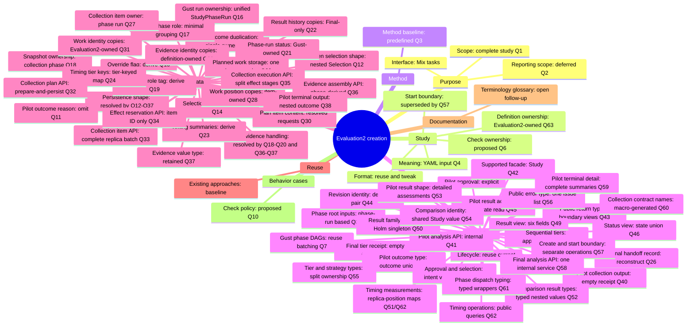

## Approved structures

The structural design is frozen through Q57. Evaluation2 is a new subsystem. The diagrams show the target structures, not the current scaffold.

### Supported Study API

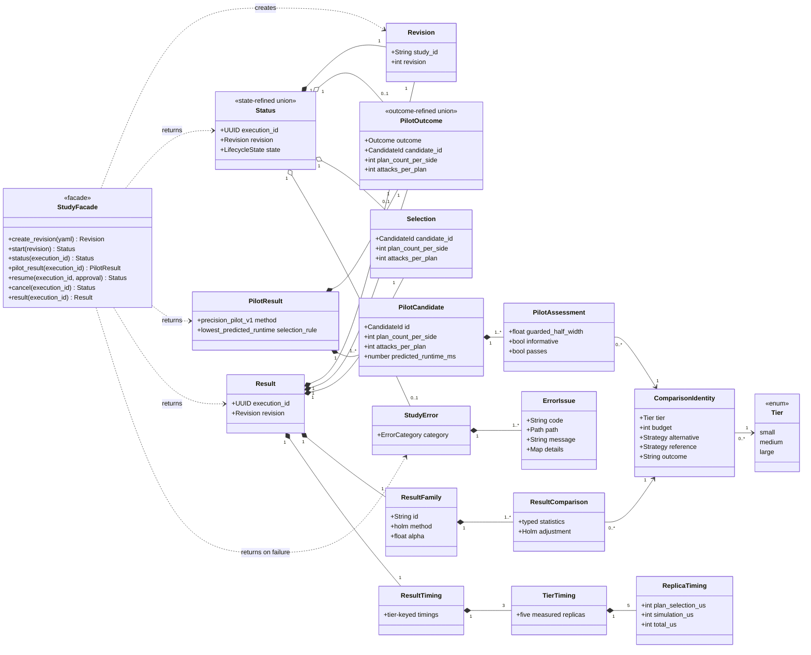

Public structure rules:

- `NetworkDefense.Evaluation2.Study` is the only supported facade.
- Public views are transient. They do not add persistence records.
- `Status` and `PilotOutcome` use discriminated unions.
- Pilot and Final results share `Study.Comparison` identities.
- Public statistics are typed values. Python maps stay at the transport boundary.

### Internal persistence and execution ownership

```mermaid
classDiagram
    direction LR

    class StudyRevision {
        +UUID id
        +String study_id
        +int revision
        +Definition definition
    }

    class StudyExecution {
        +UUID id
        +UUID study_revision_id
        +LifecycleState state
        +PilotOutcome pilot_outcome
        +Selection selection
        +StudyError error
    }

    class StudyPhase {
        +UUID id
        +UUID study_execution_id
        +PhaseKind phase
    }

    class StudyPhaseRun {
        +UUID id
        +UUID study_phase_id
        +RunKey key
        +GustRunId gust_run_id
    }

    class CollectionPlan {
        +UUID id
        +UUID study_phase_run_id
        +WorkItem items
    }

    class WorkItem {
        +int comparison_position
        +Side side
        +GraphRevision graph_revision
        +Strategy strategy
        +Seed selection_seed
        +Seed evaluation_root
        +int attack_count
    }

    class CollectionItem {
        +UUID id
        +UUID study_phase_run_id
        +ReplicaPosition replica_position
        +int item_position
        +UUID optimization_run_id
        +UUID experiment_id
    }

    class EvidenceSnapshot {
        +UUID id
        +UUID study_phase_id
        +Evidence evidence
    }

    class Evidence {
        +ordered comparison observations
    }

    class StudyResult {
        +UUID id
        +UUID study_execution_id
        +CorrectedFamily family
        +Timing timing
    }

    class GustRun {
        <<external>>
    }

    class OptimizationRun {
        <<external>>
    }

    class SimulationExperiment {
        <<external>>
    }

    StudyRevision "1" *-- "0..*" StudyExecution : executions
    StudyExecution "1" *-- "0..4" StudyPhase : phase groups
    StudyExecution "1" *-- "0..1" StudyResult : successful Final output

    StudyPhase "1" *-- "1..*" StudyPhaseRun : run links
    StudyPhase "1" *-- "0..1" EvidenceSnapshot : collection evidence

    StudyPhaseRun "1" --> "1" GustRun : identifies
    StudyPhaseRun "1" *-- "0..1" CollectionPlan : collection runs only
    StudyPhaseRun "1" *-- "0..*" CollectionItem : replica effects

    CollectionPlan "1" *-- "1..*" WorkItem : resolved requests
    CollectionItem ..> CollectionPlan : selects by item_position
    CollectionItem "0..*" --> "0..1" OptimizationRun : reserves and reuses
    CollectionItem "0..*" --> "0..1" SimulationExperiment : reserves and reuses

    EvidenceSnapshot "1" *-- "1" Evidence : contains
```

Internal structure rules:

- The internal UUID of `StudyRevision` stays private. Public code uses `{study_id, revision}`.
- Every Gust run has one `StudyPhaseRun`; `StudyPhase` stores no run or output cache.
- Collection phases own snapshots. Collection phase runs own plans and items.
- One immutable `CollectionPlan` stores resolved Evaluation2 `WorkItem` requests.
- `CollectionItem` stores positions and retry-safe effect links, not work copies.
- Gust owns detailed run and task status. Evaluation2 owns study lifecycle state.

## Purpose

### Q1 — Scope

**Question:** Should the first replacement support complete studies only, or also retain standalone comparison and family operations?

**Recommendation:** Support complete studies first. Keep comparison and family calculations as internal reusable functions. Add standalone workflow operations only when a concrete use requires them.

**Reason:** Each separate operation adds an input contract, submission path, result reader, and verification surface.

**Choices:**

- **Complete studies:** Pilot, explicit approval, fresh Final evidence, statistical analysis, and required timing.
- **Studies and tools:** Complete studies plus supported standalone comparison and family operations.
- **Smaller first slice:** Build only part of the study path first. Specify the intended first outcome before continuing.

**Answer:** Complete study, operated through Mix tasks and supporting code.

**User clarification:** Work top down. Start with a high-level bird's-eye view. Then descend into Elixir modules, data shapes, state machines, and other implementation details.

The answer selects the primary study path. It does not approve a workflow library, persistence model, or command syntax.

### Q2 — Reporting scope

**Question:** Should evaluation produce study results and a terminal summary, or also generate thesis-ready tables and plots?

**Recommendation:** Produce machine-readable study results and a short terminal summary. Let separate reporting tools consume those results.

**Reason:** This gives evaluation a clear completion boundary. Presentation changes can stay separate from collection and inference.

**Answer:** Deferred. Agree the subsystem purpose and boundary before discussing output details.

## Bird's-eye view

**Approved:** Evaluation takes a declared study, runs it, and produces results.


The operator uses Mix tasks. The user approved this level and requested the next zoom.

## Zoom 1 — Study

Study means the existing YAML input that declares the evaluation. Use the current format as the baseline. Existing scenarios, comparisons, and strategies retain their meanings.

Source inspection confirms these eight top-level entries in the current YAML:

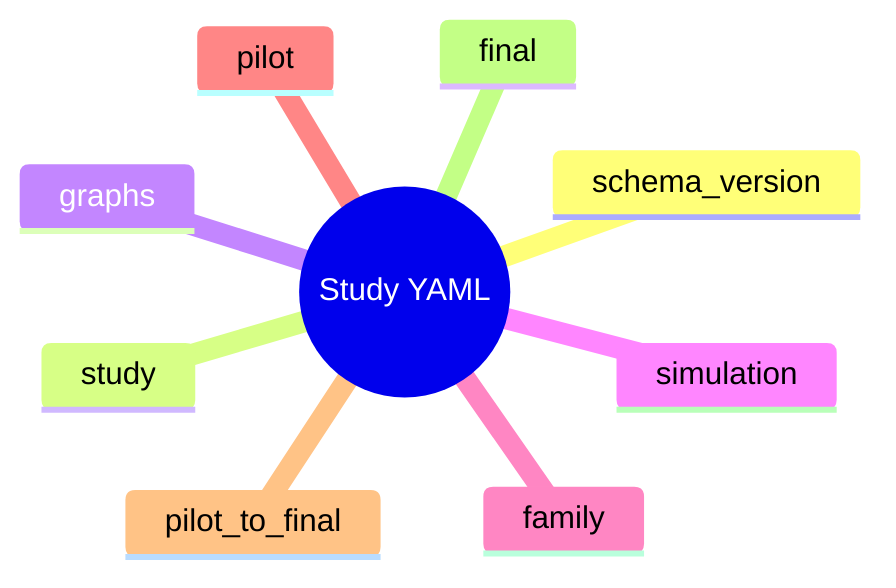

- `schema_version` and `study`: definition identity and revision information.
- `graphs` and `simulation`: scenarios, strategy configurations, and evidence-trial controls.
- `family`: declared comparisons and correction settings.
- `pilot`, `pilot_to_final`, and `final`: sampling, analysis, and the approval boundary.

Sources: `contracts/evaluation/study/v1/valid/study-small.yaml`, `src/priv/evaluation/study/v1/schemas/definition.schema.json`, and `.pi/tmp/study-model-field-flow.md`.

Fixed literal declarations include Holm, pause, the Pilot runtime selection rule, and the two-sided Final test. Family alpha and Final alpha are required to agree. Equal values in distinct Pilot/Final or scoring/evidence settings do not by themselves establish redundancy.

Introduce adjustments only when a concrete simplification requires them.

### Q4 — Study meaning

**Earlier question:** Does Study mean only the declared plan, or the plan together with its runs and results?

**Answer:** Study is the YAML input, like the current YAML format. Reuse it and tweak it if needed.

**User correction:** Reuse established scenarios, comparisons, strategies, and supporting code. Do not redesign everything or reopen their definitions. Scouts can inspect the existing source to resolve factual questions.

### Q5 — Start boundary

**Proposed question:** Should a Mix task accept a YAML file and start the study, or should the operator first register a revision and then start it separately?

**Status:** Deferred before asking. The user clarified that existing approaches should be reused while their supporting implementation becomes simpler.

Keep the current input approach as the baseline. Revisit this boundary only if implementation evidence gives a concrete reason.

## Method

### Q3 — Method baseline

**Earlier framing:** The assistant incorrectly presented methodology flexibility as an open design choice.

**User correction:** The methodology was established from the start. Selectable methodologies were never part of the requested design.

**Recorded constraint:** Apply `docs/concepts/evaluation-methodology.md`. Study inputs and settings vary within that methodology. This is an original constraint, not a newly selected feature.

Do not reopen this constraint during the interview unless the user requests a method change.

## Implementation map

The user approved this map as the next level of discussion:

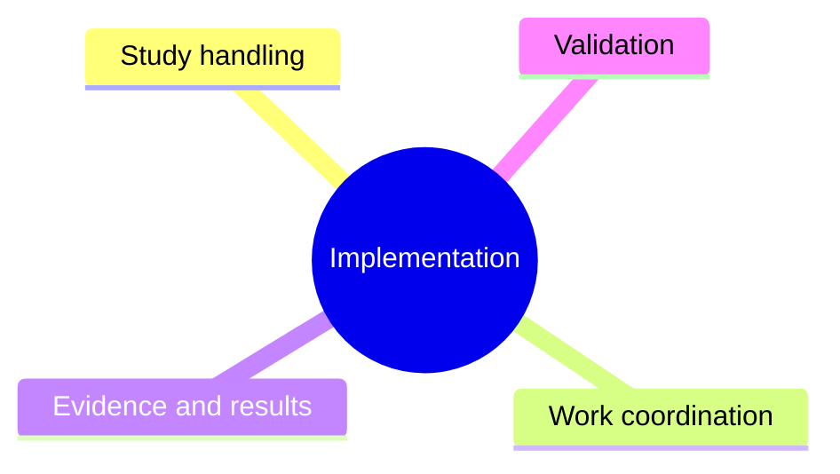

The design question for each branch is: what custom code is necessary, and what can existing libraries provide?

Examine Study handling first. It establishes the trusted definition used by the other branches.

## Study handling

### Q6 — Check ownership

**Proposal:** Validate the study once when the YAML enters the application. Decode trusted stored data on later reads.

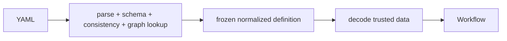

```elixir
# External boundary
def create(yaml) do
  with {:ok, raw} <- Yaml.parse(yaml),
       {:ok, definition} <- Definition.parse(raw),
       :ok <- GraphReferences.check(definition) do
    Revisions.insert(definition)
  end
end

# Internal read
def load(revision_id) do
  revision_id
  |> Revisions.fetch!()
  |> Definition.decode_stored!()
end
```

Keep resource checks in the operation that consumes the resource.

```elixir
WorkPlan.build(definition, selection)
ComputeRequest.encode(evidence, analysis_settings)
```

Do not call the full external `Definition.parse/1` path from Pilot and Final loaders.

## Code shape — first pass

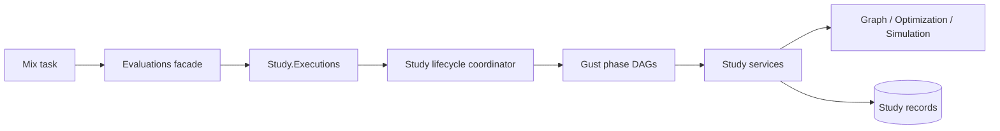

Placeholder module shape. These names describe responsibilities. They do not claim that source modules exist.

```text
NetworkDefense.Evaluation.Study
├── Definition          # Existing YAML contract and normalized definition
├── Revisions           # Create and load frozen definitions
├── Executions          # Lifecycle persistence and status
├── Lifecycle           # Reuse/copy current pure transition table
├── Resume              # Validate and freeze Final selection
├── Cancel              # Apply lifecycle cancellation policy
├── Workflow            # Dispatch and await Gust phase DAGs
├── Collection
│   ├── Plan            # Definition + counts + phase -> work items
│   ├── Execute         # Call optimization and simulation APIs
│   └── Evidence        # Work results -> aligned matrices
├── Pilot
│   ├── Analyze         # Candidate/comparison calculations
│   └── Decide          # Complete-family candidate decision
├── Final
│   ├── Collect         # Sequential tiers and replicas
│   ├── Timing          # One clock owner
│   └── Analyze         # Comparison family + Holm
└── Result              # Final result construction and read
```

Avoid modules whose only job is to copy or recheck another internal shape.

### Public functions

Keep the current study operations as the baseline:

```elixir
Evaluations.create_study_revision(yaml)
Evaluations.start_study(revision_id)
Evaluations.study_status(execution_id)
Evaluations.resume_study(execution_id, selection)
Evaluations.cancel_study(execution_id)
Evaluations.study_result(execution_id)
```

Mix tasks are thin adapters:

```text
mix evaluation.study.create <study.yaml>
mix evaluation.study.start <revision-id>
mix evaluation.study.status <execution-id>
mix evaluation.study.resume <execution-id> <selection>
mix evaluation.study.result <execution-id>
mix evaluation.study.cancel <execution-id>
```

The create/start split remains the current baseline. Revisit it only if it creates unnecessary code in the reduced implementation.

## Workflow

### Pilot approval

**Question:** Should Final collection start automatically after a passing Pilot?

**Answer:** Keep explicit approval. The user selected this option during the initial discussion.

Collection and analysis run automatically within each phase. Every valid Pilot outcome pauses before Final collection.

### Q7 — Study pipeline and Gust phase DAGs

Gust owns each batch. The application lifecycle coordinates the phases and the runtime tier list.

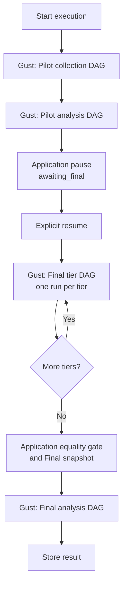

This keeps dynamic tiers sequential without implementing a second batch executor.

Lifecycle events reuse the current pure state machine:

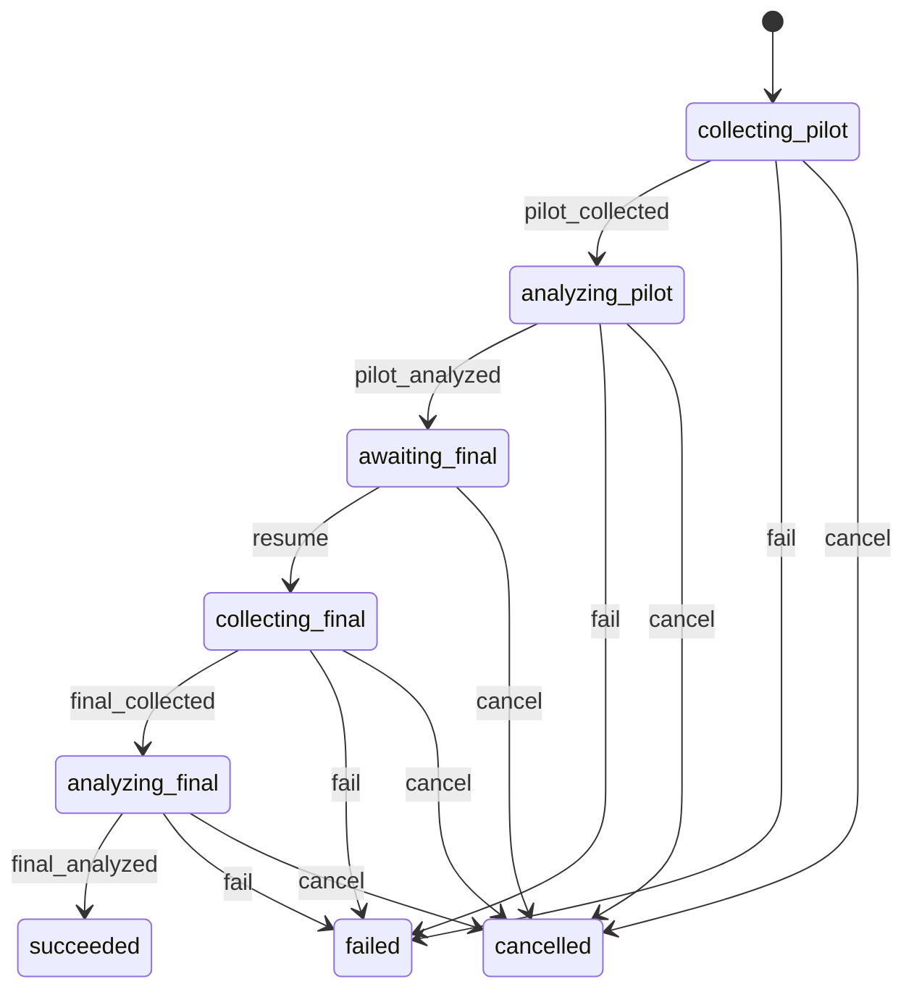

```text
assemble_pilot_snapshot  -> :pilot_collected
accept_pilot_outcome     -> :pilot_analyzed
resume_study             -> :resume
accept_final_snapshot    -> :final_collected
store_result             -> :final_analyzed
task/run failure         -> :fail
cancel_study             -> :cancel
```

#### Pilot collection DAG

```elixir
defmodule PilotCollectionDAG do
  use Gust.DSL

  task_action :prepare_pilot_collection, Placeholder.PreparePilotCollection,
    downstream: [:collect_pilot_item],
    store_result: true

  task_action :collect_pilot_item, Placeholder.CollectPilotItem,
    map_over: :prepare_pilot_collection,
    downstream: [:assemble_pilot_snapshot]

  task_action :assemble_pilot_snapshot, Placeholder.AssemblePilotSnapshot,
    store_result: true
end
```

Gust creates one mapped task per collection item. It runs the batch and retries failed mapped tasks.

#### Pilot analysis DAG

```elixir
defmodule PilotAnalysisDAG do
  use Gust.DSL

  task_action :prepare_pilot_analysis, Placeholder.PreparePilotAnalysis,
    downstream: [:evaluate_pilot_candidate],
    store_result: true

  task_action :evaluate_pilot_candidate, Placeholder.EvaluatePilotCandidate,
    map_over: :prepare_pilot_analysis,
    downstream: [:select_pilot_outcome],
    store_result: true

  task_action :select_pilot_outcome, Placeholder.SelectPilotOutcome,
    store_result: true
end
```

#### Final tier collection DAG

One Gust run collects one tier. The static DAG owns warm-up and the five measured replicas.

```elixir
defmodule FinalTierCollectionDAG do
  use Gust.DSL

  task_action :check_environment_before_warm_up, Placeholder.CheckEnvironment,
    downstream: [:prepare_warm_up]

  task_action :prepare_warm_up, Placeholder.PrepareReplica,
    downstream: [:run_plan_warm_up],
    store_result: true

  task_action :run_plan_warm_up, Placeholder.RunPlan,
    map_over: :prepare_warm_up,
    downstream: [:run_simulation_warm_up]

  task_action :run_simulation_warm_up, Placeholder.RunSimulation,
    map_over: :prepare_warm_up,
    downstream: [:check_environment_before_0]

  measured_replica(0, after: :check_environment_after_0)
  measured_replica(1, after: :check_environment_after_1)
  measured_replica(2, after: :check_environment_after_2)
  measured_replica(3, after: :check_environment_after_3)
  measured_replica(4, after: :check_environment_after_4)

  task_action :complete_final_tier, Placeholder.CompleteFinalTier,
    store_result: true
end
```

Each `measured_replica/2` expands to:


#### Final analysis DAG

```elixir
defmodule FinalAnalysisDAG do
  use Gust.DSL

  task_action :prepare_final_analysis, Placeholder.PrepareFinalAnalysis,
    downstream: [:compare_final_member],
    store_result: true

  task_action :compare_final_member, Placeholder.CompareFinalMember,
    map_over: :prepare_final_analysis,
    downstream: [:correct_final_family],
    store_result: true

  task_action :correct_final_family, Placeholder.CorrectFinalFamily,
    store_result: true
end
```

#### Application sequencing

```elixir
def run_pilot(execution) do
  with {:ok, pilot_snapshot} <- GustPhase.run(:pilot_collection, execution),
       {:ok, pilot_outcome} <- GustPhase.run(:pilot_analysis, execution, pilot_snapshot),
       {:ok, execution} <- State.accept_pilot_outcome(execution, pilot_outcome) do
    {:paused, execution}
  end
end

def run_final(execution) do
  tier_results =
    execution
    |> declared_tiers()
    |> Enum.map(&GustPhase.run(:final_tier_collection, execution, &1))

  with {:ok, final_snapshot, timing} <- FinalCollection.accept(tier_results),
       {:ok, final_result} <- GustPhase.run(:final_analysis, execution, final_snapshot),
       {:ok, result} <- Results.store(execution, final_result, timing) do
    {:completed, result}
  end
end
```

Proposed placeholder files:

```text
src/priv/gust/dags/
├── evaluation_study_pilot_collection.exs
├── evaluation_pilot.exs
├── evaluation_study_final_tier_collection.exs
└── evaluation_final.exs

src/lib/network_defense/evaluation/study/pipeline/
├── lifecycle.ex
├── coordinator.ex
├── runner.ex
├── state.ex
├── pilot_collection.ex
├── pilot_analysis.ex
├── final_collection.ex
├── final_analysis.ex
└── actions/...
```

Reuse the lifecycle and sequencing mechanisms. Simplify the task contracts and repeated validation inside them.

### Data ownership


```text
StudyRevision      normalized definition
StudyExecution     lifecycle, Pilot outcome, frozen selection
Phase/tier record  accepted Gust run and stage output
CollectionItem     retry-safe optimization/simulation links
EvidenceSnapshot   accepted matrices
Gust task results  outputs within one phase run
StudyResult        successful final output
```

### Data between phase DAGs

Application records carry accepted data across Gust runs.


Do not load task results from an earlier Gust run inside a later run. Pass an accepted application reference instead.

### Phase input/output contracts

Each Gust run has:

```text
one compact root input
one terminal success output
Gust-owned failure state
```

Task results do not store an error union. A failed task or run uses Gust status and its persisted error.

#### Pilot collection

```elixir
defmodule PilotCollectionContract do
  defmodule Input do
    defstruct [:phase_id]
  end

  defmodule Output do
    defstruct [:snapshot_id]
  end
end
```

```elixir
# Gust run params
%{"study_phase_id" => phase_id}

# Terminal task: assemble_pilot_snapshot
%{"snapshot_id" => snapshot_id}
```

Application interface:

```elixir
GustPhase.run(:pilot_collection, %PilotCollectionContract.Input{
  phase_id: phase.id
})
#=> {:ok, %PilotCollectionContract.Output{snapshot_id: snapshot_id}}
```

#### Pilot analysis

```elixir
defmodule PilotAnalysisContract do
  defmodule Input do
    defstruct [:phase_id]
  end

  defmodule Output do
    defstruct [
      :outcome,
      :candidate_id,
      :plan_count_per_side,
      :attacks_per_plan,
      :candidate_summaries
    ]
  end
end
```

```elixir
# Gust run params
%{"study_phase_id" => phase_id}

# Terminal task: select_pilot_outcome
%{
  "outcome" => "recommended" | "insufficient",
  "candidate_id" => candidate_id | nil,
  "plan_count_per_side" => integer | nil,
  "attacks_per_plan" => integer | nil,
  "candidate_summaries" => summaries
}
```

The phase loader obtains the accepted Pilot snapshot through the execution’s Pilot collection phase. The run input does not repeat the snapshot ID.

#### Final tier collection

```elixir
defmodule FinalTierContract do
  defmodule Input do
    defstruct [:phase_run_id]
  end

  defmodule Output do
    defstruct [:tier, :tier_position, :measured_positions]
  end
end
```

```elixir
# Gust run params
%{"study_phase_run_id" => phase_run_id}

# Terminal task: complete_final_tier
%{
  "tier" => tier,
  "tier_position" => tier_position,
  "measured_positions" => [0, 1, 2, 3, 4]
}
```

The phase-run record owns the execution, tier, position, and Gust run ID. Tasks load the frozen selection from `StudyExecution`.

The application runner combines the Gust receipt with coordinator-owned timing:

```elixir
%FinalTierRunResult{
  gust_run_id: gust_run_id,
  receipt: %FinalTierContract.Output{},
  timing: %TierTiming{}
}
```

#### Final collection aggregate

This is an application-stage output, not a separate Gust DAG output.

```elixir
%FinalCollectionOutput{
  snapshot_id: snapshot_id,
  tier_runs: [
    %{
      tier: tier,
      tier_position: tier_position,
      gust_run_id: gust_run_id
    }
  ],
  timing: %TimingSummary{}
}
```

It is created after all tier runs pass the replica equality gate.

#### Final analysis

```elixir
defmodule FinalAnalysisContract do
  defmodule Input do
    defstruct [:phase_id]
  end

  defmodule Output do
    defstruct [:family_result]
  end
end
```

```elixir
# Gust run params
%{"study_phase_id" => phase_id}

# Terminal task: correct_final_family
%{"family_result" => corrected_family}
```

The phase loader obtains the accepted Final snapshot and collection aggregate from the Final collection phase.

#### Generic phase runner

```elixir
def run_phase(dag, input, terminal_task, decode_output) do
  with {:ok, run} <- GustRun.create(dag, Contract.to_params(input)),
       :ok <- GustRun.dispatch(run),
       {:ok, :succeeded} <- GustRun.await(run.id),
       stored <- Gust.Flows.get_task_result_by_name_run!(terminal_task, run.id) do
    {:ok, decode_output.(stored)}
  end
end
```

The real runner also links the run to its phase before dispatch and maps Gust failure to a bounded `StudyError`.

#### Contract rules

```text
root input       phase or phase-run ID
mapped input     item ID or declared position
terminal output  one typed success value
failure output   none; use Gust failure state
large evidence   EvidenceSnapshot, referenced by ID
lifecycle data   StudyExecution and phase records
```

Do not add a schema version to every internal task map. Keep versioning on durable public or evidence contracts that need it.

Phase acceptance checks the expected lifecycle state and decodes the terminal result. The task that creates the result owns its scientific checks.

### Data inside one phase DAG

`map_over` receives compact work identity.

```elixir
# Pilot or Final collection prepare result
[
  %{collection_item_id: item_id}
]

# Pilot analysis prepare result
[
  %{
    candidate_position: candidate_position,
    comparison_position: comparison_position
  }
]

# Final analysis prepare result
[
  %{comparison_position: comparison_position}
]
```

Mapped tasks store only outputs needed by the same run’s fan-in task.

```elixir
# Pilot candidate assessment
%{
  candidate_position: candidate_position,
  comparison_position: comparison_position,
  guarded_half_width: half_width,
  informative: informative,
  passes: passes
}

# Final comparison result
%{
  comparison_position: comparison_position,
  statistics: statistics
}
```

### Gust fan-in

```elixir
def mapped_results!(run_id, task_name) do
  task_name
  |> Gust.Flows.get_tasks_by_name(run_id)
  |> Enum.map(& &1.result)
end
```

```elixir
def select_pilot_outcome(run_id, definition) do
  run_id
  |> mapped_results!(:evaluate_pilot_candidate)
  |> Enum.map(&PilotAssessment.decode_stored!/1)
  |> Pilot.Decide.run(definition.pilot)
end
```

The fan-in task owns family completeness and ordering checks.

### Lifecycle acceptance

The application accepts a completed phase result under the existing state lock.

```elixir
def accept_pilot_analysis(execution_id, run_id) do
  outcome = GustResult.fetch!(run_id, :select_pilot_outcome)

  State.transaction(execution_id, :analyzing_pilot, fn execution ->
    execution
    |> Executions.put_pilot_outcome(outcome)
    |> State.transition!(:pilot_analyzed)
  end)
end
```

Late completion cannot advance a cancelled or failed execution.

### Error interface

```text
ordinary task exception  Gust retries the task
Gust.DAG.NonRecError     Gust fails the task immediately
failed phase run         application applies lifecycle :fail
bounded StudyError       public status and terminal reporting
```

## Phase task interfaces

### Pilot collection


#### Collection item shape

Prepare the immutable work once. Later tasks use the stored work instead of rebuilding it from the complete definition.

```elixir
%CollectionItem{
  id: item_id,
  phase_id: phase_id,
  replica_position: 0,
  item_position: item_position,
  work: %WorkItem{},
  optimization_run_id: optimization_run_id | nil,
  experiment_id: experiment_id | nil
}
```

`work` is application-written and immutable.

#### `prepare_pilot_collection`

```elixir
@spec run(phase_id()) :: [map()]

def run(phase_id) do
  phase = Phases.fetch!(phase_id)
  execution = Executions.fetch!(phase.execution_id)
  definition = Revisions.load!(execution.study_revision_id)

  definition
  |> Collection.Plan.pilot()
  |> Collection.Limits.check_phase!()
  |> CollectionItems.create_or_load(phase.id)
  |> Enum.map(&%{"collection_item_id" => &1.id})
end
```

Owns:

```text
Pilot work planning
phase work-count limit
stable item positions
immutable stored WorkItem
```

Does not run optimization or simulation.

#### `collect_pilot_item`

```elixir
@spec run(collection_item_id()) :: :ok

def run(item_id) do
  item = CollectionItems.fetch!(item_id)

  optimization =
    item
    |> ItemEffects.reserve_optimization()
    |> Optimizations.run_reserved!()

  item
  |> ItemEffects.reserve_experiment(optimization)
  |> Simulations.run!()

  :ok
end
```

Gust interface:

```elixir
task_action :collect_pilot_item, Placeholder.CollectPilotItem,
  map_over: :prepare_pilot_collection,
  downstream: [:assemble_pilot_snapshot]
```

The task stores no result. Success means the linked domain records completed. Gust owns retry. Reservation reuses existing links.

#### `assemble_pilot_snapshot`

Build valid evidence directly. Do not build it and then run a second validation pipeline.

```elixir
@spec run(run_id(), phase_id()) :: PilotCollectionContract.Output.t()

def run(run_id, phase_id) do
  phase = Phases.fetch!(phase_id)
  execution = Executions.fetch!(phase.execution_id)
  definition = Revisions.load!(execution.study_revision_id)

  item_ids =
    GustResult.fetch!(run_id, :prepare_pilot_collection)
    |> CollectionItemRefs.decode!()

  items = CollectionItems.fetch_many!(item_ids)
  evidence = Evidence.build_pilot!(definition, items)

  snapshot =
    EvidenceSnapshots.create_or_load(
      phase.id,
      :pilot,
      evidence
    )

  %PilotCollectionContract.Output{snapshot_id: snapshot.id}
end
```

`Evidence.build_pilot!/2` constructs:

```text
comparisons in declared order
rows from stored WorkItem positions
one attack-column list shared by both sides
exact Pilot row and column counts from the plan
```

Separate checks are unnecessary because:

```text
complete family         created by Collection.Plan.pilot/1
exact item set          item IDs come from the prepare task
completed work          Gust starts assembly after mapped tasks succeed
shared attack columns   builder creates one column list for both matrices
Pilot capacity          planner creates the declared dimensions
```

Keep only:

```text
missing referenced record -> fail while loading
malformed external result -> fail at its boundary decoder
snapshot retry            -> create_or_load returns the same snapshot
```

#### Gust boundary adapters

```elixir
def prepare_from_run(run_id) do
  run_id
  |> PhaseContext.phase_id!()
  |> PreparePilotCollection.run()
end

def collect_from_map(%{"collection_item_id" => item_id}) do
  CollectPilotItem.run(item_id)
end

def assemble_from_run(run_id) do
  phase_id = PhaseContext.phase_id!(run_id)

  run_id
  |> AssemblePilotSnapshot.run(phase_id)
  |> PilotCollectionContract.to_params()
end
```

#### Acceptance

```elixir
def accept_pilot_collection(execution_id, run_id) do
  output = GustResult.fetch!(run_id, :assemble_pilot_snapshot)
  snapshot_id = PilotCollectionContract.decode_output!(output).snapshot_id

  State.transaction(execution_id, :collecting_pilot, fn execution ->
    execution
    |> Phases.accept_snapshot!(:pilot_collection, run_id, snapshot_id)
    |> State.transition!(:pilot_collected)
  end)
end
```

Acceptance checks lifecycle ownership. Snapshot scientific checks remain owned by assembly.

### Pilot analysis tasks

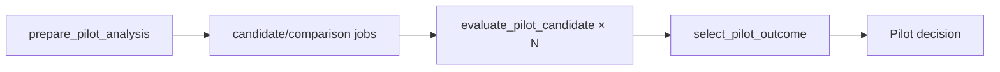

#### Job shape

```elixir
%PilotJob{
  candidate_position: candidate_position,
  comparison_position: comparison_position,
  stream_seed: stream_seed
}
```

The job carries positions and the derived analysis stream. It does not repeat study, family, snapshot, identity, candidate, or analysis settings.

#### `prepare_pilot_analysis`

```elixir
@spec run(phase_id()) :: [map()]

def run(phase_id) do
  phase = Phases.fetch!(phase_id)
  execution = Executions.fetch!(phase.execution_id)
  definition = Revisions.load!(execution.study_revision_id)

  for {_candidate, candidate_position} <-
        Enum.with_index(definition.pilot.candidates),
      {comparison, comparison_position} <-
        Enum.with_index(definition.family.comparisons) do
    %PilotJob{
      candidate_position: candidate_position,
      comparison_position: comparison_position,
      stream_seed:
        PilotSeeds.comparison_stream_seed(
          definition,
          comparison,
          comparison_position
        )
    }
    |> PilotJob.to_params()
  end
end
```

Candidate eligibility is already owned by study creation:

```text
candidate counts <= Pilot collection capacity
Pilot snapshot == declared collection capacity
```

The prepare task does not recheck capacity.

#### Compute request

The Python request contains only numerical inputs:

```elixir
%PilotComputeRequest{
  alternative: alternative_matrix,
  reference: reference_matrix,
  plan_count: candidate.plan_count_per_side,
  attacks_per_plan: candidate.attacks_per_plan,
  outer_subsamples: settings.outer_subsamples,
  stream_seed: job.stream_seed,
  guard_quantile: settings.guard_quantile,
  confidence_level: settings.confidence_level,
  bootstrap_replicates: settings.bootstrap_replicates
}
```

Do not send these values to Python:

```text
study revision ID
family ID
snapshot ID
candidate ID
comparison identity
selection rule
target half-width
```

They are application-owned metadata or decision policy.

The compute service combines `stream_seed`, `plan_count`, and `attacks_per_plan` in its deterministic seed sequence.

Python response:

```elixir
%PilotComputeResponse{
  guarded_half_width: guarded_half_width,
  informative: informative
}
```

#### `evaluate_pilot_candidate`

```elixir
@spec run(phase_id(), PilotJob.t()) :: CandidateAssessment.t()

def run(phase_id, job) do
  {definition, snapshot} = PilotAnalysis.load_inputs!(phase_id)
  candidate = Enum.fetch!(definition.pilot.candidates, job.candidate_position)
  evidence = Evidence.comparison!(snapshot, job.comparison_position)
  settings = definition.pilot.analysis

  response =
    evidence
    |> PilotComputeRequest.build(candidate, settings, job.stream_seed)
    |> EvaluationCompute.evaluate_pilot_candidate!()

  %CandidateAssessment{
    candidate_position: job.candidate_position,
    comparison_position: job.comparison_position,
    guarded_half_width: response.guarded_half_width,
    informative: response.informative,
    passes:
      response.informative and
        response.guarded_half_width <= settings.target_half_width
  }
end
```

The Python request boundary checks strict types, rectangular matrices, equal attack-column counts, eligible sample counts, and resource limits. The response boundary checks `guarded_half_width` and `informative` once. There is no echoed metadata to compare.

#### Mapped result

```elixir
%{
  "candidate_position" => candidate_position,
  "comparison_position" => comparison_position,
  "guarded_half_width" => guarded_half_width,
  "informative" => informative,
  "passes" => passes
}
```

#### `select_pilot_outcome`

```elixir
@spec run(run_id(), phase_id()) :: PilotAnalysisContract.Output.t()

def run(run_id, phase_id) do
  {definition, pilot_snapshot} = PilotAnalysis.load_inputs!(phase_id)

  assessments =
    Gust.Flows.get_tasks_by_name(:evaluate_pilot_candidate, run_id)
    |> Enum.map(&CandidateAssessment.decode_stored!(&1.result))

  summaries =
    Pilot.Decide.summarize(
      assessments,
      definition.pilot.candidates,
      definition.family.comparisons,
      pilot_snapshot.runtime_evidence
    )

  Pilot.Decide.select(summaries, definition.pilot.analysis.selection_rule)
end
```

Gust creates one mapped task per prepare item and starts fan-in only after all mapped tasks succeed. The selector does not compare preparation output with a separately rebuilt job list.

#### Candidate summary

```elixir
%CandidateSummary{
  candidate_position: candidate_position,
  candidate_id: candidate_id,
  plan_count_per_side: plan_count,
  attacks_per_plan: attacks,
  worst_guarded_half_width: worst_half_width,
  all_comparisons_informative: informative,
  non_informative_comparison_positions: positions,
  all_comparisons_passed: passed,
  predicted_runtime_ms: predicted_runtime
}
```

Runtime follows the methodology definition:

```elixir
predicted_runtime =
  tier_count *
    largest_strategy_group_count_in_one_tier *
    plan_count *
    (median_plan_selection_ms + attacks_per_plan * median_attack_trial_ms)
```

This resolves the documented group-count discrepancy in favor of the methodology.

#### Selection

```elixir
passing = Enum.filter(summaries, & &1.all_comparisons_passed)

case Enum.min_by(passing, &Pilot.Decide.selection_key/1, fn -> nil end) do
  nil ->
    %PilotAnalysisContract.Output{
      outcome: :insufficient,
      candidate_id: nil,
      candidate_summaries: summaries
    }

  summary ->
    %PilotAnalysisContract.Output{
      outcome: :recommended,
      candidate_id: summary.candidate_id,
      plan_count_per_side: summary.plan_count_per_side,
      attacks_per_plan: summary.attacks_per_plan,
      candidate_summaries: summaries
    }
end
```

Tie-break key:

```elixir
{
  summary.predicted_runtime_ms,
  -summary.plan_count_per_side,
  summary.attacks_per_plan,
  summary.candidate_position
}
```

#### Application acceptance and pause

```elixir
def accept_pilot_analysis(execution_id, run_id) do
  output =
    run_id
    |> GustResult.fetch!(:select_pilot_outcome)
    |> PilotAnalysisContract.decode_output!()

  State.transaction(execution_id, :analyzing_pilot, fn execution ->
    execution
    |> Executions.put_pilot_outcome(PilotOutcome.compact(output))
    |> Phases.accept_result!(:pilot_analysis, run_id)
    |> State.transition!(:pilot_analyzed)
  end)
end
```

The complete candidate summaries stay in the terminal Gust result. `StudyExecution` stores only the compact outcome required for status and resume.

## Persistence shape — placeholders

Keep the current lifecycle, phase-run ownership, and selection fields until the phase contracts show that a field is unnecessary.

```elixir
%StudyExecution{
  id: execution_id,
  study_revision_id: revision_id,
  state: :collecting_pilot | :analyzing_pilot | :awaiting_final |
         :collecting_final | :analyzing_final | :succeeded |
         :failed | :cancelled,
  pilot_outcome: pilot_outcome | nil,
  selected_candidate_id: candidate_id | nil,
  selected_plan_count_per_side: integer | nil,
  selected_attacks_per_plan: integer | nil,
  pilot_override: boolean | nil,
  error: error | nil
}
```

Initial data-owner placeholders:

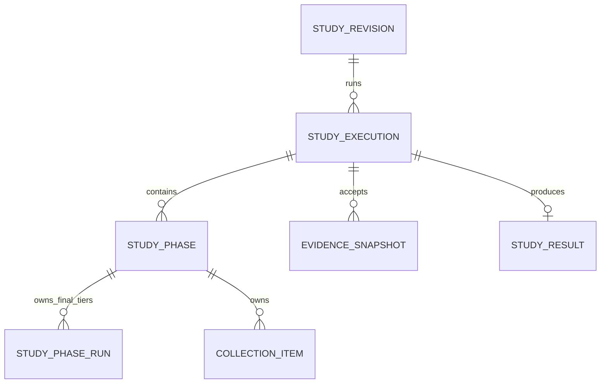

```text
StudyRevision     normalized YAML definition
StudyExecution    lifecycle, Pilot outcome, frozen selection
StudyPhase        accepted phase Gust run and phase output
StudyPhaseRun     ordered Final tier Gust runs
CollectionItem    immutable planned work and stable optimization/simulation links
EvidenceSnapshot  accepted Pilot or Final matrices
StudyResult       successful compact result
```

The phase records now have a clear owner: they connect the application lifecycle to separate Gust phase runs. Simplify their fields and checks later. The Final handoff remains undecided.

## Data

### Q9 — Evidence handling

**Proposal:** One accepted evidence shape for Pilot and one for Final.

```elixir
%Evidence{
  role: :pilot | :final,
  family_id: family_id,
  comparisons: [
    %ComparisonEvidence{
      identity: identity,
      attack_seeds: seeds,
      alternative: matrix,
      reference: matrix
    }
  ]
}
```

Assembly constructs the evidence from the validated definition and immutable planned work:

```elixir
def assemble(item_ids, definition, role) do
  item_ids
  |> CollectionItems.fetch_many!()
  |> Evidence.build!(definition, role)
  |> EvidenceSnapshots.create_or_load(role)
end
```

The builder iterates the declared family, creates one shared column list, and fills the two matrices at their declared positions. It does not need separate family, alignment, or matrix-size check passes.

Later code uses the accepted snapshot:

```elixir
snapshot = EvidenceSnapshots.fetch!(snapshot_id)
Pilot.Analyze.run(snapshot, definition.pilot)
Final.Analyze.run(snapshot, definition.final)
```

Do not rebuild optimization and simulation history during analysis or result read-back.

## Core service shape

### Collection

```elixir
Collection.Plan.pilot(definition)
#=> [%WorkItem{}]

Collection.Plan.final(definition, selection, tier, replica_position)
#=> [%WorkItem{}]

Collection.Execute.run(collection_item_id)
#=> {:ok, collection_item_id}

Collection.Evidence.assemble(execution_id, role, replica_position)
#=> {:ok, %EvidenceSnapshot{}}
```

Retry-safe effect ownership stays in the stable collection item:

```elixir
def run(item_id) do
  item = CollectionItems.lock!(item_id)
  optimization = CollectionItems.reserve_optimization(item)
  Optimizations.run_reserved(optimization)
  experiment = CollectionItems.reserve_experiment(item, optimization)
  Simulations.run(experiment)
  CollectionItems.complete(item)
end
```

### Pilot

```elixir
Pilot.Analyze.prepare(snapshot, definition)
#=> [%CandidateComparison{}]

Pilot.Analyze.run(candidate_comparison)
#=> %CandidateAssessment{
#     guarded_half_width: number,
#     informative: boolean,
#     passes: boolean
#   }

Pilot.Decide.run(assessments, definition.pilot)
#=> %PilotDecision{
#     outcome: :recommended | :insufficient,
#     recommendation: candidate | nil
#   }
```

Pilot methodology decisions remain mandatory.

```text
Candidate eligibility
  candidate counts fit the collected Pilot matrices

Comparison feasibility
  every outer subsample is informative

Comparison precision
  guarded half-width <= target half-width

Candidate pass
  every declared comparison is feasible and precise

Pilot outcome
  select the passing candidate by the runtime rule
  or return :insufficient when no candidate passes
```

These are observed scientific decisions. Construction cannot guarantee them.

### Approval

Reuse the current application pause and selection-freeze mechanism. Final collection starts as a new coordinated phase after the transaction commits.

```elixir
def resume_study(execution_id, requested_selection) do
  with {:ok, execution} <- Resume.accept(execution_id, requested_selection),
       :ok <- Coordinator.start(execution.id) do
    {:ok, execution}
  end
end
```

`Resume.accept/2` validates the Pilot outcome, freezes the declared candidate, and applies lifecycle event `:resume`. Final tier runs load this selection from `StudyExecution`.

The approval input reuses the current compact union:

```elixir
:recommended
{:override_insufficient, candidate_id}
```

The caller does not provide Final counts. `Resume.accept/2` resolves and freezes them from the declared candidate.

### Q11 — Compact insufficient outcome

**Source fact:** The current selector produces only one insufficient reason: `"no_passing_candidate"`. The terminal Gust result already retains every candidate summary and failed comparison detail.

**Question:** Should the compact `PilotOutcome` store an insufficient reason?

**Recommendation:** Store only the `:insufficient` tag. The reason is implied by the methodology: no declared candidate passed every comparison. Keep the detailed explanation in the terminal Pilot-analysis result.

```elixir
@type t ::
        %PilotOutcome{
          outcome: :recommended,
          candidate_id: String.t(),
          plan_count_per_side: pos_integer(),
          attacks_per_plan: pos_integer()
        }
        | %PilotOutcome{
            outcome: :insufficient,
            candidate_id: nil,
            plan_count_per_side: nil,
            attacks_per_plan: nil
          }
```

**Answer:** Store only the `:insufficient` tag. Do not persist a reason in the compact outcome. The terminal Pilot-analysis result remains the detailed explanation.

Add a reason enum later only if the methodology gains more than one scientifically distinct insufficient outcome.

### Q12 — Frozen selection shape

**Source fact:** The current implementation stores four scalar fields on `StudyExecution` and reconstructs a `Selection` struct. The Evaluation2 scaffold currently defines both representations.

**Worked example:** Approval selects candidate `candidate-b`, which declares six plans per side and twelve attacks per plan.

Scalar execution fields:

```elixir
%StudyExecution{
  selected_candidate_id: "candidate-b",
  selected_plan_count_per_side: 6,
  selected_attacks_per_plan: 12,
  pilot_override: false
}
```

Nested selection:

```elixir
%StudyExecution{
  selection: %Selection{
    candidate_id: "candidate-b",
    plan_count_per_side: 6,
    attacks_per_plan: 12,
    pilot_override: false
  }
}
```

**Question:** Should the Evaluation2 application model own one optional `Selection.t()` value, or retain four optional scalar fields?

**Recommendation:** Use `selection: Selection.t() | nil` in the application model. It makes partial selections unrepresentable and prevents each Final consumer from reconstructing the same value. A persistence adapter can map the value to existing scalar columns if retaining the current table is cheaper than a migration.

**Answer:** Use one nested `Selection.t() | nil` field because it is easier to read. Do not expose four optional selection fields in the Evaluation2 application model.

### Q13 — Pilot override flag

**Source fact:** The current `Selection` stores `pilot_override: boolean()`. The same fact is already implied by the compact Pilot outcome and the approved selection path.

Recommended approval:

```elixir
%StudyExecution{
  pilot_outcome: %PilotOutcome{outcome: :recommended},
  selection: %Selection{candidate_id: "candidate-b"}
}
```

Insufficient override:

```elixir
%StudyExecution{
  pilot_outcome: %PilotOutcome{outcome: :insufficient},
  selection: %Selection{candidate_id: "candidate-b"}
}
```

**Question:** Should `Selection` store `pilot_override`, or should the application derive it from `PilotOutcome.outcome`?

**Recommendation:** Remove `pilot_override` from `Selection`. Under the current approval contract, a selection after `:insufficient` is always an override and a selection after `:recommended` is not. Deriving it prevents contradictory states such as an insufficient outcome with `pilot_override: false`.

**Answer:** Remove `pilot_override`. Derive override status from `PilotOutcome.outcome` when reporting needs it.

### Q14 — Selection persistence

**Source fact:** The existing table stores candidate ID, plan count, attack count, and override as separate columns. The application decision now uses one nested `Selection` value and no override field.

Scalar persistence:

```text
selected_candidate_id          candidate-b
selected_plan_count_per_side   6
selected_attacks_per_plan      12
```

Single-value persistence:

```json
{
  "candidate_id": "candidate-b",
  "plan_count_per_side": 6,
  "attacks_per_plan": 12
}
```

**Question:** Should Evaluation2 persist `Selection` as one nullable JSONB/map field, or retain the existing scalar columns behind a mapping adapter?

**Recommendation:** Persist one nullable `selection` map. The application never needs to query executions by individual selection counts. One field matches the application type, removes all-or-none column constraints, and avoids reconstructing the same value on every read. Decode the application-written map once when loading `StudyExecution`.

**Answer:** Persist the complete `Selection` as one nullable map.

### Q15 — Pilot outcome duplication

**Source fact:** The current implementation stores the compact Pilot outcome on `StudyExecution` and copies the same map into the Pilot-analysis phase `result_ref`. The detailed candidate summaries remain in the terminal Gust result.

Duplicated acceptance:

```elixir
%StudyExecution{pilot_outcome: compact_outcome}
%StudyPhase{accepted_run_id: run_id, result_ref: compact_outcome}
```

Single-owner acceptance:

```elixir
%StudyExecution{pilot_outcome: compact_outcome}
%StudyPhase{accepted_run_id: run_id}
```

Both records are written in the same acceptance transaction. The phase identifies the accepted Gust source, and the execution owns the application decision used by resume and status.

**Question:** Should the Pilot-analysis phase retain a duplicate `result_ref`, or should `StudyExecution` be the only compact-outcome owner?

**Recommendation:** Remove the duplicate phase `result_ref`. Keep the accepted Gust run ID on the phase and the compact outcome on `StudyExecution`. The transaction between them provides source binding without storing and comparing the same map twice.

**Answer:** `StudyExecution` is the only compact Pilot-outcome owner. The Pilot-analysis phase keeps the accepted Gust run ID and does not copy the outcome.

### Q16 — Gust run ownership

**Source fact:** The current model uses two run representations. Pilot Collection, Pilot Analysis, and Final Analysis store one scalar Gust run ID on `StudyPhase`. Final Collection stores one `StudyPhaseRun` row for each tier.

Current special cases:

```text
Pilot Collection   StudyPhase.gust_run_id
Pilot Analysis     StudyPhase.gust_run_id
Final Collection   StudyPhaseRun × three tiers
Final Analysis     StudyPhase.gust_run_id
```

Unified run records:

```text
Pilot Collection   StudyPhaseRun(key: :single)
Pilot Analysis     StudyPhaseRun(key: :single)
Final Collection   StudyPhaseRun(key: {:tier, :small})
                   StudyPhaseRun(key: {:tier, :medium})
                   StudyPhaseRun(key: {:tier, :large})
Final Analysis     StudyPhaseRun(key: :single)
```

```elixir
@type run_key :: :single | {:tier, Tier.t()}

%StudyPhaseRun{
  study_phase_id: phase_id,
  key: run_key,
  gust_run_id: run_id
}
```

**Question:** Should every Gust run use `StudyPhaseRun`, or should single-run phases keep a scalar run ID on `StudyPhase`?

**Recommendation:** Use `StudyPhaseRun` for every Gust run. Then `StudyPhase` owns only the phase identity and lifecycle boundary, while one generic run record owns creation, dispatch, waiting, retry identity, and terminal status. This removes separate coordinator code paths for scalar and tiered runs.

**Answer:** Every Gust run uses `StudyPhaseRun`. `StudyPhase` does not store a scalar Gust run ID.

### Q17 — StudyPhase responsibility

**Source fact:** The current Evaluation2 scaffold gives `StudyPhase` run identity, snapshot identity, decoded output, and an error. The preceding decisions assign those facts to other owners.

Current broad phase record:

```elixir
%StudyPhase{
  phase: :pilot_collection,
  gust_run_id: run_id,
  snapshot_id: snapshot_id,
  output: output,
  error: error
}
```

Proposed grouping record:

```elixir
%StudyPhase{
  id: phase_id,
  execution_id: execution_id,
  phase: :pilot_collection
}
```

Related owners:

```text
StudyPhaseRun     Gust run identity and terminal run state
EvidenceSnapshot accepted Pilot or Final evidence
StudyExecution   lifecycle, Pilot outcome, frozen selection, terminal error
StudyResult      successful Final result
Gust             detailed task result and task error
```

**Question:** Should `StudyPhase` become a minimal grouping identity, or retain cached output, snapshot, and error fields?

**Recommendation:** Keep `StudyPhase` minimal. It groups runs under one declared phase and provides the transaction lock target for phase acceptance. Do not copy data already owned by snapshots, executions, results, or Gust.

**Answer:** `StudyPhase` keeps only its identity, owning execution, and phase kind.

### Q18 — Evidence snapshot ownership

**Source fact:** The Evaluation2 scaffold currently links `EvidenceSnapshot` to `StudyExecution`. After Q17, `StudyPhase` no longer stores a snapshot ID.

Execution-owned snapshot:

```elixir
%EvidenceSnapshot{
  id: snapshot_id,
  execution_id: execution_id,
  role: :pilot,
  evidence: evidence
}
```

Phase-owned snapshot:

```elixir
%EvidenceSnapshot{
  id: snapshot_id,
  study_phase_id: pilot_collection_phase_id,
  role: :pilot,
  evidence: evidence
}
```

The phase-owned form gives one direct relation:

```text
StudyExecution
└── StudyPhase :pilot_collection
    ├── StudyPhaseRun × one or more phase runs
    └── EvidenceSnapshot × one accepted snapshot
```

**Question:** Should an evidence snapshot belong directly to its collection phase, or only to the overall execution and role?

**Recommendation:** Store `study_phase_id` on `EvidenceSnapshot`. The execution is already available through the phase. A unique phase relation identifies the accepted evidence without a copied `snapshot_id` on `StudyPhase` or an execution-plus-role lookup convention.

**Answer:** An evidence snapshot belongs directly to its collection `StudyPhase`.

### Q19 — Evidence role tag

**Source fact:** The current scaffold stores the Pilot/Final role on both `EvidenceSnapshot` and its nested `Evidence`. The owning collection phase already determines the same role.

Duplicated role:

```elixir
%StudyPhase{phase: :pilot_collection}
%EvidenceSnapshot{role: :pilot}
%Evidence{role: :pilot}
```

Derived role:

```elixir
%StudyPhase{phase: :pilot_collection}
%EvidenceSnapshot{evidence: %Evidence{comparisons: comparisons}}
```

```elixir
Phase.evidence_role(:pilot_collection)
#=> :pilot
```

**Question:** Should snapshots and evidence store a `role` field, or derive Pilot/Final role from the owning phase kind?

**Recommendation:** Derive the role from `StudyPhase.phase` and remove both stored role fields. This prevents contradictory values and keeps the phase as the single lifecycle owner. Analysis phases receive a snapshot ID and load its owning collection phase, so detached evidence does not need its own role tag.

**Answer:** The owning collection phase is the only source of the Pilot/Final role. Remove `role` from both `EvidenceSnapshot` and `Evidence`.

### Q20 — Evidence identity copies

**Source fact:** The immutable study definition already owns the family ID, each comparison identity, and the declared comparison order. The current evidence shape copies the family ID and each comparison identity into the snapshot.

Copied metadata:

```elixir
%Evidence{
  family_id: "primary-comparisons",
  comparisons: [
    %ComparisonEvidence{
      identity: %ComparisonIdentity{
        tier: :small,
        budget: 4,
        alternative: :simulation_informed,
        reference: :cvss,
        outcome: :mission_impact
      },
      alternative: alternative_matrix,
      reference: reference_matrix
    }
  ]
}
```

Definition-owned metadata:

```elixir
%Evidence{
  comparisons: [
    %ComparisonEvidence{
      alternative: alternative_matrix,
      reference: reference_matrix,
      attack_seeds: attack_seeds
    }
  ]
}
```

Analysis restores readable pairs by position:

```elixir
Enum.zip(definition.family.comparisons, evidence.comparisons)
```

**Question:** Should evidence copy family and comparison identities, or store only ordered observations?

**Recommendation:** Store only the ordered observations. Snapshot construction already owns canonical declared order, and the snapshot reaches its immutable definition through phase → execution → revision. Remove `family_id` and `ComparisonEvidence.identity`; add identity only in views or exported documents by zipping with the definition.

**Answer:** Evidence stores only ordered observations. Family and comparison identities remain owned by the immutable study definition.

### Q21 — StudyPhaseRun status

**Source fact:** Gust already persists run status, task status, task results, and task errors. A `StudyPhaseRun` status or error would mirror that workflow state.

Mirrored status:

```elixir
%StudyPhaseRun{
  gust_run_id: 42,
  status: :succeeded,
  error: nil
}

%Gust.Run{id: 42, status: :succeeded}
```

Link-only record:

```elixir
%StudyPhaseRun{
  study_phase_id: phase_id,
  key: :single,
  gust_run_id: 42
}
```

Application progress comes from both authoritative owners:

```text
StudyExecution.state  domain lifecycle and cancellation
Gust.Run.status       workflow execution status
```

**Question:** Should `StudyPhaseRun` copy Gust status and errors, or remain only a stable application-to-Gust link?

**Recommendation:** Keep `StudyPhaseRun` link-only. Read workflow status and detailed errors from Gust. Keep the bounded terminal study error on `StudyExecution`. This avoids synchronization checks and lets a cancelled execution remain cancelled even if a Gust run finishes later.

**Answer:** Gust remains the only owner of run and task status. `StudyPhaseRun` stores only the application-to-Gust link.

### Q22 — StudyResult history copies

**Source fact:** The current `StudyResult` scaffold copies `pilot_outcome` and `selection` from `StudyExecution`, then adds the corrected Final family and timing.

Copied history:

```elixir
%StudyResult{
  execution_id: execution_id,
  pilot_outcome: execution.pilot_outcome,
  selection: execution.selection,
  family: corrected_family,
  timing: timing
}
```

Single-owner persistence:

```elixir
%StudyResult{
  execution_id: execution_id,
  family: corrected_family,
  timing: timing
}
```

A readable result view can combine the records:

```elixir
%StudyResultView{
  pilot_outcome: execution.pilot_outcome,
  selection: execution.selection,
  family: result.family,
  timing: result.timing
}
```

**Question:** Should the persisted `StudyResult` copy Pilot outcome and selection history, or store only the Final outputs it owns?

**Recommendation:** Keep Pilot outcome and selection on `StudyExecution` only. Persist only corrected Final statistics and timing on `StudyResult`. Build a joined view for the public read API or exports. The successful execution is immutable, so the view remains reproducible without duplicate fields.

**Answer:** Persist only Final-owned outputs on `StudyResult`. Build the complete public result view by joining the successful execution and result.

### Q23 — Timing summary persistence

**Source fact:** Final collection measures five values for plan selection, simulation, and total time in each tier. The methodology reports median and range. Median and range are deterministic functions of the five raw values.

Raw timings:

```elixir
%TierTiming{
  tier: :small,
  plan_selection_us: [91, 88, 94, 90, 89],
  simulation_us: [410, 405, 418, 409, 407],
  total_us: [506, 498, 517, 504, 501]
}
```

Copied derived summary:

```elixir
%DurationSummary{
  median_us: 504,
  min_us: 498,
  max_us: 517
}
```

**Question:** Should `StudyResult` persist only the five raw timing values, or persist raw values together with median/range summaries?

**Recommendation:** Persist only the raw values. Provide `Timing.median/1`, `Timing.range/1`, and result-view operations that derive the reported summary. This preserves all observations and prevents stored summaries from disagreeing with their source values.

**Answer:** Persist only the five raw measured values for each timing boundary. Derive median and range when building result views or reports.

### Q24 — Timing tier keys

**Source fact:** `Tier` is the closed set `:small | :medium | :large`. The current timing shape stores tiers as a list, and every `TierTiming` repeats its tier.

List with repeated tier:

```elixir
%TimingSummary{
  tiers: [
    %TierTiming{tier: :small, total_us: small_values},
    %TierTiming{tier: :medium, total_us: medium_values},
    %TierTiming{tier: :large, total_us: large_values}
  ]
}
```

Map keyed by tier:

```elixir
%TimingSummary{
  by_tier: %{
    small: %TierTiming{total_us: small_values},
    medium: %TierTiming{total_us: medium_values},
    large: %TierTiming{total_us: large_values}
  }
}
```

Ordered reporting remains explicit:

```elixir
Tier.all()
|> Enum.map(&Map.fetch!(summary.by_tier, &1))
```

**Question:** Should `TimingSummary` use a tier-keyed map and remove `tier` from `TierTiming`, or retain the ordered list with repeated tier fields?

**Recommendation:** Use a map keyed by `Tier.t()`. The key owns tier identity, while `Tier.all/0` owns presentation order. This prevents a list entry from carrying the wrong tier and makes direct tier lookup readable.

**Answer:** Use a tier-keyed timing map. Remove the repeated `tier` field from `TierTiming`.

### Q25 — Final tier terminal receipt

**Source fact:** The current `FinalTierContract.Output` contains only the tier and measured replica positions. The `StudyPhaseRun` key already owns the tier, and the static DAG already owns measured positions `0..4`.

Current receipt:

```elixir
%FinalTierContract.Output{
  tier: :small,
  measured_positions: [0, 1, 2, 3, 4]
}
```

The same facts already exist here:

```elixir
%StudyPhaseRun{key: {:tier, :small}, gust_run_id: run_id}
```

```text
Final tier DAG definition → measured replicas 0, 1, 2, 3, 4
Gust run status          → every required task succeeded
```

**Question:** Should a successful Final tier Gust run store this terminal receipt, or should Gust success plus the phase-run link be sufficient?

**Recommendation:** Remove the terminal business receipt. Use Gust success as the completion signal, load raw timing from the timing task results, and load observations from persisted collection items. Remove `FinalTierContract.Output` and the receipt field from `FinalTierRunResult` unless a later task produces an observed value that has no other owner.

**Answer:** Keep the contract convention with an empty typed output:

```elixir
%FinalTierContract.Output{}
```

The output carries no tier or replica metadata. Gust success remains the completion fact.

### Q26 — Final collection handoff

**Source fact:** The current scaffold has an application-level `FinalCollectionOutput` containing snapshot ID, tier-run references, and timing. The preceding decisions give each value another durable owner.

```elixir
%FinalCollectionOutput{
  snapshot_id: snapshot_id,
  tier_runs: tier_runs,
  timing: timing
}
```

Durable owners:

```text
EvidenceSnapshot   accepted Final evidence, owned by Final Collection phase
StudyPhaseRun      tier-to-Gust links
Gust task results  raw timing boundaries before StudyResult exists
StudyResult        raw timing after successful Final Analysis
```

After a coordinator restart, the aggregate can be rebuilt:

```elixir
phase = Phases.fetch!(execution.id, :final_collection)
snapshot = EvidenceSnapshots.for_phase!(phase.id)
runs = PhaseRuns.for_phase(phase.id)
timing = FinalTiming.load_from_gust!(runs)
```

**Question:** Should Evaluation2 persist a separate Final collection handoff/output record, or rebuild the aggregate from these owners?

**Recommendation:** Do not persist a separate handoff record. Treat `FinalCollectionOutput` as a transient view if a function needs it. The application can recover after a crash from the accepted snapshot, phase-run links, and Gust timing results, then persist timing once in `StudyResult`.

**Answer:** Do not persist a Final collection handoff. Rebuild the transient aggregate from its durable owners.

### Q27 — Collection item ownership

**Source fact:** The current Evaluation2 scaffold links each `CollectionItem` to `StudyPhase`. Final Collection now has three distinct `StudyPhaseRun` records under one phase.

Phase-owned items:

```elixir
%CollectionItem{
  phase_id: final_collection_phase_id,
  replica_position: 0,
  work: work
}
```

Finding the small-tier items requires reading work metadata:

```elixir
CollectionItems.for_phase(phase_id)
|> Enum.filter(&small_tier_work?/1)
```

Phase-run-owned items:

```elixir
%CollectionItem{
  study_phase_run_id: small_tier_run_id,
  replica_position: 0,
  work: work
}
```

```elixir
CollectionItems.for_phase_run(small_tier_run_id)
```

**Question:** Should `CollectionItem` belong to the specific `StudyPhaseRun` that plans and executes it, or only to the broader phase?

**Recommendation:** Store `study_phase_run_id` on `CollectionItem`. It gives every item one execution owner, makes Final tier queries direct, and ties retry-safe optimization/simulation links to the exact Gust run. Pilot Collection still works because its phase has one `StudyPhaseRun(key: :single)`.

**Answer:** Each `CollectionItem` belongs to the specific `StudyPhaseRun` that planned and executes it.

### Q28 — Collection position ownership

**Source fact:** The current Evaluation2 scaffold stores a complete `WorkItem` inside `CollectionItem`. The reused `WorkItem` also contains `item_position` and `replica_position`, which `CollectionItem` already stores.

Duplicated positions:

```elixir
%CollectionItem{
  replica_position: 0,
  item_position: 12,
  work: %WorkItem{
    replica_position: 0,
    item_position: 12,
    comparison_position: 1,
    side: :alternative
  }
}
```

Single-owner positions:

```elixir
%CollectionItem{
  replica_position: 0,
  item_position: 12,
  work: %WorkItem{
    comparison_position: 1,
    side: :alternative
  }
}
```

The row identity remains:

```text
study_phase_run_id + replica_position + item_position
```

**Question:** Should `CollectionItem` be the only owner of replica and item positions, with those fields removed from stored `WorkItem`?

**Recommendation:** Keep positions on `CollectionItem` only. They identify and order the persisted work row. `WorkItem` should contain only the scientific execution request. This prevents positional mismatches and keeps uniqueness constraints on ordinary columns instead of nested JSON fields.

**Answer:** `CollectionItem` is the sole owner of `replica_position` and `item_position`. Remove both fields from the Evaluation2 work request.

### Q29 — Planned work storage

**Source fact:** Final Collection repeats the same scientific inputs for one warm-up and five measured replicas. If every `CollectionItem` stores a complete resolved work request, the same graph, strategy, budget, seed, and simulation settings are stored six times.

Per-item storage:

```elixir
%CollectionItem{
  replica_position: replica,
  item_position: 12,
  work: %WorkItem{graph_revision_id: graph_id, strategy: strategy, selection_seed: seed}
}
```

One phase-run plan:

```elixir
%CollectionPlan{
  study_phase_run_id: phase_run_id,
  items: [%WorkItem{graph_revision_id: graph_id, strategy: strategy, selection_seed: seed}]
}

%CollectionItem{
  replica_position: replica,
  item_position: 12
}
```

The task resolves stable work by position:

```elixir
plan = CollectionPlans.fetch_for_run!(item.study_phase_run_id)
work = CollectionPlan.fetch_item!(plan, item.item_position)
```

Pilot has one replica position. Final uses the same ordered plan for the warm-up and all five measured replicas. The `CollectionItem` rows remain separate because each replica owns distinct optimization and simulation effect links.

**Question:** Should one immutable `CollectionPlan` belong to each collection `StudyPhaseRun`, while `CollectionItem` stores only replica/item positions and effect links?

**Recommendation:** Store one immutable plan per phase run. This keeps planned work stable across retries without copying the same work into every replica row. It also avoids the old behavior of rebuilding and comparing canonical work on every item execution.

**Answer:** Store one immutable `CollectionPlan` for each collection `StudyPhaseRun`. `CollectionItem` stores only replica/item positions and retry-safe effect links.

### Q30 — Collection plan item content

A plan can store either resolved execution requests or only coordinates into the study definition.

Resolved request:

```elixir
%WorkItem{
  comparison_position: 1,
  side: :alternative,
  graph_revision_id: graph_id,
  strategy: strategy,
  budget: budget,
  plan_position: 3,
  selection_seed: seed,
  evaluation_root: root,
  attack_count: attack_count,
  simulation: simulation_settings
}
```

Coordinate-only item:

```elixir
%PlanItem{
  comparison_position: 1,
  side: :alternative,
  plan_position: 3
}
```

A coordinate-only item requires each task to load the definition and frozen selection, then reconstruct the optimization and simulation request. A resolved item copies some definition data once into the immutable plan, but retries execute the exact stored request without reconstruction or comparison checks.

**Question:** Should `CollectionPlan.items` contain complete resolved `WorkItem` requests, or compact coordinates that tasks resolve from the definition?

**Recommendation:** Store complete resolved requests. The planner is the single owner of request construction. Later tasks decode the stored request and execute it. This replaces the old repeated reconstruction and equality checks with one immutable execution manifest.

**Answer:** `CollectionPlan.items` contains complete resolved `WorkItem` requests.

### Q31 — Work item identity copies

**Source fact:** The reused legacy `WorkItem` embeds the complete comparison identity and also stores the comparison position. It stores the budget three times: in the comparison, in the selected strategy, and as a top-level field.

```elixir
%LegacyWorkItem{
  comparison_position: 1,
  comparison: %Comparison{tier: :medium, budget: 6, outcome: outcome},
  side: :alternative,
  strategy: %Strategy{key: strategy_key, budget: 6},
  budget: 6
}
```

Collection needs the position and side to assemble ordered evidence. The immutable definition owns the full comparison identity under Q20. The resolved selected strategy already owns its budget.

A smaller Evaluation2 request is:

```elixir
%Evaluation2.WorkItem{
  comparison_position: 1,
  side: :alternative,
  graph_revision_id: graph_id,
  initial_foothold_node_id: foothold_id,
  strategy: %Strategy{key: strategy_key, budget: 6},
  plan_position: 3,
  selection_seed: seed,
  evaluation_root: root,
  attack_count: attack_count,
  iterations_per_run: iterations,
  max_attempts: max_attempts
}
```

**Question:** Should Evaluation2 define its own `WorkItem` without the embedded comparison and top-level budget fields?

**Recommendation:** Yes. Keep `comparison_position` and `side` for evidence assembly. Use the selected strategy as the sole budget owner. Join the full comparison identity from the immutable definition only when analysis or presentation needs it.

**Answer:** Define an Evaluation2-specific `WorkItem`. Remove the embedded comparison, the top-level budget, and the replica/item positions. The selected strategy owns its budget.

### Q32 — Collection plan public API

The approved model requires one persisted `CollectionPlan` per collection `StudyPhaseRun`. Two public API shapes can create it.

Planner and persistence separated:

```elixir
items = Plan.final(definition, selection, tier)
CollectionPlans.create_once(phase_run_id, items)
```

One application operation:

```elixir
CollectionPlans.prepare_final(
  phase_run_id,
  definition,
  selection,
  tier
)
```

The first form permits callers to construct an unowned plan value before persistence. The second form lets one operation construct and persist the authoritative plan. A repeated call returns the plan already owned by the phase run.

Proposed public signatures:

```elixir
@spec prepare_pilot(StudyPhaseRun.id(), Definition.t()) ::
        {:ok, CollectionPlan.t()} | {:error, StudyError.t()}

@spec prepare_final(
        StudyPhaseRun.id(),
        Definition.t(),
        Selection.t(),
        Tier.t()
      ) :: {:ok, CollectionPlan.t()} | {:error, StudyError.t()}

@spec fetch_for_run!(StudyPhaseRun.id()) :: CollectionPlan.t()
```

`CollectionPlan.t()` contains its ID, owner ID, and complete ordered work requests. `fetch_item!/2` remains a pure operation on that value.

**Question:** Should the public collection-plan service construct and persist the plan in one idempotent operation, instead of exposing a separate public pure planner?

**Recommendation:** Use one application operation. Keep the lower-level item-construction function private. This gives plan construction one owner and prevents an unpersisted plan from becoming a second public representation.

**Answer:** Use one idempotent public operation that constructs and persists the authoritative plan. Keep lower-level item construction private.

### Q33 — Collection item public API

A collection plan fixes the complete ordered work list. Collection items add one replica coordinate and the retry-safe effect links.

Individual creation lets a caller supply positions:

```elixir
CollectionItems.create(plan.id,
  replica_position: 0,
  item_position: 12
)
```

This API can create an incomplete replica or omit an item position.

Replica preparation derives the exact rows from the plan:

```elixir
CollectionItems.prepare_replica(
  plan.id,
  replica_position
)
```

Proposed signatures:

```elixir
@spec prepare_replica(CollectionPlan.id(), CollectionItem.replica_position()) ::
        {:ok, [CollectionItem.t()]} | {:error, StudyError.t()}

@spec fetch!(CollectionItem.id()) :: CollectionItem.t()

@spec list_replica(
        StudyPhaseRun.id(),
        CollectionItem.replica_position()
      ) :: [CollectionItem.t()]
```

`prepare_replica/2` creates one row for every plan item. The plan index becomes `item_position`. A repeated call returns the same ordered rows. The caller cannot create an arbitrary partial set through the public API.

Pilot calls the operation for replica `0`. Final calls it for warm-up `-1` and measured replicas `0..4`.

**Question:** Should the public collection-item API create the complete replica batch from a plan, with individual row creation kept private?

**Recommendation:** Yes. The plan already owns the complete ordered work set. Batch preparation preserves that construction guarantee and removes a later completeness check against caller-created rows.

**Answer:** `CollectionItems.prepare_replica/2` creates or returns the complete ordered item batch for one replica. Individual row creation remains private.

### Q34 — Effect reservation public API

The existing reservation functions accept both a collection-item ID and a caller-built request:

```elixir
Reservations.reserve_optimization(item_id, optimization_request)
Reservations.reserve_experiment(item_id, simulation_request)
```

This boundary must check that the caller-built request agrees with the planned item.

The immutable `CollectionPlan` now owns the complete resolved request. A narrower API can derive each domain request internally:

```elixir
Reservations.reserve_optimization(item_id)
Reservations.reserve_experiment(item_id)
```

Proposed signatures:

```elixir
@spec reserve_optimization(CollectionItem.id()) ::
        {:ok, OptimizationRun.t()} | {:error, StudyError.t()}

@spec reserve_experiment(CollectionItem.id()) ::
        {:ok, Experiment.t()} | {:error, StudyError.t()}
```

The reservation service loads the collection item, loads its phase-run plan, selects the stored `WorkItem`, and builds the domain request. For simulation, it also loads the completed optimization linked to the item. The row lock and create-or-reuse transaction remain copied from the existing reservation mechanism.

**Question:** Should the public reservation API accept only `CollectionItem.id()` and derive requests from the authoritative plan?

**Recommendation:** Yes. This prevents callers from supplying a second request representation and removes request-versus-plan equality checks from the reservation boundary.

**Answer:** Both reservation functions accept only `CollectionItem.id()`. They load the authoritative plan and derive the domain requests internally.

### Q35 — Collection execution public API

The current scaffold exposes one operation that runs both effects and returns one UUID:

```elixir
@spec run(CollectionItem.id()) ::
        {:ok, Ecto.UUID.t()} | {:error, StudyError.t()}
```

The phase DAG owns two distinct mapped stages. Final timing also measures them separately:

```text
run optimization batch
        ↓
optimization completion marker
        ↓
run simulation batch
```

A split API matches those task boundaries:

```elixir
@spec run_optimization(CollectionItem.id()) ::
        :ok | {:error, StudyError.t()}

@spec run_simulation(CollectionItem.id()) ::
        :ok | {:error, StudyError.t()}
```

Each operation reserves or reuses its linked domain record, runs it, and waits for completion. It returns `:ok` because `CollectionItem` already owns the optimization and experiment IDs. Gust task results do not need to copy those IDs.

**Question:** Should collection execution expose two operations, `run_optimization/1` and `run_simulation/1`, and return only `:ok` on success?

**Recommendation:** Yes. This matches the Gust DAG, preserves separate timing boundaries, gives each mapped stage its own retry unit, and avoids duplicate result IDs.

**Answer:** Expose `run_optimization/1` and `run_simulation/1`. Each operation returns `:ok` after its linked effect completes.

Accepted sequence:

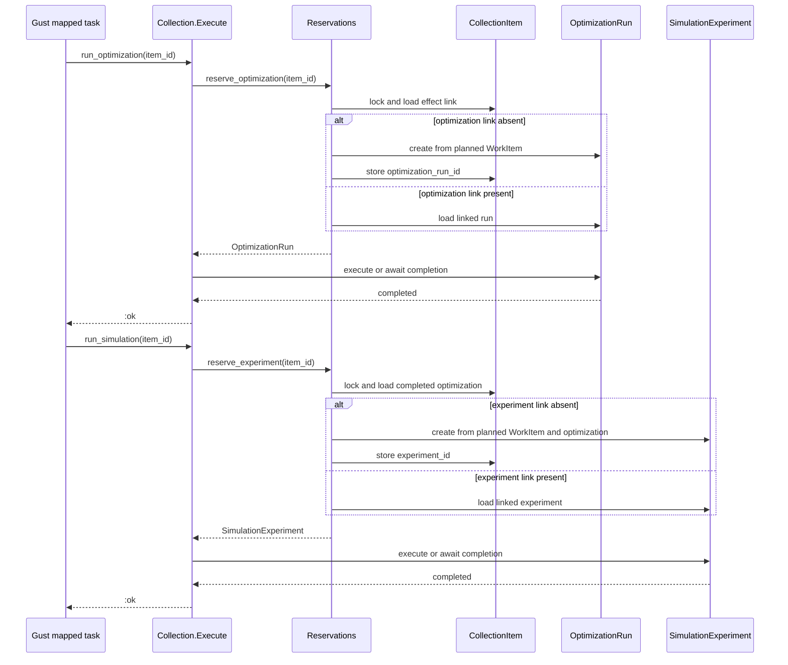

### Q36 — Evidence assembly public API

The current scaffold exposes caller-selected role and replica values:

```elixir
Evidence.build(definition, role, collection_items)
Evidence.assemble(execution_id, role, replica_position)
```

The approved ownership model already determines these values:

```text
StudyPhase.phase                 -> Pilot or Final role
StudyPhaseRun records            -> collection runs
CollectionPlan                   -> ordered work
CollectionItem records           -> completed effects
accepted evidence replica policy -> replica 0
StudyRevision                    -> immutable definition
```

A phase-owned API can load these values internally:

```elixir
@spec assemble(StudyPhase.id()) ::
        {:ok, EvidenceSnapshot.t()} | {:error, StudyError.t()}

@spec fetch_for_phase!(StudyPhase.id()) :: EvidenceSnapshot.t()
```

`assemble/1` accepts only a collection phase. Pilot assembly reads the single run. Final assembly reads all tier runs in `Tier.all/0` order and uses measured replica `0`. A retry returns the existing phase-owned snapshot.

The lower-level matrix-building function remains private because its inputs are application-owned records, not a separate public boundary.

**Question:** Should the public evidence API accept only `StudyPhase.id()` and derive role, runs, definition, and accepted replica internally?

**Recommendation:** Yes. This gives snapshot assembly one authoritative input and removes caller-selected role and replica arguments.

**Answer:** `EvidenceSnapshots.assemble/1` accepts only `StudyPhase.id()`. It derives the role, phase runs, definition, and accepted replica from application-owned records.

Accepted sequence:

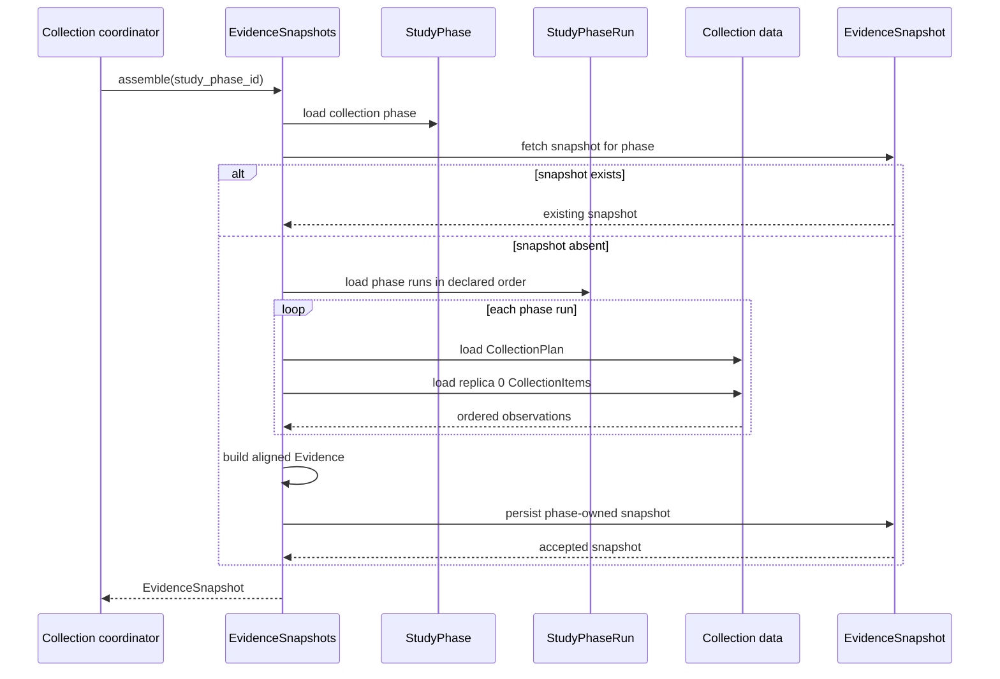

### Q37 — Evidence public value type

After Q19 and Q20, evidence no longer owns a role, family ID, or comparison identities. Two shapes remain possible.

Wrapper value:

```elixir
%Evidence{
  comparisons: [
    %ComparisonEvidence{
      attack_seeds: seeds,
      alternative: alternative_matrix,
      reference: reference_matrix
    }
  ]
}
```

Direct snapshot list:

```elixir
%EvidenceSnapshot{
  study_phase_id: phase_id,
  observations: [
    %ComparisonEvidence{
      attack_seeds: seeds,
      alternative: alternative_matrix,
      reference: reference_matrix
    }
  ]
}
```

The wrapper adds one type, but it can own evidence operations without coupling them to persistence:

```elixir
Evidence.fetch_comparison!(evidence, comparison_position)
Evidence.comparison_count(evidence)
Evidence.plan_counts(evidence)
Evidence.attack_count(evidence, comparison_position)
```

The snapshot remains the persistence identity. `Evidence` remains the accepted scientific value.

**Question:** Should Evaluation2 retain a small `Evidence` value object containing only the ordered comparison observations?

**Recommendation:** Yes. Remove copied identity fields, but retain the value object. It gives matrix and sample-dimension operations a clear public owner while keeping `EvidenceSnapshot` focused on persistence ownership.

**Answer:** Retain `Evidence` as the accepted scientific value. It contains only ordered `ComparisonEvidence` observations. `EvidenceSnapshot` owns its persistent identity and collection phase.

### Q38 — Pilot terminal output type

The current Pilot contract flattens the compact outcome into nullable fields beside detailed candidate summaries:

```elixir
%PilotAnalysisContract.Output{
  outcome: :recommended,
  candidate_id: candidate_id,
  plan_count_per_side: plan_count,
  attacks_per_plan: attack_count,
  summaries: candidate_summaries
}
```

Evaluation2 already has the approved compact outcome type:

```elixir
%PilotOutcome{
  outcome: :recommended,
  candidate_id: candidate_id,
  plan_count_per_side: plan_count,
  attacks_per_plan: attack_count
}
```

A nested terminal result can reuse it:

```elixir
%PilotAnalysisContract.Output{
  outcome: %PilotOutcome{...},
  candidates: candidate_summaries
}
```

Proposed type:

```elixir
@type t :: %__MODULE__{
        outcome: PilotOutcome.t(),
        candidates: [CandidateSummary.t()]
      }
```

The Gust terminal result retains the detailed candidate summaries. Lifecycle acceptance stores only `result.outcome` on `StudyExecution`.

**Question:** Should the Pilot-analysis terminal output use a nested `PilotOutcome.t()` plus the complete candidate summaries?

**Recommendation:** Yes. This reuses one compact outcome type, removes four flattened nullable fields from the phase contract, and makes the acceptance boundary explicit.

**Answer:** `PilotAnalysisContract.Output` contains `outcome: PilotOutcome.t()` and `candidates: [CandidateSummary.t()]`.

Accepted sequence:

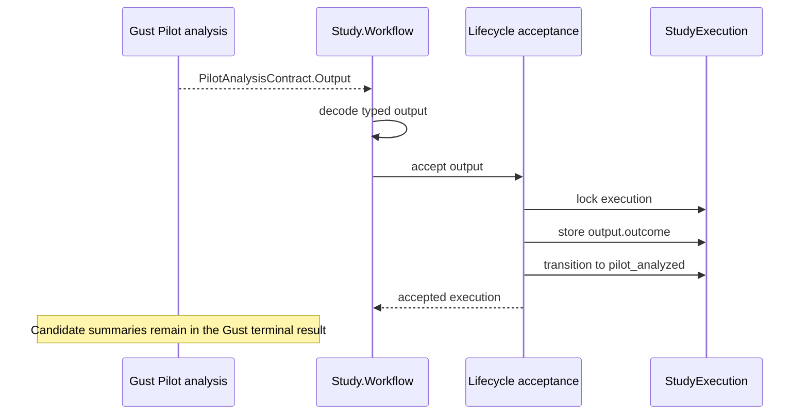

### Q39 — Phase contract root inputs

Every Gust run now has a `StudyPhaseRun` record. The current contracts use different duplicated inputs, such as phase ID, tier, or execution ID.

A uniform root convention can use the current run link plus only the accepted upstream record that the run consumes:

```elixir
%PilotCollectionContract.Input{
  phase_run_id: phase_run_id
}

%PilotAnalysisContract.Input{
  phase_run_id: phase_run_id,
  snapshot_id: pilot_snapshot_id
}

%FinalTierContract.Input{
  phase_run_id: phase_run_id
}

%FinalAnalysisContract.Input{
  phase_run_id: phase_run_id,
  snapshot_id: final_snapshot_id
}
```

The run link derives the execution, phase kind, and run key. A Final tier run derives its tier from `StudyPhaseRun.key`. Collection runs derive the immutable definition and frozen selection through their execution. Analysis inputs name the exact accepted snapshot they consume.

**Question:** Should all four phase contracts use `phase_run_id` as their root identity and add only `snapshot_id` for analysis phases?

**Recommendation:** Yes. This creates one stable convention, removes copied execution/tier fields, and keeps the cross-phase evidence dependency explicit.

**Answer:** Every phase contract uses `phase_run_id` as its root identity. Pilot and Final analysis inputs also contain the accepted `snapshot_id`.

Accepted input flow:

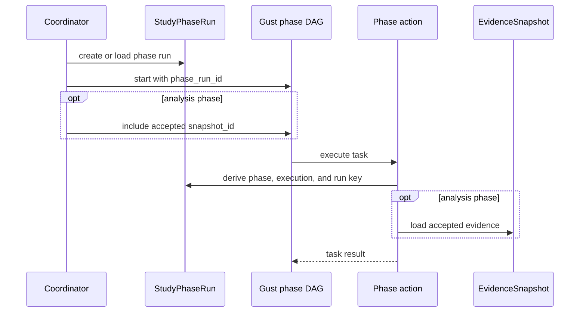

### Q40 — Pilot Collection terminal output

The current Pilot Collection contract returns the snapshot ID:

```elixir
%PilotCollectionContract.Output{
  snapshot_id: snapshot_id
}
```

The accepted ownership model already stores that relationship:

```elixir
%EvidenceSnapshot{
  id: snapshot_id,
  study_phase_id: pilot_collection_phase_id
}
```

An empty terminal output can signal successful DAG completion without copying the snapshot ID:

```elixir
%PilotCollectionContract.Output{}
```

After Gust succeeds, the coordinator loads the phase-owned snapshot:

```elixir
snapshot = EvidenceSnapshots.fetch_for_phase!(pilot_collection_phase_id)
```

If snapshot assembly fails, the Gust terminal task fails. A successful run therefore means the snapshot is available.

**Question:** Should Pilot Collection use an empty typed terminal output, like the approved Final-tier contract?

**Recommendation:** Yes. Let `EvidenceSnapshot` own its ID and phase relationship. Use Gust success as the receipt, then load the snapshot through its owner.

**Answer:** `PilotCollectionContract.Output` is an empty typed struct. Gust success is the completion receipt, and the coordinator loads the phase-owned snapshot.

Accepted sequence:

```mermaid
sequenceDiagram
    participant G as Gust Pilot Collection
    participant A as Assemble snapshot task
    participant S as EvidenceSnapshots
    participant W as Study.Workflow
    participant L as Lifecycle acceptance

    G->>A: run terminal assembly
    A->>S: assemble(pilot_collection_phase_id)
    S-->>A: EvidenceSnapshot
    A-->>G: empty Output
    G-->>W: run succeeded
    W->>S: fetch_for_phase(pilot_collection_phase_id)
    S-->>W: accepted snapshot
    W->>L: accept Pilot collection
    L-->>W: execution is pilot_collected
```

### Q41 — Pilot analysis public module

The scaffold splits Pilot analysis across `Pilot.Analyze` and `Pilot.Decide`. Their public functions accept a mixture of definitions, phase IDs, settings, and runtime evidence.

```elixir
Pilot.Analyze.prepare(definition)
Pilot.Analyze.run(phase_id, job)
Pilot.Decide.summarize(assessments, pilot, family, runtime)
Pilot.Decide.select(summaries, rule)
```

The accepted snapshot identifies the evidence and leads to the immutable definition. A single public phase service can expose the three Gust task boundaries:

```elixir
@spec prepare(EvidenceSnapshot.id()) ::
        {:ok, [PilotJob.t()]} | {:error, StudyError.t()}

@spec evaluate(EvidenceSnapshot.id(), PilotJob.t()) ::
        {:ok, CandidateAssessment.t()} | {:error, StudyError.t()}

@spec decide(EvidenceSnapshot.id(), [CandidateAssessment.t()]) ::
        {:ok, PilotAnalysisContract.Output.t()} | {:error, StudyError.t()}
```

`prepare/1` builds the ordered candidate/comparison jobs. `evaluate/2` reads one comparison's matrices and performs the Pilot calculation. `decide/2` creates complete candidate summaries and selects the outcome.

The public module is:

```elixir
NetworkDefense.Evaluation2.Study.Pilot.Analysis
```

Lower-level statistical and runtime-estimation functions can remain internal or reuse existing modules.

**Question:** Should one public `Pilot.Analysis` module own `prepare/1`, `evaluate/2`, and `decide/2`, with `snapshot_id` as their study context?

**Recommendation:** Yes. This matches the three Gust task stages, removes caller-supplied definition fragments, and reduces the public helper-module count.

**User correction:** Pilot analysis is a phase implementation detail. It should not be part of the supported external API. Only complete study operations should be public.

**Answer:** Keep `Pilot.Analysis` internal. Its cross-module functions remain ordinary Elixir `def` functions because Gust actions call them, but mark the module as internal and exclude it from supported API documentation.

Supported boundary:

```mermaid
flowchart LR
    O[Operator or Mix task] --> S[Evaluation2 Study facade]
    S --> W[Internal study workflow]
    W --> P[Internal phase services]
    P --> G[Gust DAG actions]
```

### Q42 — Supported study facade

The current scaffold exposes `NetworkDefense.Evaluation2` with study-prefixed functions:

```elixir
Evaluation2.create_study_revision(document)
Evaluation2.start_study(revision_id)
Evaluation2.study_status(execution_id)
Evaluation2.resume_study(execution_id, selection)
Evaluation2.cancel_study(execution_id)
Evaluation2.study_result(execution_id)
```

Because Q1 limits the subsystem to complete studies, a dedicated facade can use shorter names:

```elixir
NetworkDefense.Evaluation2.Study.create_revision(document)
NetworkDefense.Evaluation2.Study.start(revision_id)
NetworkDefense.Evaluation2.Study.status(execution_id)
NetworkDefense.Evaluation2.Study.resume(execution_id, selection)
NetworkDefense.Evaluation2.Study.cancel(execution_id)
NetworkDefense.Evaluation2.Study.result(execution_id)
```

All collection, evidence, analysis, lifecycle, phase-contract, and Gust-action modules remain internal. Only types returned or accepted by this facade form the supported contract.

**Question:** Should `NetworkDefense.Evaluation2.Study` be the single supported public facade, replacing the current top-level `NetworkDefense.Evaluation2` facade?

**Recommendation:** Yes. The namespace states the only supported operation scope and removes repeated `_study` suffixes from every function.

**Answer:** `NetworkDefense.Evaluation2.Study` is the only supported public facade. Remove the equivalent top-level `NetworkDefense.Evaluation2` facade. Internal modules can expose typed cross-module functions, but they are not supported external APIs.

Accepted boundary sequence:

```mermaid
sequenceDiagram
    participant O as Operator or Mix task
    participant S as Evaluation2.Study
    participant I as Internal study services
    participant G as Gust workflows

    O->>S: create_revision, start, status, resume, cancel, or result
    S->>I: call internal operation
    opt operation starts or resumes work
        I->>G: dispatch phase workflow
    end
    I-->>S: internal record or error
    S-->>O: supported Study value or bounded error
```

### Q43 — Public return types

The current facade returns internal persistence structs directly:

```elixir
{:ok, %StudyRevision{...}}
{:ok, %StudyExecution{...}}
{:ok, %StudyResult{...}}
```

This makes persistence fields part of the supported API. The facade can instead return three boundary values under its namespace:

```elixir
%Study.Revision{...}
%Study.Status{...}
%Study.Result{...}
```

Proposed signatures:

```elixir
@spec create_revision(binary()) ::
        {:ok, Study.Revision.t()} | {:error, Study.Error.t()}

@spec start(Study.revision_id()) ::
        {:ok, Study.Status.t()} | {:error, Study.Error.t()}

@spec status(Study.execution_id()) ::
        {:ok, Study.Status.t()} | {:error, Study.Error.t()}

@spec resume(Study.execution_id(), Study.approval()) ::
        {:ok, Study.Status.t()} | {:error, Study.Error.t()}

@spec cancel(Study.execution_id()) ::
        {:ok, Study.Status.t()} | {:error, Study.Error.t()}

@spec result(Study.execution_id()) ::
        {:ok, Study.Result.t()} | {:error, Study.Error.t()}
```

These are transient boundary views. Internal persistence remains `StudyRevision`, `StudyExecution`, and `StudyResult`. Q22 already requires the public result to join execution-owned Pilot history with Final-owned result data.

**Question:** Should the Study facade return public `Revision`, `Status`, and `Result` values instead of internal persistence structs?

**Recommendation:** Yes. This keeps database shape internal while limiting the supported type surface to three study-facing values.

**Answer:** The Study facade returns transient `Study.Revision`, `Study.Status`, and `Study.Result` values. Internal persistence structs remain unsupported implementation details.

### Q44 — Public revision value

The YAML declares `{study_id, revision}`. Persistence also adds a UUID for internal foreign keys. The database already enforces a unique index on the declared pair, so both forms identify the same revision.

Duplicated public identity:

```elixir
%Study.Revision{
  id: internal_uuid,
  study_id: "study-small",
  revision: 1
}
```

Declared public identity only:

```elixir
%Study.Revision{
  study_id: "study-small",
  revision: 1
}
```

Proposed type:

```elixir
@type t :: %__MODULE__{
        study_id: String.t(),
        revision: pos_integer()
      }
```

The internal `StudyRevision` record keeps its UUID for database relationships. The public facade resolves the declared pair when it starts an execution.

```elixir
Study.start(%Study.Revision{study_id: "study-small", revision: 1})
```

**Question:** Should the public API use only the declared `{study_id, revision}` identity and keep the UUID internal?

**Recommendation:** Yes. This removes the duplicate public identifier and gives Mix tasks a readable stable reference.

**Answer:** The public `Study.Revision` contains only `study_id` and `revision`. Internal persistence keeps its UUID for foreign keys.

Accepted sequence:

```mermaid
sequenceDiagram
    participant C as Caller
    participant S as Evaluation2.Study
    participant R as Revision store
    participant E as Execution store

    C->>S: start(Study.Revision)
    S->>R: find by study_id and revision
    R-->>S: internal revision with UUID
    S->>E: create execution with internal UUID
    E-->>S: internal execution
    S-->>C: Study.Status
```

### Q45 — Public Pilot-result access

`Study.Status` can remain a small lifecycle view, but an operator must inspect the complete Pilot candidate summaries before approval. This is especially necessary when the outcome is insufficient and the operator must choose an override candidate.

Embedding all summaries in every status response makes status reads load and decode the terminal Gust result:

```elixir
Study.status(execution_id)
#=> %Study.Status{pilot_candidates: [...]}
```

A separate complete-study operation keeps status lightweight:

```elixir
Study.pilot_result(execution_id)
#=> {:ok, %Study.PilotResult{outcome: outcome, candidates: summaries}}
```

Proposed signature:

```elixir
@spec pilot_result(Study.execution_id()) ::
        {:ok, Study.PilotResult.t()} | {:error, Study.Error.t()}
```

The implementation follows the accepted Pilot Analysis `StudyPhaseRun`, loads its Gust terminal result, decodes `PilotAnalysisContract.Output`, and maps it to the supported value. It creates no duplicate persistence.

**Question:** Should the Study facade expose `pilot_result/1` as the supported way to read complete Pilot candidate summaries?

**Recommendation:** Yes. Approval needs these details, while `status/1` should remain a small lifecycle read.

**Answer:** The Study facade exposes `pilot_result/1`. It reads the accepted Pilot Analysis Gust output and returns a transient `Study.PilotResult` view.

Accepted sequence:

```mermaid
sequenceDiagram
    participant O as Operator
    participant S as Evaluation2.Study
    participant P as Pilot Analysis phase run
    participant G as Gust terminal result

    O->>S: pilot_result(execution_id)
    S->>P: find accepted Pilot Analysis run
    P->>G: load terminal output
    G-->>P: PilotAnalysisContract.Output
    P-->>S: decoded outcome and candidates
    S-->>O: Study.PilotResult
```

### Q46 — Public status value

The execution UUID has no declared natural key, so it remains the public execution reference. The status shape depends on the lifecycle state. Use one struct with a state-refined union instead of one broad type with optional fields in every state.

```elixir
@type t ::
        pilot_running()
        | awaiting_final()
        | final_running()
        | succeeded()
        | failed()
        | cancelled()

@type pilot_running :: %__MODULE__{
        execution_id: Study.execution_id(),
        revision: Study.Revision.t(),
        state: :collecting_pilot | :analyzing_pilot,
        pilot_outcome: nil,
        selection: nil,
        error: nil
      }

@type awaiting_final :: %__MODULE__{
        execution_id: Study.execution_id(),
        revision: Study.Revision.t(),
        state: :awaiting_final,
        pilot_outcome: Study.PilotOutcome.t(),
        selection: nil,
        error: nil
      }

@type final_running :: %__MODULE__{
        execution_id: Study.execution_id(),
        revision: Study.Revision.t(),
        state: :collecting_final | :analyzing_final,
        pilot_outcome: Study.PilotOutcome.t(),
        selection: Study.Selection.t(),
        error: nil
      }

@type succeeded :: %__MODULE__{
        execution_id: Study.execution_id(),
        revision: Study.Revision.t(),
        state: :succeeded,
        pilot_outcome: Study.PilotOutcome.t(),
        selection: Study.Selection.t(),
        error: nil
      }

@type failed :: %__MODULE__{
        execution_id: Study.execution_id(),
        revision: Study.Revision.t(),
        state: :failed,
        pilot_outcome: Study.PilotOutcome.t() | nil,
        selection: Study.Selection.t() | nil,
        error: Study.Error.t()
      }

@type cancelled :: %__MODULE__{
        execution_id: Study.execution_id(),
        revision: Study.Revision.t(),
        state: :cancelled,
        pilot_outcome: Study.PilotOutcome.t() | nil,
        selection: Study.Selection.t() | nil,
        error: nil
      }
```

Failed and cancelled executions can occur at different stages, so only those variants retain optional accepted context. A failed execution remains a successful status read. An inability to perform the read uses the outer error tuple.

Complete candidate summaries remain in `Study.pilot_result/1` and do not appear in status.

**Question:** Should `Study.Status.t()` be this state-refined union over one public struct?

**Recommendation:** Yes. It encodes valid field combinations without introducing one struct module for every lifecycle state.

**Answer:** `Study.Status.t()` is a state-refined union over one public struct. Only failed and cancelled variants retain optional accepted context.

Accepted state model:

```mermaid
stateDiagram-v2
    [*] --> PilotRunning
    PilotRunning --> AwaitingFinal
    AwaitingFinal --> FinalRunning
    FinalRunning --> Succeeded

    PilotRunning --> Failed
    AwaitingFinal --> Failed
    FinalRunning --> Failed

    PilotRunning --> Cancelled
    AwaitingFinal --> Cancelled
    FinalRunning --> Cancelled
```

### Q47 — Public Pilot outcome type

`Study.PilotOutcome` has the same optional-field problem. A recommendation requires a candidate and sample counts. An insufficient outcome contains only its tag under Q11.

Use one struct with an outcome-refined union:

```elixir
@type t :: recommended() | insufficient()

@type recommended :: %__MODULE__{
        outcome: :recommended,
        candidate_id: Study.candidate_id(),
        plan_count_per_side: pos_integer(),
        attacks_per_plan: pos_integer()
      }

@type insufficient :: %__MODULE__{
        outcome: :insufficient,
        candidate_id: nil,
        plan_count_per_side: nil,
        attacks_per_plan: nil
      }
```

This same shape can serve as the internal compact outcome and the supported public value. The public boundary does not need a second mapped representation.

**Question:** Should `Study.PilotOutcome.t()` be this outcome-refined union over one struct?

**Recommendation:** Yes. It makes invalid combinations visible to Dialyzer and preserves the compact insufficient outcome approved in Q11.

**Answer:** `Study.PilotOutcome.t()` is an outcome-refined union over one struct. Recommended outcomes require a candidate and counts. Insufficient outcomes contain only the tag.

### Q48 — Approval input and frozen selection

Approval input expresses operator intent. Frozen selection records the accepted sample-size choice. They are different types.

```elixir
@type Study.approval ::
        :recommended
        | {:override_insufficient, Study.candidate_id()}
```

```elixir
@type Study.Selection.t() :: %Study.Selection{
        candidate_id: Study.candidate_id(),
        plan_count_per_side: pos_integer(),
        attacks_per_plan: pos_integer()
      }
```

The public resume signature is:

```elixir
@spec Study.resume(
        Study.execution_id(),
        Study.approval()
      ) :: {:ok, Study.Status.t()} | {:error, Study.Error.t()}
```

The operator never supplies sample counts. Resume loads the declared candidate and freezes its counts. `Selection` stores no `pilot_override` field. Override status is derived from the accepted `PilotOutcome` and `Selection` under Q13.

**Question:** Should the public boundary keep this intent-versus-frozen-value split?

**Recommendation:** Yes. It prevents callers from supplying unverified counts and preserves one compact selection representation.

**Answer:** `Study.approval()` represents operator intent. `Study.Selection.t()` represents the validated frozen candidate and counts. Selection stores no override flag.

Accepted sequence:

```mermaid
sequenceDiagram
    participant O as Operator
    participant S as Evaluation2.Study
    participant E as StudyExecution
    participant D as Study definition
    participant W as Final workflow

    O->>S: resume(execution_id, approval)
    S->>E: lock awaiting execution
    S->>E: load accepted PilotOutcome
    S->>D: resolve declared candidate and counts
    S->>E: store frozen Selection
    S->>E: transition to collecting_final
    E-->>S: committed status
    S->>W: start Final workflow
    S-->>O: Study.Status
```

### Q49 — Public result value

A successful public result joins execution-owned Pilot history with Final-owned scientific output. It does not copy detailed Pilot candidate summaries, raw evidence, phase runs, or Gust history.

```elixir
%Study.Result{
  execution_id: execution_id,
  revision: revision,
  pilot_outcome: pilot_outcome,
  selection: selection,
  family: corrected_family,
  timing: timing
}
```

Proposed type:

```elixir
@type t :: %__MODULE__{
        execution_id: Study.execution_id(),
        revision: Study.Revision.t(),
        pilot_outcome: Study.PilotOutcome.recommended() | Study.PilotOutcome.insufficient(),
        selection: Study.Selection.t(),
        family: Study.Result.Family.t(),
        timing: Study.Result.Timing.t()
      }
```

`Study.result/1` returns this value only after success. Before success it returns a bounded result-not-available error. Full Pilot candidate summaries remain available through `Study.pilot_result/1`.

The public value is assembled from:

```text
StudyExecution -> revision, Pilot outcome, selection
StudyResult    -> corrected family, raw timings
```

**Question:** Should `Study.Result` contain exactly these six fields?

**Recommendation:** Yes. They form the complete successful study result without exposing execution machinery or duplicating the detailed Pilot report.

**Answer:** `Study.Result` contains `execution_id`, `revision`, `pilot_outcome`, `selection`, `family`, and `timing`. All fields are required because the value exists only after success.

Accepted read sequence:

```mermaid
sequenceDiagram
    participant C as Caller
    participant S as Evaluation2.Study
    participant E as StudyExecution
    participant R as Internal StudyResult

    C->>S: result(execution_id)
    S->>E: load successful execution
    S->>R: load Final-owned result
    E-->>S: revision, Pilot outcome, selection
    R-->>S: corrected family, raw timing
    S-->>C: Study.Result
```

### Q50 — Public corrected-family envelope

The current internal value stores `method` and `family_size`:

```elixir
%CorrectedFamily{
  family_id: family_id,
  method: "holm",
  alpha: alpha,
  family_size: family_size,
  comparisons: comparisons
}
```

Evaluation2 has one fixed correction method, Holm. Keep that method explicit as a singleton type. `family_size` remains the length of `comparisons` and is derived.

```elixir
%Study.Result.Family{
  id: family_id,
  method: :holm,
  alpha: alpha,
  comparisons: comparisons
}
```

```elixir
@type method :: :holm

@type t :: %__MODULE__{
        id: String.t(),
        method: method(),
        alpha: float(),
        comparisons: [Study.Result.Comparison.t()]
      }
```

The public result builder joins `id`, `method`, and `alpha` from the immutable definition with the corrected comparison outputs. `size/1` derives the family size.

**Answer:** Keep `method` as the singleton type `:holm`. Omit only the derived `family_size` field.

### Q51 — Public timing measurements

The current timing type stores three parallel lists. Their lengths and positions can disagree:

```elixir
%TierTiming{
  plan_selection_us: [p0, p1, p2, p3, p4],
  simulation_us: [s0, s1, s2, s3, s4],
  total_us: [t0, t1, t2, t3, t4]
}
```

The methodology measures three boundaries for each of exactly five replicas. Group the three values by replica and key them by the measured replica position:

```elixir
%Study.Result.Timing.Tier{
  replicas: %{
    0 => %Study.Result.Timing.Replica{plan_selection_us: p0, simulation_us: s0, total_us: t0},
    1 => %Study.Result.Timing.Replica{plan_selection_us: p1, simulation_us: s1, total_us: t1},
    2 => %Study.Result.Timing.Replica{plan_selection_us: p2, simulation_us: s2, total_us: t2},
    3 => %Study.Result.Timing.Replica{plan_selection_us: p3, simulation_us: s3, total_us: t3},
    4 => %Study.Result.Timing.Replica{plan_selection_us: p4, simulation_us: s4, total_us: t4}
  }
}
```

```elixir
@type replicas :: %{
        required(0) => Replica.t(),
        required(1) => Replica.t(),
        required(2) => Replica.t(),
        required(3) => Replica.t(),
        required(4) => Replica.t()
      }
```

The complete timing value keeps the approved tier-keyed map:

```elixir
%Study.Result.Timing{
  by_tier: %{
    small: small_timing,
    medium: medium_timing,
    large: large_timing
  }
}
```

Median and range remain derived operations. Warm-up timing remains excluded. Presentation order uses replica positions `0..4`.

**Answer:** Public timing groups the three measured boundaries by replica, uses a map keyed by measured replica positions `0..4` for each tier, and keeps the approved tier-keyed map. This revises the earlier tuple choice. Median and range remain derived operations.

### Q52 — Public corrected-comparison types

The existing comparison statistics contract stores `estimate`, `interval`, `test`, and `assessment` as untyped maps. A supported public result should not expose string-keyed maps.

Preserve the scientific groupings as typed values:

```elixir
%Study.Result.Comparison{
  identity: %Study.Result.Comparison.Identity{
    tier: :small,
    budget: budget,
    alternative: alternative,
    reference: reference,
    outcome: outcome
  },
  statistics: %Study.Result.Comparison.Statistics{
    method: :corrected_crossed_bootstrap_v1,
    estimate: %Estimate{contrast: :alternative_minus_reference, value: estimate},
    interval: %Interval{confidence_level: confidence, lower: lower, upper: upper},
    test: %Test{
      method: :centered_crossed_bootstrap,
      alternative: :two_sided,
      raw_p_value: raw_p_value
    },
    assessment: %Assessment{
      status: :informative,
      warnings: []
    }
  },
  adjustment: %Study.Result.Comparison.Adjustment{
    adjusted_p_value: adjusted_p_value,
    reject_null: reject_null
  }
}
```

All fixed strings become singleton atom types. Assessment status remains `:informative | :non_informative`, and the only current warning is `:zero_width_interval`. The Python wire decoder performs the external shape and numeric checks once, then constructs these typed values.

The public value omits the Python wire `schema_version`; that version belongs to the transport decoder rather than the scientific result.

**Question:** Should the supported corrected comparison use typed nested values instead of the legacy string-keyed statistics maps?

**Recommendation:** Yes. This gives the public result precise types while preserving the established scientific grouping and calculations.

**Answer:** Supported corrected comparisons use typed nested identity, statistics, and adjustment values. Fixed wire literals become singleton atom types. Python schema versions and string-keyed maps remain at the transport boundary.

Accepted boundary sequence:

```mermaid
sequenceDiagram
    participant P as Python comparison
    participant D as Wire decoder
    participant A as Final analysis
    participant R as Study.Result

    P-->>D: JSON statistics maps
    D->>D: check transport shape and numbers
    D-->>A: typed Statistics
    A->>A: apply Holm correction
    A-->>R: typed Comparison with Adjustment
```

### Q53 — Public Pilot result shape

The current candidate summary copies several values that are derived from its comparison assessments: worst half-width, all-informative, non-informative positions, and all-passed. It also omits the full per-comparison details needed to understand an insufficient outcome.

Use one complete typed view:

```elixir
%Study.PilotResult{
  method: :precision_pilot_v1,
  selection_rule: :lowest_predicted_runtime,
  outcome: pilot_outcome,
  candidates: candidates
}
```

```elixir
%Study.PilotResult.Candidate{
  id: candidate_id,
  plan_count_per_side: plan_count,
  attacks_per_plan: attack_count,
  predicted_runtime_ms: predicted_runtime_ms,
  comparisons: comparison_assessments
}
```

```elixir
%Study.PilotResult.Comparison{
  identity: comparison_identity,
  guarded_half_width: guarded_half_width,
  informative: informative,
  passes: passes
}
```

Candidate list order and comparison list order follow the immutable definition. Public values omit internal candidate and comparison positions. Operations derive `worst_guarded_half_width`, `informative?`, `non_informative_comparisons`, and `passes?` from the comparison list.

**Question:** Should `Study.PilotResult` expose full per-comparison assessments and derive the candidate aggregate fields instead of storing them?

**Recommendation:** Yes. This makes insufficient outcomes explainable while removing copied aggregate values.

**Answer:** `Study.PilotResult` contains the compact outcome, fixed method and selection rule, and complete candidates with per-comparison assessments. Candidate aggregate values are derived operations.

Accepted construction:

```mermaid
flowchart LR
    A[Candidate assessments]
    D[Immutable definition]
    C[Typed candidates]
    P[Study.PilotResult]

    A --> C
    D -->|identities and declared order| C
    C --> P
```

### Q54 — Shared public comparison identity

Pilot and Final results identify the same declared family comparisons. A result-specific identity type would duplicate that contract.

Use one public study value:

```elixir
%Study.Comparison{
  tier: :small,
  budget: budget,
  alternative: alternative,
  reference: reference,
  outcome: outcome
}
```

```elixir
@type t :: %__MODULE__{
        tier: Study.Tier.t(),
        budget: pos_integer(),
        alternative: Study.strategy(),
        reference: Study.strategy(),
        outcome: String.t()
      }
```

Both result paths reuse it:

```elixir
%Study.PilotResult.Comparison{identity: %Study.Comparison{...}}
%Study.Result.Comparison{identity: %Study.Comparison{...}}
```

The immutable definition remains the source. Public view builders join the identity by declared position. Evidence values continue to store no comparison identity.

**Question:** Should `Study.Comparison` be the one supported comparison-identity type shared by Pilot and Final results?

**Recommendation:** Yes. It removes a duplicated result-specific identity type while keeping evidence identity-free.

**Answer:** `Study.Comparison` is the single supported comparison identity. Pilot and Final result views join it from the immutable definition. Evidence remains identity-free.

### Q55 — Public tier and strategy types

`Study.Comparison` and result timing expose tiers and strategies. The tier vocabulary belongs to Evaluation2 and has a required order. The strategy vocabulary already belongs to the optimization domain.

Expose a Study tier module:

```elixir
@type Study.Tier.t() :: :small | :medium | :large

@spec Study.Tier.all() :: [Study.Tier.t()]
@spec Study.Tier.position(Study.Tier.t()) :: 0..2
@spec Study.Tier.from_position(0..2) :: Study.Tier.t()
```

Reuse the existing strategy type through an alias:

```elixir
@type Study.strategy() ::
        NetworkDefense.Optimization.Contracts.OptimizationParams.strategy()
```

Do not create a second `Study.Strategy` enum or wrapper. Public values use atoms from the established optimization vocabulary.

**Question:** Should Evaluation2 own `Study.Tier` with ordering operations while `Study.strategy()` aliases the existing domain type?

**Recommendation:** Yes. Tier has Evaluation2-specific closed ordering behavior. Strategy already has a domain owner and should not be copied.

**Answer:** Evaluation2 owns the closed ordered `Study.Tier` module. `Study.strategy()` aliases the existing optimization strategy type without adding a wrapper.

### Q56 — Public study error type

The existing error envelope has string categories plus separate `issues` and `schema_errors` lists. Evaluation2 uses only four outer categories:

```elixir
@type Study.Error.category ::
        :validation_failed
        | :request_too_large
        | :conflict
        | :unavailable
```

Use one supported envelope and normalize schema diagnostics into the same issue list:

```elixir
%Study.Error{
  category: :validation_failed,
  issues: [
    %Study.Error.Issue{
      code: "invalid_yaml",
      path: ["pilot", "candidates", 0],
      message: "The YAML value is invalid.",
      details: %{}
    }
  ]
}
```

```elixir
@type t :: %__MODULE__{
        category: category(),
        issues: [Issue.t()]
      }
```

```elixir
@type Issue.path_component :: String.t() | non_neg_integer()

@type Issue.t() :: %Issue{
        code: String.t(),
        path: [Issue.path_component()],
        message: String.t(),
        details: map()
      }
```

The boundary exposes no parser diagnostics, submitted values, stack traces, Ecto changesets, or Gust errors. Internal failures map once into this bounded type. The same type appears in facade error tuples and terminal `Study.Status.failed()` values.

**Question:** Should `Study.Error` use this one-list typed envelope instead of exposing the existing internal error contract?

**Recommendation:** Yes. It gives the only public facade one stable error shape and removes the special public distinction between schema errors and other issues.

**Answer:** `Study.Error` has one typed issue list and the four closed categories `:validation_failed`, `:request_too_large`, `:conflict`, and `:unavailable`. Internal diagnostics map into this boundary once.

Accepted error flow:

```mermaid
sequenceDiagram
    participant I as Internal operation
    participant M as Error mapper
    participant S as Evaluation2.Study
    participant C as Caller

    I-->>M: parser, storage, lifecycle, or Gust failure
    M->>M: remove internal diagnostics
    M->>M: build Study.Error issues
    M-->>S: Study.Error
    S-->>C: error Study.Error
```

### Q57 — Create and start boundary

The public library can freeze a revision and start an execution as two operations, or combine them.

Separate operations:

```elixir
{:ok, revision} = Study.create_revision(yaml)
{:ok, status} = Study.start(revision)
```

Combined operation:

```elixir
{:ok, status} = Study.start(yaml)
```

A stored immutable revision can support multiple executions. Combining the operations makes duplicate revision handling and repeated execution intent ambiguous. The Mix interface can still provide a convenience command that calls both library operations in sequence.

Proposed public signatures:

```elixir
@spec Study.create_revision(binary()) ::
        {:ok, Study.Revision.t()} | {:error, Study.Error.t()}

@spec Study.start(Study.Revision.t()) ::
        {:ok, Study.Status.t()} | {:error, Study.Error.t()}
```

**Question:** Should the supported Study API keep revision creation and execution start as separate operations?

**Recommendation:** Yes. This preserves revision reuse and one clear responsibility per operation. Operator tooling can compose them without adding a second library contract.

**Answer:** Keep `Study.create_revision/1` and `Study.start/1` as separate supported operations. A Mix task can compose them for a one-command operator workflow.

Accepted composition:

```mermaid
sequenceDiagram
    participant O as Operator
    participant M as Mix task
    participant S as Evaluation2.Study

    O->>M: start YAML file
    M->>S: create_revision(yaml)
    S-->>M: Study.Revision
    M->>S: start(revision)
    S-->>M: Study.Status
    M-->>O: execution started
```

### Q58 — Internal Final Analysis module

Final Analysis has the same three Gust stages as Pilot Analysis: prepare jobs, evaluate mapped jobs, and combine the complete family. The current scaffold splits context across definitions, phase IDs, and family values.

Use one internal phase service with the accepted Final snapshot as context:

```elixir
@spec Final.Analysis.prepare(EvidenceSnapshot.id()) ::
        {:ok, [FinalJob.t()]} | {:error, Study.Error.t()}

@spec Final.Analysis.evaluate(EvidenceSnapshot.id(), FinalJob.t()) ::
        {:ok, Study.Result.Comparison.Statistics.t()} | {:error, Study.Error.t()}

@spec Final.Analysis.correct(
        EvidenceSnapshot.id(),
        [Study.Result.Comparison.Statistics.t()]
      ) :: {:ok, FinalAnalysisContract.Output.t()} | {:error, Study.Error.t()}
```

`prepare/1` creates one ordered job per declared comparison. `evaluate/2` loads the comparison matrices and runs the corrected crossed bootstrap. `correct/2` applies Holm exactly once across the complete ordered family and returns the typed family output.

The module is internal:

```elixir
defmodule NetworkDefense.Evaluation2.Study.Final.Analysis do
  @moduledoc false
end
```

**Question:** Should one internal `Final.Analysis` module own `prepare/1`, `evaluate/2`, and `correct/2`, with `snapshot_id` as the study context?

**Recommendation:** Yes. This mirrors the accepted Pilot Analysis boundary and maps directly to the three Gust stages.

**Answer:** One internal `Final.Analysis` module owns `prepare/1`, `evaluate/2`, and `correct/2`, with the accepted snapshot ID as study context.

### Q59 — Complete internal Pilot candidate summary

The Pilot terminal output must be the source of the complete supported Pilot report. Each internal candidate summary therefore retains its ordered per-comparison assessments.

```elixir
%CandidateSummary{
  candidate_position: candidate_position,
  candidate_id: candidate_id,
  plan_count_per_side: plan_count,
  attacks_per_plan: attack_count,
  predicted_runtime_ms: predicted_runtime,
  comparisons: [
    %CandidateSummary.Comparison{
      comparison_position: comparison_position,
      guarded_half_width: guarded_half_width,
      informative: informative,
      passes: passes
    }
  ]
}
```

`worst_guarded_half_width`, `informative?`, `non_informative_comparisons`, and `passes?` are derived operations. `Study.pilot_result/1` joins declared comparison identities without reading mapped Gust task results.

**Answer:** Use this complete `CandidateSummary` shape. Remove stored aggregate fields.

### Q60 — Collection phase contract names

Pilot Collection and Final tier collection have identical data shapes:

```elixir
Input  -> phase_run_id
Output -> empty typed struct
```

The current scaffold puts the structs in `CollectionPhaseShape` and keeps two delegating contract modules. This removes source duplication but also removes the approved names `%PilotCollectionContract.Output{}` and `%FinalTierContract.Output{}`.

A shared macro can define the implementation once while generating contract-named types:

```elixir
defmodule CollectionPhaseContract do
  defmacro __using__(_options) do
    quote do
      defmodule Input do
        defstruct [:phase_run_id]
      end

      defmodule Output do
        defstruct []
      end

      # Shared typed codec implementation.
    end
  end
end
```

```elixir
defmodule PilotCollectionContract do
  use CollectionPhaseContract
end

defmodule FinalTierContract do
  use CollectionPhaseContract
end
```

ExDNA sees one source implementation. Gust actions retain phase-specific struct names and Dialyzer types.

**Question:** Should Evaluation2 use the macro-generated per-contract `Input` and `Output` modules?

**Recommendation:** Yes. It preserves the Q25/Q40 typed contract convention without source duplication or ExDNA suppression.

**Answer:** Use one `CollectionPhaseContract` macro that generates contract-specific `Input`, `Output`, and codec functions inside `PilotCollectionContract` and `FinalTierContract`.

### Q61 — Typed phase dispatch

The current generic behaviour erases phase types:

```elixir
@callback to_params(term()) :: map()
@callback decode_output!(map()) :: term()

@spec Workflow.run_phase(module(), map(), atom(), function()) ::
        {:ok, term()} | {:error, Study.Error.t()}
```

A simpler boundary is to remove the generic public behaviour and expose one typed internal workflow function per phase:

```elixir
@spec Workflow.run_pilot_collection(PilotCollectionContract.Input.t()) ::
        {:ok, PilotCollectionContract.Output.t()} | {:error, Study.Error.t()}

@spec Workflow.run_pilot_analysis(PilotAnalysisContract.Input.t()) ::
        {:ok, PilotAnalysisContract.Output.t()} | {:error, Study.Error.t()}

@spec Workflow.run_final_tier(FinalTierContract.Input.t()) ::
        {:ok, FinalTierContract.Output.t()} | {:error, Study.Error.t()}

@spec Workflow.run_final_analysis(FinalAnalysisContract.Input.t()) ::
        {:ok, FinalAnalysisContract.Output.t()} | {:error, Study.Error.t()}
```

One private dispatcher can still own the common Gust mechanics:

```elixir
@spec dispatch(module(), map(), atom()) ::
        {:ok, map()} | {:error, Study.Error.t()}
```

Each typed wrapper encodes its input, calls `dispatch/3`, and decodes its own output. Dialyzer sees concrete types at every cross-module call.

**Question:** Should Evaluation2 remove the generic `PhaseContract` behaviour and `run_phase/4` API in favor of four typed workflow functions over one private dispatcher?

**Recommendation:** Yes. This removes `term()` from the phase boundary and keeps shared Gust mechanics private.

**Answer:** Remove the generic `PhaseContract` behaviour and `run_phase/4`. Use four typed workflow functions over one private Gust dispatcher.

### Q62 — Public timing operations

The public `Study.Result.Timing` value contains the raw five-replica measurements. Median and range are required report outputs, but the current scaffold places those operations only in the internal Final collection module.

Put pure read operations on the value that callers receive:

```elixir
@type Study.Result.Timing.boundary ::
        :plan_selection | :simulation | :total

@type Study.Result.Timing.measurements :: %{
        required(0) => non_neg_integer(),
        required(1) => non_neg_integer(),
        required(2) => non_neg_integer(),
        required(3) => non_neg_integer(),
        required(4) => non_neg_integer()
      }

@spec Study.Result.Timing.measurements(
        Study.Result.Timing.t(),
        Study.Tier.t(),
        Study.Result.Timing.boundary()
      ) :: Study.Result.Timing.measurements()

@spec Study.Result.Timing.median(
        Study.Result.Timing.t(),
        Study.Tier.t(),
        Study.Result.Timing.boundary()
      ) :: non_neg_integer()

@spec Study.Result.Timing.range(
        Study.Result.Timing.t(),
        Study.Tier.t(),
        Study.Result.Timing.boundary()
      ) :: {non_neg_integer(), non_neg_integer()}
```

The internal `Final.Timing` module owns collection and assembly. The public value owns deterministic queries over accepted raw measurements.

**Answer:** `Study.Result.Timing` owns `measurements/3`, `median/3`, and `range/3`. `measurements/3` returns a map keyed by measured replica positions `0..4`, not a tuple.

### Q63 — Evaluation2 definition ownership

The first scaffold aliased the complete normalized definition from the legacy subsystem:

```elixir
alias NetworkDefense.Evaluation.Study.Contracts.Definition,
  as: StoredDefinition
```

That makes the new subsystem depend on legacy Evaluation types even when it does not call the legacy parser.

Evaluation2 instead owns plain typed definition values under:

```text
NetworkDefense.Evaluation2.Study.Definition
NetworkDefense.Evaluation2.Study.Definition.*
```

The owned tree preserves the established YAML shape: study identity, graph and strategy declarations, simulation controls, comparison family, Pilot settings, pause handoff, and Final settings. It reuses neutral domain types such as optimization strategies, simulation objectives, rules, and defense-action registries.

It does not copy the legacy parser, changesets, schema validator, consistency checker, JSON boundary, or legacy error envelope. `Study.Definition.parse/1` and `decode_stored!/1` remain Evaluation2 boundary placeholders.

**Answer:** Evaluation2 owns its complete normalized definition value tree and has no source dependency on `NetworkDefense.Evaluation.*`.

### Scaffold alignment after DeepSeek review

The following points require no additional design choice:

- `WorkItem` includes `initial_foothold_node_id` so a stored collection plan is a complete resolved request.
- `FinalTierRunResult` contains the tier coordinate, Gust run identity, and timing. It does not contain an empty receipt.
- Evaluation2 revision creation accepts exactly the declared tiers `small`, `medium`, and `large`; internal `Study.Definition.decode_tier!/1` converts their accepted stored strings to `Study.Tier` atoms.
- `Study.Comparison.outcome` remains an open declared string owned by the Evaluation2 definition contract.
- Public value types use the `Study.candidate_id()` and `Study.strategy()` aliases consistently.
- Scaffold-only `Placeholder` and `NotImplementedError` modules must be removed when the corresponding operations are implemented.

### Final collection

The application runs tiers sequentially. Gust runs each tier’s item batches.

```elixir
def run(execution) do
  execution
  |> declared_tiers()
  |> Enum.with_index()
  |> Enum.map(fn {tier, tier_position} ->
    run_tier(execution, tier, tier_position)
  end)
  |> accept_final_collection(execution)
end
```

#### One tier run

```elixir
def run_tier(execution, tier, tier_position) do
  phase_run = TierRuns.create_or_load(execution.id, tier, tier_position)

  GustPhase.run(:final_tier_collection,
    execution_id: execution.id,
    phase_run_id: phase_run.id,
    tier: tier,
    tier_position: tier_position
  )
end
```

#### Gust owns each batch

```mermaid
flowchart LR
    PREP[prepare replica] --> PLAN["run plan item × N"]
    PLAN --> PM[plan completion marker]
    PM --> SIM["run simulation item × N"]
    SIM --> SM[simulation completion marker]
```

```elixir
task_action :prepare_0, Placeholder.PrepareReplica,
  downstream: [:mark_plan_dispatch_0],
  store_result: true

task_action :run_plan_0, Placeholder.RunPlanItem,
  map_over: :prepare_0,
  downstream: [:mark_plan_completion_0]

task_action :run_simulation_0, Placeholder.RunSimulationItem,
  map_over: :prepare_0,
  downstream: [:mark_simulation_completion_0]
```

No custom `Task.Supervisor`, batch executor, or retry loop is required.

#### One mapped item

```elixir
def run_plan_item(collection_item_id) do
  ConcurrencyGate.run(fn ->
    item = CollectionItems.fetch!(collection_item_id)
    request = WorkItems.optimization_request(item)
    run = ItemEffects.reserve_optimization(item, request)
    Optimizations.run_reserved(run.id)
  end)
end

def run_simulation_item(collection_item_id) do
  ConcurrencyGate.run(fn ->
    item = CollectionItems.fetch!(collection_item_id)
    optimization = ItemEffects.completed_optimization!(item)
    request = WorkItems.simulation_request(item, optimization)
    experiment = ItemEffects.reserve_experiment(item, request)
    Simulations.run(experiment.id)
  end)
end
```

Gust retries temporary mapped-task failures. `Gust.DAG.NonRecError` stops retry for permanent failures. Stable collection-item links prevent new optimization or experiment records on retry.

#### Timing owner

Reuse the current coordinator-owned recorder. The coordinator awaits the tier run and receives timing markers from the static DAG.

```elixir
{:ok, tier_result, timing} =
  TierAwaiter.await(gust_run_id,
    recorder: TimingRecorder.new(tier, tier_position)
  )
```

Timing boundaries surround Gust’s mapped batches. Queue time and Gust retry delay remain in the measured interval.

#### Final acceptance

```elixir
def accept_final_collection(tier_results, execution) do
  timing = Timing.summarize(tier_results)
  by_replica = FinalReplicas.complete_family_summaries(tier_results)

  FinalReplicas.require_equal!(by_replica)

  snapshot =
    Evidence.assemble_final(
      execution.id,
      replica_position: 0
    )

  {:ok, snapshot, timing}
end
```

Do not compare timing values or run IDs in the replica equality gate.

#### Retry ownership

```text
mapped plan/simulation retry  Gust
retry-safe effect identity    CollectionItem + reservation
batch completion/fan-in       Gust
sequential tier order         application lifecycle
single timing clock           application coordinator
failed tier                   fail Final collection; no replacement replica
```

### Final analysis and result

```elixir
Final.Analyze.prepare(snapshot, definition)
#=> [%FinalComparison{}]

Final.Analyze.run(final_comparison)
#=> %ComparisonStatistics{}

Final.Analyze.correct(statistics, definition.family)
#=> %CorrectedFamily{}

Result.store(execution_id, pilot_decision, selection, family, timing)
#=> {:ok, %StudyResult{}}
```

## Reuse

### Reuse boundary

**Question:** Which old code should survive?

**Proposed answer:** Retain the established algorithms and domain operations. Extract useful transformations from their lifecycle wrappers.

| Reuse | Simplify around it |
| --- | --- |
| YAML parser, schema, and scientific definition checks | Repeated full validation on stored-definition loads |
| Graph, optimization, and simulation APIs | Phase-specific request wrappers and repeated canonical-work reconstruction |
| Sampling, seed derivation, bootstrap, and Holm calculations | Study metadata carried through pure numerical operations |
| Matrix assembly and required replica comparison | Duplicate evidence/history checks at later stages |
| Stable domain effect links | Phase/run/receipt representations that only mirror workflow progress |

Use the proposed module and evidence shapes above as the current working model.

## Behavior cases

### Q10 — Check policy

No automated-test design for now. Keep behavior cases as implementation requirements.

#### Construction rule

```text
IF the application fully controls how a fact is created,
THEN construct the fact correctly and do not check it again later.

IF a fact depends on observed evidence, an external boundary, resource use,
or concurrent lifecycle state,
THEN keep one check or calculation at the owning boundary.
```

```text
Constructed facts
  declared comparison order
  shared attack-column identity
  planned matrix dimensions
  mapped item identity

Necessary checks or calculations
  YAML and compute boundary decoding
  candidate fits available Pilot evidence
  Pilot informativeness and precision
  Final environment stability
  Final replica equality
  valid resume selection
  lifecycle state during acceptance
  resource limits at use
```

```text
EVAL-INPUT-01
WHEN study YAML fails the creation contract,
THE application SHALL reject it before collection.

EVAL-APPROVAL-01
WHEN approval selects an invalid candidate,
THE study SHALL remain waiting.

EVAL-RETRY-01
WHEN collection retries the same work item,
THE collection SHALL reuse its domain effect links.

EVAL-PILOT-01
WHEN a Pilot candidate exceeds the available evidence,
THE Pilot SHALL reject that candidate as ineligible.

EVAL-PILOT-02
WHEN any outer subsample is non-informative,
THE candidate/comparison assessment SHALL be non-passing.

EVAL-PILOT-03
WHEN no candidate passes every declared comparison,
THE Pilot SHALL return :insufficient.

EVAL-EVIDENCE-01
WHEN evidence is assembled,
THE builder SHALL use the declared family order and one shared attack-column list for both sides.

EVAL-FINAL-01
WHEN measured Final replicas disagree,
THE application SHALL reject Final evidence.
```

Automation of these cases is deferred.

## Documentation follow-up

**Open:** Review whether the evaluation documentation needs one shared glossary after the module and contract names stabilize.

The glossary could distinguish these terms:

```text
tier                 one of the small, medium, or large network sizes
Pilot candidate       a proposed pair of plan and attack sample counts
seed                  a deterministic random-stream input with a declared role
matrix                plain aligned plan-row and attack-column observations
comparison family     the complete set corrected together
```

Also search existing documentation for older or ambiguous uses of `tier`, `network size`, `scenario`, `candidate`, and `seed`. Update them only after the redesign fixes the final names.
