# Evaluation redesign: decision tree and Q&A

## Status

Working design interview for simpler evaluation execution and checking. Reuse the established methodology, YAML study definition, scenarios, comparisons, strategies, and supporting code. Adjust existing contracts where the simplification needs it.

**Agreed interview scope:** Reuse the existing evaluation approaches. Simplify the code and mechanisms that make them work.

Preserve the methodology, current YAML, domain concepts, and scientific flow as the baseline. Interview decisions should focus on unnecessary implementation layers, repeated checks, orchestration, handoffs, and supporting code. Propose input or interface adjustments only when a concrete simplification requires them.

Study means the existing YAML input, reused and tweaked as needed. Source exploration should answer questions about existing concepts before the interview introduces design choices.

The study pipeline and its Gust phase DAGs are the current design focus. Treat proposed application modules as placeholders. Assume they do not exist yet.

Gust already owns mapped batches, dependency fan-in, and task retry. Do not duplicate these features in application code.

Use existing source as a mechanism library. Reuse or copy the current lifecycle, phase sequencing, explicit resume policy, stable effect links, Final tier DAG, timing rules, and scientific calculations.

Design order: define the phase DAGs and the application boundaries between them. Then assign placeholder actions, inputs, outputs, and persistence.

**User correction:** The initial Pilot/Final diagram was already too detailed for the bird's-eye view.

### Interview mode

The user asked the assistant to continue without waiting for an answer at every step.

- Inspect existing code before asking factual questions.
- Keep established approaches as the baseline.
- Refine one implementation responsibility at a time.
- Prefer module trees, function signatures, data shapes, and short code sketches.
- Keep prose short.
- Keep behavior cases. Defer automated test design.
- Record implementation recommendations as proposals, separate from confirmed requirements.
- Ask when a remaining choice needs user input.

## Decision tree

Leaves summarize questions and answers. `Open` marks an unresolved decision. The interview follows one branch at a time.

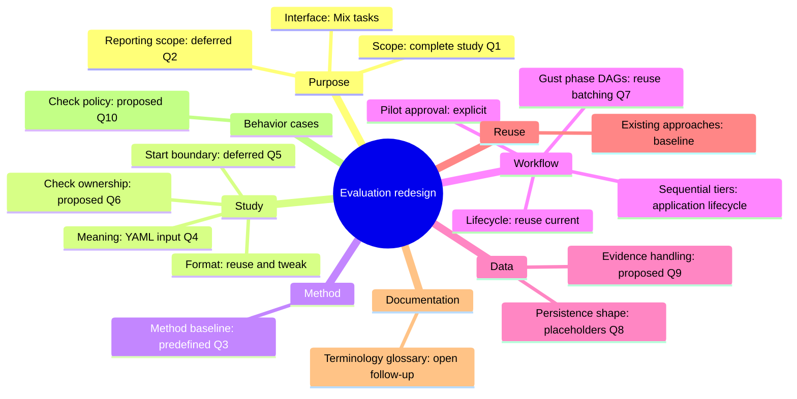

## Purpose

### Q1 — Scope

**Question:** Should the first replacement support complete studies only, or also retain standalone comparison and family operations?

**Recommendation:** Support complete studies first. Keep comparison and family calculations as internal reusable functions. Add standalone workflow operations only when a concrete use requires them.

**Reason:** Each separate operation adds an input contract, submission path, result reader, and verification surface.

**Choices:**

- **Complete studies:** Pilot, explicit approval, fresh Final evidence, statistical analysis, and required timing.
- **Studies and tools:** Complete studies plus supported standalone comparison and family operations.
- **Smaller first slice:** Build only part of the study path first. Specify the intended first outcome before continuing.

**Answer:** Complete study, operated through Mix tasks and supporting code.

**User clarification:** Work top down. Start with a high-level bird's-eye view. Then descend into Elixir modules, data shapes, state machines, and other implementation details.

The answer selects the primary study path. It does not approve a workflow library, persistence model, or command syntax.

### Q2 — Reporting scope

**Question:** Should evaluation produce study results and a terminal summary, or also generate thesis-ready tables and plots?

**Recommendation:** Produce machine-readable study results and a short terminal summary. Let separate reporting tools consume those results.

**Reason:** This gives evaluation a clear completion boundary. Presentation changes can stay separate from collection and inference.

**Answer:** Deferred. Agree the subsystem purpose and boundary before discussing output details.

## Bird's-eye view

**Approved:** Evaluation takes a declared study, runs it, and produces results.


The operator uses Mix tasks. The user approved this level and requested the next zoom.

## Zoom 1 — Study

Study means the existing YAML input that declares the evaluation. Use the current format as the baseline. Existing scenarios, comparisons, and strategies retain their meanings.

Source inspection confirms these eight top-level entries in the current YAML:

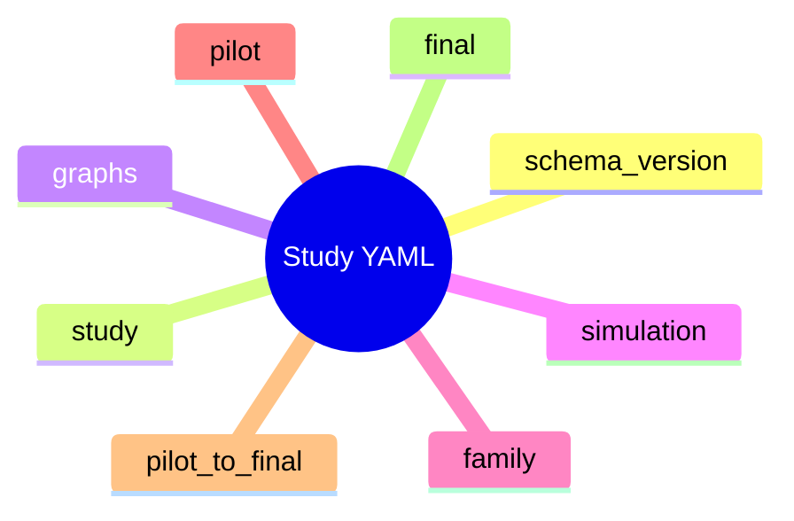

- `schema_version` and `study`: definition identity and revision information.
- `graphs` and `simulation`: scenarios, strategy configurations, and evidence-trial controls.
- `family`: declared comparisons and correction settings.
- `pilot`, `pilot_to_final`, and `final`: sampling, analysis, and the approval boundary.

Sources: `contracts/evaluation/study/v1/valid/study-small.yaml`, `src/priv/evaluation/study/v1/schemas/definition.schema.json`, and `.pi/tmp/study-model-field-flow.md`.

Fixed literal declarations include Holm, pause, the Pilot runtime selection rule, and the two-sided Final test. Family alpha and Final alpha are required to agree. Equal values in distinct Pilot/Final or scoring/evidence settings do not by themselves establish redundancy.

Introduce adjustments only when a concrete simplification requires them.

### Q4 — Study meaning

**Earlier question:** Does Study mean only the declared plan, or the plan together with its runs and results?

**Answer:** Study is the YAML input, like the current YAML format. Reuse it and tweak it if needed.

**User correction:** Reuse established scenarios, comparisons, strategies, and supporting code. Do not redesign everything or reopen their definitions. Scouts can inspect the existing source to resolve factual questions.

### Q5 — Start boundary

**Proposed question:** Should a Mix task accept a YAML file and start the study, or should the operator first register a revision and then start it separately?

**Status:** Deferred before asking. The user clarified that existing approaches should be reused while their supporting implementation becomes simpler.

Keep the current input approach as the baseline. Revisit this boundary only if implementation evidence gives a concrete reason.

## Method

### Q3 — Method baseline

**Earlier framing:** The assistant incorrectly presented methodology flexibility as an open design choice.

**User correction:** The methodology was established from the start. Selectable methodologies were never part of the requested design.

**Recorded constraint:** Apply `docs/concepts/evaluation-methodology.md`. Study inputs and settings vary within that methodology. This is an original constraint, not a newly selected feature.

Do not reopen this constraint during the interview unless the user requests a method change.

## Implementation map

The user approved this map as the next level of discussion:

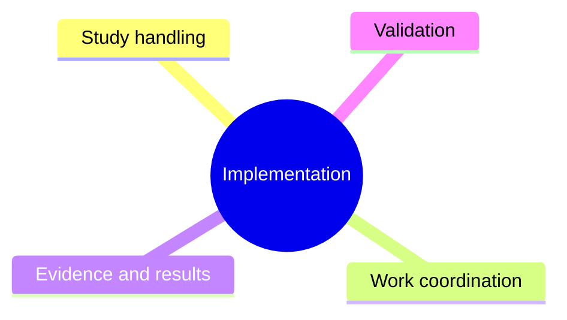

The design question for each branch is: what custom code is necessary, and what can existing libraries provide?

Examine Study handling first. It establishes the trusted definition used by the other branches.

## Study handling

### Q6 — Check ownership

**Proposal:** Validate the study once when the YAML enters the application. Decode trusted stored data on later reads.

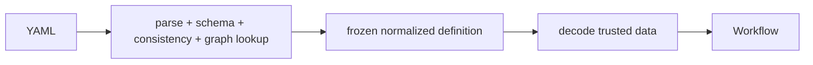

```elixir
# External boundary
def create(yaml) do
  with {:ok, raw} <- Yaml.parse(yaml),
       {:ok, definition} <- Definition.parse(raw),
       :ok <- GraphReferences.check(definition) do
    Revisions.insert(definition)
  end
end

# Internal read
def load(revision_id) do
  revision_id
  |> Revisions.fetch!()
  |> Definition.decode_stored!()
end
```

Keep resource checks in the operation that consumes the resource.

```elixir
WorkPlan.build(definition, selection)
ComputeRequest.encode(evidence, analysis_settings)
```

Do not call the full external `Definition.parse/1` path from Pilot and Final loaders.

## Code shape — first pass

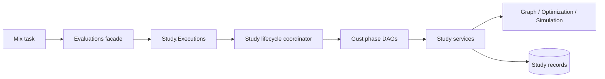

Placeholder module shape. These names describe responsibilities. They do not claim that source modules exist.

```text
NetworkDefense.Evaluation.Study
├── Definition          # Existing YAML contract and normalized definition
├── Revisions           # Create and load frozen definitions
├── Executions          # Lifecycle persistence and status
├── Lifecycle           # Reuse/copy current pure transition table
├── Resume              # Validate and freeze Final selection
├── Cancel              # Apply lifecycle cancellation policy
├── Workflow            # Dispatch and await Gust phase DAGs
├── Collection
│   ├── Plan            # Definition + counts + phase -> work items
│   ├── Execute         # Call optimization and simulation APIs
│   └── Evidence        # Work results -> aligned matrices
├── Pilot
│   ├── Analyze         # Candidate/comparison calculations
│   └── Decide          # Complete-family candidate decision
├── Final
│   ├── Collect         # Sequential tiers and replicas
│   ├── Timing          # One clock owner
│   └── Analyze         # Comparison family + Holm
└── Result              # Final result construction and read
```

Avoid modules whose only job is to copy or recheck another internal shape.

### Public functions

Keep the current study operations as the baseline:

```elixir
Evaluations.create_study_revision(yaml)
Evaluations.start_study(revision_id)
Evaluations.study_status(execution_id)
Evaluations.resume_study(execution_id, selection)
Evaluations.cancel_study(execution_id)
Evaluations.study_result(execution_id)
```

Mix tasks are thin adapters:

```text
mix evaluation.study.create <study.yaml>
mix evaluation.study.start <revision-id>
mix evaluation.study.status <execution-id>
mix evaluation.study.resume <execution-id> <selection>
mix evaluation.study.result <execution-id>
mix evaluation.study.cancel <execution-id>
```

The create/start split remains the current baseline. Revisit it only if it creates unnecessary code in the reduced implementation.

## Workflow

### Pilot approval

**Question:** Should Final collection start automatically after a passing Pilot?

**Answer:** Keep explicit approval. The user selected this option during the initial discussion.

Collection and analysis run automatically within each phase. Every valid Pilot outcome pauses before Final collection.

### Q7 — Study pipeline and Gust phase DAGs

Gust owns each batch. The application lifecycle coordinates the phases and the runtime tier list.

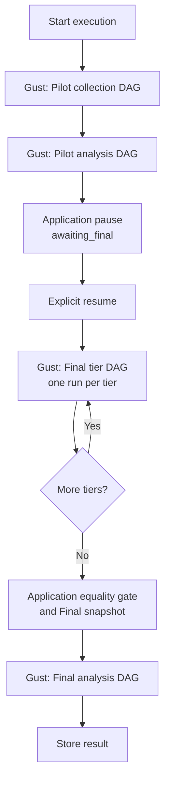

This keeps dynamic tiers sequential without implementing a second batch executor.

Lifecycle events reuse the current pure state machine:

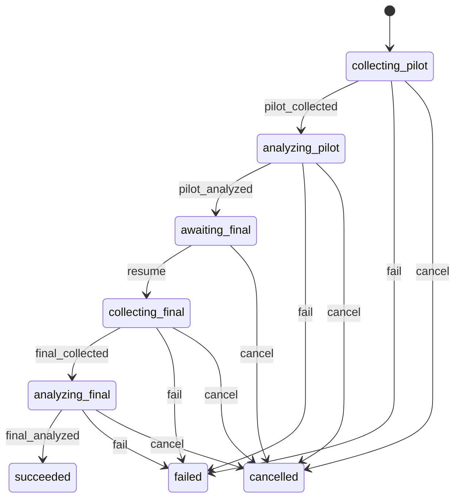

```text
assemble_pilot_snapshot  -> :pilot_collected
accept_pilot_outcome     -> :pilot_analyzed
resume_study             -> :resume
accept_final_snapshot    -> :final_collected
store_result             -> :final_analyzed
task/run failure         -> :fail
cancel_study             -> :cancel
```

#### Pilot collection DAG

```elixir
defmodule PilotCollectionDAG do
  use Gust.DSL

  task_action :prepare_pilot_collection, Placeholder.PreparePilotCollection,
    downstream: [:collect_pilot_item],
    store_result: true

  task_action :collect_pilot_item, Placeholder.CollectPilotItem,
    map_over: :prepare_pilot_collection,
    downstream: [:assemble_pilot_snapshot]

  task_action :assemble_pilot_snapshot, Placeholder.AssemblePilotSnapshot,
    store_result: true
end
```

Gust creates one mapped task per collection item. It runs the batch and retries failed mapped tasks.

#### Pilot analysis DAG

```elixir
defmodule PilotAnalysisDAG do
  use Gust.DSL

  task_action :prepare_pilot_analysis, Placeholder.PreparePilotAnalysis,
    downstream: [:evaluate_pilot_candidate],
    store_result: true

  task_action :evaluate_pilot_candidate, Placeholder.EvaluatePilotCandidate,
    map_over: :prepare_pilot_analysis,
    downstream: [:select_pilot_outcome],
    store_result: true

  task_action :select_pilot_outcome, Placeholder.SelectPilotOutcome,
    store_result: true
end
```

#### Final tier collection DAG

One Gust run collects one tier. The static DAG owns warm-up and the five measured replicas.

```elixir
defmodule FinalTierCollectionDAG do
  use Gust.DSL

  task_action :check_environment_before_warm_up, Placeholder.CheckEnvironment,
    downstream: [:prepare_warm_up]

  task_action :prepare_warm_up, Placeholder.PrepareReplica,
    downstream: [:run_plan_warm_up],
    store_result: true

  task_action :run_plan_warm_up, Placeholder.RunPlan,
    map_over: :prepare_warm_up,
    downstream: [:run_simulation_warm_up]

  task_action :run_simulation_warm_up, Placeholder.RunSimulation,
    map_over: :prepare_warm_up,
    downstream: [:check_environment_before_0]

  measured_replica(0, after: :check_environment_after_0)
  measured_replica(1, after: :check_environment_after_1)
  measured_replica(2, after: :check_environment_after_2)
  measured_replica(3, after: :check_environment_after_3)
  measured_replica(4, after: :check_environment_after_4)

  task_action :complete_final_tier, Placeholder.CompleteFinalTier,
    store_result: true
end
```

Each `measured_replica/2` expands to:

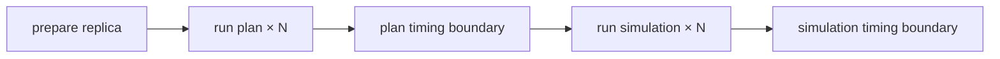

#### Final analysis DAG

```elixir
defmodule FinalAnalysisDAG do
  use Gust.DSL

  task_action :prepare_final_analysis, Placeholder.PrepareFinalAnalysis,
    downstream: [:compare_final_member],
    store_result: true

  task_action :compare_final_member, Placeholder.CompareFinalMember,
    map_over: :prepare_final_analysis,
    downstream: [:correct_final_family],
    store_result: true

  task_action :correct_final_family, Placeholder.CorrectFinalFamily,
    store_result: true
end
```

#### Application sequencing

```elixir
def run_pilot(execution) do
  with {:ok, pilot_snapshot} <- GustPhase.run(:pilot_collection, execution),
       {:ok, pilot_outcome} <- GustPhase.run(:pilot_analysis, execution, pilot_snapshot),
       {:ok, execution} <- State.accept_pilot_outcome(execution, pilot_outcome) do
    {:paused, execution}
  end
end

def run_final(execution) do
  tier_results =
    execution
    |> declared_tiers()
    |> Enum.map(&GustPhase.run(:final_tier_collection, execution, &1))

  with {:ok, final_snapshot, timing} <- FinalCollection.accept(tier_results),
       {:ok, final_result} <- GustPhase.run(:final_analysis, execution, final_snapshot),
       {:ok, result} <- Results.store(execution, final_result, timing) do
    {:completed, result}
  end
end
```

Proposed placeholder files:

```text
src/priv/gust/dags/
├── evaluation_study_pilot_collection.exs
├── evaluation_pilot.exs
├── evaluation_study_final_tier_collection.exs
└── evaluation_final.exs

src/lib/network_defense/evaluation/study/pipeline/
├── lifecycle.ex
├── coordinator.ex
├── runner.ex
├── state.ex
├── pilot_collection.ex
├── pilot_analysis.ex
├── final_collection.ex
├── final_analysis.ex
└── actions/...
```

Reuse the lifecycle and sequencing mechanisms. Simplify the task contracts and repeated validation inside them.

### Data ownership


```text
StudyRevision      normalized definition
StudyExecution     lifecycle, Pilot outcome, frozen selection
Phase/tier record  accepted Gust run and stage output
CollectionItem     retry-safe optimization/simulation links
EvidenceSnapshot   accepted matrices
Gust task results  outputs within one phase run
StudyResult        successful final output
```

### Data between phase DAGs

Application records carry accepted data across Gust runs.

```mermaid
flowchart LR
    PC["Pilot collection run"] -->|snapshot ID| APP1["Application accepts snapshot"]
    APP1 --> PA["Pilot analysis run"]
    PA -->|Pilot outcome| APP2["Application stores outcome and pauses"]
    APP2 --> FC["Final tier runs"]
    FC -->|tier receipts + timing| APP3["Application equality gate and snapshot"]
    APP3 --> FA["Final analysis run"]
    FA -->|corrected family| RESULT["Application stores result"]
```

Do not load task results from an earlier Gust run inside a later run. Pass an accepted application reference instead.

### Phase input/output contracts

Each Gust run has:

```text
one compact root input
one terminal success output
Gust-owned failure state
```

Task results do not store an error union. A failed task or run uses Gust status and its persisted error.

#### Pilot collection

```elixir
defmodule PilotCollectionContract do
  defmodule Input do
    defstruct [:phase_id]
  end

  defmodule Output do
    defstruct [:snapshot_id]
  end
end
```

```elixir
# Gust run params
%{"study_phase_id" => phase_id}

# Terminal task: assemble_pilot_snapshot
%{"snapshot_id" => snapshot_id}
```

Application interface:

```elixir
GustPhase.run(:pilot_collection, %PilotCollectionContract.Input{
  phase_id: phase.id
})
#=> {:ok, %PilotCollectionContract.Output{snapshot_id: snapshot_id}}
```

#### Pilot analysis

```elixir
defmodule PilotAnalysisContract do
  defmodule Input do
    defstruct [:phase_id]
  end

  defmodule Output do
    defstruct [
      :outcome,
      :candidate_id,
      :plan_count_per_side,
      :attacks_per_plan,
      :candidate_summaries
    ]
  end
end
```

```elixir
# Gust run params
%{"study_phase_id" => phase_id}

# Terminal task: select_pilot_outcome
%{
  "outcome" => "recommended" | "insufficient",
  "candidate_id" => candidate_id | nil,
  "plan_count_per_side" => integer | nil,
  "attacks_per_plan" => integer | nil,
  "candidate_summaries" => summaries
}
```

The phase loader obtains the accepted Pilot snapshot through the execution’s Pilot collection phase. The run input does not repeat the snapshot ID.

#### Final tier collection

```elixir
defmodule FinalTierContract do
  defmodule Input do
    defstruct [:phase_run_id]
  end

  defmodule Output do
    defstruct [:tier, :tier_position, :measured_positions]
  end
end
```

```elixir
# Gust run params
%{"study_phase_run_id" => phase_run_id}

# Terminal task: complete_final_tier
%{
  "tier" => tier,
  "tier_position" => tier_position,
  "measured_positions" => [0, 1, 2, 3, 4]
}
```

The phase-run record owns the execution, tier, position, and Gust run ID. Tasks load the frozen selection from `StudyExecution`.

The application runner combines the Gust receipt with coordinator-owned timing:

```elixir
%FinalTierRunResult{
  gust_run_id: gust_run_id,
  receipt: %FinalTierContract.Output{},
  timing: %TierTiming{}
}
```

#### Final collection aggregate

This is an application-stage output, not a separate Gust DAG output.

```elixir
%FinalCollectionOutput{
  snapshot_id: snapshot_id,
  tier_runs: [
    %{
      tier: tier,
      tier_position: tier_position,
      gust_run_id: gust_run_id
    }
  ],
  timing: %TimingSummary{}
}
```

It is created after all tier runs pass the replica equality gate.

#### Final analysis

```elixir
defmodule FinalAnalysisContract do
  defmodule Input do
    defstruct [:phase_id]
  end

  defmodule Output do
    defstruct [:family_result]
  end
end
```

```elixir
# Gust run params
%{"study_phase_id" => phase_id}

# Terminal task: correct_final_family
%{"family_result" => corrected_family}
```

The phase loader obtains the accepted Final snapshot and collection aggregate from the Final collection phase.

#### Generic phase runner

```elixir
def run_phase(dag, input, terminal_task, decode_output) do
  with {:ok, run} <- GustRun.create(dag, Contract.to_params(input)),
       :ok <- GustRun.dispatch(run),
       {:ok, :succeeded} <- GustRun.await(run.id),
       stored <- Gust.Flows.get_task_result_by_name_run!(terminal_task, run.id) do
    {:ok, decode_output.(stored)}
  end
end
```

The real runner also links the run to its phase before dispatch and maps Gust failure to a bounded `StudyError`.

#### Contract rules

```text
root input       phase or phase-run ID
mapped input     item ID or declared position
terminal output  one typed success value
failure output   none; use Gust failure state
large evidence   EvidenceSnapshot, referenced by ID
lifecycle data   StudyExecution and phase records
```

Do not add a schema version to every internal task map. Keep versioning on durable public or evidence contracts that need it.

Phase acceptance checks the expected lifecycle state and decodes the terminal result. The task that creates the result owns its scientific checks.

### Data inside one phase DAG

`map_over` receives compact work identity.

```elixir
# Pilot or Final collection prepare result
[
  %{collection_item_id: item_id}
]

# Pilot analysis prepare result
[
  %{
    candidate_position: candidate_position,
    comparison_position: comparison_position
  }
]

# Final analysis prepare result
[
  %{comparison_position: comparison_position}
]
```

Mapped tasks store only outputs needed by the same run’s fan-in task.

```elixir
# Pilot candidate assessment
%{
  candidate_position: candidate_position,
  comparison_position: comparison_position,
  guarded_half_width: half_width,
  informative: informative,
  passes: passes
}

# Final comparison result
%{
  comparison_position: comparison_position,
  statistics: statistics
}
```

### Gust fan-in

```elixir
def mapped_results!(run_id, task_name) do
  task_name
  |> Gust.Flows.get_tasks_by_name(run_id)
  |> Enum.map(& &1.result)
end
```

```elixir
def select_pilot_outcome(run_id, definition) do
  run_id
  |> mapped_results!(:evaluate_pilot_candidate)
  |> Enum.map(&PilotAssessment.decode_stored!/1)
  |> Pilot.Decide.run(definition.pilot)
end
```

The fan-in task owns family completeness and ordering checks.

### Lifecycle acceptance

The application accepts a completed phase result under the existing state lock.

```elixir
def accept_pilot_analysis(execution_id, run_id) do
  outcome = GustResult.fetch!(run_id, :select_pilot_outcome)

  State.transaction(execution_id, :analyzing_pilot, fn execution ->
    execution
    |> Executions.put_pilot_outcome(outcome)
    |> State.transition!(:pilot_analyzed)
  end)
end
```

Late completion cannot advance a cancelled or failed execution.

### Error interface

```text
ordinary task exception  Gust retries the task
Gust.DAG.NonRecError     Gust fails the task immediately
failed phase run         application applies lifecycle :fail
bounded StudyError       public status and terminal reporting
```

## Phase task interfaces

### Pilot collection


#### Collection item shape

Prepare the immutable work once. Later tasks use the stored work instead of rebuilding it from the complete definition.

```elixir
%CollectionItem{
  id: item_id,
  phase_id: phase_id,
  replica_position: 0,
  item_position: item_position,
  work: %WorkItem{},
  optimization_run_id: optimization_run_id | nil,
  experiment_id: experiment_id | nil
}
```

`work` is application-written and immutable.

#### `prepare_pilot_collection`

```elixir
@spec run(phase_id()) :: [map()]

def run(phase_id) do
  phase = Phases.fetch!(phase_id)
  execution = Executions.fetch!(phase.execution_id)
  definition = Revisions.load!(execution.study_revision_id)

  definition
  |> Collection.Plan.pilot()
  |> Collection.Limits.check_phase!()
  |> CollectionItems.create_or_load(phase.id)
  |> Enum.map(&%{"collection_item_id" => &1.id})
end
```

Owns:

```text
Pilot work planning
phase work-count limit
stable item positions
immutable stored WorkItem
```

Does not run optimization or simulation.

#### `collect_pilot_item`

```elixir
@spec run(collection_item_id()) :: :ok

def run(item_id) do
  item = CollectionItems.fetch!(item_id)

  optimization =
    item
    |> ItemEffects.reserve_optimization()
    |> Optimizations.run_reserved!()

  item
  |> ItemEffects.reserve_experiment(optimization)
  |> Simulations.run!()

  :ok
end
```

Gust interface:

```elixir
task_action :collect_pilot_item, Placeholder.CollectPilotItem,
  map_over: :prepare_pilot_collection,
  downstream: [:assemble_pilot_snapshot]
```

The task stores no result. Success means the linked domain records completed. Gust owns retry. Reservation reuses existing links.

#### `assemble_pilot_snapshot`

Build valid evidence directly. Do not build it and then run a second validation pipeline.

```elixir
@spec run(run_id(), phase_id()) :: PilotCollectionContract.Output.t()

def run(run_id, phase_id) do
  phase = Phases.fetch!(phase_id)
  execution = Executions.fetch!(phase.execution_id)
  definition = Revisions.load!(execution.study_revision_id)

  item_ids =
    GustResult.fetch!(run_id, :prepare_pilot_collection)
    |> CollectionItemRefs.decode!()

  items = CollectionItems.fetch_many!(item_ids)
  evidence = Evidence.build_pilot!(definition, items)

  snapshot =
    EvidenceSnapshots.create_or_load(
      phase.id,
      :pilot,
      evidence
    )

  %PilotCollectionContract.Output{snapshot_id: snapshot.id}
end
```

`Evidence.build_pilot!/2` constructs:

```text
comparisons in declared order
rows from stored WorkItem positions
one attack-column list shared by both sides
exact Pilot row and column counts from the plan
```

Separate checks are unnecessary because:

```text
complete family         created by Collection.Plan.pilot/1
exact item set          item IDs come from the prepare task
completed work          Gust starts assembly after mapped tasks succeed
shared attack columns   builder creates one column list for both matrices
Pilot capacity          planner creates the declared dimensions
```

Keep only:

```text
missing referenced record -> fail while loading
malformed external result -> fail at its boundary decoder
snapshot retry            -> create_or_load returns the same snapshot
```

#### Gust boundary adapters

```elixir
def prepare_from_run(run_id) do
  run_id
  |> PhaseContext.phase_id!()
  |> PreparePilotCollection.run()
end

def collect_from_map(%{"collection_item_id" => item_id}) do
  CollectPilotItem.run(item_id)
end

def assemble_from_run(run_id) do
  phase_id = PhaseContext.phase_id!(run_id)

  run_id
  |> AssemblePilotSnapshot.run(phase_id)
  |> PilotCollectionContract.to_params()
end
```

#### Acceptance

```elixir
def accept_pilot_collection(execution_id, run_id) do
  output = GustResult.fetch!(run_id, :assemble_pilot_snapshot)
  snapshot_id = PilotCollectionContract.decode_output!(output).snapshot_id

  State.transaction(execution_id, :collecting_pilot, fn execution ->
    execution
    |> Phases.accept_snapshot!(:pilot_collection, run_id, snapshot_id)
    |> State.transition!(:pilot_collected)
  end)
end
```

Acceptance checks lifecycle ownership. Snapshot scientific checks remain owned by assembly.

### Pilot analysis tasks

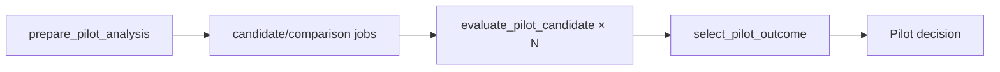

#### Job shape

```elixir
%PilotJob{
  candidate_position: candidate_position,
  comparison_position: comparison_position,
  stream_seed: stream_seed
}
```

The job carries positions and the derived analysis stream. It does not repeat study, family, snapshot, identity, candidate, or analysis settings.

#### `prepare_pilot_analysis`

```elixir
@spec run(phase_id()) :: [map()]

def run(phase_id) do
  phase = Phases.fetch!(phase_id)
  execution = Executions.fetch!(phase.execution_id)
  definition = Revisions.load!(execution.study_revision_id)

  for {_candidate, candidate_position} <-
        Enum.with_index(definition.pilot.candidates),
      {comparison, comparison_position} <-
        Enum.with_index(definition.family.comparisons) do
    %PilotJob{
      candidate_position: candidate_position,
      comparison_position: comparison_position,
      stream_seed:
        PilotSeeds.comparison_stream_seed(
          definition,
          comparison,
          comparison_position
        )
    }
    |> PilotJob.to_params()
  end
end
```

Candidate eligibility is already owned by study creation:

```text
candidate counts <= Pilot collection capacity
Pilot snapshot == declared collection capacity
```

The prepare task does not recheck capacity.

#### Compute request

The Python request contains only numerical inputs:

```elixir
%PilotComputeRequest{
  alternative: alternative_matrix,
  reference: reference_matrix,
  plan_count: candidate.plan_count_per_side,
  attacks_per_plan: candidate.attacks_per_plan,
  outer_subsamples: settings.outer_subsamples,
  stream_seed: job.stream_seed,
  guard_quantile: settings.guard_quantile,
  confidence_level: settings.confidence_level,
  bootstrap_replicates: settings.bootstrap_replicates
}
```

Do not send these values to Python:

```text
study revision ID
family ID
snapshot ID
candidate ID
comparison identity
selection rule
target half-width
```

They are application-owned metadata or decision policy.

The compute service combines `stream_seed`, `plan_count`, and `attacks_per_plan` in its deterministic seed sequence.

Python response:

```elixir
%PilotComputeResponse{
  guarded_half_width: guarded_half_width,
  informative: informative
}
```

#### `evaluate_pilot_candidate`

```elixir
@spec run(phase_id(), PilotJob.t()) :: CandidateAssessment.t()

def run(phase_id, job) do
  {definition, snapshot} = PilotAnalysis.load_inputs!(phase_id)
  candidate = Enum.fetch!(definition.pilot.candidates, job.candidate_position)
  evidence = Evidence.comparison!(snapshot, job.comparison_position)
  settings = definition.pilot.analysis

  response =
    evidence
    |> PilotComputeRequest.build(candidate, settings, job.stream_seed)
    |> EvaluationCompute.evaluate_pilot_candidate!()

  %CandidateAssessment{
    candidate_position: job.candidate_position,
    comparison_position: job.comparison_position,
    guarded_half_width: response.guarded_half_width,
    informative: response.informative,
    passes:
      response.informative and
        response.guarded_half_width <= settings.target_half_width
  }
end
```

The Python request boundary checks strict types, rectangular matrices, equal attack-column counts, eligible sample counts, and resource limits. The response boundary checks `guarded_half_width` and `informative` once. There is no echoed metadata to compare.

#### Mapped result

```elixir
%{
  "candidate_position" => candidate_position,
  "comparison_position" => comparison_position,
  "guarded_half_width" => guarded_half_width,
  "informative" => informative,
  "passes" => passes
}
```

#### `select_pilot_outcome`

```elixir
@spec run(run_id(), phase_id()) :: PilotAnalysisContract.Output.t()

def run(run_id, phase_id) do
  {definition, pilot_snapshot} = PilotAnalysis.load_inputs!(phase_id)

  assessments =
    Gust.Flows.get_tasks_by_name(:evaluate_pilot_candidate, run_id)
    |> Enum.map(&CandidateAssessment.decode_stored!(&1.result))

  summaries =
    Pilot.Decide.summarize(
      assessments,
      definition.pilot.candidates,
      definition.family.comparisons,
      pilot_snapshot.runtime_evidence
    )

  Pilot.Decide.select(summaries, definition.pilot.analysis.selection_rule)
end
```

Gust creates one mapped task per prepare item and starts fan-in only after all mapped tasks succeed. The selector does not compare preparation output with a separately rebuilt job list.

#### Candidate summary

```elixir
%CandidateSummary{
  candidate_position: candidate_position,
  candidate_id: candidate_id,
  plan_count_per_side: plan_count,
  attacks_per_plan: attacks,
  worst_guarded_half_width: worst_half_width,
  all_comparisons_informative: informative,
  non_informative_comparison_positions: positions,
  all_comparisons_passed: passed,
  predicted_runtime_ms: predicted_runtime
}
```

Runtime follows the methodology definition:

```elixir
predicted_runtime =
  tier_count *
    largest_strategy_group_count_in_one_tier *
    plan_count *
    (median_plan_selection_ms + attacks_per_plan * median_attack_trial_ms)
```

This resolves the documented group-count discrepancy in favor of the methodology.

#### Selection

```elixir
passing = Enum.filter(summaries, & &1.all_comparisons_passed)

case Enum.min_by(passing, &Pilot.Decide.selection_key/1, fn -> nil end) do
  nil ->
    %PilotAnalysisContract.Output{
      outcome: :insufficient,
      candidate_id: nil,
      candidate_summaries: summaries
    }

  summary ->
    %PilotAnalysisContract.Output{
      outcome: :recommended,
      candidate_id: summary.candidate_id,
      plan_count_per_side: summary.plan_count_per_side,
      attacks_per_plan: summary.attacks_per_plan,
      candidate_summaries: summaries
    }
end
```

Tie-break key:

```elixir
{
  summary.predicted_runtime_ms,
  -summary.plan_count_per_side,
  summary.attacks_per_plan,
  summary.candidate_position
}
```

#### Application acceptance and pause

```elixir
def accept_pilot_analysis(execution_id, run_id) do
  output =
    run_id
    |> GustResult.fetch!(:select_pilot_outcome)
    |> PilotAnalysisContract.decode_output!()

  State.transaction(execution_id, :analyzing_pilot, fn execution ->
    execution
    |> Executions.put_pilot_outcome(PilotOutcome.compact(output))
    |> Phases.accept_result!(:pilot_analysis, run_id)
    |> State.transition!(:pilot_analyzed)
  end)
end
```

The complete candidate summaries stay in the terminal Gust result. `StudyExecution` stores only the compact outcome required for status and resume.

## Persistence shape — placeholders

Keep the current lifecycle, phase-run ownership, and selection fields until the phase contracts show that a field is unnecessary.

```elixir
%StudyExecution{
  id: execution_id,
  study_revision_id: revision_id,
  state: :collecting_pilot | :analyzing_pilot | :awaiting_final |
         :collecting_final | :analyzing_final | :succeeded |
         :failed | :cancelled,
  pilot_outcome: pilot_outcome | nil,
  selected_candidate_id: candidate_id | nil,
  selected_plan_count_per_side: integer | nil,
  selected_attacks_per_plan: integer | nil,
  pilot_override: boolean | nil,
  error: error | nil
}
```

Initial data-owner placeholders:

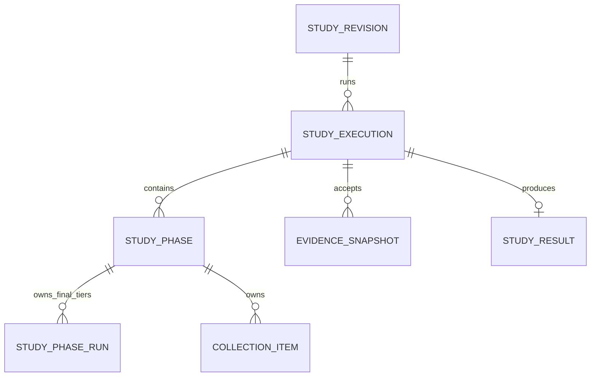

```text
StudyRevision     normalized YAML definition
StudyExecution    lifecycle, Pilot outcome, frozen selection
StudyPhase        accepted phase Gust run and phase output
StudyPhaseRun     ordered Final tier Gust runs
CollectionItem    immutable planned work and stable optimization/simulation links
EvidenceSnapshot  accepted Pilot or Final matrices
StudyResult       successful compact result
```

The phase records now have a clear owner: they connect the application lifecycle to separate Gust phase runs. Simplify their fields and checks later. The Final handoff remains undecided.

## Data

### Q9 — Evidence handling

**Proposal:** One accepted evidence shape for Pilot and one for Final.

```elixir
%Evidence{
  role: :pilot | :final,
  family_id: family_id,
  comparisons: [
    %ComparisonEvidence{
      identity: identity,
      attack_seeds: seeds,
      alternative: matrix,
      reference: matrix
    }
  ]
}
```

Assembly constructs the evidence from the validated definition and immutable planned work:

```elixir
def assemble(item_ids, definition, role) do
  item_ids
  |> CollectionItems.fetch_many!()
  |> Evidence.build!(definition, role)
  |> EvidenceSnapshots.create_or_load(role)
end
```

The builder iterates the declared family, creates one shared column list, and fills the two matrices at their declared positions. It does not need separate family, alignment, or matrix-size check passes.

Later code uses the accepted snapshot:

```elixir
snapshot = EvidenceSnapshots.fetch!(snapshot_id)
Pilot.Analyze.run(snapshot, definition.pilot)
Final.Analyze.run(snapshot, definition.final)
```

Do not rebuild optimization and simulation history during analysis or result read-back.

## Core service shape

### Collection

```elixir
Collection.Plan.pilot(definition)
#=> [%WorkItem{}]

Collection.Plan.final(definition, selection, tier, replica_position)
#=> [%WorkItem{}]

Collection.Execute.run(collection_item_id)
#=> {:ok, collection_item_id}

Collection.Evidence.assemble(execution_id, role, replica_position)
#=> {:ok, %EvidenceSnapshot{}}
```

Retry-safe effect ownership stays in the stable collection item:

```elixir
def run(item_id) do
  item = CollectionItems.lock!(item_id)
  optimization = CollectionItems.reserve_optimization(item)
  Optimizations.run_reserved(optimization)
  experiment = CollectionItems.reserve_experiment(item, optimization)
  Simulations.run(experiment)
  CollectionItems.complete(item)
end
```

### Pilot

```elixir
Pilot.Analyze.prepare(snapshot, definition)
#=> [%CandidateComparison{}]

Pilot.Analyze.run(candidate_comparison)
#=> %CandidateAssessment{
#     guarded_half_width: number,
#     informative: boolean,
#     passes: boolean
#   }

Pilot.Decide.run(assessments, definition.pilot)
#=> %PilotDecision{
#     outcome: :recommended | :insufficient,
#     recommendation: candidate | nil
#   }
```

Pilot methodology decisions remain mandatory.

```text
Candidate eligibility
  candidate counts fit the collected Pilot matrices

Comparison feasibility
  every outer subsample is informative

Comparison precision
  guarded half-width <= target half-width

Candidate pass
  every declared comparison is feasible and precise

Pilot outcome
  select the passing candidate by the runtime rule
  or return :insufficient when no candidate passes
```

These are observed scientific decisions. Construction cannot guarantee them.

### Approval

Reuse the current application pause and selection-freeze mechanism. Final collection starts as a new coordinated phase after the transaction commits.

```elixir
def resume_study(execution_id, requested_selection) do
  with {:ok, execution} <- Resume.accept(execution_id, requested_selection),
       :ok <- Coordinator.start(execution.id) do
    {:ok, execution}
  end
end
```

`Resume.accept/2` validates the Pilot outcome, freezes the declared candidate, and applies lifecycle event `:resume`. Final tier runs load this selection from `StudyExecution`.

### Final collection

The application runs tiers sequentially. Gust runs each tier’s item batches.

```elixir
def run(execution) do
  execution
  |> declared_tiers()
  |> Enum.with_index()
  |> Enum.map(fn {tier, tier_position} ->
    run_tier(execution, tier, tier_position)
  end)
  |> accept_final_collection(execution)
end
```

#### One tier run

```elixir
def run_tier(execution, tier, tier_position) do
  phase_run = TierRuns.create_or_load(execution.id, tier, tier_position)

  GustPhase.run(:final_tier_collection,
    execution_id: execution.id,
    phase_run_id: phase_run.id,
    tier: tier,
    tier_position: tier_position
  )
end
```

#### Gust owns each batch

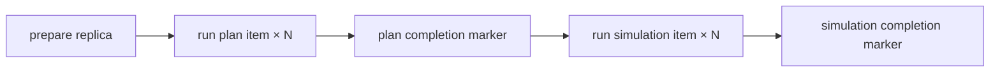

```elixir
task_action :prepare_0, Placeholder.PrepareReplica,
  downstream: [:mark_plan_dispatch_0],
  store_result: true

task_action :run_plan_0, Placeholder.RunPlanItem,
  map_over: :prepare_0,
  downstream: [:mark_plan_completion_0]

task_action :run_simulation_0, Placeholder.RunSimulationItem,
  map_over: :prepare_0,
  downstream: [:mark_simulation_completion_0]
```

No custom `Task.Supervisor`, batch executor, or retry loop is required.

#### One mapped item

```elixir
def run_plan_item(collection_item_id) do
  ConcurrencyGate.run(fn ->
    item = CollectionItems.fetch!(collection_item_id)
    request = WorkItems.optimization_request(item)
    run = ItemEffects.reserve_optimization(item, request)
    Optimizations.run_reserved(run.id)
  end)
end

def run_simulation_item(collection_item_id) do
  ConcurrencyGate.run(fn ->
    item = CollectionItems.fetch!(collection_item_id)
    optimization = ItemEffects.completed_optimization!(item)
    request = WorkItems.simulation_request(item, optimization)
    experiment = ItemEffects.reserve_experiment(item, request)
    Simulations.run(experiment.id)
  end)
end
```

Gust retries temporary mapped-task failures. `Gust.DAG.NonRecError` stops retry for permanent failures. Stable collection-item links prevent new optimization or experiment records on retry.

#### Timing owner

Reuse the current coordinator-owned recorder. The coordinator awaits the tier run and receives timing markers from the static DAG.

```elixir
{:ok, tier_result, timing} =
  TierAwaiter.await(gust_run_id,
    recorder: TimingRecorder.new(tier, tier_position)
  )
```

Timing boundaries surround Gust’s mapped batches. Queue time and Gust retry delay remain in the measured interval.

#### Final acceptance

```elixir
def accept_final_collection(tier_results, execution) do
  timing = Timing.summarize(tier_results)
  by_replica = FinalReplicas.complete_family_summaries(tier_results)

  FinalReplicas.require_equal!(by_replica)

  snapshot =
    Evidence.assemble_final(
      execution.id,
      replica_position: 0
    )

  {:ok, snapshot, timing}
end
```

Do not compare timing values or run IDs in the replica equality gate.

#### Retry ownership

```text
mapped plan/simulation retry  Gust
retry-safe effect identity    CollectionItem + reservation
batch completion/fan-in       Gust
sequential tier order         application lifecycle
single timing clock           application coordinator
failed tier                   fail Final collection; no replacement replica
```

### Final analysis and result

```elixir
Final.Analyze.prepare(snapshot, definition)
#=> [%FinalComparison{}]

Final.Analyze.run(final_comparison)
#=> %ComparisonStatistics{}

Final.Analyze.correct(statistics, definition.family)
#=> %CorrectedFamily{}

Result.store(execution_id, pilot_decision, selection, family, timing)
#=> {:ok, %StudyResult{}}
```

## Reuse

### Reuse boundary

**Question:** Which old code should survive?

**Proposed answer:** Retain the established algorithms and domain operations. Extract useful transformations from their lifecycle wrappers.

| Reuse | Simplify around it |
| --- | --- |
| YAML parser, schema, and scientific definition checks | Repeated full validation on stored-definition loads |
| Graph, optimization, and simulation APIs | Phase-specific request wrappers and repeated canonical-work reconstruction |
| Sampling, seed derivation, bootstrap, and Holm calculations | Study metadata carried through pure numerical operations |
| Matrix assembly and required replica comparison | Duplicate evidence/history checks at later stages |
| Stable domain effect links | Phase/run/receipt representations that only mirror workflow progress |

Use the proposed module and evidence shapes above as the current working model.

## Behavior cases

### Q10 — Check policy

No automated-test design for now. Keep behavior cases as implementation requirements.

#### Construction rule

```text
IF the application fully controls how a fact is created,
THEN construct the fact correctly and do not check it again later.

IF a fact depends on observed evidence, an external boundary, resource use,
or concurrent lifecycle state,
THEN keep one check or calculation at the owning boundary.
```

```text
Constructed facts
  declared comparison order
  shared attack-column identity
  planned matrix dimensions
  mapped item identity

Necessary checks or calculations
  YAML and compute boundary decoding
  candidate fits available Pilot evidence
  Pilot informativeness and precision
  Final environment stability
  Final replica equality
  valid resume selection
  lifecycle state during acceptance
  resource limits at use
```

```text
EVAL-INPUT-01
WHEN study YAML fails the creation contract,
THE application SHALL reject it before collection.

EVAL-APPROVAL-01
WHEN approval selects an invalid candidate,
THE study SHALL remain waiting.

EVAL-RETRY-01
WHEN collection retries the same work item,
THE collection SHALL reuse its domain effect links.

EVAL-PILOT-01
WHEN a Pilot candidate exceeds the available evidence,
THE Pilot SHALL reject that candidate as ineligible.

EVAL-PILOT-02
WHEN any outer subsample is non-informative,
THE candidate/comparison assessment SHALL be non-passing.

EVAL-PILOT-03
WHEN no candidate passes every declared comparison,
THE Pilot SHALL return :insufficient.

EVAL-EVIDENCE-01
WHEN evidence is assembled,
THE builder SHALL use the declared family order and one shared attack-column list for both sides.

EVAL-FINAL-01
WHEN measured Final replicas disagree,
THE application SHALL reject Final evidence.
```

Automation of these cases is deferred.

## Documentation follow-up

**Open:** Review whether the evaluation documentation needs one shared glossary after the module and contract names stabilize.

The glossary could distinguish these terms:

```text
tier                 one of the small, medium, or large network sizes
Pilot candidate       a proposed pair of plan and attack sample counts
seed                  a deterministic random-stream input with a declared role
matrix                plain aligned plan-row and attack-column observations
comparison family     the complete set corrected together
```

Also search existing documentation for older or ambiguous uses of `tier`, `network size`, `scenario`, `candidate`, and `seed`. Update them only after the redesign fixes the final names.
