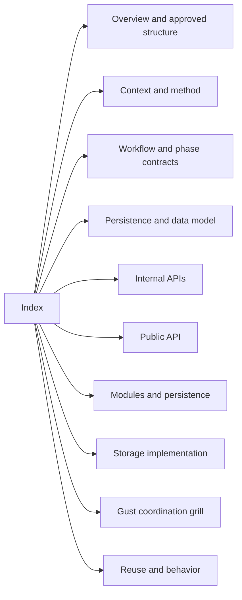
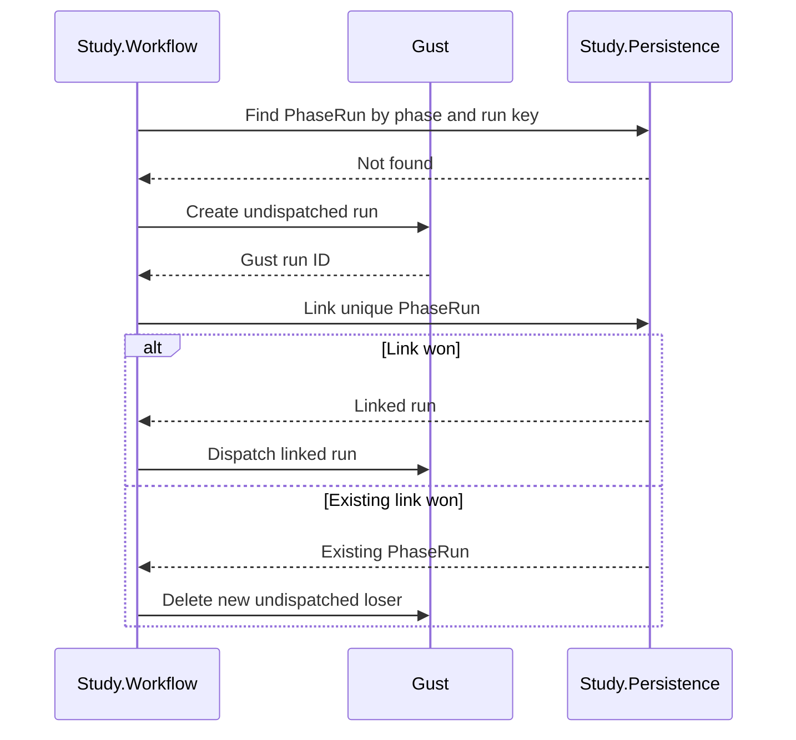

# Evaluation2 creation: redesign index

> Design-interview history. Later decisions supersede earlier proposals within this record.
> Use the [native operator guide](../evaluation2.md), [methodology](../concepts/evaluation-methodology.md) and [stable verification record](../history/evaluation2-verification.md) for current interfaces and status.

## Purpose

This index links the focused documents for the Evaluation2 design. The split keeps the decision history, examples, and diagrams readable without changing their meaning.

## Current status

- Recorded decisions through Q96 are preserved in the linked documents; Q8 was never assigned.
- Q81 selects **create, link, then dispatch** for Gust run provisioning.
- Evaluation2 remains a new subsystem. Legacy Evaluation is only a source of selected proven mechanisms.
- The storage and Persistence implementation passed independent `openai/gpt-6.1-sol` review.
- Gust coordination decisions continue from Q97 in the focused coordination grill.
- Q114 selects the Pilot milestone, with minimal YAML and JSON Schema parsing first. Q115 selects copying and adapting focused legacy mechanisms. Q116 permits unknown keys and drops them during normalization.
- Q118 selects native Elixir analysis with a new deterministic numerical contract. Exact NumPy output compatibility is not required.
- Q119 selects deletion of Python, obsolete JSON schemas, and legacy analysis after the native replacement works and is verified. Q120 retains a minimal Evaluation2 YAML-input schema and `ex_json_schema`.
- Q121–Q125 simplify the format: candidate sizes plus extra pool capacity, one study seed, primary comparisons derived from tier alternatives, and explicit budget lists. Q126 selects Nx and Decimal first.
- Q127–Q129 require new-format-only storage. The complete local development database reset, Gust migrations, and sample-network seeding are verified: five graphs and five revisions. Backward compatibility is not an acceptance goal. Q140 explicitly permits isolated local `network_defense_test`; preserve development for real study validation and perform no additional development reset.
- The latest testing policy supersedes the earlier test exclusion: use behavior-focused unit and integration tests, manual study validation, and independent code/test review, with cases for each concern. Statistical soundness takes priority over reproducing legacy numerical outputs.

## Document map

| Document | Contents |
|---|---|
| [Overview and approved structure](evaluation2-redesign-overview.md) | Status history, decision tree, ownership diagrams, and approved structures |
| [Context and method](evaluation2-redesign-context.md) | Purpose, study meaning, method, implementation map, and first code shape |
| [Workflow and phase contracts](evaluation2-redesign-workflow.md) | Gust phase DAGs, task contracts, collection flow, and phase interfaces |
| [Persistence and data model](evaluation2-redesign-data-model.md) | Persistence placeholders, data ownership, and Q9–Q31 |
| [Internal APIs](evaluation2-redesign-internal-apis.md) | Collection, evidence, phase-contract, and facade boundaries in Q32–Q42 |
| [Public API](evaluation2-redesign-public-api.md) | Supported Study facade and public values in Q43–Q57 |
| [Modules and persistence](evaluation2-redesign-persistence.md) | Module organization, Spectral, transactions, Gust provisioning, and context reads in Q58–Q89 |
| [Storage implementation](evaluation2-redesign-storage-implementation.md) | Approved physical schema, Persistence API, review fixes, evidence reads, lifecycle acceptance proof, migration sequence, and DeepSeek stages in Q90–Q96 |
| [Gust coordination grill](grilling-evaluation2-gust-coordination.md) | Open implementation decisions for invocation, sequencing, recovery, cancellation, and Mix-task operation from Q97 |
| [Reuse and behavior](evaluation2-redesign-behavior.md) | Selective legacy reuse, behavior cases, check policy, and documentation follow-up |
| [Full-refactor sketches](evaluation2-refactor-sketches.md) | Working YAML/schema, typed model, interfaces, workflow, and single-batch delivery specification |
| [Behavior and statistical test plan](evaluation2-test-plan.md) | Concern-based unit/integration cases, manual study validation, calibration, and test-review requirements |
| [Statistical validation](evaluation2-statistical-validation.md) | Selected matching-based inference, conditional proof audit, baseline defects, and numerical contract |
| [Prespecified statistical checks](evaluation2-statistical-checks.md) | Planned controlled models, error/coverage flags, family/precision experiments, and reporting |
| [Consolidated refactor scope](evaluation2-full-refactor-brief.md) | Complete end state and constraints; latest delivery uses goal batches |
| [Native verification record](../history/evaluation2-verification.md) | Stable implementation evidence, failures and limits; independent of temporary execution files |

## Working rules

1. Continue the design top-down. Explain the current code, consequences, examples, and recommendation before each decision question.
2. Include a relevant diagram, brief code example, or public-interface sketch in grilling explanations. Keep examples focused; do not include full implementations. Use Mermaid for workflow, transaction, ownership, and recovery boundaries when it improves clarity.
3. Mark recommendations as proposals until the user selects them.
4. Use `deepseek/deepseek-flash` when the user requests DeepSeek delegation. Keep delegated implementation scopes narrow.
5. Use a blend of behavior-focused unit tests, integration tests, manual end-to-end study validation, and code/test reviews. Map each concern to named cases and observable outcomes. Tests must protect behavior rather than private implementation details; avoid duplicate layers and test-only production frameworks.
6. Keep permanent regression tests in the existing test structure. Scratch probes remain outside the repository; remove them after execution and record commands/results. Review statistical validity through assumptions, independent expectations, and reproducible calibration rather than exact legacy-output matching.
7. Preserve one Elixir module per source file.
8. Do not commit unless the user explicitly requests a commit.
9. Review the complete implementation batch with `openai/gpt-6.1-sol`. The reviewer is read-only and checks code and test implementation against the agreed design, test plan, statistical method, and prototype scope. Internal corrections stay with the single implementation owner.

## Latest provisioning decision

Only a linked Gust run is dispatched. A crash before linking can leave an inert `:created` Gust row. Manual reconciliation removes old unlinked rows. Evaluation2 does not add PhaseRun provisioning state and does not fork Gust.
