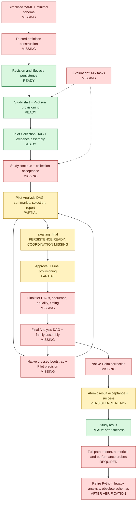

# Evaluation2 Gust coordination grill

> Design-interview and delivery history. Current interfaces and verified status are in the [operator guide](../evaluation2.md), [architecture](../architecture/evaluation-architecture.md) and [stable verification record](../history/evaluation2-verification.md).

> Part of the [Evaluation2 redesign index](grilling-evaluation-redesign.md).
> This document stress-tests cross-phase Gust coordination after Persistence approval through Q96.

```text
Evaluation2 Gust coordination
├─ Invocation
│  ├─ Q97 Blocking owner: Study facade [#q97--blocking-owner]
│  ├─ Q98 Return timing: add Study.continue/1 [#q98--study-return-timing]
│  ├─ Q99 Continue boundary: operator or terminal [#q99--continue-stopping-boundary]
│  └─ Q100 Wait timeout: optional [#q100--wait-timeout]
├─ Definition
│  ├─ Q116 Unknown keys: ignore and drop [#q116--unknown-definition-keys]
│  ├─ Q117 Cross-field checks: revisit representation [#q117--minimal-cross-field-checks]
│  ├─ Q121 Input compatibility: simplify format [#q121--definition-input-compatibility]
│  ├─ Q122 Pilot pool: candidates plus extra [#q122--pilot-pool-construction]
│  ├─ Q123 Seed input: one study seed [#q123--seed-input-construction]
│  ├─ Q124 Comparison family: derive from tier alternatives [#q124--comparison-family-construction]
│  ├─ Q125 Budget declaration: explicit budget list [#q125--budget-declaration]
│  ├─ Q127 Stored format: new format and reset [#q127--stored-definition-compatibility]
│  ├─ Q128 Reset scope: complete local dev reset [#q128--database-reset-scope]
│  └─ Q129 Follow-up withdrawn: no compatibility [#q129--graph-and-foothold-selection]
├─ Analysis runtime
│  ├─ Q118 Elixir conformance: new deterministic contract [#q118--native-elixir-analysis-conformance]
│  ├─ Q119 Python retirement: delete after replacement works [#q119--python-retirement-scope]
│  ├─ Q120 Schema retirement: keep minimal input schema [#q120--json-schema-retirement-scope]
│  ├─ Q126 Numerical stack: Nx and Decimal first [#q126--native-numerical-stack]
│  └─ Q141 Inference method: matching-based betting [#q141--confirmatory-inference-method]
├─ Phase runs
│  ├─ Q105 DAG ownership: four Evaluation2 DAGs [#q105--evaluation2-dag-ownership]
│  ├─ Provisioning: create-link-dispatch [Q81]
│  ├─ Q110 PhaseRun ID: preallocate UUID [#q110--phase-run-input-identity]
│  ├─ Q112 Dispatch: Gust row lock [#q112--conditional-gust-dispatch]
│  ├─ Q101 Completion wait: RunMonitor GenServer [#q101--completion-wait-mechanism]
│  └─ Q107 Failure mapping: typed errors permanent [#q107--minimal-task-failure-policy]
├─ Sequencing
│  ├─ Q114 First completion slice: Pilot, parser first [#q114--first-completion-slice]
│  ├─ Pilot boundary: accept then launch analysis [Q98–Q99]
│  ├─ Q102 Final run shape: one run per tier [#q102--final-collection-run-shape]
│  ├─ Q103 Final tier cursor: derived [#q103--final-tier-cursor]
│  ├─ Q104 Tier completion: status and typed output [#q104--tier-completion-proof]
│  ├─ Q106 Replica declaration: compile-time macro [#q106--measured-replica-declaration]
│  └─ Analysis launch: after collection acceptance [Q98–Q99]
├─ Recovery
│  ├─ Linked run: dispatch again [Q81]
│  ├─ Q109 Unlinked run: no reconciler [#q109--unlinked-created-runs]
│  └─ Caller restart: re-enter continue from durable state [Q81, Q99, Q103]
├─ Cancellation
│  ├─ Q108 Gust cancellation: commit then stop [#q108--cancellation-order]
│  └─ Late completion: Persistence rejects [Q84–Q96]
├─ Operations
│  ├─ Q130 Approval command: separate command [#q130--operator-approval-command]
│  ├─ Q137 Gust runtime: application starts with command [#q137--gust-runtime-ownership]
│  ├─ Mix tasks: sketched in refactor blueprint
│  └─ Observability: existing logs/status/reports
├─ Strategy controls
│  ├─ Q132 Simulation settings: shared study model [#q132--strategy-simulation-controls]
│  ├─ Q133 Action policy: one study-level set [#q133--allowed-defense-action-policy]
│  └─ Q135 Feasibility: one study-wide policy [#q135--study-feasibility-policy]
├─ Collection shape
│  └─ Q136 Shared reference: one group per replica [#q136--shared-reference-collection]
├─ Provenance
│  └─ Q134 Metadata ownership: minimal captured facts [#q134--provenance-ownership]
├─ Verification
│  ├─ Q138 Tests: behavior-focused blend [#q138--behavior-focused-tests]
│  ├─ Q139 Statistics: sound methodology first [#q139--statistical-acceptance]
│  └─ Q140 Integration database: isolated local test DB [#q140--automated-integration-database]
├─ Delivery
│  ├─ Q131 Original batch: superseded by Q142 [#q131--full-refactor-delivery]
│  ├─ Q142 Goal batches: 3h, workers then owner [#q142--goal-batch-delivery]
│  └─ Q143 Documentation: Goal 05.5 [#q143--documentation-refresh-goal]
├─ Reuse
│  └─ Q115 Legacy boundary: copy and adapt [#q115--legacy-reuse-boundary]
└─ Documentation
   ├─ Q111 ExDoc scope: capability modules [#q111--exdoc-and-mermaid-policy]
   └─ Q113 Tooling: source docs only [#q113--documentation-tooling]
```

## Invocation

### Q97 — Blocking owner

Evaluation2 needs two different behaviors:

1. the supported `Study` API starts or resumes durable work;
2. a Mix task waits until the next operator boundary or terminal state.

The same process does not have to own both behaviors.

#### Option A — Mix task blocks; Study returns after ensure

```text
Study.start(revision)
  → create execution and Pilot Collection phase
  → create/link/dispatch the Pilot Collection Gust run
  → return Status(:collecting_pilot)

Mix task
  → call internal Workflow.await_boundary(execution_id)
  → observe terminal Gust output
  → accept the phase
  → ensure the next phase run
  → stop at :awaiting_final
```

`Study.resume/2` freezes Selection, ensures the first Final tier run, and returns `:collecting_final`. The Mix task continues until `:succeeded`, `:failed`, or `:cancelled`.

If the Mix task exits, the current Gust run continues. A continuation Mix task uses the execution ID and re-enters the same reconciliation loop.

Advantages:

- public Study calls remain short;
- Mix tasks can provide blocking one-command operation;
- no coordinator process or recovery scanner is required;
- recovery uses durable lifecycle and PhaseRun records;
- tests can call one reconciliation step at a time.

Limitation:

- cross-phase progress pauses when no Mix task or other caller runs the reconciliation loop.

#### Option B — Study calls block

```text
Study.start(revision)
  → run all Pilot phase coordination
  → return only at :awaiting_final

Study.resume(execution_id, intent)
  → run all Final coordination
  → return only at a terminal state
```

Advantages:

- the supported API directly represents the complete operator command;
- a Mix task only calls Study.

Limitations:

- API calls can run for a long time;
- a caller exit needs a separate recovery entry despite the blocking API;
- short status-oriented API operations become mixed with long coordination.

#### Option C — Background coordinator

```text
Study.start(revision)
  → create execution
  → start or notify a supervised coordinator
  → return immediately
```

The coordinator observes Gust completion and advances the study without a waiting caller.

Advantages:

- studies progress without an attached Mix task;
- public calls return quickly.

Limitations:

- requires a supervisor, wake-up protocol, restart scanning, duplicate-process control, and shutdown behavior;
- adds a second durable-work recovery problem beside Gust;
- increases the first implementation and verification scope.

**Recommendation:** Use Option A. Keep `Study.start/1` and `Study.resume/2` short. Put blocking and recovery behavior in Mix-task orchestration over an internal, idempotent `Workflow.await_boundary/1` operation.

**Question:** Which layer should own the blocking coordination loop?

**Answer:** The supported `Study` facade owns coordination because non-Mix callers also need the same behavior. Mix tasks call `Study`; they do not own Evaluation2 lifecycle rules or cross-phase recovery logic. The return timing remains open in Q98.

### Q98 — Study return timing

Study can own coordination in three ways.

#### Option A — Blocking start and resume

```elixir
Study.start(revision)
# returns at :awaiting_final

Study.resume(execution_id, intent)
# returns at :succeeded, :failed, or :cancelled
```

This preserves the current seven-operation public facade. Calls can run for a long time. A caller exit still needs recovery by execution ID.

#### Option B — Add a public continuation operation

```elixir
Study.start(revision)
# returns :collecting_pilot after the first run is ensured

Study.continue(execution_id)
# blocks until the next operator boundary or terminal state

Study.resume(execution_id, intent)
# returns :collecting_final after the first Final run is ensured
```

Study still owns the loop. Mix, web, and worker callers use the same public operation. This adds one supported facade function but keeps start and resume short.

#### Option C — Background coordination

```elixir
Study.start(revision)
# starts or wakes a supervised coordinator and returns
```

Study owns orchestration through a background process. This requires restart scans, duplicate-process control, and multi-node ownership.

**Recommendation:** Use Option B. Add one explicit `Study.continue/1` operation. It gives every caller the same durable recovery path without adding a coordinator process or making start and resume long-running.

**Question:** Should Study block in start/resume, add `continue/1`, or coordinate in the background?

**Answer:** Add `Study.continue/1`. `Study.start/1` and `Study.resume/2` ensure the first required Gust run and return the active Status. `Study.continue/1` owns the blocking coordination and recovery loop for all callers.

### Q99 — Continue stopping boundary

`Study.continue/1` can stop at different boundaries.

#### Option A — Next operator or terminal boundary

```text
collecting_pilot
  → Pilot Collection
  → Pilot Analysis
  → stop at awaiting_final

collecting_final
  → small tier
  → medium tier
  → large tier
  → Final Analysis
  → stop at succeeded, failed, or cancelled
```

A call from `awaiting_final` returns the current Status because operator approval is required. A call from a terminal state also returns the current Status.

#### Option B — One Gust phase

Each call processes at most one phase run. Callers must understand Pilot Collection, Pilot Analysis, each Final tier, and Final Analysis.

#### Option C — Terminal state only

A call that starts in Pilot would wait at `awaiting_final`, but it cannot continue without operator intent. This option needs an approval callback or embedded operator policy and conflicts with the explicit approval boundary.

**Recommendation:** Use Option A. Stop at the next operator boundary or terminal state. Keep individual phase runs internal.

**Question:** Where should `Study.continue/1` stop?

**Answer:** Stop at the next operator boundary or terminal state. From Pilot, continue to `:awaiting_final`. From Final, continue to `:succeeded`, `:failed`, or `:cancelled`. A call from an existing boundary returns the current Status. Individual Gust phases remain internal.

### Q100 — Wait timeout

A caller can wait for a boundary indefinitely or stop waiting after a deadline.

#### Option A — Optional caller timeout

```elixir
Study.continue(execution_id)
# waits indefinitely

Study.continue(execution_id, timeout: 30_000)
# waits for at most 30 seconds
```

If the timeout expires, return the current Status. The study remains active. Timeout does not fail or cancel the study.

#### Option B — Always wait indefinitely

Keep only `continue/1`. A caller that needs a deadline must run the call in its own Task and stop waiting externally.

#### Option C — Fixed application timeout

Use one configured timeout for all callers. This is simple but does not fit both CLI and web callers well.

**Recommendation:** Use Option A. Keep `continue/1` as the indefinite form and add `continue/2` options for bounded callers. Return current Status on timeout.

**Question:** How should callers limit the wait time?

**Answer:** Support both forms. `Study.continue/1` waits indefinitely. `Study.continue/2` accepts `timeout: non_neg_integer()`. When the timeout expires, return the current Status without changing or failing the study.

## Phase runs

### Q101 — Completion wait mechanism

Gust stores run status durably. Evaluation2 needs to detect when the canonical linked run reaches a terminal state.

#### Option A — Poll the Gust run row

```text
read linked run
  → created: dispatch it
  → active: sleep for poll interval
  → succeeded: decode terminal task output
  → failed or cancelled: map failure
```

Use a monotonic deadline for bounded waits. The existing legacy workflow uses this mechanism.

#### Option B — Use Gust notification internals

Subscribe to Gust PostgreSQL notifications or dispatcher internals and wake when a run changes. Gust does not expose a stable public run-completion subscription API. This option couples Evaluation2 to dependency internals.

#### Option C — Do not wait

Make `continue/1` perform one reconciliation step and return. Callers poll Study themselves. This conflicts with Q99, which makes `continue/1` block until a boundary.

**Recommendation:** Use Option A behind an internal implementation-neutral waiter. `Study.continue/1` depends on `Study.Workflow.RunWaiter.await/2`, not on polling directly.

```elixir
defmodule Study.Workflow.RunWaiter do
  @type timeout :: :infinity | non_neg_integer()
  @type terminal_status :: :succeeded | :failed | :cancelled

  @callback await(pos_integer(), timeout()) ::
              {:ok, terminal_status()}
              | :timeout
              | {:error, term()}
end
```

A direct `RunWaiter.Polling` implementation can read the canonical Gust run until terminal status or deadline. A future notifier implementation can subscribe internally, receive a wake-up message, and then re-read the authoritative Gust row.

An alternative is one supervised `Study.Workflow.RunMonitor` GenServer. It stores only active caller wait registrations. It groups callers by Gust run ID, polls each run once, and replies to every waiter when the run becomes terminal or the caller deadline expires.

```text
Study.continue caller
  → RunMonitor.await(run_id, timeout)
  → RunMonitor polls Gust or receives a wake-up message
  → RunMonitor re-reads the authoritative Gust row
  → RunMonitor replies with terminal status or timeout
```

The RunMonitor does not own lifecycle transitions, phase sequencing, run dispatch, or durable state. If it restarts, callers retry `Study.continue/1`; Gust and Persistence retain all authoritative facts. A future notification message is only a wake-up signal.

The GenServer adds waiter registration, timers, caller monitoring, and supervision. It also deduplicates polls and provides a natural message-receive point.

**Recommendation:** Use the singleton RunMonitor GenServer if message-based completion is an intended near-term direction. Keep it as a wait-only service. Do not turn it into a background study coordinator.

**Question:** Should completion waiting use a singleton RunMonitor GenServer or a direct per-caller polling adapter?

**Answer:** Use one supervised `Study.Workflow.RunMonitor` GenServer. It groups waiters by Gust run ID and supports polling now and wake-up messages later. It stores no durable study state and does not coordinate lifecycle transitions or dispatch the next run.

## Sequencing

### Q102 — Final Collection run shape

The current approved model uses one Final Collection StudyPhase and three sequential Gust runs:

```text
Final Collection phase
  → small PhaseRun
  → medium PhaseRun
  → large PhaseRun
```

Each tier run owns one immutable CollectionPlan, its warm-up, five measured replicas, CollectionItems, and tier timing output.

Because the tier set is now fixed, a different design is possible: one combined static Gust DAG with explicit small, medium, and large task groups chained in order.

#### Option A — One Gust run per tier

Study coordinates three runs in `Tier.all/0` order. Each run uses the reusable Final Tier DAG.

Advantages:

- one plan and item set per tier run;
- isolated tier timing and retry scope;
- matches the approved PhaseRun, CollectionPlan, and CollectionItem ownership;
- keeps the Final Tier DAG smaller.

Cost:

- Study must determine and start the next tier after each success.

#### Option B — One combined Final Collection run

One large static DAG chains all three tier task groups.

Advantages:

- Gust owns the full sequential chain;
- Study coordinates one Final Collection run.

Costs:

- changes PhaseRun from tier-keyed to single;
- requires new plan and item ownership for multiple tiers in one run;
- combines three timing outputs and retry scopes;
- replaces several approved persistence decisions.

**Recommendation:** Keep Option A. The coordinator loop is small, while the per-tier persistence and timing boundaries remain clear.

**Question:** Should Final Collection keep one Gust run per tier or use one combined Gust run?

**Answer:** Keep one Gust run per tier. Preserve tier-keyed PhaseRuns, per-tier CollectionPlans and CollectionItems, isolated timing output, and the reusable Final Tier DAG.

### Q103 — Final tier cursor

After a restart, Study must find the next tier in this order:

```text
small → medium → large
```

Example:

```text
small PhaseRun:  succeeded
medium PhaseRun: running
large PhaseRun:  absent
```

#### Option A — Derive progress

Walk `Tier.all/0`. Read each PhaseRun link and its Gust status. Wait for the first active tier, create the first missing tier after all earlier tiers succeeded, or stop on a failed/cancelled tier.

#### Option B — Store a cursor

Persist `current_tier` on StudyPhase or StudyExecution. This duplicates PhaseRun and Gust facts and can disagree with them after a cross-repository crash.

**Recommendation:** Derive progress. Do not add a cursor field.

**Question:** Should Study derive the next Final tier or persist a separate cursor?

**Answer:** Derive progress. Walk `Tier.all/0` in order. A missing run is the next tier only when every earlier tier has a valid succeeded run. An active run is the current tier. A failed or cancelled run stops coordination. All succeeded runs complete Final tier collection. Reject gaps such as a large run existing while medium is absent.

Crash recovery follows the same operation: dispatch a linked created run, await an active run, validate a succeeded run, or ensure the first valid missing run. Concurrent callers converge through Q81's canonical PhaseRun link.

### Q104 — Tier completion proof

A Gust run status of `:succeeded` says that Gust finished the DAG. Evaluation2 also needs the terminal task result that contains the typed Final Tier output and timing source.

#### Option A — Status plus typed terminal output

Treat a tier as complete only when:

1. the canonical linked Gust run has succeeded;
2. the declared terminal task succeeded exactly once;
3. its result decodes through `Final.TierContract`;
4. the output belongs to the expected PhaseRun and tier context.

Illustrative implementation:

```elixir
defp load_final_tier_completion(%PhaseRun{} = phase_run, expected_tier) do
  with :ok <- expect_run_key(phase_run, expected_tier),
       {:ok, gust_run} <- GustAdapter.fetch_run(phase_run.gust_run_id),
       :ok <- expect_status(gust_run, :succeeded),
       {:ok, input} <- Final.TierContract.decode_input(gust_run.params),
       :ok <- expect_phase_run(input.phase_run_id, phase_run.id),
       {:ok, raw_result} <-
         GustAdapter.fetch_unique_task_result(
           gust_run.id,
           :complete_final_tier
         ),
       {:ok, %Final.TierContract.Output{}} <-
         Final.TierContract.decode_output(raw_result) do
    :ok
  end
end
```

The actual contract can keep its internal bang decoder if Workflow catches decoder failures and maps them into one internal workflow error. The terminal result remains the empty typed success value approved in Q25.

Reject all of these cases:

```text
PhaseRun key does not match expected tier
Gust run is not succeeded
run input names another PhaseRun
terminal task is missing
more than one terminal task has the declared name
terminal task did not succeed
terminal result does not decode
```

Tier timing is read from the declared timing task results after this completion check. The empty terminal output does not duplicate timing.

#### Option B — Run status only

Move to the next tier when the run says succeeded. This can hide a missing, malformed, or wrong terminal result.

**Recommendation:** Use Option A. Gust status is necessary but not sufficient. Decode and source-bind the terminal output before moving to the next tier.

**Question:** What should prove that one Final tier completed successfully?

**Answer:** Require the canonical Gust run to succeed and require one unique terminal task result that decodes through `Final.TierContract`. Bind the Gust run input to the expected PhaseRun and tier. Use an idiomatic Elixir `with` chain as the railway-style happy path. Do not add a custom Result pipeline or operator.

## Phase DAG ownership

### Q105 — Evaluation2 DAG ownership

Evaluation2 currently has four typed phase contracts but no Gust DAG or action modules.

#### Option A — Four Evaluation2-owned DAGs

Create one static DAG for each phase type:

```text
Pilot Collection DAG
Pilot Analysis DAG
Final Tier DAG
Final Analysis DAG
```

Each Gust action is a thin adapter to an Evaluation2 capability. The Final Tier DAG is reused for small, medium, and large PhaseRuns.

#### Option B — One generic parameterized DAG

Use one DAG that branches on a phase-kind parameter. This reduces DAG module count but replaces typed static task graphs with runtime branching.

#### Option C — Reuse legacy DAGs

Call `NetworkDefense.Evaluation.*` DAGs. This creates the direct legacy dependency that Evaluation2 intentionally removed.

**Recommendation:** Use Option A. Evaluation2 owns four static DAGs and their thin action adapters. Keep scientific work in `Study.Collection`, `Study.Pilot.Analysis`, and `Study.Final.Analysis`.

**Question:** Which subsystem should own the Gust phase DAGs?

**Answer:** Evaluation2 owns four static DAGs: Pilot Collection, Pilot Analysis, Final Tier, and Final Analysis. Each DAG uses thin Evaluation2 action adapters. The Final Tier DAG is reused for the small, medium, and large PhaseRuns. Do not use one runtime-branching generic DAG and do not reference legacy Evaluation DAGs.

Representative Pilot Collection shape:

```elixir
task_action(:prepare_pilot_collection, Prepare,
  downstream: [:collect_pilot_item],
  store_result: true
)

task_action :collect_pilot_item, Collect,
  map_over: :prepare_pilot_collection,
  downstream: [:assemble_pilot_snapshot] do
  [collection_item_id: params["collection_item_id"]]
end

task_action(:assemble_pilot_snapshot, Assemble,
  store_result: true
)
```

### Q106 — Measured replica declaration

The Final Tier DAG keeps the warm-up explicit. A compile-time macro generates the five identical measured-replica task chains.

```elixir
MeasuredReplica.declare(0, :check_environment_before_1)
MeasuredReplica.declare(1, :check_environment_before_2)
MeasuredReplica.declare(2, :check_environment_before_3)
MeasuredReplica.declare(3, :check_environment_before_4)
MeasuredReplica.declare(4, :check_environment_after_replicas)
```

Each expansion declares static Gust tasks for environment check, replica preparation, plan timing boundaries, mapped optimization, simulation timing boundaries, and mapped simulation. Gust sees concrete task names for every position. Replicas do not use runtime `map_over` because that can run them concurrently.

**Question:** How should the Final Tier DAG declare repeated measured-replica chains?

**Answer:** Use one Evaluation2-owned compile-time macro for replicas 0–4. Keep the warm-up explicit. Verify the generated task graph and fixed sequential links.

### Q107 — Minimal task failure policy

Use Gust's existing exception distinction without adding a failure model:

```text
known tagged Evaluation2 error
  → raise Gust.DAG.NonRecError

unexpected exception
  → do not catch; Gust applies its normal retry policy
```

Do not add a `Workflow.Failure` struct, failure codec, retryable-code registry, or generic classifier. Log the bounded typed error and raise a fixed permanent message. If a concrete and common typed temporary error appears later, add one explicit retryable branch for that error only.

Representative action boundary:

```elixir
case Collection.run_optimization(item_id) do
  :ok ->
    %{}

  {:error, error} ->
    Logger.error("Evaluation2 optimization task failed",
      error: inspect(error)
    )

    raise Gust.DAG.NonRecError,
      "Evaluation2 optimization task failed"
end
```

**Question:** How should Evaluation2 classify typed Gust action failures?

**Answer:** Treat current typed errors as permanent. Let uncaught exceptions use Gust's normal retries. Add explicit retryable typed cases only when implementation evidence requires them.

## Cancellation

### Q108 — Cancellation order

Cancellation crosses Evaluation2 Persistence and Gust without one shared transaction.

Use this order:

```text
commit StudyExecution cancellation
→ stop linked active Gust runs best effort
→ return cancelled Status
```

If Gust cleanup fails, log it and preserve the successful cancellation result. A later `Study.cancel/1` or maintenance operation can retry cleanup. Persistence rejects all late phase acceptance after cancellation.

Do not stop Gust before the application cancellation commit. A crash in that order can leave an active study with a stopped run. Do not intentionally leave expensive linked work running after cancellation when a best-effort stop is available.

Representative facade flow:

```elixir
with {:ok, context} <-
       Persistence.cancel_execution(execution_id) do
  Workflow.stop_active_runs_best_effort(execution_id)
  {:ok, Views.status(context.revision, context.execution)}
end
```

**Question:** How should Study cancellation coordinate with Gust?

**Answer:** Commit application cancellation first. Then stop linked active Gust runs on a best-effort basis. Gust cleanup is not part of the cancellation success condition.

## Recovery cleanup

### Q109 — Unlinked created runs

Normal concurrent provisioning deletes the newly created Gust run when another caller already linked the canonical run. A crash between run creation and the Persistence link can leave an undispatched `:created` run.

Do not implement an orphan scanner, cleanup process, or maintenance task. The orphan performs no study work. Investigate it manually if operational evidence shows that these rows accumulate.

**Question:** What orphan cleanup should the first Gust integration implement?

**Answer:** None. Delete only a known concurrent losing run.

## Provisioning identity

### Q110 — PhaseRun input identity

Workflow preallocates the PhaseRun UUID before it creates the Gust run. It puts the UUID in the typed Gust input and supplies the same UUID to `Persistence.link_phase_run/4`.

```elixir
phase_run_id = Ecto.UUID.generate()
input = %Contract.Input{phase_run_id: phase_run_id}

with {:ok, gust_run} <-
       Gust.Flows.create_run(%{
         dag_id: dag_id,
         params: Contract.to_params(input)
       }),
     {:ok, canonical} <-
       Persistence.link_phase_run(
         phase_id,
         run_key,
         phase_run_id,
         gust_run.id
       ) do
  settle_created_run(gust_run, canonical)
end
```

If the caller wins, the transaction inserts the proposed ID. If another caller already linked a run, Persistence returns that canonical PhaseRun and Workflow deletes the losing Gust run. A crash before linking leaves the permitted inert Q109 orphan.

This keeps `gust_run_id` required. It also preserves create-link-dispatch and PhaseRun-rooted contracts without an intermediate nullable row or direct Gust parameter update.

**Question:** How should Workflow supply the PhaseRun ID to Gust before the Persistence link exists?

**Answer:** Preallocate the UUID in Workflow and pass it to both Gust and Persistence.

## Documentation

### Q111 — ExDoc and Mermaid policy

Use official `@moduledoc` and `@doc` documentation for the public Study facade and major internal capability or contract modules. Keep small records, codecs, generated values, and action adapters hidden unless readers need them to understand a supported type or contract.

Document each supported `Study` operation. Document internal capability operations that other modules call, especially lifecycle, transaction, retry, ordering, or timing boundaries. Private helpers need no function documentation.

Add a focused Mermaid diagram when a module owns a non-trivial state, interaction, ownership, or sequencing contract. Expected examples are the Study lifecycle, Persistence ownership, lifecycle acceptance, Gust create-link-dispatch, and Final tier replica sequence. Do not add diagrams to simple records or value modules.

Documentation must state purpose, rationale, invariants, or important limitations. It must not narrate visible implementation steps.

**Question:** Which internal Evaluation2 modules should appear in generated ExDoc?

**Answer:** Document major capability and contract modules. Keep small implementation modules hidden.

### Q112 — Conditional Gust dispatch

A status read followed by `Gust.DAG.Run.Trigger.dispatch_run/1` is unsafe because Gust enqueue does not check the current status. Two callers can enqueue the same run from stale `:created` values.

Evaluation2 serializes dispatch through the Gust run row:

```elixir
Gust.Repo.transaction(fn ->
  run =
    Gust.Flows.Run
    |> where([run], run.id == ^run_id)
    |> lock("FOR UPDATE")
    |> Gust.Repo.one!()

  if run.status == :created do
    Gust.DAG.Run.Trigger.dispatch_run(run)
  else
    run
  end
end)
```

This is a Gust-repository transaction. It is separate from application Persistence transactions. Do not add an application dispatch flag or patch Gust.

**Question:** How should Evaluation2 make dispatch conditional on the authoritative run still being `:created`?

**Answer:** Lock the Gust run row, read its current status, and dispatch inside that Gust transaction only when it remains `:created`.

### Q113 — Documentation tooling

Add real `@moduledoc` and `@doc` source documentation with focused Mermaid fences. Do not add ExDoc dependencies or rendering configuration in the Gust implementation task. Rendered-document verification can happen later if the project adds a documentation toolchain.

**Question:** How should the current task handle ExDoc and Mermaid support?

**Answer:** Add source documentation and Mermaid fences only. Do not add tooling.

## Completion audit

### Q114 — First completion slice

The current Evaluation2 happy path reaches one durable boundary:

```text
Persisted Revision
  → Study.start/1
  → execution and Pilot Collection phase
  → create, link, and dispatch Evaluation2 Pilot Collection run
  → Pilot Collection DAG stores evidence and its terminal receipt
  → stop
```

The next code exists in pieces but is not connected:

- `Workflow.pilot_collection_result/1` validates the canonical run and terminal task.
- `Workflow.run_pilot/1` raises `NotImplementedError`.
- `Study.continue/1` does not exist.
- `Pilot.Analysis.evaluate/2`, `decide/2`, and `report/1` return placeholder errors.
- `Study.create_revision/1` and `Definition.parse/1` are placeholders, so the supported YAML entry path also remains open.

#### Option A — Complete the Pilot vertical slice

Deliver this supported path first:

```text
YAML
  → create Revision
  → start Pilot Collection
  → continue
  → accept collection receipt and snapshot
  → run Pilot Analysis
  → accept Pilot outcome
  → stop at awaiting_final
  → read pilot_result
```

This slice requires the definition boundary, Pilot Analysis contracts and science, its Evaluation2 DAG and actions, and the first `Study.continue/1` reconciliation loop.

#### Option B — Build a four-phase coordination skeleton

Add `Study.continue/1` and phase sequencing first, while the scientific operations continue to return placeholders.

This proves lifecycle routing but cannot complete a scientifically valid phase.

#### Option C — Build scientific helpers bottom-up

Implement matrix, evidence, Pilot, Final, and timing helpers before connecting any cross-phase flow.

This reduces placeholder count but delays the first runnable operator path.

**Recommendation:** Use Option A. It creates the first complete, scientifically meaningful checkpoint. It also exercises the approved restart boundary before Final adds tier sequencing and timing.

**Question:** Which implementation slice should become the first working milestone?

**Answer:** Complete the Pilot vertical slice first. Implement it in three steps: minimal YAML and JSON-Schema validation into a trusted Revision; Revision-to-`awaiting_final` coordination and Pilot Analysis; then one full YAML-to-`awaiting_final` proof. Copy and adapt focused legacy mechanisms under Q115. The exact treatment of unknown YAML keys remains an open parser decision.

#### Gap map

This diagram records the Python-backed baseline before Q118. Q118 replaces the Python client work with native Elixir numerical implementation. The existing Python service is a migration reference. Its retirement scope remains open in Q119.

```mermaid
flowchart TB
    YAML["YAML study document"] --> PARSE["Definition parse and revision creation<br/>MISSING"]
    PARSE --> REV["Revision persistence<br/>DONE"]
    REV --> START["Study.start and Pilot provisioning<br/>DONE"]
    START --> PCDAG["Evaluation2 Pilot Collection DAG<br/>DONE"]
    PCDAG --> PSNAP["Pilot evidence snapshot<br/>DONE"]
    PSNAP --> PCONT["Study.continue and collection acceptance<br/>MISSING"]

    PCONT --> PPREP["Pilot job preparation<br/>PARTIAL"]
    PPREP --> PCLIENT["Evaluation2 Python request client and codec<br/>MISSING"]
    PCLIENT --> PYPILOT["Python candidate comparison<br/>READY"]
    PYPILOT --> PSELECT["Elixir candidate summaries and selection<br/>MISSING"]
    PSELECT --> PACCEPT["Accept outcome and reach awaiting_final<br/>PERSISTENCE READY; WORKFLOW MISSING"]
    PACCEPT --> PREPORT["Study.pilot_result<br/>MISSING"]

    PACCEPT --> RESUME["Study.resume approval<br/>PARTIAL"]
    RESUME --> FCONT["Continue Final coordination<br/>MISSING"]
    FCONT --> FCOLLECT["Final preparation and tier DAGs<br/>MISSING"]
    FCOLLECT --> FTIMING["Tier order, equality gate, and timing<br/>MISSING"]
    FTIMING --> FACCEPT["Accept Final snapshot<br/>PERSISTENCE READY"]

    FACCEPT --> FADAG["Final Analysis DAG and actions<br/>MISSING"]
    FADAG --> FCLIENT["Evaluation2 comparison and Holm clients<br/>MISSING"]
    FCLIENT --> PYFINAL["Python comparison and Holm calculations<br/>READY"]
    PYFINAL --> FRESULT["Assemble corrected family<br/>MISSING"]
    FRESULT --> STORE["Store result and succeed<br/>PERSISTENCE READY"]
    STORE --> READ["Study.result<br/>DONE after success"]

    READ --> MIX["Evaluation2 Mix tasks<br/>MISSING"]
    MIX --> PROOF["Migrated database and end-to-end probe<br/>BLOCKED BY LOCAL DB AUTH"]

    classDef done fill:#d9f7df,stroke:#1f7a3f,color:#123b20
    classDef partial fill:#fff2bf,stroke:#a87800,color:#4d3900
    classDef gap fill:#ffd9d9,stroke:#a83232,color:#4f1515
    classDef external fill:#d9ecff,stroke:#276aa3,color:#153650
    classDef blocked fill:#eadcff,stroke:#6941a5,color:#2f1d4a

    class REV,START,PCDAG,PSNAP,READ done
    class PPREP,PACCEPT,RESUME,FACCEPT,STORE partial
    class PARSE,PCONT,PCLIENT,PSELECT,PREPORT,FCONT,FCOLLECT,FTIMING,FADAG,FCLIENT,FRESULT,MIX gap
    class PYPILOT,PYFINAL external
    class PROOF blocked
```



The Python service owns the numerical calculations. Evaluation2 still owns transport, identity binding, lifecycle coordination, scientific policy, and persistence.

```text
Python owns:
- Pilot guarded half-width and informative result
- Final corrected crossed-bootstrap comparison statistics
- Holm family adjustment

Evaluation2 owns:
- loading the correct snapshot matrices
- building and decoding strict requests
- binding each result to its phase and mapped job
- applying the Pilot target and selecting a candidate
- sequencing Final tiers and checking replica equality
- accepting lifecycle transitions and storing the final result
```

#### Provisional legacy reuse scan

These candidates are initial evidence. They do not fix the implementation design. Evaluation2 must not depend on the legacy `NetworkDefense.Evaluation` namespace.

| Evaluation2 gap | Initial reuse classification | Legacy or existing source | Main adaptation |
|---|---|---|---|
| YAML transport | **ADAPT** | `evaluation/study/yaml.ex` | Return `Evaluation2.Study.Error` and feed the new typed definition. |
| Definition validation | **ADAPT** | `evaluation/study/contracts/definition.ex` | Build Evaluation2 Spectral structs and preserve the new issue paths. |
| Revision creation | **ADAPT** | `evaluation/study/revisions.ex` | Use Evaluation2 graph resolution and `Persistence.insert_revision/1`. |
| `Study.continue/1` | **REFERENCE ONLY** | Legacy `pipeline/runner.ex` and `coordinator.ex` | Keep state routing ideas. Do not copy the ephemeral coordinator model. |
| Mix tasks | **ADAPT** | `mix/tasks/evaluation.compare.ex` and `evaluation.family.ex` | Call the Evaluation2 Study facade and continuation boundary. |
| Pilot HTTP transport | **ADAPT** | Legacy Pilot, comparison, and family clients | Keep Req timeouts, response limits, and bounded error classification. Use Evaluation2 codecs and errors. |
| Pilot request building | **ADAPT** | Legacy Pilot `request_builder.ex` | Load Evaluation2 snapshot matrices and bind candidate/comparison positions. |
| Pilot numerical method | **REFERENCE ONLY** | `services/evaluation_compute` Pilot endpoint | Keep the Python service as the authority. Do not copy the algorithm into Elixir. |
| Pilot summaries and selection | **ADAPT** | Historical Pilot selection plus Evaluation2 `Pilot.Summary` | Produce the approved summaries, `:recommended` or `:insufficient`, and the declared tie-break. |
| Pilot acceptance | **REFERENCE ONLY** | Legacy Pilot acceptance | Use Evaluation2 locked persistence and phase witnesses instead. |
| Final replica preparation | **ADAPT** | Legacy `final/collection/prepare_replica.ex` | Replace legacy IO and item-store types with Evaluation2 tier-run and collection records. |
| Final tier DAG | **ADAPT** | Legacy Final collection DAG and measured-replica macro | Create Evaluation2 actions and phase-run input contracts. |
| Warm-up and five replicas | **COPY SHAPE ONLY** | Legacy timing schedule | Preserve position `-1`, then positions `0..4`; use Evaluation2 values. |
| Environment checks | **ADAPT** | Legacy `environment_boundary.ex` | Read Evaluation2 revision and environment ownership. |
| Final timing | **ADAPT** | Legacy awaiter, recorder, and tier summary | Make Evaluation2 `Final.Timing` the clock and result owner. |
| Sequential tiers | **ADAPT** | Legacy `tiers.ex` and `tier_runner.ex` | Use Evaluation2 phase-run persistence and `Study.continue/1`. |
| Tier terminal receipt | **ADAPT** | Legacy Final collection workflow | Decode the Evaluation2 tier contract and verify exact phase-run identity. |
| Final evidence assembly | **REFERENCE ONLY** | Legacy snapshot and evidence assembler | Evaluation2 owns comparison matrices and a different evidence shape. |
| Replica equality | **REFERENCE ONLY** | Legacy replica-family and canonical checks | Recreate the approved Evaluation2 equality rule over tier results. |
| Final comparison client | **ADAPT** | Legacy `comparison/client.ex` | Keep transport mechanics and decode into Evaluation2 typed statistics. |
| Holm client | **ADAPT** | Legacy `family/client.ex` | Keep transport mechanics and decode into Evaluation2 corrected-family values. |
| Final job preparation | **ADAPT** | Legacy family prepare/member modules | Emit Evaluation2 `ComparisonJob` positions and reload data from the accepted snapshot. |
| Final DAG actions | **ADAPT** | Legacy Final Analysis prepare, compare, and correct actions | Use Evaluation2 contracts, snapshot ownership, and bounded errors. |
| Corrected-family assembly | **ADAPT** | Legacy family result assembly | Preserve declared order and join Evaluation2 statistics with Holm rows. |
| Result persistence | **REFERENCE ONLY** | Evaluation2 persistence already implemented | Connect Final acceptance to `accept_final_analysis/3`; do not replace storage. |

The strongest initial reuse candidates are transport mechanics, validation sequences, Gust DAG shapes, timing logic, and selection rules. Persistence and lifecycle code should remain Evaluation2-owned.

### Q115 — Legacy reuse boundary

Evaluation2 must remain independent from `NetworkDefense.Evaluation`, but much of the legacy implementation contains useful mechanisms.

#### Option A — Copy and adapt into Evaluation2

Move only the required mechanisms into the Evaluation2 namespace, then simplify them against the approved contracts.

```text
legacy client or workflow
  → copy the small mechanism
  → replace legacy types and errors
  → remove duplicate checks and unused branches
  → keep Evaluation2 as the only dependency
```

This favors readable local code and keeps the redesign independent.

#### Option B — Extract shared neutral modules now

Move common clients, codecs, timing helpers, or DAG utilities into a namespace used by both systems.

This can reduce duplication, but it creates a shared abstraction before Evaluation2 proves which code is actually common.

#### Option C — Call legacy modules directly

Evaluation2 imports `NetworkDefense.Evaluation` clients, workflows, or helpers.

This is the smallest immediate change, but it violates the approved subsystem boundary and carries legacy types and policy into the redesign.

**Recommendation:** Use Option A initially. Copy and reduce only the mechanisms needed for the next vertical slice. Reconsider shared neutral modules after the Evaluation2 path works and the true duplication is visible.

**Question:** What boundary should Evaluation2 use when it reuses legacy implementation code?

**Answer:** Copy and adapt focused mechanisms into Evaluation2. Replace legacy types, errors, persistence calls, and policy. Keep Evaluation2 independent. Do not extract shared modules until the working path shows stable, genuine duplication. Do not call legacy modules directly.

### Q116 — Unknown definition keys

The legacy JSON Schema rejects every unknown object key with `additionalProperties: false`. The proposed minimal Evaluation2 schema can omit that rule.

The required known fields still fail when absent or invalid. The decision only controls extra keys.

Example input:

```yaml
pilot:
  candidates:
    - id: baseline
      plan_count_per_side: 10
      attacks_per_plan: 20
      note_for_operator: cheap baseline
```

#### Option A — Ignore and drop unknown keys

The schema validates required known fields. Typed materialization keeps only Evaluation2 fields. `note_for_operator` is accepted but does not enter the stored normalized definition.

This is the smallest implementation. It also means a supplied extra key can disappear without an error.

A misspelled required key still fails because the real required key is absent:

```yaml
attacks_per_plna: 20
```

#### Option B — Reject unknown keys

Keep `additionalProperties: false` on each defined object. This detects misspelled optional or duplicated keys, but requires the schema to list every accepted field.

#### Option C — Allow one explicit metadata map

Reject unknown keys in scientific and lifecycle objects, but permit arbitrary operator data under a declared `metadata` key.

This preserves annotations without silently accepting unknown fields throughout the document. It adds one public field that Evaluation2 must define and store or intentionally discard.

**Recommendation:** Use Option A for the prototype if unknown values are deliberately disposable. Keep required fields strict and document that normalization drops unknown keys. Use Option C only if operator annotations must survive revision storage.

**Question:** When the YAML contains an unknown key, should Evaluation2 ignore and drop it, reject it, or allow it only under an explicit metadata field?

**Answer:** Ignore unknown keys at every definition level and drop them during typed normalization. Required known keys remain strict. The stored Revision contains only the normalized Evaluation2 definition.

### Q117 — Minimal cross-field checks

JSON Schema is suitable for local shape checks:

```text
required key
string, number, boolean, or array
minimum value
non-empty collection
enum value
UUID format
```

It is a poor fit for relationships between distant fields. Evaluation2 can either check those relationships at revision creation or let later phase code fail when it uses them.

Examples:

```text
candidate plan count <= Pilot collection capacity
comparison tier names an existing graph
a strategy names a strategy declared for that graph
candidate IDs and comparison identities are unique
Final comparison seed count == comparison count
family alpha == Final alpha
Pilot and Final random pools do not overlap
```

If creation skips these checks, `Study.start/1` can commit an execution and dispatch Gust work that cannot complete or that violates the declared scientific method.

#### Option A — Minimal executable consistency checks

Use JSON Schema for local shape. Add one small Elixir consistency pass for relationships that prevent normal execution or scientific validity. Skip cosmetic and speculative checks.

#### Option B — JSON Schema only

Accept every document that satisfies local shape. Let collection, analysis, or persistence report relationship failures later.

This is less parser code, but failures happen after revision storage and possibly after execution dispatch.

#### Option C — Adapt the full legacy consistency suite

Port every current cross-field rule, including complete tier coverage and every pool-overlap rule.

This provides the strictest creation boundary but carries more legacy policy into the redesign.

**Recommendation:** Use Option A. Keep only checks needed for deterministic identity, reference resolution, available capacity, random-stream separation, and scientific parameter agreement.

**Question:** Should Evaluation2 run a small cross-field consistency pass at revision creation, or rely only on JSON Schema?

**Answer:** Pending. After choosing native analysis, the user asked whether the model can make forbidden states unrepresentable instead of adding consistency validation. Revisit the representation before selecting checks. Remove duplicated facts and derive dependent values when that preserves the scientific method; validate only irreducible external-input relationships at creation.

### Q118 — Native Elixir analysis conformance

The proposed final boundary is:

```text
Evaluation2 Gust action
  → native Elixir numerical module
  → typed Evaluation2 result
```

This removes HTTP, Pydantic wire contracts, deployment configuration, and transport failure mapping.

The current Python service is also the only complete numerical authority. It implements corrected crossed bootstrap, Pilot guarded precision, p-values, confidence intervals, and Holm correction. Its test suite contains fixed random-stream and numerical oracles.

A practical Elixir stack is available, but it is new to this project:

```text
Nx       tensors, indexing, reductions, seeded sampling
Decimal  exact Holm decision arithmetic
custom   quantile interpolation and method-specific calculations
```

No single Elixir library replaces NumPy. Nx, Explorer, Scholar, Matrex, and EXLA are not current project dependencies.

The central issue is conformance:

#### Option A — New deterministic Evaluation2 contract

Keep the same statistical formulas and decision rules, but define a new Elixir RNG and floating-point contract. Fixed seeds produce stable Evaluation2 results under that contract. Numeric values can differ from Python because Nx does not provide NumPy PCG64 and `SeedSequence` compatibility; quantile interpolation and reduction order must also be specified. Different random samples can change a threshold decision or the recommended candidate. Preserve the method, not a promise of identical outcomes.

This makes the full native rewrite feasible. Existing Python fixtures become migration references rather than exact output requirements.

#### Option B — Exact Python numerical parity

Require the Elixir implementation to reproduce current Python outputs for the same inputs and seeds.

This requires NumPy-compatible PCG64 and `SeedSequence`, matching sampling order, float64 reductions, quantile interpolation, `isclose`, and ULP behavior. Nx alone does not provide this compatibility. The port becomes substantially larger and higher risk.

#### Option C — Keep Python as the authority

Keep the current service when exact historical results are required. Evaluation2 adds only typed clients and orchestration.

**Recommendation:** If the goal is one readable Elixir subsystem, use Option A. Preserve the statistical method and deterministic behavior, but version a new Evaluation2 numerical contract. Keep Python temporarily as a migration oracle until Elixir conformance and performance checks pass, then remove the runtime service.

**Question:** May the native Elixir implementation define a new deterministic random stream and produce different numeric values from Python while preserving the same statistical method?

**Answer:** Yes. Evaluation2 will use a new deterministic Elixir numerical contract. Preserve the statistical formulas, sampling rules, and decision rules. Numeric results, threshold outcomes, and candidate recommendations can differ from Python. Exact NumPy RNG and bitwise output compatibility are not required.

The Nx and Decimal stack remains a proposal. Verify formulas against Python with predetermined sample indices, verify repeatable Elixir execution, and measure representative workload performance before selecting any acceleration backend. Follow the existing disposable-probe policy; Q118 does not authorize permanent automated tests.

#### Updated native completion map

This is the selected direction after Q118. Native analysis remains unimplemented.



### Q119 — Python retirement scope

Evaluation2 has no implemented Python numerical caller. Its native analysis can therefore be built without HTTP clients.

The legacy subsystem still calls the Python service:

- `evaluation/study/pipeline/pilot/analysis/client.ex` calls the Pilot endpoint.
- `evaluation/comparison/client.ex` calls the comparison endpoint.
- `evaluation/family/client.ex` calls the Holm endpoint.

Deleting the service now would break those existing paths. Native Evaluation2 and complete Python-service retirement are separate milestones.

#### Option A — Native Evaluation2 first; retain legacy Python temporarily

Build Evaluation2 analysis in Elixir. Keep the Python service for legacy callers and disposable numerical comparisons. Remove it after an explicit legacy-retirement or legacy-migration decision.

This keeps the current work scoped to Evaluation2.

#### Option B — Retire legacy analysis with the service

Make native Evaluation2 the supported analysis path. Remove the legacy analysis commands, their Python callers, and the service after the native path is verified.

This removes the old runtime instead of maintaining compatibility. It requires an explicit list of legacy entry points to retire.

#### Option C — Migrate legacy callers too

Adapt legacy clients or actions to call the new native core. Preserve legacy public entry points while accepting the new numerical contract.

This expands the change to two subsystems and their result contracts.

**Recommendation:** Use Option A for the first implementation. Keep native Evaluation2 independent, then make Python deletion a separate verified cleanup milestone.

**Question:** Should Python remain temporarily for legacy Evaluation, should those legacy paths be retired, or should they also migrate to the new native core?

**Answer:** Delete the Python implementation, JSON schemas, and legacy analysis after the native replacement works. Retire the legacy analysis paths rather than migrate their public entry points. Keep the existing implementation available during the port for verification. The exact JSON Schema deletion scope is clarified in Q120. No deletion is authorized before the replacement is complete and verified.

### Q120 — JSON Schema retirement scope

The repository has two relevant schema roles:

```text
legacy analysis wire schemas
  → Python request and response contracts

study-definition schema
  → validate external YAML before typed revision creation
```

Q114 and Q116 select a minimal JSON Schema boundary for new Evaluation2 YAML input. Q119 requests deletion of JSON schemas with the retired analysis. Clarify whether that deletion covers only obsolete schemas or also the new parser schema.

#### Option A — Delete legacy schemas; keep minimal Evaluation2 input schema

Delete obsolete analysis request and response schemas and the old definition schema after the new parser owns its minimal schema. Keep JSON Schema only at the external YAML creation boundary.

#### Option B — Remove JSON Schema from Evaluation2 too

Delete the old schemas and implement the new parser's required-field, type, enum, and local numeric checks directly in Elixir. This replaces the earlier JSON Schema direction.

**Recommendation:** Use Option A. It preserves the chosen minimal parser boundary and removes the duplicated transport contracts made obsolete by native analysis.

**Question:** Should JSON Schema remain only for the new Evaluation2 YAML input, or should the redesign remove JSON Schema validation entirely?

**Answer:** Keep the minimal Evaluation2 YAML-input schema. Delete obsolete legacy analysis schemas after the native replacement is verified. Retain `ex_json_schema` for the new input boundary. Python Pydantic contracts retire with the Python compute service.

The retirement scan identified legacy schemas under `src/priv/evaluation/{contracts,family,pilot,final}/v1/schemas/`. The old definition schema is under `src/priv/evaluation/study/v1/schemas/`. Use the new Evaluation2 input schema instead of depending on that legacy path. Remove old snapshot-schema consumers only when their legacy collection or analysis callers are retired. JSON fixtures and schemas are distinct artifacts; Q120 does not require deleting migration evidence before verification.

### Q121 — Definition input compatibility

The current scaffold preserves the legacy YAML shape. This includes independently declared values that must agree, such as `family.alpha` and `final.analysis.alpha`.

There are two ways to improve the model:

```text
preserve old input
  → reject contradictory declarations once
  → normalize into one trusted representation

simplify new input
  → declare each independent fact once
  → derive dependent values
  → remove the corresponding consistency check
```

Elixir structs and typespecs alone do not enforce cross-field constraints. The supported creation boundary still needs to reject malformed external input and resolve database references. A normalized representation can prevent ordinary downstream code from reconstructing the same contradictions.

Pilot collection capacity and candidate sample counts need separate treatment: a collection pool can deliberately exceed candidate sizes for outer subsampling. Do not collapse those values without checking the scientific meaning.

**Recommendation:** Allow a new minimal Evaluation2 YAML format. Keep one source of truth for duplicated facts and use construction-time resolution for references. Preserve independently meaningful experimental controls.

**Question:** May Evaluation2 change the legacy YAML layout to remove duplicated declarations, or must it accept the old format unchanged?

**Answer:** Simplify the Evaluation2 format. Declare each independent fact once and derive dependent values. Existing YAML can require updates. Do not add compatibility machinery solely to preserve the legacy layout.

The representation audit confirms that duplicated family/Final alpha is one fact that can be declared once. Pilot collection capacity and candidate counts are different scientific controls: outer sampling selects rows and shared columns without replacement from the collected pool. Deriving the pool only from candidate maxima would change this experiment. Any new representation must retain the ability to collect a larger pool independently in both dimensions.

### Q122 — Pilot pool construction

Current independent declarations can express an impossible request:

```text
collected plans = 20
candidate plans = 50
```

The underlying scientific controls still matter separately. A candidate requests a sample; the collected pool supplies the population for outer subsampling. Preserve independent control over additional rows and columns.

#### Option A — Extra pool capacity beyond candidate maxima

Declare candidates and two non-negative extra-capacity values. Derive the collected dimensions:

```text
pool plans   = maximum candidate plans   + extra plans
pool attacks = maximum candidate attacks + extra attacks
```

For example, a largest candidate of 20 plans and 40 attacks, with 10 extra plans and 20 extra attacks, produces a 30-by-60 pool per side.

Every previously valid absolute pool can be represented by subtracting the candidate maxima. An undersized pool cannot be expressed. Changing the candidate grid can change collection cost because the derived pool follows the maxima.

Zero extra capacity is allowed by the current candidate-capacity relation. It means the largest candidate uses every available row or column in that dimension.

#### Option B — Explicit absolute pool dimensions

Declare absolute collection dimensions and candidate dimensions separately. A single constructor verifies that every candidate fits. Keep downstream code free of repeated capacity checks.

This keeps collection cost fixed when candidate sizes change, but the input can express a contradiction that creation must reject.

**Recommendation:** Use Option A if the priority is eliminating invalid combinations from the input model. Preserve the larger-pool experiment through independent extra-plan and extra-attack controls. Use Option B if a fixed absolute collection budget is an important operator control.

**Question:** Should the Pilot pool be specified as extra capacity beyond candidate maxima, or as fixed absolute dimensions?

**Answer:** Declare candidate sizes and non-negative extra pool capacity independently for plans and attacks. Derive each collected dimension from the maximum candidate dimension plus its extra count. Do not store or accept a second independently configurable absolute capacity. Preserve the ability to collect larger evidence pools for outer subsampling. Changing the candidate grid can change the derived pool size and collection cost.

### Q123 — Seed input construction

The legacy format asks the operator for ordered selection-seed pools, per-tier evaluation roots, a Pilot analysis base seed, and a Final seed per comparison. Several consistency checks exist only because these arrays can be short, duplicated, or overlapping.

The scientific method requires the relationships between streams, not hand-written arrays:

- Pilot and Final collection use separate streams.
- Both sides of a comparison share the intended ordered selection seeds.
- Both sides share the same attack-column seeds, derived from the tier evaluation root.
- Each comparison has its own analysis context.
- Pilot candidates of one comparison share the intended analysis root; candidate counts and child streams determine the sampling.
- Retries and task scheduling do not change a logical job's seeds.

#### Option A — One study seed

Declare one non-negative seed and derive all schedules from stable, named contexts:

```text
study seed
  → Pilot selection rows
  → Pilot tier evaluation roots
  → Pilot comparison analysis streams
  → Final selection rows
  → Final tier evaluation roots
  → Final comparison analysis streams
```

The planner generates the required counts from the declared candidates, pool extras, tiers, and comparisons. Derivation must preserve deliberate common randomness between sides and candidates. Allocate valid numeric seeds within the downstream storage range and establish required disjointness internally; different context labels alone do not prove distinct bounded integer outputs.

Changing the study seed changes collection and analysis together.

#### Option B — Separate collection and analysis seeds

Declare one base seed for collection and one for analysis. Derive the same phase- and role-specific schedules internally.

This retains the ability to vary resampling randomness while holding the collection schedule fixed. It adds one independent experimental control without restoring hand-written arrays.

#### Option C — Keep explicit seed lists and roots

Keep manual schedules and check their lengths, uniqueness, and phase separation at construction.

This gives direct control over every scalar seed, but retains much of the input complexity that the redesign seeks to remove.

**Recommendation:** Use Option A for the smallest study format. Use Option B if varying analysis randomness independently from collected evidence is an intended experiment. In both cases, generate schedules internally and keep them auditable through the stored definition, derivation version, and item provenance.

**Question:** Should operators provide one study seed, separate collection and analysis seeds, or complete seed schedules?

**Answer:** Declare one study seed. Derive schedules internally according to each role's scientific context. Preserve deliberate common randomness and the required Pilot/Final separation. Generate the required schedule lengths from the work dimensions. Do not expose manual seed arrays or per-tier root inputs. Changing the study seed changes collection and analysis together. The exact bounded-integer allocation and stable derivation contract still need to be specified.

Derive from logical scientific identity rather than database IDs, process state, or completion order. Selection rows remain shared where the method requires them; evaluation roots remain tier-scoped; analysis contexts remain comparison-scoped. Final measured replicas repeat the same scientific seeds and evidence inputs so their equality gate remains meaningful. Replica record IDs and timing-replica positions must not change those scientific seeds.

### Q124 — Comparison family construction

The current input declares graph and strategy settings in one place, then repeats tier, budget, alternative, and reference in a separate comparison list. Legacy consistency checks resolve the repeated names and compare budgets.

The supported primary method compares declared alternatives against CVSS within one graph tier and budget. Mission impact is the primary outcome. A separate comparison list can therefore be replaced by a construction rule for that supported family.

#### Option A — Derive primary comparisons from tier setups

Keep graph identity and budget in a tier setup. Declare its CVSS reference configuration and alternatives there. Each declared alternative produces one primary comparison against that reference. The example uses one budget; support for multiple budgets is a separate decision.

```text
Tier setup
├─ graph and foothold
├─ budget
├─ CVSS reference configuration
└─ alternatives
   ├─ strategy A → A versus CVSS
   └─ strategy B → B versus CVSS
```

Tier and budget are inherited. No comparison can name another tier or a mismatched budget. Per-strategy settings remain configurable. The constructor resolves external graph and foothold references once.

Every declared alternative is a primary family member. Adding an alternative changes the Holm family size and can change adjusted results for existing members. Descriptive or exploratory strategies must not be silently added to this primary set.

#### Option B — Keep an explicit comparison list

Keep reusable strategy declarations and explicitly select comparison pairs in a separate list. Resolve them once when constructing the trusted definition.

This supports arbitrary subsets and pairings, but retains references that external input can contradict. It is useful if non-primary pairings are an intended supported feature.

**Recommendation:** Use Option A for the approved primary study scope. Derive the comparison view from the declared alternatives and preserve its canonical order. Keep arbitrary exploratory pairings outside this supported input unless explicitly required.

**Question:** Should the primary family be derived from alternatives declared inside each tier setup, or selected by a separate comparison list?

**Answer:** Derive the primary family from the alternatives declared in each tier setup. Each alternative is compared against the tier's CVSS reference and inherits its graph and budget context. Do not require a separate comparison list. Keep per-strategy settings and canonical comparison order explicit. Adding alternatives changes the primary Holm family. Descriptive and arbitrary exploratory pairings remain outside this supported family.

### Q125 — Budget declaration

The scientific comparison identity includes a tier and budget. Q124 places the budget in the tier setup rather than repeating it on both strategy declarations and comparisons.

#### Option A — One explicit budget list per tier

Use one list type even when the study has only one budget:

```yaml
# Illustrative proposed shape
budgets: [8, 16]
alternatives:
  - strategy: strategy_a
  - strategy: strategy_b
```

Construct one comparison for each declared budget and alternative. Reuse the tier's graph and strategy configuration. Canonical expansion follows declared budget order and alternative order.

```text
Tier
├─ budget 8
│  ├─ A versus CVSS
│  └─ B versus CVSS
└─ budget 16
   ├─ A versus CVSS
   └─ B versus CVSS
```

All generated comparisons belong to the same study-level Holm family. With two budgets and two alternatives, this tier contributes four family members. Collection and analysis work also grow with those comparisons.

This requires multi-budget support in the new normalized representation; the legacy key-based strategy lookup is not the implementation to preserve.

#### Option B — One scalar budget per tier

Support one budget in each tier setup. Run another study to examine another budget for the same tier.

This is a smaller initial study shape, but separate studies do not automatically form one shared Holm family.

**Recommendation:** Use Option A if the study must compare several action budgets on the same graph. The implementation is one explicit budget list and deterministic expansion, not a generic experiment-grid framework. Use Option B if one budget per tier covers the intended study.

**Question:** Should a tier accept an explicit budget list, or exactly one budget?

**Answer:** Use one explicit budget list per tier, including a one-item list for a single-budget study. Evaluate every declared alternative against CVSS at every declared budget. Inherit graph and common budget context rather than repeating it in strategies or comparison declarations. Expand comparisons in declared budget and alternative order. All generated comparisons belong to the same study-level Holm family.

### Q126 — Native numerical stack

The new numerical contract still needs an implementation stack. The current Elixir project has no tensor library. Decimal is already locked transitively, but using it directly should have an explicit dependency declaration.

#### Option A — Nx and Decimal; measure before adding EXLA

Use Nx float64 tensors for sampling, indexed matrix operations, reductions, and ordering. Implement the method-specific formulas and quantile interpolation in a small native core. Use Decimal for Holm adjustment and threshold decisions. Begin with the CPU BinaryBackend for the correctness probe; accept it as the final backend only if representative Pilot workloads are fast enough.

If that backend is inadequate, evaluate CPU EXLA on the same kernel. Keep backend selection internal. Do not add a runtime engine registry or study-level backend configuration.

This does not assume that Nx provides a complete bootstrap method or NumPy-level performance by default.

#### Option B — Nx, CPU EXLA, and Decimal from the start

Plan the hot numerical kernel for compiled CPU execution immediately. This adds compiler/runtime setup and backend constraints before measuring the workload, but can avoid building a slow BEAM-oriented numerical loop first.

#### Option C — Pure Elixir lists and Decimal

Use lists, explicit RNG state, and scalar arithmetic. This minimizes new packages but requires implementing matrix access and resampling without a tensor backend. Pilot multiplies inner bootstrap work by candidates, comparisons, and outer subsamples, so normal-path performance is a material risk.

**Recommendation:** Use Option A. Prove the formulas and repeatability first, then use a representative disposable Pilot probe to select the final CPU backend. Add EXLA only if the measured path needs it. The existing no-permanent-tests policy still applies.

**Question:** Should the native core start with Nx and Decimal and add EXLA only if a representative performance probe requires it?

**Answer:** Start with Nx and an explicit Decimal dependency. Use float64 for the matrix calculations. Verify formulas and deterministic execution, then measure representative Pilot work. Add CPU EXLA only if that measured workload needs it. Do not add a numerical backend registry or study-level backend selection. Preserve the parser-first implementation order and the disposable-probe policy.

### Q127 — Stored definition compatibility

Q121 permits a new YAML layout. The normalized stored format is a separate boundary: Persistence encodes and decodes `Definition.t()` with Spectral. New nested budget contexts and generated seed schedules can require a different trusted model.

```text
old YAML compatibility   already waived by Q121
old stored Definition   separate decision
```

#### Option A — New prototype format only

Use the new normalized representation without old-format readers or migrations. Existing Evaluation2 prototype studies are outside the new supported path. Recreate any needed study under the new format.

This does not authorize a database reset. Before removing data, identify the exact database, Evaluation2 records, and dependent Gust runs. Preserve graph revisions and unrelated application records.

#### Option B — Preserve existing stored Evaluation2 studies

Keep old-format readers or migrate the records. Arbitrary old explicit seed schedules cannot generally be represented by one new study seed while preserving the original observations, so preserving old studies can require a legacy representation as well as the new one.

This is distinct from retaining the legacy analysis implementation retired by Q119.

**Recommendation:** Use Option A for the prototype, unless existing Evaluation2 evidence must remain usable. The current normal path has not produced a complete end-to-end Evaluation2 scientific result, and compatibility code would compete with the new readable model.

**Question:** Must the new implementation keep existing stored Evaluation2 prototype studies usable, or may it support only the new format?

**Answer:** Support only the new format and reset the database. Do not add old-definition readers or seed-schedule compatibility. The user explicitly requested a reset; the target environment and database scope remain to be identified in Q128 before destructive execution.

### Q128 — Database reset scope

A database reset can mean different operations:

```text
Evaluation2 records only
  → keep graphs and unrelated application data

whole local application database
  → remove graphs, study data, and other application records

application and Gust stores
  → also remove workflow definitions, runs, and task history
```

The reset must identify the actual database and environment. Repository configuration must establish whether the application and Gust share a physical store. A full reset also needs a source for the frozen graph revisions and footholds required by the new study input.

**Question:** Which local environment and database scope should the reset cover?

**Answer:** Completely reset the local development database, including its application and Gust data. Recreate sample networks and graphs through the existing Mix setup/seed path. There is no existing test database to reset. A test configuration is not evidence of an actual test database. Do not create or reset a test database as part of this work.

The reset is part of the new-format rollout. Verify the actual local host and database before executing the destructive command. The setup path migrates both repositories and runs `priv/repo/seeds.exs`; it creates sample graph revisions but no Evaluation2 studies. No old Evaluation2 data compatibility is required.

#### Reset verification

The local development reset completed. The worker verified `network_defense_dev` in container `network-defense-local-postgres`, exposed at `127.0.0.1:5433`, with `MIX_ENV=dev`. No test database was used or modified.

Commands executed from the application project:

```text
mix ecto.reset
mix ecto.migrate -r Gust.Repo --migrations-path deps/gust/priv/repo/migrations
mix ecto.setup
```

The first reset reached seeding while required Gust tables were absent. Explicit Gust migration followed by the existing setup task completed successfully. The reset is complete; the cause of the initial setup failure remains a separate investigation.

Verified results:

- 42 application migrations, latest `20261029195122`.
- 12 Gust migrations, latest `20260904163000`.
- Five sample graphs and five revision-1 graph revisions.
- Sample network sizes: 15, 50, 100, 500, and 1000 hosts. The existing generator adds one extra persisted Host row to each network.
- Required Gust tables exist; no other database connections remained at verification.
- No source files, credentials, or compatibility behavior changed. No commit was created.

### Q129 — Graph and foothold selection

The existing seed task recreates sample networks with stable titles and host names, but fresh UUIDs. Requiring UUIDs in YAML would force input edits after each complete reset.

The graph API can list revision summaries and load an exact revision. It has no existing title-to-revision or host-name resolver; the new creation boundary must implement a focused lookup if readable selectors are selected.

#### Option A — Names in YAML, UUIDs in the trusted definition

Select a graph by exact title and revision number, and select its initial foothold by host name. Resolve them during `Study.create_revision/1` and freeze the actual revision and node UUIDs.

```yaml
# Illustrative proposed shape
network:
  title: example-small-network
  revision: 1
foothold: entry-host-1
```

Require exactly one matching graph revision and exactly one matching Host node in that revision. Return a bounded error for zero or multiple matches. Never silently choose the first or latest revision. After creation, names do not retarget an existing study.

A reset creates different stored identities. Readable input survives that reset, but a recreated study freezes the new graph revision; this does not promise identical evidence across database resets.

#### Option B — UUIDs in YAML

Require an exact graph revision UUID and foothold UUID. Resolve the graph and verify that the node belongs to it and is a Host during creation.

This is direct, but the operator must discover and update UUIDs after resets.

#### Option C — Both explicit selector forms

Support either readable names or exact UUIDs. Both construct the same trusted definition.

This adds schema and parser branches. It is useful if automation already produces UUID-based input.

**Recommendation:** Use Option A for the local prototype and seeded networks. Keep the lookup at creation and use frozen UUIDs everywhere downstream. Add a second selector form only for a concrete caller.

**Question:** Should study YAML use readable graph/host selectors, exact UUIDs, or both?

**Answer:** Follow-up withdrawn. The user stopped this discussion and reiterated: completely reset the local development database and support only the new format. Do not add backward-compatibility readers, migration adapters, or alternative input branches to preserve the old layout. Execute the approved local development reset and regenerate sample networks through the existing setup task. This question must not reopen the settled reset or compatibility decisions.

### Q130 — Operator approval command

The library contract already separates Pilot execution from Final approval. `Study.continue/1` stops at `:awaiting_final`; `Study.pilot_result/1` exposes the report; `Study.resume/2` freezes the selected candidate and begins Final work. No approval policy belongs inside the workflow.

The remaining choice concerns the Mix-task interface.

#### Option A — Separate explicit approval command

The Pilot command prints the execution ID and report, then exits at the approval boundary. A later command supplies `:recommended` or an explicit insufficient-outcome override and continues Final.

```text
Pilot command
  → create revision, start, continue
  → print Pilot report
  → exit at awaiting_final

Final command
  → resume with explicit approval
  → continue
  → print terminal result
```

A continuation command re-enters an interrupted execution without granting approval. It returns immediately when the execution is already awaiting approval.

This is non-interactive and scriptable. The operator can inspect the report before starting potentially expensive Final work.

#### Option B — Interactive approval prompt

The same command runs Pilot, displays the report, prompts for approval, then calls `Study.resume/2` and `Study.continue/1`.

The library boundary remains the same, but the CLI gains prompt handling and an interactive operator session. Automation still needs an explicit non-interactive route.

**Recommendation:** Use Option A for the first working prototype. Keep the task layer thin and make Final approval an explicit action. Defer an interactive shell until there is a concrete need.

**Question:** Should Final approval be a separate command, or should the Pilot command prompt interactively?

**Answer:** Use a separate explicit command. The Pilot command prints the report and execution ID, then exits at `:awaiting_final`. A later command supplies the recommended-candidate approval or explicit insufficient-outcome override and drives Final. Do not add an interactive approval prompt to the first implementation. Continuation never grants approval.

#### Coordination audit

The source-and-decision audit found no remaining ordinary happy-path sequencing choice in Q97–Q113. The missing work is implementation and integration:

```text
start/resume
  → commit lifecycle change
  → ensure first canonical Gust run
  → return Status

continue
  → load durable lifecycle and phase context
  → ensure canonical linked run
  → wait through RunMonitor
  → validate terminal proof
  → accept phase transaction
  → ensure next phase or tier
  → stop at operator or terminal boundary
```

Persistence already owns successor-phase creation and locked acceptance. Do not add a coordinator process, tier cursor, or another lifecycle store.

The remaining seed-allocation details and constructor guards are engineering specifications for the implementation slice. Resolve them against Q117 and Q121–Q126, the required stream relationships, and the simplified representation. Do not reopen reset, compatibility, or ordinary sequencing choices as new operator questions.

### Q131 — Full-refactor delivery

**Delivery granularity superseded by Q142.** Preserve the completed design; use goal batches under the latest instruction.

**Question:** Should implementation start with a separately delegated parser stage, or should the complete design be sketched first?

**Answer:** Continue the design and provide concrete code, schema, and interface sketches first. Then send the entire refactor to one implementation agent as a single large batch. The implementation can follow dependency order internally, but do not split it into separate user-approved implementation assignments. No source implementation starts at this point.

Q131 supersedes the earlier proposal to delegate and review the parser as a separate implementation batch. Parser-first remains the internal dependency order.

The working [full-refactor sketches](evaluation2-refactor-sketches.md) contain the proposed YAML, minimal schema excerpt, trusted aggregate, native numerical interfaces, workflow loop, and one-batch verification outline. They remain a draft until remaining scientific controls are resolved.

### Q132 — Strategy simulation controls

The current model has global simulation settings and a separate scoring block for simulation-informed and simulated-annealing strategies. Both locations can declare rules, iterations per run, and maximum attempts.

The two roles are distinct:

```text
optimizer scoring
  → estimate which defense plan is best

evidence simulation
  → measure the selected plan for Pilot or Final
```

#### Option A — Shared world model; strategy-owned scoring effort

Declare rules, horizon, and attempt policy once at study level. Scored strategies inherit that model, while declaring their scoring objective and Monte Carlo trial count. Simple strategies carry no scoring settings.

```text
Study simulation model
├─ scored optimizer uses it to rank plans
└─ evidence simulation uses it to measure plans

Scored strategy
├─ objective
└─ scoring trial count
```

This keeps the simulated world constant while letting strategies spend different effort estimating candidate quality. Scoring trials, collected attack trials, and bootstrap repetitions remain different controls.

#### Option B — Independent scoring simulation settings

Keep a complete simulation configuration in each scored strategy. The optimizer can use a shorter horizon, different rules, or another attempt policy than the evidence simulation.

This supports deliberately approximate or different optimizer models, but those differences become part of the treatment. They must be recorded and interpreted accordingly.

**Recommendation:** Use Option A for the primary controlled comparison. Keep independent optimizer-model experiments outside the initial supported format unless they are part of the intended study.

**Question:** Should scored strategies inherit the study's simulation model, with only objective and scoring effort configured per strategy?

**Answer:** Use one study-level simulation model. Scored strategies inherit its rules, iterations per run, and attempt policy. Keep scoring objective and Monte Carlo trial count per scored strategy. Simple strategies carry no scoring configuration. Do not expose independent optimizer-world overrides in the initial format.

### Q133 — Allowed defense action policy

The neutral strategies have different intrinsic capabilities:

```text
CVSS                     patch vulnerabilities only
topology segmentation    block segment reachability only
random                   all registered action types
simulation informed      all registered action types
simulated annealing      all registered action types
```

The third registered action family is credential revocation. A shared permitted universe does not make every strategy capable of every action. Preserve the actual strategies rather than silently redefining their algorithms.

#### Option A — One study-level permitted action set

Declare the permitted action types once. Construct each strategy's effective set from the intersection of study permission and its intrinsic capability. Record the effective sets with the frozen strategy configuration.

```text
study permits patch, block, revoke
  → CVSS: patch
  → segmentation: block
  → general strategies: patch, block, revoke
```

Reject a declaration that leaves an included strategy with no permitted action type. This checks the policy intersection, not whether the graph contains enough targets or whether an optimizer will spend its full budget.

The comparison remains one between end-to-end defense strategies with documented capabilities. Do not describe it as a pure ranking comparison over identical candidate pools.

#### Option B — Action sets per strategy

Each strategy declares its own permitted set. Intrinsic capabilities still apply. This supports deliberate restrictions, such as a patch-only random benchmark while another general strategy can also block and revoke.

Those restrictions are treatment differences and increase the number of independently controlled inputs.

**Recommendation:** Use Option A for the primary study. It removes repeated permission declarations without pretending that CVSS and segmentation implement the same action family.

**Question:** Should the study declare one permitted action set or a separate set for each strategy?

**Answer:** Declare one study-level permitted action set. Derive each strategy's effective set from that permission and the strategy's intrinsic capabilities. Preserve CVSS patch-only behavior and segmentation block-only behavior; general strategies can use all permitted supported action types. Do not expose per-strategy permission overrides in the initial format. Reject an included strategy with no permitted supported action type at construction.

### Q134 — Provenance ownership

The old definition asks for ten revision strings. They are caller assertions, not automatically verified build or environment identity. Current Evaluation2 does not capture build, source, dependency, runtime, host, or container identity.

Some facts are already authoritative records: graph revision IDs, foothold IDs, seeds, effect IDs, Gust run IDs, and item/replica coordinates. Application version and dependency lock data are locally available but not yet captured by Evaluation2.

The existing Final environment gate reads a configured deployment label and compares it with a frozen expected label. It detects changes in that label, not unreported hardware or software changes.

#### Option A — Minimal captured facts and one deployment-owned environment label

Remove the ten required operator revision assertions. Preserve actual input/effect identities, record available application/runtime/dependency identity, and freeze the configured measured-environment label at study creation for Final boundary checks. Record the native method and seed-derivation contract with the build metadata. Mark unavailable facts explicitly rather than inventing values.

Keep observed values separate from the deployment-provided label in the stored provenance. Do not claim an authenticated environment fingerprint or introduce a host/container inventory framework.

```text
stored provenance
├─ observed: graph, work, effect and run identities
├─ captured: available application/runtime/dependency identity
└─ configured: measured-environment label
```

#### Option B — Retain explicit operator assertions

Keep the revision-label block in YAML. Clearly label its strings as operator assertions and keep them distinct from actual recorded IDs and runtime facts.

This retains human-defined model/software labels but adds input fields that the system cannot independently verify.

**Recommendation:** Use Option A for this prototype. Prefer facts already available from execution and the existing environment-label mechanism over ten mandatory descriptive strings. Limit automatic capture to small, truthful values; do not make unavailable repository metadata a new normal-path failure.

**Question:** Should the new input remove the ten required revision-label assertions and use minimal captured provenance plus the configured environment label?

**Answer:** Capture minimal facts. Remove the ten required operator revision assertions from YAML. Preserve authoritative graph/work/effect/run identities with their current owners, capture available application/runtime/dependency metadata, and freeze the configured measured-environment label for Final boundary checks. Record the native method and seed-derivation contract. Keep deployment assertions distinct from observed facts and mark unavailable metadata honestly. Do not add an environment-fingerprinting framework.

### Q135 — Study feasibility policy

The existing feasibility flag controls different application points:

```text
optimization
  → reject an initially infeasible graph
  → filter or reject defense choices that break mission feasibility

evidence simulation
  → reject an infeasible defended graph before attacks start
```

A shared policy can drive both points without two independently configurable flags. The methodology also describes feasibility-policy comparisons, so making the policy fixed would deliberately narrow the supported experiments.

#### Option A — One study-wide policy, required by default

Use a readable policy value such as `required` or `unrestricted`. All strategies and evidence simulation inherit it. `required` is the default. There are no strategy overrides.

```yaml
# Illustrative proposed shape
defense:
  feasibility: required
```

`required` preserves pre-attack mission feasibility. `unrestricted` permits defensive choices that already disrupt the mission; measured impact can then include damage caused by the defense before the attack. Such a study measures a different policy and must record it explicitly.

#### Option B — Always require feasibility

Treat feasibility as a fixed condition of the primary method. Omit the YAML field and always pass the required policy to optimization and evidence simulation.

This removes an input control but excludes unrestricted-feasibility studies from the first implementation.

**Recommendation:** Use Option A with a required default if the methodology's feasibility-policy comparison remains intended. It preserves that scientific control with one value and no duplicate or per-strategy settings. Use Option B if only feasibility-preserving studies are in scope.

**Question:** Should the new format expose one study-wide feasibility policy, or always require feasibility?

**Answer:** Use one study-wide policy, defaulting to `required`, with an explicit `unrestricted` option. Every strategy and evidence simulation inherit the same policy. Do not expose per-strategy feasibility flags. Record the policy as an experimental control; unrestricted studies can include mission disruption caused by defense before attacks begin.

### Q136 — Shared reference collection

The current planner enumerates each comparison and creates separate alternative and reference work. With several alternatives against the same CVSS reference, tier, budget, graph, policy, and seed schedule, it creates repeated reference work.

```text
current pair-shaped work
A versus CVSS → collect A and CVSS
B versus CVSS → collect B and CVSS again
```

The plan payload stores typed work entries; CollectionItems identify entry and replica positions. A strategy-group representation would change that payload and evidence projection rather than require a new cache or new group table.

#### Option A — Collect each strategy group once per replica

Plan unique groups by tier, budget, and strategy configuration. Comparisons refer to their alternative and CVSS groups.

```text
collected groups: A, B, CVSS
comparisons: A versus CVSS; B versus CVSS
```

Reuse is limited to the same phase, tier, budget, and replica. Pilot and Final collect fresh evidence separately. Warm-up and each measured replica still execute their own effects; do not reuse effects across timing replicas.

A common reference makes comparison estimates dependent. Holm supports dependent family members, and each comparison still uses the prescribed independent row resampling and shared attack columns.

This aligns the work model with strategy groups and removes redundant reference execution. Evidence projection must make group ownership explicit.

#### Option B — Collect a reference per comparison

Keep the current pair-shaped plan and separate effect IDs for every comparison side. This requires less adaptation of the existing Pilot collector, but repeats reference work with the same scientific inputs and includes that repetition in runtime.

**Recommendation:** Use Option A for the redesigned full batch. Represent shared reference work directly rather than introducing a caching layer. Keep the established per-replica effect identity and phase separation.

**Question:** Should comparisons within one tier/budget/replica reuse one collected CVSS group or collect CVSS separately for each alternative?

**Answer:** Share one collected reference group. Plan each unique tier/budget/strategy group once per replica and derive comparison views from those groups. Pilot, Final warm-up, and each measured Final replica retain distinct CollectionItems and effect records. Reuse a reference through logical projection, never by linking the same optimization or experiment into multiple CollectionItem rows.

The source audit confirms that the collection SQL tables use only phase-run/replica/item coordinates and a typed JSON plan. The new representation can preserve those table shapes and effect-link uniqueness constraints. Replace comparison-side-centered WorkItems and evidence assembly with group-centered physical work and comparison projections.

Update the methodology to state shared reference observations explicitly. Within each comparison, alternative and reference rows remain independently sampled/resampled and attack columns remain shared. Family dependence is allowed by Holm. Runtime group counts must count unique budget/strategy groups, including CVSS once per budget.

### Q137 — Gust runtime ownership

The runtime audit distinguishes a caller process exit from stopping the entire BEAM VM.

```text
caller exits, Gust VM lives
  → current Gust run can continue

whole Mix VM exits
  → its Gust workers and in-memory clock state stop
  → persisted rows remain
```

Gust 0.1.40 can reclaim enqueued runs and expired starting/running leases when a core/single runtime starts. It does not sweep every active status; waiting rows are not claimed by that path. Do not promise universal restart recovery.

The current legacy implementation keeps timing only in its caller recorder. It cannot reconstruct timing from stored Gust results. The new design must implement Q104's durable timing-result contract rather than assume that legacy timing is already durable.

#### Timing consequence of the approved API

`Study.resume/2` dispatches before the caller enters `Study.continue/1`. A timing owner created only inside `continue` can therefore miss the first marker on the normal path.

Use the existing planned `Final.Timing` capability as a clock-only service in the Gust execution runtime. It owns monotonic readings, not study lifecycle or tier progression. Marker tasks persist completed replica durations in Gust results. Bind an in-progress tier to its clock session so a restarted clock cannot silently mix readings.

Completed tier timings can be read after caller loss. An incomplete measurement that loses its clock session fails; preserve the approved no-replacement-replica rule. Keep raw monotonic readings in memory.

#### Option A — Self-contained Mix commands

Each study command starts the local application/Gust execution runtime, drives its operator boundary, then exits. No separately running application is required for the commands.

A normal Pilot exit occurs at awaiting_final; a normal Final exit occurs at a terminal state. Interrupting the whole command also stops its engine. Later continuation can reconcile eligible recovered work, but cannot invent missing measurement time.

#### Option B — Existing long-running application owns Gust

Run Gust and the clock service in the normal development application. Study commands provision and wait without starting a competing core runtime. The current Gust phase/tier can finish after a command exits; a later command accepts it and starts the next phase/tier.

This needs the application running, but keeps the engine independent from the operator terminal. It adds no background study coordinator.

**Recommendation:** Use Option A for a standalone prototype workflow, or Option B if study commands are expected to attach to the existing running application. Select one operating model explicitly so CLI startup, clock ownership, and interruption behavior agree.

**Question:** Should study commands own their Gust runtime, or attach to the existing long-running development application?

**Answer:** Start the normal application with the study command. Its application-supervised Gust workers and Final timing capability run until the command reaches its operator or terminal boundary. Do not add a remote attachment/RPC mode for the first implementation.

Timing remains inside Evaluation2. Mix tasks contain no clock, marker, replica, or measurement logic; they parse arguments, start the application, call the Study facade, and display results. Ensure the application has an execution-capable Gust role, rather than console-only startup.

Stopping the entire command VM stops its workers and clock. Later continuation can reconcile eligible durable work; an incomplete timed tier whose clock was lost must fail under the no-replacement-replica rule. Completed timing results remain readable from Gust. Do not promise universal Gust restart recovery.

### Q138 — Behavior-focused tests

**Question:** What verification should the full implementation batch deliver?

**Answer:** The user requires a blend of unit tests, integration tests, manual study validation, and code/test reviews. Add named test cases for each concern. Tests must protect observable behavior, particularly unit tests; avoid overengineering, private-implementation assertions, duplicated layer coverage, and test-only production frameworks. The reviewer must check test implementation against the design and test plan. This supersedes the earlier exclusion of permanent automated tests.

The [behavior-focused test plan](evaluation2-test-plan.md) maps concerns to EARS cases and their primary verification layer. Use test-first development for changed behavior. Keep the full refactor under one implementation owner and independently review its tests.

### Q139 — Statistical acceptance

**Question:** Must native results match the previous numerical implementation?

**Answer:** No. The user explicitly prioritizes statistically sound methodology over legacy numerical equality or backward compatibility. Treat the previous Python code as a reference, not an unquestioned oracle. Review the estimand, sampling units and dependence, estimator, interval/null calculation, Pilot selection, and multiple-testing control. Correct a baseline method when scientific review justifies it, and update the specification and cases with the rationale.

Add independent statistical review and a small reproducible calibration study with stated assumptions, prespecified assessment criteria, and Monte Carlo uncertainty. Preserve useful reproducibility within the new declared contract without requiring old random streams or exact old outputs.

### Q140 — Automated integration database

The earlier reset was scoped to the sole local development database. Q138 now requests permanent integration tests, while the project already has an isolated test-database configuration.

**Question:** May the implementation create and use the standard isolated local test database for automated integration tests, keeping real study validation on local development?

**Answer:** Explicitly approved through the follow-up question: create/use the isolated local `network_defense_test` database in the existing PostgreSQL instance. Verify both application/Gust Repo targets and local connection settings before setup. Preserve development data; no additional development reset or remote/production operation is authorized. Manual full-study validation remains on development. No test database was created during this design work. This explicit answer replaces the earlier withdrawn assistant update.

### Q141 — Confirmatory inference method

The experiment remains a comparison of mean mission impact on frozen graphs, with plan-selection randomness and shared attack inputs. The previous bootstrap can report false certainty under a known null; that calculation is not an accepted oracle.

Three directions were examined:

1. Revise an approximate crossed bootstrap. This remains unaccepted: fixing zero spread or removing the multiplier alone does not establish validity.
2. Use a conservative bounded-difference inequality. Its conditional proof passed, but intervals can be very wide and its precision depends on counts/range rather than observed variation.
3. Use bounded-mean betting tests over independent row/column matchings, then average their evidence. Its independent mathematical audit found no material flaw under the fixed-sample IID-input model. It can adapt better in some low-variation examples, without treating all matrix cells as independent.

The third direction is a main-authored crossed-data adaptation of established betting/e-value principles. Its complete pipeline is not an already published validated procedure. Source attribution, implementation checks, practical precision, and power assessment remain required.

```text
same collection matrix
  → fixed matchings with independent pairs inside each
  → bounded-mean evidence per matching
  → average evidence, preserving shared-input dependence
  → pointwise interval and valid marginal p-value
  → Holm correction for the frozen family
```

Preserve the all-cell mean, fresh Final evidence, fixed Final counts, and no outcome-dependent stopping. Small samples may yield wide uncertainty. Timing replicas add no independent scientific samples. The full rule and its assumptions are in [statistical validation](evaluation2-statistical-validation.md).

**Recommendation — proposal:** Adopt the matching-based method. It has a conditional finite-sample validity argument and avoids the old false-certainty failure. Finalize its configuration/types and prespecified implementation/power checks before delegating the full source batch. Do not add a menu of numerical engines.

**Question:** Should the full refactor use this matching-based method?

**Answer:** Adopt matching-based inference. Keep the experiment and all-cell mean; use the audited bounded-mean matching method for intervals and marginal p-values, followed by Holm. Finalize its settings/interfaces/validation before execution. This decision did not itself start implementation.

### Q142 — Goal-batch delivery

**Instruction:** Split the refactor using the pi-goal-writer skill. Each goal has a three-hour total limit. Its agent starts 1–2 workers for bounded scaffolding, then implements substantive logic itself.

**Recorded delivery:** The original temporary delivery plan proposed six dependency-ordered milestones with separate pasteable commands. Q143 adds documentation Goal 05.5. All helpers, checks, reviews, and reporting share the goal's original absolute deadline. An unmet goal blocks its successors. No goal is started by drafting the plan.

**Retirement requirement:** MUST DELETE all obsolete implementation within the agreed scope, as if it never existed in the active project. No disabled copy, compatibility alias/wrapper, stub, fallback, archive directory, or deferred-cleanup TODO may remain. Require zero-leftover evidence after native verification. Preserve protected/native/shared assets; if deletion is blocked, the goal remains unmet.

The installed goal command has no documented wall-clock cutoff flag. The plan states the deadline contract and the need for operator/runtime pause or an external cutoff; it does not invent a timer option or mark partial work complete.

### Q143 — Documentation refresh goal

**Instruction:** Add a goal around 05.5 to update documentation, examples, diagrams and related material so they match the implementation.

**Recorded delivery:** Goal 05.5 follows the verified native study in Goal 05 and precedes Goal 06. It covers current guides, methodology/architecture, public/internal API examples, module docs, YAML/worked examples, diagram sources/rendered assets, setup/CLI guidance and navigation. Use actual code and verified evidence while preserving the agreed semantics; a material mismatch is a blocker, not a reason to present a bug as intended behavior.

The same three-hour limit and 1–2 scaffolding-worker/owner-implementation rules apply. Keep unrun calibration explicitly unverified and historical records clearly labeled. Goal 06 repeats example/link/diagram checks after deleting obsolete artifacts. Seven planned goals allocate up to 21 hours without changing any existing deadline. This change drafts a goal; it does not start the documentation sweep.
