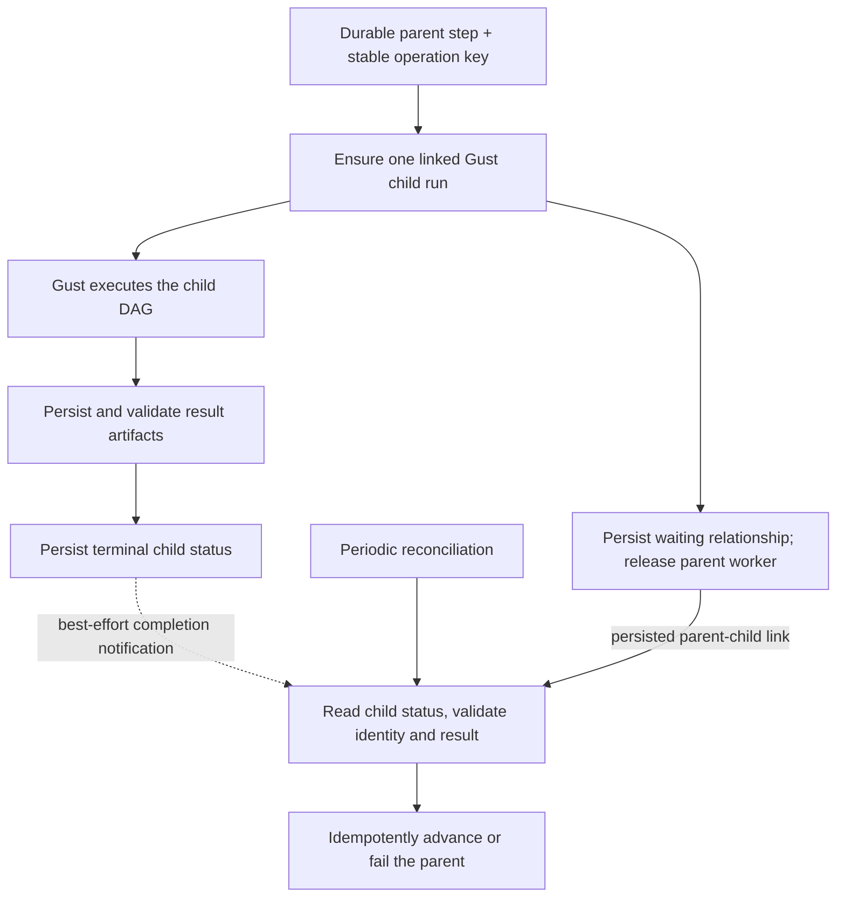

# Gust for durable evaluation and study workflows

Status: source review complete. The subsequent working decision selects Gust scheduling stages on a persistent Python server. Integration is not implemented or verified. This document preserves the source assessment and alternative designs.

Related documents:

- [Decision record](grilling-evaluation.md)
- [Current evaluation pipeline](evaluation-pipeline.md)
- [Current integration design, stage catalog, and REST API](evaluation-stage-integration.md)

**Later decisions:** Python is a compute-only, idempotent, stateless HTTP server. Typed JSON results return in the response; Gust saves successful task results. Save/load input snapshots as database JSON and use the existing dashboard. ZIP bundles, archive-loading stages, file manifests/checksums, and report packaging are removed from the target. Earlier asynchronous-operation, Python-output-store, and artifact suggestions in this review are alternatives, not requirements. The data-binding compiler is also rejected. See the current design and Q9–Q11 in the interview record.

## Scope and requirements

The user wants executable, declarative DAGs that make evaluation and study changes easy to understand. Durable execution is required because this is part of a larger workflow. Paid Oban Pro is excluded.

The review used a temporary clone of [Gust](https://github.com/marciok/gust), at commit `23fc8361482c2f85169c89a384d3a5ee73c2f317`. The separate official Python package was reviewed at commit `e40bbc00295d2eb50ea1e4ab5652cb3d5533da15`.

The review covered source, documentation, schemas, and relevant tests. No dependencies were installed. No tests, fault-injection experiments, or Gust workloads ran. The clone remained unchanged.

## Assessment

**Gust is worth evaluating for durable, code-defined DAGs.** It provides task dependencies, mapped work, PostgreSQL state, run claiming, retries, external waits, and execution history.

It is more than a DAG data structure. It introduces an OTP application, repository, migrations, loaders, dispatchers, and execution services. Its core role can run without the Gust web interface.

Gust's task edges express scheduling dependencies. They do not automatically turn existing function signatures into typed dataflow or replace domain schemas. Task wrappers, context handling, and result lookup must remain clear enough to meet the original simplification goal.

The strongest limits for this project are:

1. Task effects can repeat after failures or lease recovery.
2. Completion callbacks are not a reliable delivery protocol by themselves.
3. Elixir runs do not preserve an immutable executable DAG version.
4. Python task persistence does not freeze the imported source or environment.
5. Existing study results are temporary; installing a scheduler does not make those results durable.

The recommendation is conditional. Clarify graph authoring and basic recovery before implementation. The user later deferred production-grade cross-deployment versioning: it is not a prerequisite for the prototype. A future Gust fork is an option, not requested work.

## Verified claims

| Claim | Source assessment | Consequence |
| --- | --- | --- |
| PostgreSQL-backed run and task state | Confirmed in schemas and persistence code. | Restart recovery has persisted state to read. |
| One leased run coordinator | Confirmed. Expired runs can be claimed by another coordinator. | This differs from one independently queued Oban job per task attempt. |
| Task status, errors, attempts, and wait state persist | Confirmed. | Execution can inspect prior task state. |
| All task results persist automatically | False. Successful output persistence is opt-in. | Enable saved outputs where needed; use durable artifact references for large results. |
| Retry policy survives a crash unchanged | Not established. Retry metadata persists, but the reviewed restart path does not honor the remaining timer delay. | Test restart/backoff behavior before relying on it. |
| The run lease prevents duplicate effects | Not established. Task writes do not carry the run claim token as a fence. | Use stable domain-operation identities and idempotent effects. |
| The completion callback reliably wakes a parent | False as a standalone guarantee. Terminal state is written before the callback. | Reconcile from persisted child state; do not rely on a callback alone. |
| Durable external waits | Confirmed. Waiting tasks and resume payloads are persisted. | A parent can pause without holding an Oban worker open. |
| Built-in transactional parent/child ownership | Not found. Official examples pass identifiers and resume a parent through application code. | Correlation, duplicate-start prevention, cancellation, and result validation remain integration work. |
| Immutable DAG definition per Elixir run | Not present in the reviewed run model. | A versioning and deployment policy is required. |
| Arbitrary runtime graph composition | No supported durable model found. The DSL defines edges in code and supports mapped task expansion. | Do not assume Gust replaces a runtime-composed graph system. |
| Oban Pro required | No. Gust core has no Oban dependency. | Paid Oban Pro is not part of this proposal. |

Source references are listed below. These findings describe the reviewed checkout, not every Gust release.

## Recovery semantics

Gust claims runs through PostgreSQL and renews a lease. Another coordinator can recover a run after its claim expires. Completed task records can inform reconstruction.

A task can still perform an effect before its completion is persisted. A replacement execution can repeat that effect. Lease ownership alone also does not stop a stale task from completing external work.

Use a logical operation key that remains stable across attempts. Keep attempt identifiers separate for diagnostics. Including a changing retry number in the deduplication key would defeat deduplication.

Examples of effects that need this contract include creating an evaluation run, submitting analysis, publishing an artifact, and advancing a parent workflow. Pure numerical work may simply be recomputed when duplicate work is acceptable.

The review found recovery paths and focused tests. It did not establish complete node-failure behavior through execution. Do not interpret persisted rows as proof of every desired recovery property.

## Parent and child handoff

The following is a proposed integration pattern, not current project behavior or a built-in Gust guarantee.

Required properties:

- Child creation and its parent link must survive retries and crash windows without creating duplicate logical children.
- A callback is a wake-up hint. Persisted child status and validated output determine the parent transition.
- Reconciliation must find completed children even when no callback ran.
- Writing an outbox record only inside the callback does not close the crash gap before the callback. Use a transactional completion mechanism or reconstruct notification work from terminal child records.
- Resuming a parent must be idempotent and must not undo cancellation.
- Define deadlines, cancellation propagation, and the treatment of late results.

The larger parent workflow is not yet identified. Do not introduce an Oban parent solely because the pasted example uses one. If Gust owns both parent and child orchestration, its external-wait mechanism may reduce custom state, but the completion and correlation contracts still need proof.

## Fit with the current project

### No durable stage-output store exists

A follow-up source review found no artifact/object store or persistent analysis volume in the current implementation. Evaluation archives are generated in memory from PostgreSQL records. Python request outputs live in temporary directories and are removed after the response.

Relevant code:

- `src/lib/network_defense_web/controllers/evaluation_download_controller.ex:5-6`
- `src/lib/network_defense/evaluation/output_contract.ex:95-174`
- `evaluation/analysis/src/network_defense_analysis/service.py:116-152`, `:197-199`
- `infra/modules/local/analysis/main.tf:1-29`

The durable artifact storage in this proposal is new work, not an existing capability. A persistent Python process alone does not provide it. Choose a small prototype mechanism after the stage-output shapes and sizes are clear; do not assume that S3 or another service is required.

### Durable domain state already exists

Evaluation runs, resolved manifests, specifications, experiments, and simulation results are persisted by existing Elixir contexts. Those contexts should remain authoritative for their domain state.

The evaluation worker uses Oban with one configured attempt. Current recovery relies on explicit resume behavior rather than automatic job retries.

Relevant code:

- `src/lib/network_defense/evaluation/evaluation_worker.ex:4-10`
- `src/lib/network_defense/evaluation/evaluation_runs.ex:49-101`
- `src/lib/network_defense/evaluation.ex:338-417`

### Study orchestration is currently temporary

`StudySession` and its dashboard coordinator own an in-memory attempt and the parsed Pilot/Final results. They are not a durable parent workflow. Closing or losing the session removes that state.

A durable workflow needs backend-owned lifecycle state and durable result references. The browser should display that state and send commands, not own its recovery.

Relevant code:

- `src/lib/network_defense/evaluation/study/study_session.ex:1-66`
- `src/lib/network_defense_web/live/web/dashboard/study_coordinator.ex:1-21`, `:281-340`

The repository does not currently establish a general durable parent workflow owner. Earlier generic workflow tables were removed. That fact does not prevent adding durable orchestration, but it means there is no existing parent integration to assume.

### Avoid duplicate authorities

| State | Proposed owner |
| --- | --- |
| DAG readiness, task attempts, waits, and workflow transitions | Gust, if selected |
| Evaluation run status, plans, experiments, and domain cancellation | Existing evaluation contexts |
| Study definition and version | Existing study-specification context, with execution-version additions as needed |
| Analysis output | Durable artifact/result storage with identity and digest |
| Dashboard status | A projection of persisted backend state |

Gust should call existing domain operations rather than implement their state transitions again. Do not add Runic as another scheduler without a separate demonstrated need.

## Python integration

### GustPy is an adapter, not a separate Python scheduler

Gust parses the Python DAG and schedules its tasks in Elixir. Each task starts a separate Python process. JSON carries context, messages, and saved results.

GustPy can therefore replace a separate Python DAG authoring layer in some designs. It is not simply a drop-in implementation of an in-process Python dataflow graph.

| Option | Advantages | Costs |
| --- | --- | --- |
| Gust coordinates the existing Python analysis operation | Preserves the archive/service boundary and in-memory numerical data between internal functions. A Python DAG library can make that internal flow declarative. | Gust checkpoints the outer operation, not its internal Python progress. Interrupted analysis may rerun unless internal outputs are persisted. |
| GustPy schedules individual Python stages | One durable scheduler tracks both Elixir and Python tasks. Saved task outputs expose stage-level progress. | A new Python process per task, JSON boundaries, and explicit artifact references for numerical objects. This changes the current service/deployment model. |
| Gust dispatches stages to a persistent Python server | One durable dependency scheduler with stage-level visibility. A persistent Python deployment can execute registered stages without starting a new interpreter for every task. | Requires a remote-stage protocol, durable operation identity and outputs, cancellation policy, and recovery of ambiguous requests. This is proposed integration work, not a built-in Gust guarantee. |

The user proposed the stage-server option after this review and selected Gust dispatching individual stages. Python is a persistent remote executor, not a second DAG scheduler. This supersedes the earlier DAG-per-runtime scheduling direction. Completed stage outputs must persist; an interrupted stage restarts from its beginning. Internal numerical checkpoints are not required initially. The remote-stage integration, operation/artifact protocol, and deployment-version policy remain open.

NumPy arrays and custom statistical objects do not cross the JSON boundary directly. Small summaries can be converted. Large intermediate data should use durable artifacts with references and digests rather than database task-result maps.

The existing HTTP analysis client has correlation IDs but no deduplication/result-lookup protocol. Repeating a pure calculation may be acceptable; it is not the same as recording one durable analysis operation. Decide whether to allow recomputation or preserve completed internal stages.

### Source and environment versioning

For Python runs, GustPy copies the DAG file to a temporary location. It does not snapshot imported modules, the interpreter, dependencies, lock files, or input data. The Python process uses the configured project directory.

That copy is not a complete reproducibility boundary. For every execution option, preserve the source revision, dependency environment, inputs, and scientific seed policy. A source hash detects a mismatch; it does not make the old code executable after deployment.

The Elixir adapter and the Python package are separate releases. Pin and test their compatibility together.

## Conditions before adoption

These are proposed checks, not completed tests. Basic restart/reuse behavior remains in the prototype scope. Full deployment compatibility, stale-worker hardening, and comprehensive fault-injection coverage are later concerns, not prerequisites for exploring the design:

1. Restore a partially completed run after coordinator and node failure.
2. Restart during retry backoff and verify the intended timing policy.
3. Repeat a task after an effect but before completion persistence; prove deduplication or explicitly allow recomputation.
4. Lose the completion callback; prove the parent still resumes through reconciliation.
5. Retry child creation after a crash; prove one logical child is retained.
6. Resume a waiting run after a deployment; prove it uses the intended graph, source, and environment.
7. Cancel while work completes; prove a late result cannot revive cancelled work.
8. Persist a Python-stage artifact and recover from it without relying on a dead process or local temporary file.
9. Build and inspect the generated graph; prove study authors can replace a meaningful stage without editing unrelated orchestration.

Package metadata also needs a check: the repository license file says MIT, while the reviewed core package metadata declares Apache-2.0. Clarify the distributed package's license before adoption.

## Source references

All Gust links below are pinned to the reviewed commit.

- [Run schema and lease fields](https://github.com/marciok/gust/blob/23fc8361482c2f85169c89a384d3a5ee73c2f317/apps/gust/lib/gust/flows/run.ex#L8-L30)
- [Task state and output schema](https://github.com/marciok/gust/blob/23fc8361482c2f85169c89a384d3a5ee73c2f317/apps/gust/lib/gust/flows/task.ex#L8-L39)
- [Claim and lease operations](https://github.com/marciok/gust/blob/23fc8361482c2f85169c89a384d3a5ee73c2f317/apps/gust/lib/gust/run/claim/repo.ex#L8-L58)
- [Task result persistence and retry metadata](https://github.com/marciok/gust/blob/23fc8361482c2f85169c89a384d3a5ee73c2f317/apps/gust/lib/gust/dag/runner/task_execution.ex#L39-L140)
- [Retry reconstruction](https://github.com/marciok/gust/blob/23fc8361482c2f85169c89a384d3a5ee73c2f317/apps/gust/lib/gust/dag/stage_coordinator/retrying_task.ex#L23-L64)
- [Terminal-state write and completion callback](https://github.com/marciok/gust/blob/23fc8361482c2f85169c89a384d3a5ee73c2f317/apps/gust/lib/gust/dag/runner/dag_worker.ex#L284-L304)
- [Durable task resume](https://github.com/marciok/gust/blob/23fc8361482c2f85169c89a384d3a5ee73c2f317/apps/gust/lib/gust/dag/task_waiter/repo.ex#L18-L46)
- [Parent-waits-for-child example](https://github.com/marciok/gust/blob/23fc8361482c2f85169c89a384d3a5ee73c2f317/examples/dags/parent_waits_for_child.ex)
- [Child-resumes-parent example](https://github.com/marciok/gust/blob/23fc8361482c2f85169c89a384d3a5ee73c2f317/examples/dags/child_resumes_parent.ex)
- [Elixir runtime source loading](https://github.com/marciok/gust/blob/23fc8361482c2f85169c89a384d3a5ee73c2f317/apps/gust/lib/gust/dag/runtime/adapters/elixir.ex#L32-L39)
- [Core application services](https://github.com/marciok/gust/blob/23fc8361482c2f85169c89a384d3a5ee73c2f317/apps/gust/lib/gust/application.ex#L57-L77)
- [Core execution role](https://github.com/marciok/gust/blob/23fc8361482c2f85169c89a384d3a5ee73c2f317/apps/gust/lib/gust/app_children.ex#L38-L81)
- [GustPy source-file handling](https://github.com/marciok/gust/blob/23fc8361482c2f85169c89a384d3a5ee73c2f317/apps/gust_py/lib/gust_py/runtime/adapter.ex#L13-L50)
- [GustPy process execution](https://github.com/marciok/gust/blob/23fc8361482c2f85169c89a384d3a5ee73c2f317/apps/gust_py/lib/gust_py/executor/uv.ex#L14-L68)
- [Official Python package](https://github.com/marciok/gust_py/tree/e40bbc00295d2eb50ea1e4ab5652cb3d5533da15)
